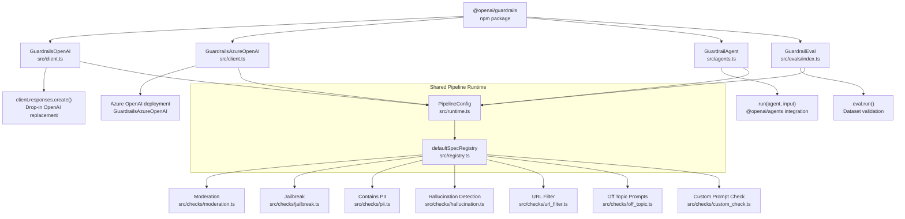
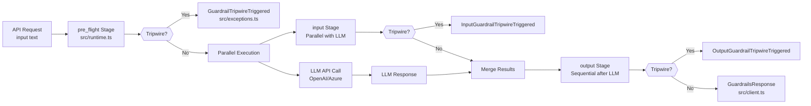

<!-- source: DeepWiki mcp.deepwiki.com · repo openai/openai-guardrails-js · page 1 Overview · fetched 2026-10-26 -->

# Overview

<details>
<summary>Relevant source files</summary>

The following files were used as context for generating this wiki page:

- [README.md](README.md)
- [docs/assets/images/guardrails-js-config-screenshot-100pct-q70.webp](docs/assets/images/guardrails-js-config-screenshot-100pct-q70.webp)
- [docs/index.md](docs/index.md)
- [docs/ref/exceptions-typescript.md](docs/ref/exceptions-typescript.md)
- [docs/tripwires.md](docs/tripwires.md)
- [package-lock.json](package-lock.json)
- [package.json](package.json)
- [src/index.ts](src/index.ts)

</details>


This document introduces the OpenAI Guardrails TypeScript framework (`@openai/guardrails`), a safety and validation library for Large Language Model (LLM) applications. It explains the framework's purpose, core architecture, integration patterns, and key features. For detailed installation instructions, see [Installation](#2.1). For in-depth architecture details, see [Architecture Overview](#1.1). For core terminology and concepts, see [Key Concepts](#1.2).

---

## What is OpenAI Guardrails

OpenAI Guardrails is a TypeScript/JavaScript package that adds configurable safety and compliance validation to LLM applications. The framework provides a drop-in wrapper for OpenAI's TypeScript client, enabling automatic input/output validation through a declarative pipeline configuration [README.md:1-3]().

The framework addresses several key challenges in LLM application development:

| Challenge | Solution |
|-----------|----------|
| **Content Safety Violations** | Built-in moderation, jailbreak detection, and NSFW filtering [README.md:181-185]() |
| **Data Privacy Leaks** | PII detection and URL filtering guardrails [README.md:182-183]() |
| **Factual Inaccuracies** | Hallucination detection using vector stores [README.md:184]() |
| **Scope Violations** | Off-topic prompt detection and custom validation logic [README.md:186-187]() |
| **Inconsistent Validation** | Declarative pipeline configuration across all API calls [docs/index.md:9-11]() |
| **Testing Guardrails** | Evaluation framework with precision/recall metrics [README.md:92-94]() |

**Sources:** [README.md:1-10](), [docs/index.md:1-26](), [package.json:1-10]()

---

## Core Framework Components

The framework is built around three primary classes, each serving a distinct integration pattern. All classes share a common pipeline architecture but differ in their target use cases.



**Diagram: Core Framework Components and Code Structure**

### Class Responsibilities

**`GuardrailsOpenAI`**: Drop-in replacement for the standard OpenAI client. Accepts a `PipelineConfig` and returns a client instance that automatically applies guardrails to all API calls [src/index.ts:40-45](). See [GuardrailsOpenAI Client](#3.1) for detailed usage.

**`GuardrailsAzureOpenAI`**: Specialized variant for Azure OpenAI deployments. It extends the base client functionality for Azure-specific environments [src/client.ts:40-45](). See [Azure OpenAI Integration](#3.2) for configuration details.

**`GuardrailAgent`**: Integration wrapper for the `@openai/agents` SDK. It wraps an agent instance to provide automatic validation of tool calls and agent responses [src/index.ts:61-62](). See [Agents SDK Integration](#3.3) for implementation patterns.

**`GuardrailEval`**: Evaluation framework for testing guardrail configurations against labeled datasets. Processes JSONL datasets and computes precision, recall, and F1 scores [README.md:121-134](). See [Evaluation Framework](#6) for complete documentation.

**`defaultSpecRegistry`**: Central registry mapping guardrail names to implementation specifications. Located in `src/registry.ts`, this registry enables the pipeline configuration to reference guardrails by name [src/index.ts:21-23]().

**Sources:** [README.md:30-89](), [docs/index.md:14-26](), [src/index.ts:1-65]()

---

## Three-Stage Pipeline Architecture

All guardrail classes execute validation through a three-stage pipeline. Each stage runs guardrails at a different point in the request/response lifecycle.



**Diagram: Three-Stage Pipeline Execution Flow**

### Stage Characteristics

| Stage | Execution Model | Typical Use Cases |
|-------|----------------|-------------------|
| **`pre_flight`** | Sequential, before LLM | Critical safety gates, input transformations [docs/index.md:11]() |
| **`input`** | Parallel with LLM | Non-blocking jailbreak detection, intent analysis |
| **`output`** | Sequential, after LLM | Hallucination detection, PII masking in response [README.md:45-48]() |

**Execution Behavior:**
- **Pre-flight stage**: Executes before the LLM API call. If a tripwire fires, the LLM call is blocked [docs/tripwires.md:7-9]().
- **Input stage**: Runs concurrently with the LLM request to minimize latency impact.
- **Output stage**: Runs after the LLM returns its response, validating the generated text before the application receives it [README.md:51-58]().

For detailed stage selection guidance, see [Pipeline Stage Selection](#7.1).

**Sources:** [README.md:36-65](), [docs/index.md:14-20](), [docs/tripwires.md:1-11]()

---

## Integration Patterns

The framework supports three primary integration patterns.

### Pattern 1: Drop-in OpenAI Client

```typescript
import { GuardrailsOpenAI } from '@openai/guardrails';

const client = await GuardrailsOpenAI.create({
  version: 1,
  output: {
    version: 1,
    guardrails: [{ name: 'Moderation', config: { categories: ['hate'] } }]
  }
});
```

This pattern replaces the standard OpenAI client. The `responses.create()` method returns a `GuardrailsResponse` containing the standard LLM output plus `guardrail_results` [src/index.ts:39-45]().

### Pattern 2: Agents SDK Integration

```typescript
import { GuardrailAgent } from '@openai/guardrails';

const agent = new GuardrailAgent({
  config: { version: 1, output: { ... } },
  name: 'Support Agent',
  instructions: 'Help customers.'
});
```

This pattern wraps an agent to ensure all interactions are validated [README.md:69-86]().

### Pattern 3: Evaluation Framework

```typescript
import { GuardrailEval } from '@openai/guardrails';

const eval = new GuardrailEval(
  'config.json',
  'dataset.jsonl',
  32,
  'results'
);
await eval.run('Run Name');
```

Used for benchmarking guardrail configurations against labeled datasets [README.md:121-134]().

**Sources:** [README.md:32-131](), [src/index.ts:39-65]()

---

## Built-in Guardrails

The framework includes production-ready guardrails organized by category. All guardrails are registered in the `defaultSpecRegistry` [src/index.ts:21-23]().

- **Content Safety**: `Moderation`, `Jailbreak`, `NSFW Text Detection`, `Prompt Injection` [README.md:181-185]().
- **Data Protection**: `Contains PII`, `URL Filter` [README.md:182-183]().
- **Content Quality**: `Hallucination Detection`, `Off Topic Prompts`, `Custom Prompt Check` [README.md:184-187]().

For complete configuration schemas, see [Built-in Guardrails Reference](#5).

**Sources:** [README.md:176-187](), [src/checks/]()

---

## Tripwire Mechanism

When a guardrail detects a violation, it triggers a "tripwire" [docs/tripwires.md:1-3]().

**Default (Blocking) Mode**: Throws a `GuardrailTripwireTriggered` exception [src/index.ts:13-19](). Applications must catch this to handle the violation [docs/tripwires.md:12-42]().

**Suppressed Mode**: If `suppress_tripwire: true` is passed to the request, the framework returns the response normally but flags the violation in `response.guardrail_results` [docs/tripwires.md:45-63]().

**Sources:** [docs/tripwires.md:1-82](), [src/exceptions.ts:1-20]()

---

## Development and Distribution

The package is distributed via npm as `@openai/guardrails` [package.json:2-3]().

**Build Commands:**
```bash
npm run build        # Compile TypeScript [package.json:14]()
npm run test         # Run Vitest suite [package.json:17]()
npm run eval         # Run evaluation CLI [package.json:25]()
```

**Sources:** [package.json:1-68](), [README.md:133-140]()

---

## Next Steps

- **[Architecture Overview](#1.1)**: High-level architecture and classes
- **[Key Concepts](#1.2)**: Core terminology and the three-stage model
- **[Getting Started](#2)**: Installation and your first guardrailed app
- **[Built-in Guardrails Reference](#5)**: Catalog of all available checks
- **[API Reference](#9)**: Documentation for all exported classes and types

---

