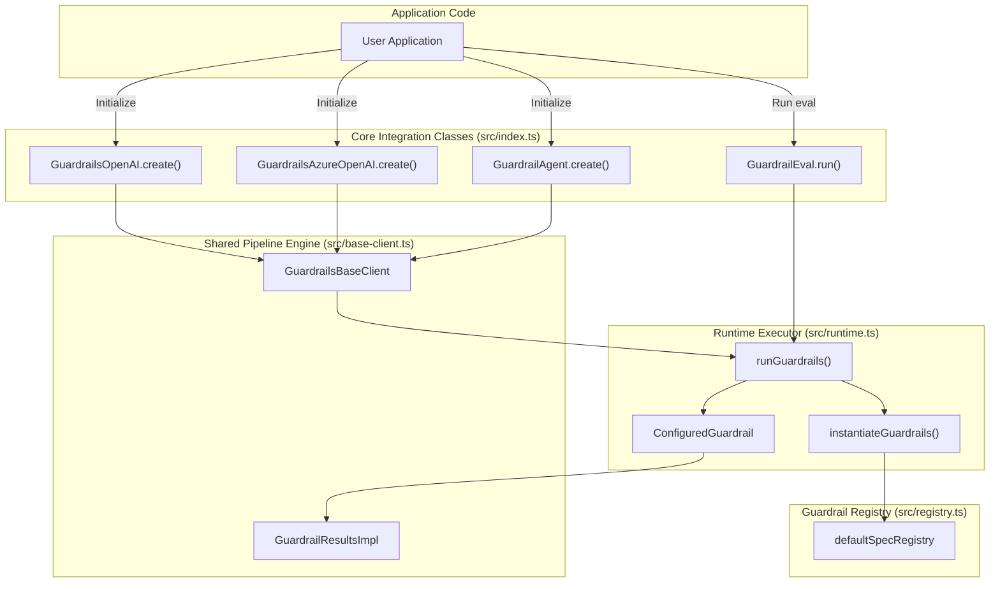
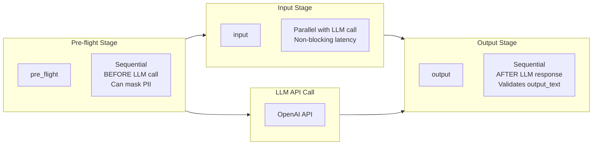
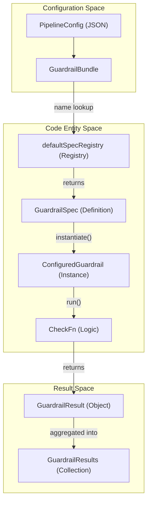

<!-- source: DeepWiki mcp.deepwiki.com · repo openai/openai-guardrails-js · page 1.1 Architecture Overview · fetched 2026-10-26 -->

# Architecture Overview

Relevant source files

The following files were used as context for generating this wiki page:

- [README.md](README.md)
- [docs/assets/images/guardrails-js-config-screenshot-100pct-q70.webp](docs/assets/images/guardrails-js-config-screenshot-100pct-q70.webp)
- [docs/index.md](docs/index.md)
- [docs/tripwires.md](docs/tripwires.md)
- [src/base-client.ts](src/base-client.ts)
- [src/runtime.ts](src/runtime.ts)
- [src/types.ts](src/types.ts)

## Purpose and Scope

This document explains the high-level architecture of the OpenAI Guardrails TypeScript framework, including the three main integration classes, the three-stage pipeline model, and the guardrail registry system. It covers how components are organized and how they work together to provide automatic input/output validation for LLM applications.

The framework is designed as a safety layer that wraps standard OpenAI clients, intercepting requests and responses to apply configurable validation logic.

## Core Integration Classes

The framework provides three primary classes for different integration patterns, all sharing the same underlying pipeline architecture:

| Class | Purpose | Primary Use Case | Returns |
|-------|---------|------------------|---------|
| `GuardrailsOpenAI` | Drop-in OpenAI client replacement | Standard OpenAI API applications | OpenAI client instance with guardrails |
| `GuardrailsAzureOpenAI` | Azure OpenAI client wrapper | Azure-deployed applications | Azure OpenAI client with guardrails |
| `GuardrailAgent` | Agents SDK integration | Multi-step agent workflows | Standard `Agent` instance from `@openai/agents` |
| `GuardrailEval` | Evaluation framework | Testing guardrail configurations | Precision, recall, F1 metrics |

### Integration Architecture

This diagram maps the relationship between user-facing classes and the internal pipeline execution logic.

**Sources**: [src/base-client.ts:145-150](), [src/runtime.ts:139-144](), [README.md:32-90]()

## Three-Stage Pipeline Architecture

The framework executes guardrails across three distinct stages, defined in the `PipelineConfig` interface [src/base-client.ts:126-131](). Each stage has different execution characteristics relative to the LLM API call:

### Pipeline Stages

| Stage | Execution Model | Timing | Common Use Cases |
|-------|----------------|--------|------------------|
| `pre_flight` | Sequential | Before LLM call | PII masking via `applyPreflightModifications` [src/base-client.ts:201-204](), critical safety. |
| `input` | Parallel with LLM | During LLM call | Jailbreak detection, prompt injection, non-blocking checks. |
| `output` | Sequential | After LLM response | Moderation, hallucination detection, URL filtering. |

**Sources**: [src/base-client.ts:79-87](), [src/base-client.ts:126-131](), [src/runtime.ts:37-42]()

## Guardrail Registry and Check Organization

The framework uses a centralized `defaultSpecRegistry` [src/registry.ts]() to manage all `GuardrailSpec` definitions. Each guardrail implements a `CheckFn` [src/types.ts:82-86]() which returns a `GuardrailResult`.

### Data Flow: Code Entities

This diagram bridges the conceptual guardrail names to the specific code entities responsible for execution.

**Sources**: [src/runtime.ts:51-55](), [src/runtime.ts:88-91](), [src/types.ts:51-74](), [src/types.ts:82-86]()

### Built-in Guardrails Summary

| Category | Guardrail Name | Implementation |
|----------|---------------|----------------|
| **Content Safety** | `Moderation` | OpenAI Moderation API |
| | `Jailbreak` | LLM-based detection |
| | `Prompt Injection` | Multi-turn conversation analysis |
| **Data Protection** | `Contains PII` | Regex/Presidio-based detection & masking |
| | `URL Filter` | Domain allowlist/blocklist |
| **Content Quality** | `Hallucination Detection` | FileSearch API + Vector Store |
| | `Off Topic Prompts` | Business scope validation |

**Sources**: [README.md:181-189](), [docs/index.md:21-25]()

## Runtime Execution Flow

When a user calls `client.responses.create()`, the `GuardrailsBaseClient` orchestrates the following flow:

1.  **Setup**: The client loads the `PipelineConfig` and instantiates guardrails via `setupGuardrails` [src/base-client.ts:191-199]().
2.  **Pre-flight**: Executes `pre_flight` bundle. If tripwires trigger, it throws `GuardrailTripwireTriggered`. If PII is detected, it applies masking to the input [src/base-client.ts:201-204]().
3.  **Input & LLM**: Runs `input` guardrails in parallel with the actual OpenAI API call to minimize latency.
4.  **Output**: Once the LLM returns, the `output` guardrails validate the generated text.
5.  **Aggregation**: All results are collected into a `GuardrailResultsImpl` object [src/base-client.ts:92-114](), which includes `allResults`, `tripwiresTriggered`, and `totalTokenUsage`.

### Token Usage Tracking
The framework tracks token consumption across the entire pipeline, including tokens used by LLM-based guardrails (like Hallucination Detection). This is exposed via `totalTokenUsage` which aggregates data from `GuardrailResult.info` [src/base-client.ts:111-113]().

**Sources**: [src/base-client.ts:79-87](), [src/base-client.ts:99-114](), [src/types.ts:172-176]()

## Backend Support

The architecture supports multiple deployment targets:
*   **OpenAI API**: Default behavior for `GuardrailsOpenAI`.
*   **Azure OpenAI**: Supported via `GuardrailsAzureOpenAI` which handles Azure-specific auth and endpoints.
*   **Local Models**: Supported by passing a `baseURL` (e.g., Ollama) to the `GuardrailsOpenAI` constructor.

**Sources**: [README.md:150-152](), [src/base-client.ts:8-18]()

---

