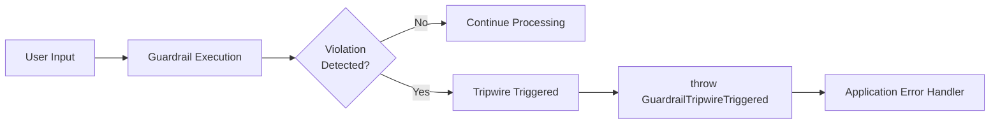
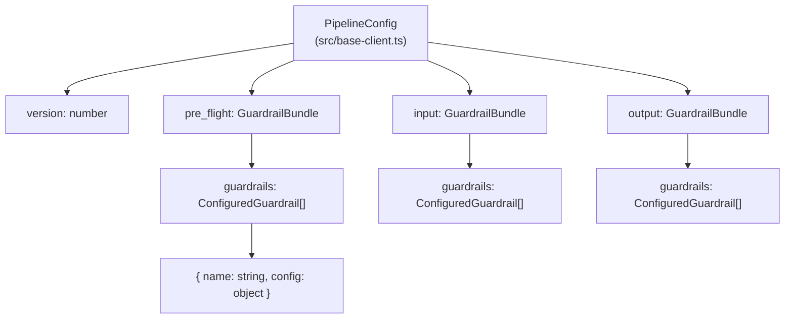
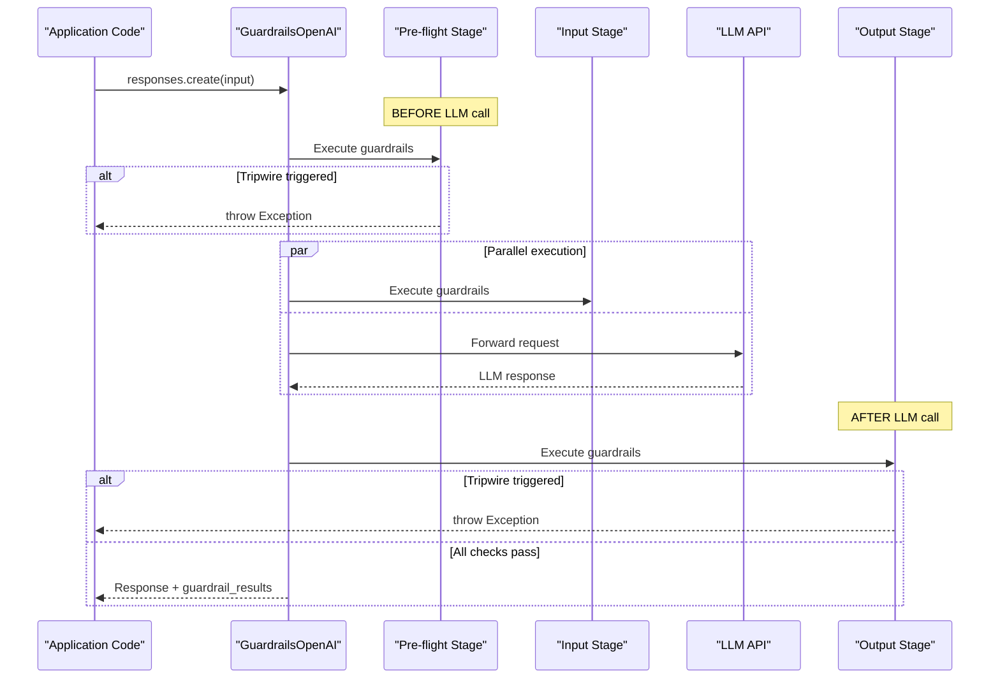
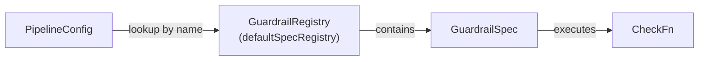

<!-- source: DeepWiki mcp.deepwiki.com · repo openai/openai-guardrails-js · page 1.2 Key Concepts · fetched 2026-10-26 -->

# Key Concepts

<details>
<summary>Relevant source files</summary>

The following files were used as context for generating this wiki page:

- [README.md](README.md)
- [docs/assets/images/guardrails-js-config-screenshot-100pct-q70.webp](docs/assets/images/guardrails-js-config-screenshot-100pct-q70.webp)
- [docs/index.md](docs/index.md)
- [docs/tripwires.md](docs/tripwires.md)
- [src/base-client.ts](src/base-client.ts)
- [src/registry.ts](src/registry.ts)
- [src/types.ts](src/types.ts)

</details>


This page defines the core terminology and concepts used throughout the OpenAI Guardrails TypeScript framework. Understanding these concepts is essential for configuring guardrails, handling violations, and integrating the framework into your application.

---

## Core Terminology

### Guardrails

A **guardrail** is a configurable safety check that validates text (user input or model output) against specific criteria. Each guardrail implements a focused validation function, such as content moderation, PII detection, or hallucination checking.

Guardrails are registered in the `defaultSpecRegistry` [src/registry.ts:186-186]() and referenced by name in pipeline configurations. The framework includes several built-in guardrails:

| Category | Guardrails | Purpose |
|----------|-----------|---------|
| **Content Safety** | Moderation, Jailbreak, NSFW Text, Prompt Injection Detection | Detect harmful, adversarial, or inappropriate content |
| **Data Protection** | Contains PII, URL Filter, Secret Keys | Prevent data leakage and enforce access controls |
| **Content Quality** | Hallucination Detection, Off Topic Prompts, Custom Prompt Check | Ensure output accuracy and relevance |

Each guardrail execution returns a `GuardrailResult` [src/types.ts:51-74]() object containing detection results and metadata.

**Sources:** [src/registry.ts:181-186](), [src/types.ts:51-74](), [README.md:179-189]()

---

### Tripwires

A **tripwire** is the enforcement mechanism that activates when a guardrail detects a violation. When a guardrail's logic determines the content is unsafe, it sets `tripwireTriggered: true` in the result [src/types.ts:53-53]().

**Default Behavior:** When a tripwire is triggered, the framework throws a `GuardrailTripwireTriggered` exception, blocking the API call and preventing potentially unsafe content from being processed or returned [README.md:59-63]().



**Diagram: Tripwire Default Blocking Flow**

**Suppression:** The `suppress_tripwire` parameter allows violations to be returned in `guardrail_results` without throwing exceptions, enabling manual handling [docs/tripwires.md:47-63]():

```typescript
// From docs/tripwires.md example
const response = await client.responses.create({
  model: 'gpt-5',
  input: 'Tell me a secret',
  suppress_tripwire: true  // Returns results instead of throwing
});

// Check for violations manually via GuardrailResultsImpl
for (const result of response.guardrail_results.allResults) {
  if (result.tripwireTriggered) {
    console.log(`Guardrail triggered!`);
  }
}
```

**Sources:** [src/base-client.ts:103-109](), [docs/tripwires.md:1-86](), [README.md:59-63]()

---

### Pipeline Configuration

A **pipeline configuration** (`PipelineConfig`) is a structure that defines which guardrails to apply and when [src/base-client.ts:126-131]().



**Diagram: Pipeline Configuration Structure**

**Structure [src/base-client.ts:126-131]():**

| Field | Type | Required | Description |
|-------|------|----------|-------------|
| `version` | number | No | Configuration schema version |
| `pre_flight` | `GuardrailBundle` | No | Pre-flight stage configuration |
| `input` | `GuardrailBundle` | No | Input stage configuration |
| `output` | `GuardrailBundle` | No | Output stage configuration |

**Sources:** [src/base-client.ts:126-140](), [README.md:40-49]()

---

### GuardrailResult

A **`GuardrailResult`** is the standardized interface returned by every guardrail check [src/types.ts:51-74]().

**Common Fields:**

| Field | Type | Description |
|-------|------|-------------|
| `tripwireTriggered` | boolean | True if the guardrail identified a critical failure |
| `executionFailed` | boolean | True if the guardrail failed to execute properly |
| `info` | object | Additional structured data (name, stage, metadata) |

**Sources:** [src/types.ts:51-74](), [src/base-client.ts:92-114]()

---

## Three-Stage Validation Model

The framework organizes guardrail execution into three distinct stages within the `GuardrailsBaseClient` [src/base-client.ts:145-200]().



**Diagram: Three-Stage Execution Flow**

### Pre-flight Stage
Executes **before** the LLM API call. Used for input transformations (like PII masking) and early blocking [src/base-client.ts:201-223]().

### Input Stage
Executes **in parallel** with the LLM API call to reduce latency. Typically used for jailbreak detection or off-topic checks.

### Output Stage
Executes **after** the LLM API call completes, validating the generated content before returning it to the application.

**Sources:** [src/base-client.ts:77-87](), [src/base-client.ts:201-223](), [README.md:32-49]()

---

## Execution Modes

The framework provides two error handling modes via the `raiseGuardrailErrors` property [src/base-client.ts:150-150]().

### Fail-Safe Mode (Default)
When `raiseGuardrailErrors` is `false`, if a guardrail fails to execute (e.g., network error to a sub-service), the system logs the error but continues processing.

### Fail-Secure Mode
When `raiseGuardrailErrors` is `true`, any execution failure in a guardrail throws an exception, halting the request. This is used when safety checks are mandatory.

**Sources:** [src/base-client.ts:150-150](), [docs/index.md:14-19]()

---

## Guardrail Registry

The `GuardrailRegistry` [src/registry.ts:55-178]() manages `GuardrailSpec` instances. It acts as a central catalog where guardrails are registered with their logic (`checkFn`), configuration schemas, and metadata.



**Diagram: Registry-Based Guardrail Resolution**

**Sources:** [src/registry.ts:55-186](), [src/types.ts:82-86]()

---

## Integration Entities

The framework provides several entry points that implement these concepts:

| Code Entity | Purpose |
|-------------|---------|
| `GuardrailsOpenAI` | Drop-in replacement for the OpenAI client [README.md:36-67](). |
| `GuardrailAgent` | Wrapper for the OpenAI Agents SDK [README.md:69-90](). |
| `GuardrailEval` | Framework for benchmarking guardrail performance [README.md:122-134](). |

**Sources:** [README.md:32-134](), [src/base-client.ts:145-150]()

---

