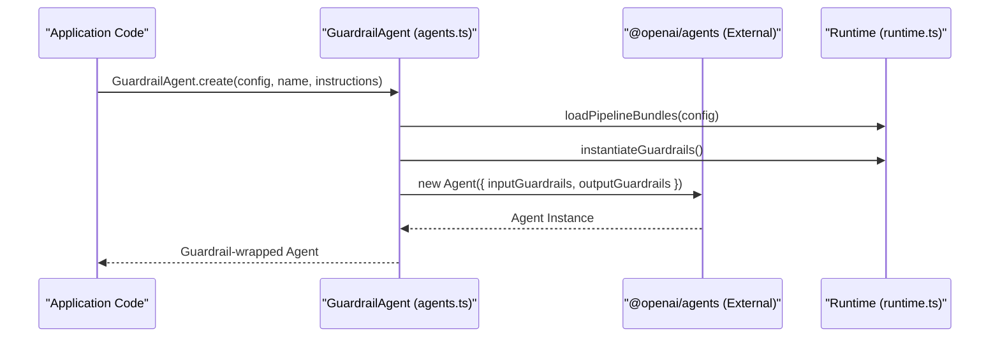

<!-- source: DeepWiki mcp.deepwiki.com · repo openai/openai-guardrails-js · page 10 Glossary · fetched 2026-10-26 -->

# Glossary

<details>
<summary>Relevant source files</summary>

The following files were used as context for generating this wiki page:

- [README.md](README.md)
- [docs/assets/images/guardrails-js-config-screenshot-100pct-q70.webp](docs/assets/images/guardrails-js-config-screenshot-100pct-q70.webp)
- [docs/index.md](docs/index.md)
- [docs/ref/checks/pii.md](docs/ref/checks/pii.md)
- [docs/ref/exceptions-typescript.md](docs/ref/exceptions-typescript.md)
- [docs/tripwires.md](docs/tripwires.md)
- [package-lock.json](package-lock.json)
- [package.json](package.json)
- [src/__tests__/unit/agents.test.ts](src/__tests__/unit/agents.test.ts)
- [src/__tests__/unit/checks/pii.test.ts](src/__tests__/unit/checks/pii.test.ts)
- [src/__tests__/unit/types.test.ts](src/__tests__/unit/types.test.ts)
- [src/agents.ts](src/agents.ts)
- [src/base-client.ts](src/base-client.ts)
- [src/checks/pii.ts](src/checks/pii.ts)
- [src/checks/prompt_injection_detection.ts](src/checks/prompt_injection_detection.ts)
- [src/types.ts](src/types.ts)
- [src/utils/content.ts](src/utils/content.ts)

</details>


This glossary defines technical terms, architectural components, and jargon specific to the `openai-guardrails-js` framework.

## Core Concepts

### Pipeline Configuration
The top-level configuration object that defines which guardrails are active and at which stage of the request/response lifecycle they execute. It is structured into three primary stages: `pre_flight`, `input`, and `output`.
*   **Code Pointer**: `PipelineConfig` interface in [src/base-client.ts:126-132]()

### Tripwire
A mechanism that triggers when a guardrail detects a violation. By default, a triggered tripwire blocks the execution of the LLM request or response by throwing a `GuardrailTripwireTriggered` exception.
*   **Implementation**: `tripwireTriggered` boolean in `GuardrailResult` [src/types.ts:51-74]()
*   **Behavior**: Managed by `GuardrailResultsImpl` to aggregate status across all stages [src/base-client.ts:92-114]()

### Stages
The framework executes guardrails in a specific order:
1.  **Pre-flight**: Executed before the LLM call. Used for tasks like PII masking where the input text to the LLM needs to be modified [src/base-client.ts:201-207]().
2.  **Input**: Executed on the user's prompt before it is sent to the LLM.
3.  **Output**: Executed on the assistant's generated text or tool calls before returning to the user [src/checks/prompt_injection_detection.ts:9-11]().

## Code Entity Mapping

The following diagram bridges the natural language concepts of the framework to the specific classes and files that implement them.

### Logic Flow and Entity Mapping
"Entity Mapping: From Configuration to Execution"
```mermaid
graph TD
    subgraph "Natural Language Space"
        A["Pipeline Configuration"]
        B["Guardrail Check"]
        C["Violation/Trigger"]
    end

    subgraph "Code Entity Space"
        A1["PipelineConfig (base-client.ts)"]
        B1["CheckFn (types.ts)"]
        C1["GuardrailResult (types.ts)"]
        D1["GuardrailTripwireTriggered (Error)"]
    end

    A -- "defines" --> B
    B -- "returns" --> C
    C -- "triggers" --> D1

    A1 -- "instantiates" --> B1
    B1 -- "returns" --> C1
    C1 -- "contains" --> "tripwireTriggered: boolean"
```
**Sources**: [src/base-client.ts:126-132](), [src/types.ts:51-86]()

## Technical Terms & Jargon

### Masking Mode
A specific mode for the **PII Detection** guardrail where sensitive information is replaced with tokens (e.g., `<EMAIL_ADDRESS>`) instead of blocking the request. This is strictly supported in the `pre_flight` stage.
*   **Code Pointer**: `PIIConfig` property `block: false` [src/checks/pii.ts:164-171]()
*   **Logic**: `applyPreflightModifications` handles the actual string replacement [src/base-client.ts:201-224]()

### GuardrailLLMContext
An interface ensuring that a guardrail has access to an OpenAI client (`guardrailLlm`). This is required for LLM-based guardrails like Jailbreak Detection or Hallucination Detection.
*   **Code Pointer**: `GuardrailLLMContext` in [src/types.ts:18-21]()

### NormalizedConversationEntry
A standardized internal representation of conversation turns (user messages, assistant responses, tool calls). It allows guardrails to analyze multi-turn history regardless of the original SDK format.
*   **Code Pointer**: `NormalizedConversationEntry` in [src/utils/conversation.ts]() (referenced in [src/agents.ts:28]())
*   **Usage**: Used in `GuardrailLLMContextWithHistory` to provide context for Prompt Injection Detection [src/types.ts:36-42]()

### Drop-in Client
Refers to `GuardrailsOpenAI`, which extends the standard `OpenAI` client to provide safety features with minimal code changes.
*   **Implementation**: `GuardrailsBaseClient` provides the shared logic for wrapping the resource client [src/base-client.ts:145-150]()

## Integration Architecture

The following diagram illustrates how the `GuardrailAgent` integrates with the `@openai/agents` SDK.

### Agent Integration Flow
"GuardrailAgent to Agents SDK Mapping"

**Sources**: [src/agents.ts:97-157](), [src/__tests__/unit/agents.test.ts:83-107]()

## Summary Table of Key Interfaces

| Term | Implementation | Description |
| :--- | :--- | :--- |
| **CheckFn** | [src/types.ts:82-86]() | The standard signature for any guardrail validation function. |
| **GuardrailBundle** | [src/runtime.ts]() | A collection of guardrail definitions and their configurations for a specific stage. |
| **TokenUsage** | [src/types.ts:162-167]() | Read-only object tracking `prompt_tokens`, `completion_tokens`, and `total_tokens` for LLM-based checks. |
| **extractLatestUserTextMessage** | [src/base-client.ts:158-172]() | Utility to find the most recent user string in a message array for text-based validation. |
| **PIIEntity** | [src/checks/pii.ts:75-141]() | Enum of all supported PII types (e.g., `US_SSN`, `KR_RRN`, `CREDIT_CARD`). |

**Sources**: [src/types.ts:82-167](), [src/base-client.ts:158-172](), [src/checks/pii.ts:75-141]()