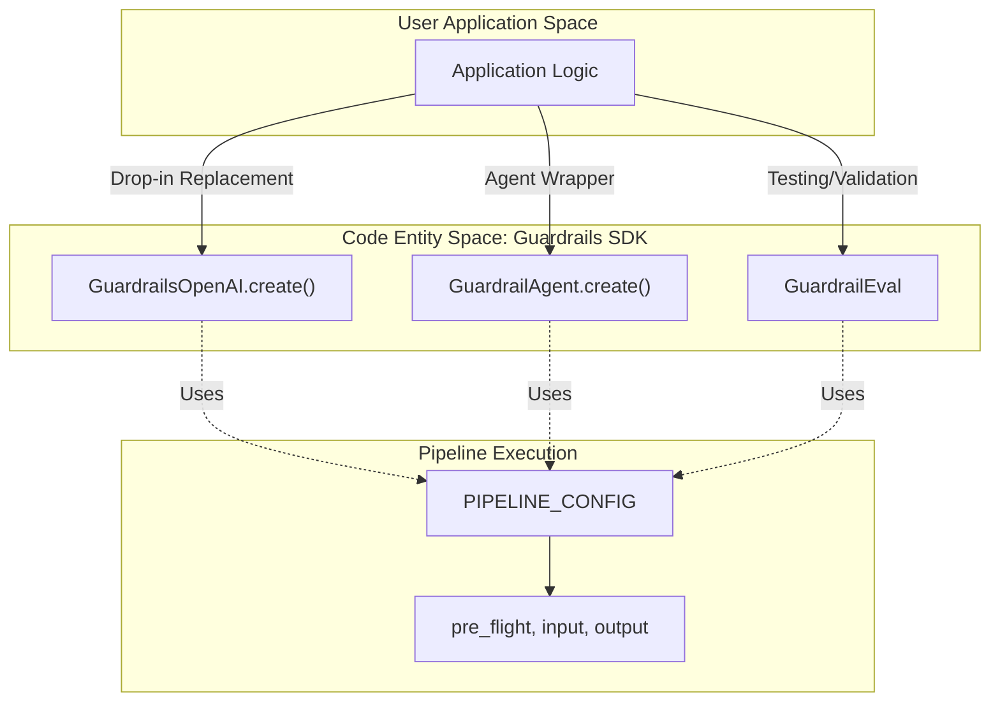
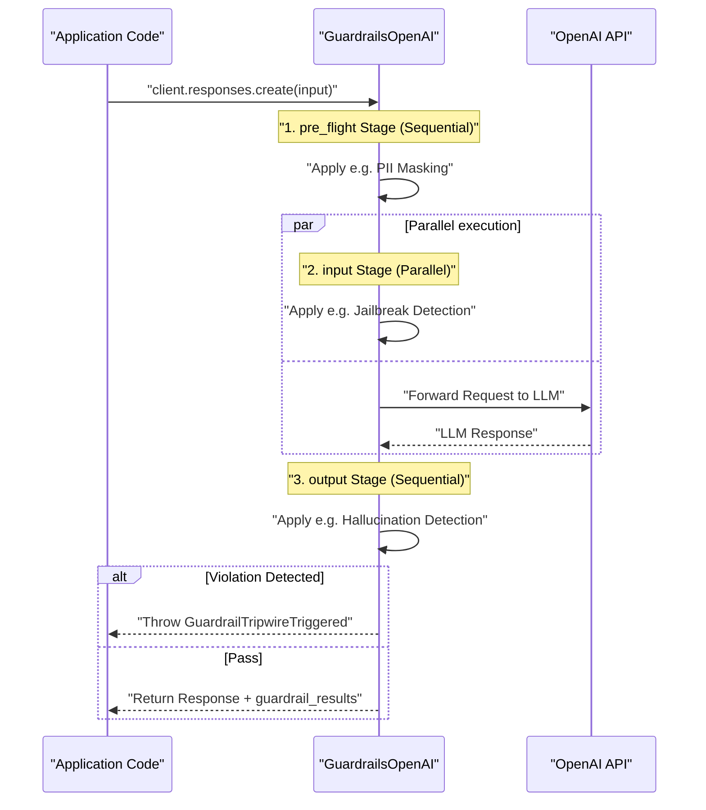

<!-- source: DeepWiki mcp.deepwiki.com · repo openai/openai-guardrails-js · page 2 Getting Started · fetched 2026-10-26 -->

# Getting Started

<details>
<summary>Relevant source files</summary>

The following files were used as context for generating this wiki page:

- [docs/agents_sdk_integration.md](docs/agents_sdk_integration.md)
- [docs/quickstart.md](docs/quickstart.md)
- [examples/basic/hello_world.ts](examples/basic/hello_world.ts)
- [examples/basic/local_model.ts](examples/basic/local_model.ts)
- [examples/basic/multiturn_with_prompt_injection_detection.ts](examples/basic/multiturn_with_prompt_injection_detection.ts)
- [examples/basic/streaming.ts](examples/basic/streaming.ts)

</details>


This section guides you through installing the OpenAI Guardrails TypeScript framework and creating your first guardrailed application. It covers the essential prerequisites, installation steps, and basic integration patterns to help you quickly add safety and compliance checks to your LLM applications.

For detailed architectural concepts and terminology, see [Architecture Overview](#1.1) and [Key Concepts](#1.2). For specific integration methods, see [Integration Patterns](#3).

## Prerequisites

Before installing the framework, ensure your development environment meets the following requirements:

| Requirement | Specification | Source |
|------------|---------------|---------|
| **Node.js** | >= 18.0.0 | [package.json:62-63]() |
| **Package Manager** | npm (included with Node.js) | [package.json:1-67]() |
| **OpenAI API Key** | Valid API key from OpenAI platform | [docs/quickstart.md:11-15]() |

### Setting Up Your API Key

The framework requires an OpenAI API key to function. Set it as an environment variable:

```bash
export OPENAI_API_KEY=sk-...
```

This environment variable is automatically detected by the OpenAI client when initializing `GuardrailsOpenAI` [examples/basic/hello_world.ts:116]() or related classes. For Azure deployments, additional configuration is required (see [Azure OpenAI Integration](#3.2)).

**Sources:** [docs/quickstart.md:11-15](), [package.json:46-49]()

## Installation Process

Install the package from npm:

```bash
npm install @openai/guardrails
```

The package includes TypeScript types, so no separate `@types/` package is required. For detailed installation steps including environment variables and initial project setup, see [Installation](#2.1).

**Sources:** [docs/quickstart.md:5-9](), [package.json:5-6]()

## Core Integration Patterns

The framework provides three primary integration patterns, each designed for different use cases:

### Pattern Overview



**Pattern Selection Guide:**

| Pattern | Use Case | Entry Point | Source |
|---------|----------|-------------|--------|
| **GuardrailsOpenAI** | Direct OpenAI API calls | `GuardrailsOpenAI.create()` | [docs/quickstart.md:52-84]() |
| **GuardrailAgent** | Agents SDK integration | `GuardrailAgent.create()` | [docs/agents_sdk_integration.md:7-15]() |
| **GuardrailEval** | Testing and validation | `new GuardrailEval()` | [docs/quickstart.md:208-213]() |

### 1. GuardrailsOpenAI: Drop-in Client Replacement
The most common pattern. Replace the standard OpenAI client with `GuardrailsOpenAI` [docs/quickstart.md:59](). It handles all guardrail validation automatically across `responses.create` and `chat.completions.create` [examples/basic/hello_world.ts:72-77]().

### 2. GuardrailAgent: Agents SDK Integration
For applications using `@openai/agents`, wrap agents with `GuardrailAgent` [docs/agents_sdk_integration.md:3-9](). It automatically wires up pipeline configurations to the agent's input and output guardrails [docs/quickstart.md:172]().

### 3. GuardrailEval: Evaluation Framework
Used for testing guardrail configurations against labeled datasets using the `GuardrailEval` class [docs/quickstart.md:208-213]().

## Basic Workflow

The typical workflow for adding guardrails follows a multi-stage execution model:



**Workflow Steps:**
1. **Configure Pipeline**: Define a `PIPELINE_CONFIG` object or JSON file [examples/basic/hello_world.ts:14-57]().
2. **Initialize Client**: Use `GuardrailsOpenAI.create(config)` [examples/basic/hello_world.ts:116]().
3. **Handle Results**: Access `response.guardrail_results` or catch `GuardrailTripwireTriggered` [examples/basic/hello_world.ts:82-90, 145-150]().

**Sources:** [docs/quickstart.md:42-50](), [examples/basic/hello_world.ts:14-91]()

## Pipeline Configuration Basics

Configurations are structured into three stages: `pre_flight`, `input`, and `output` [examples/basic/hello_world.ts:16-56](). Each stage contains an array of guardrails with their respective `name` and `config` [docs/quickstart.md:23-40]().

- **Preflight**: Runs before the LLM call (e.g., PII masking) [docs/quickstart.md:46]().
- **Input**: Runs in parallel with the LLM call (e.g., jailbreak detection) [docs/quickstart.md:47]().
- **Output**: Runs after the LLM generates content (e.g., URL filtering) [docs/quickstart.md:48]().

For details on structuring these configurations, see [Pipeline Configuration Basics](#2.3).

**Sources:** [docs/quickstart.md:42-50](), [examples/basic/hello_world.ts:14-57]()

## Quick Start Example: Hello World

The `hello_world.ts` example demonstrates a minimal chatbot with `Moderation`, `Jailbreak`, and `URL Filter` guardrails.

```typescript
import { GuardrailsOpenAI, GuardrailTripwireTriggered } from '@openai/guardrails';

const client = await GuardrailsOpenAI.create(PIPELINE_CONFIG);

try {
  const response = await client.guardrails.responses.create({
    input: "Hello world",
    model: 'gpt-4.1-mini',
  });
  console.log(response.output_text);
} catch (error) {
  if (error instanceof GuardrailTripwireTriggered) {
    console.log("Blocked!");
  }
}
```

For a line-by-line walkthrough, see [Hello World Example](#2.2).

**Sources:** [examples/basic/hello_world.ts:14-154](), [docs/quickstart.md:58-79]()

## Next Steps

- **[Installation](#2.1)** — Cover npm installation and environment variables.
- **[Hello World Example](#2.2)** — Walk through the simplest possible guardrailed chatbot.
- **[Pipeline Configuration Basics](#2.3)** — Learn how to use the Guardrails Wizard and structure JSON configs.
- **[Integration Patterns](#3)** — Explore Azure OpenAI, local models (Ollama), and streaming support.

---

