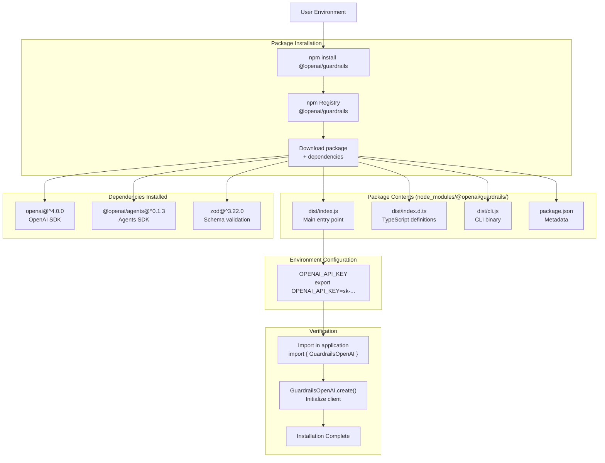
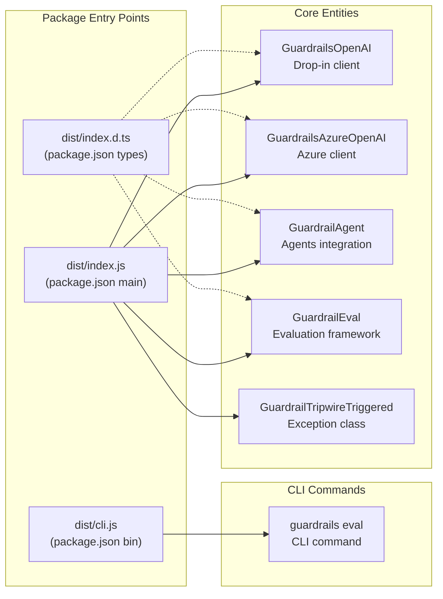
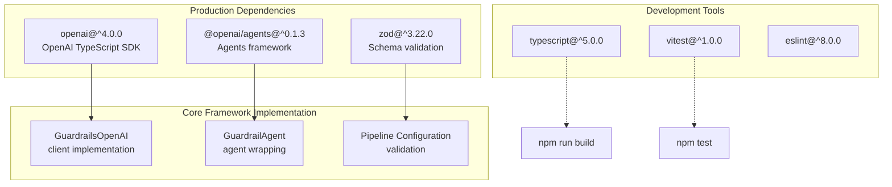

<!-- source: DeepWiki mcp.deepwiki.com · repo openai/openai-guardrails-js · page 2.1 Installation · fetched 2026-10-26 -->

# Installation

<details>
<summary>Relevant source files</summary>

The following files were used as context for generating this wiki page:

- [docs/agents_sdk_integration.md](docs/agents_sdk_integration.md)
- [docs/quickstart.md](docs/quickstart.md)
- [docs/ref/exceptions-typescript.md](docs/ref/exceptions-typescript.md)
- [package-lock.json](package-lock.json)
- [package.json](package.json)

</details>


This page covers the standard installation process for the `@openai/guardrails` package, including npm installation, environment variable configuration, and initial project setup. For information about the development environment setup for contributing to the project, see [Development Setup](). For specific integration patterns after installation, see [GuardrailsOpenAI Client]() and [Agents SDK Integration]().

## Prerequisites

The following requirements must be met before installing the guardrails package:

| Requirement | Version/Details | Purpose |
|------------|----------------|----------|
| Node.js | >=18.0.0 | JavaScript runtime environment |
| Package Manager | npm, yarn, or pnpm | Dependency management |
| OpenAI API Key | Valid API key from OpenAI | Required for guardrail execution |

**Sources:** [package.json:62-64]()

## Standard Package Installation

### Installing from npm

Install the package from the npm registry using your preferred package manager:

```bash
npm install @openai/guardrails
```

The package is published as `@openai/guardrails` with public access. This installation includes:

- Core framework classes (`GuardrailsOpenAI`, `GuardrailAgent`, `GuardrailEval`)
- Built-in guardrail checks (Moderation, PII Detection, URL Filter, etc.)
- TypeScript type definitions
- CLI tool for evaluation via the `guardrails` command

**Sources:** [package.json:2-9](), [docs/quickstart.md:5-9]()

### Installation Flow

The following diagram illustrates the complete installation and setup process:



**Sources:** [package.json:1-68](), [docs/quickstart.md:5-15]()

### Installed Package Structure

When installed, the package provides the following exports and binaries:



**Sources:** [package.json:5-9](), [docs/ref/exceptions-typescript.md:8-10]()

## Environment Configuration

### Setting the OpenAI API Key

The guardrails package requires a valid OpenAI API key to execute guardrail checks and make LLM calls. Set the `OPENAI_API_KEY` environment variable:

**Unix/Linux/macOS:**
```bash
export OPENAI_API_KEY=sk-...
```

**Windows (Command Prompt):**
```cmd
set OPENAI_API_KEY=sk-...
```

**Windows (PowerShell):**
```powershell
$env:OPENAI_API_KEY="sk-..."
```

**Sources:** [docs/quickstart.md:11-15]()

### Environment Variable Dependencies by Component

The following table shows which components typically require environment variables:

| Component | Environment Variable | Required | Purpose |
|-----------|---------------------|----------|----------|
| `GuardrailsOpenAI` | `OPENAI_API_KEY` | Yes | OpenAI API authentication |
| `GuardrailsAzureOpenAI` | N/A | No | Azure uses explicit parameters |
| `GuardrailAgent` | `OPENAI_API_KEY` | Yes | Agent execution and guardrails |
| `GuardrailEval` | `OPENAI_API_KEY` | Yes | Evaluation execution |

**Sources:** [docs/quickstart.md:11-15](), [docs/quickstart.md:174-190]()

## Verification

### Basic Import Test

Verify the installation by importing the main class in a TypeScript or JavaScript file:

```typescript
import { GuardrailsOpenAI } from '@openai/guardrails';

console.log('Installation successful');
```

### Full Initialization Test

Test that the client can be initialized with a basic configuration. The `GuardrailsOpenAI.create` method is the primary entry point for initializing the safety-wrapped client [docs/quickstart.md:63]().

```typescript
import { GuardrailsOpenAI } from '@openai/guardrails';

async function verifyInstallation() {
  try {
    const client = await GuardrailsOpenAI.create({
      version: 1,
      output: {
        version: 1,
        guardrails: []
      }
    });
    console.log('✓ Installation verified - client created successfully');
  } catch (error) {
    console.error('✗ Installation verification failed:', error);
  }
}

verifyInstallation();
```

**Sources:** [docs/quickstart.md:58-82]()

## Local Development Installation

For contributors who need to modify the guardrails source code, install from the repository:

```bash
# Clone the repository
git clone https://github.com/openai/openai-guardrails-js.git
cd openai-guardrails-js

# Install dependencies
npm install

# Build the package
npm run build
```

This process:
1. Clones the repository.
2. Installs production dependencies (`openai`, `@openai/agents`, `zod`) and development dependencies [package.json:46-61]().
3. Compiles TypeScript source files via the `build` script which runs `tsc` [package.json:14]().

## Dependency Overview

The following diagram shows the package's dependency structure:



**Sources:** [package.json:46-61]()

---

