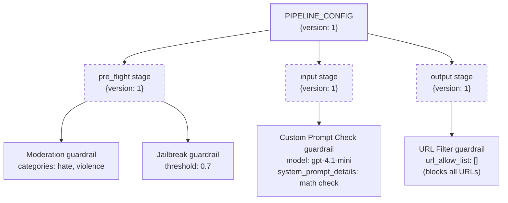
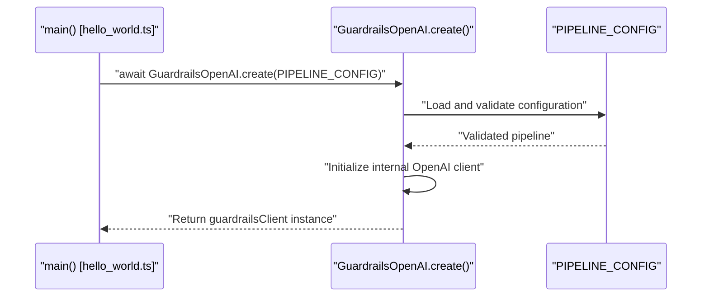
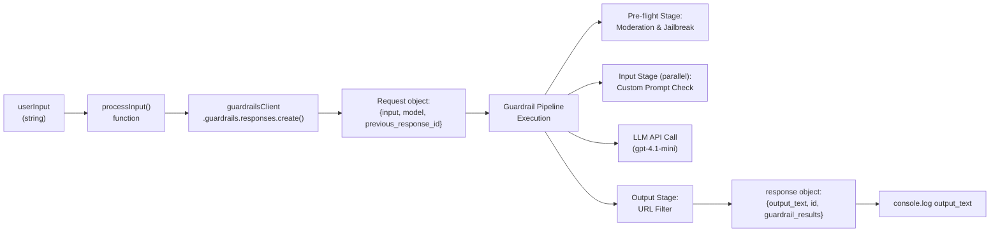
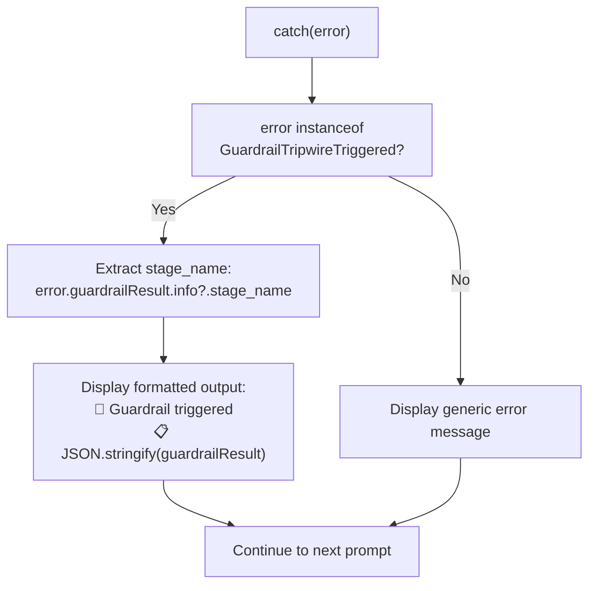

<!-- source: DeepWiki mcp.deepwiki.com · repo openai/openai-guardrails-js · page 2.2 Hello World Example · fetched 2026-10-26 -->

# Hello World Example

<details>
<summary>Relevant source files</summary>

The following files were used as context for generating this wiki page:

- [docs/agents_sdk_integration.md](docs/agents_sdk_integration.md)
- [docs/quickstart.md](docs/quickstart.md)
- [examples/basic/hello_world.ts](examples/basic/hello_world.ts)
- [examples/basic/local_model.ts](examples/basic/local_model.ts)
- [examples/basic/multiturn_with_prompt_injection_detection.ts](examples/basic/multiturn_with_prompt_injection_detection.ts)
- [examples/basic/streaming.ts](examples/basic/streaming.ts)

</details>


This page walks through the simplest possible guardrailed chatbot implementation using the `GuardrailsOpenAI` client. The example demonstrates a complete interactive chatbot with three-stage guardrail validation (pre-flight, input, and output) in under 170 lines of code.

For installation and environment setup, see [Installation](#2.1). For detailed configuration options, see [Pipeline Configuration Basics](#2.3). For understanding tripwire exceptions, see [Default Blocking Behavior](#4.1).

## Example Overview

The hello world example located at [examples/basic/hello_world.ts:1-171]() implements an interactive chatbot that:

1. Validates content safety for hate and violence (pre-flight stage).
2. Blocks math problems using custom prompt checking (input stage).
3. Filters URLs in LLM responses (output stage).
4. Handles guardrail violations gracefully with exception handling.

**Key Components**

| Component | Purpose | Lines |
|-----------|---------|-------|
| `PIPELINE_CONFIG` | Defines three-stage guardrail configuration | [examples/basic/hello_world.ts:14-57]() |
| `processInput()` | Executes guardrailed API call | [examples/basic/hello_world.ts:67-91]() |
| `main()` | Implements chatbot loop with error handling | [examples/basic/hello_world.ts:107-165]() |

Sources: [examples/basic/hello_world.ts:1-171]()

## Pipeline Configuration

The example defines an inline pipeline configuration object that specifies guardrails for all three stages:

**Pipeline Configuration Structure**



Sources: [examples/basic/hello_world.ts:14-57]()

**Configuration Details**

The pipeline configuration at [examples/basic/hello_world.ts:14-57]() demonstrates all three stages:

| Stage | Guardrail | Configuration | Purpose |
|-------|-----------|---------------|---------|
| `pre_flight` | Moderation | `categories: ['hate', 'violence']` | Filters toxic content before processing |
| `pre_flight` | Jailbreak | `model: 'gpt-4.1-mini'`, `confidence_threshold: 0.7` | Detects adversarial prompt attempts |
| `input` | Custom Prompt Check | `model: 'gpt-4.1-mini'`, `system_prompt_details: 'Check if the text contains any math problems.'` | Blocks math-related questions using LLM analysis |
| `output` | URL Filter | `url_allow_list: []` | Blocks all URLs in LLM responses |

Sources: [examples/basic/hello_world.ts:14-57]()

## Client Initialization

**Creating the GuardrailsOpenAI Client**



Sources: [examples/basic/hello_world.ts:116](), [docs/quickstart.md:63-63]()

The client initialization occurs at [examples/basic/hello_world.ts:116]():

```typescript
const guardrailsClient = await GuardrailsOpenAI.create(PIPELINE_CONFIG);
```

The `create()` method accepts the pipeline configuration directly as an object (rather than a file path). The method returns a fully configured `GuardrailsOpenAI` instance that wraps the standard OpenAI client with automatic guardrail validation.

Sources: [examples/basic/hello_world.ts:116](), [docs/quickstart.md:63-63]()

## Processing User Input

**Guardrailed API Call Flow**



Sources: [examples/basic/hello_world.ts:67-91]()

The `processInput()` function at [examples/basic/hello_world.ts:67-91]() encapsulates the guardrailed API call:

**Key Implementation Details**

| Code Element | Location | Purpose |
|--------------|----------|---------|
| `guardrailsClient.guardrails.responses.create()` | [examples/basic/hello_world.ts:73]() | Makes guardrailed API call to OpenAI |
| `input: userInput` | [examples/basic/hello_world.ts:74]() | Passes user message to LLM |
| `model: 'gpt-4.1-mini'` | [examples/basic/hello_world.ts:75]() | Specifies LLM model |
| `previous_response_id: responseId` | [examples/basic/hello_world.ts:76]() | Enables conversation tracking |
| `response.output_text` | [examples/basic/hello_world.ts:79]() | Accesses LLM response text |
| `totalGuardrailTokenUsage(response)` | [examples/basic/hello_world.ts:84]() | Tracks tokens consumed by LLM-based guardrails |

The API call at [examples/basic/hello_world.ts:73-77]() uses the `.guardrails.responses.create()` method, which applies all configured guardrails automatically.

Sources: [examples/basic/hello_world.ts:67-91]()

## Main Event Loop

The `main()` function at [examples/basic/hello_world.ts:107-165]() implements the interactive chatbot loop:

**1. Initialization (Lines 108-130)**
- Displays welcome message.
- Initializes `GuardrailsOpenAI` client with `PIPELINE_CONFIG` at [examples/basic/hello_world.ts:116]().
- Registers signal handlers (`SIGINT`, `SIGTERM`) for graceful shutdown at [examples/basic/hello_world.ts:128-129]().

**2. Event Loop (Lines 133-155)**
The infinite loop processes user input continuously:
```typescript
while (true) {
  const userInput = await new Promise<string>((resolve) => {
    rl.question('Enter a message: ', resolve);
  });
  
  try {
    responseId = await processInput(guardrailsClient, userInput, responseId);
  } catch (error) {
    if (error instanceof GuardrailTripwireTriggered) {
      // Handle violation...
    }
  }
}
```

**3. Error Handling (Lines 144-154)**
The example demonstrates proper exception handling for tripwires:
- `GuardrailTripwireTriggered`: Caught when a guardrail blocks execution.
- The `stage_name` is extracted from `error.guardrailResult.info` at [examples/basic/hello_world.ts:146]().

Sources: [examples/basic/hello_world.ts:107-165]()

## Exception Handling Details

**Tripwire Exception Processing**



Sources: [examples/basic/hello_world.ts:145-154]()

The exception handler at [examples/basic/hello_world.ts:145-154]() demonstrates accessing tripwire details. The `GuardrailTripwireTriggered` exception contains a `guardrailResult` object with metadata:

- `guardrail_name`: Which guardrail was triggered.
- `flagged`: Boolean indicating violation.
- `confidence`: Confidence score (0.0-1.0) for LLM-based checks.
- `reasoning`: Explanation if `include_reasoning` was enabled in config.

Sources: [examples/basic/hello_world.ts:145-154](), [examples/basic/hello_world.ts:36-43]()

## Running the Example

**Prerequisites**
- Set environment variable: `export OPENAI_API_KEY=sk-...` [docs/quickstart.md:14]()

**Execution Command**
From the repository root:
```bash
npx tsx examples/basic/hello_world.ts
```
The `tsx` command executes TypeScript files directly without a manual compilation step.

Sources: [examples/basic/hello_world.ts:7](), [docs/quickstart.md:1-15]()

## Code Entity Reference

**Key Classes and Functions**

| Entity | Source | Purpose |
|--------------|--------|---------|
| `GuardrailsOpenAI` | [src/index.ts]() | Main client class for drop-in OpenAI replacement |
| `GuardrailTripwireTriggered` | [src/index.ts]() | Exception thrown when a guardrail detects a violation |
| `totalGuardrailTokenUsage` | [src/index.ts]() | Helper to calculate tokens used by guardrail LLM calls |
| `responses.create()` | [src/index.ts]() | Method to execute a single turn with full pipeline validation |

Sources: [examples/basic/hello_world.ts:11](), [docs/quickstart.md:59-63]()

---

