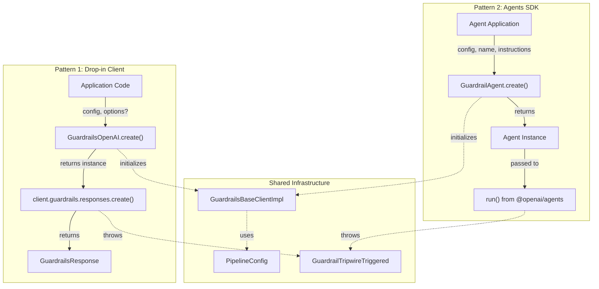
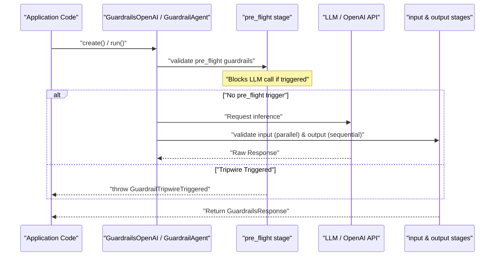

<!-- source: DeepWiki mcp.deepwiki.com · repo openai/openai-guardrails-js · page 3 Integration Patterns · fetched 2026-10-26 -->

# Integration Patterns

<details>
<summary>Relevant source files</summary>

The following files were used as context for generating this wiki page:

- [examples/basic/agents_sdk.ts](examples/basic/agents_sdk.ts)
- [examples/basic/azure_example.ts](examples/basic/azure_example.ts)
- [examples/basic/hello_world.ts](examples/basic/hello_world.ts)
- [examples/basic/local_model.ts](examples/basic/local_model.ts)
- [examples/basic/multiturn_with_prompt_injection_detection.ts](examples/basic/multiturn_with_prompt_injection_detection.ts)
- [examples/basic/streaming.ts](examples/basic/streaming.ts)
- [examples/basic/suppress_tripwire.ts](examples/basic/suppress_tripwire.ts)
- [src/client.ts](src/client.ts)

</details>


This page provides an overview of the primary integration patterns for incorporating guardrails into applications. Each pattern serves distinct use cases while sharing the same underlying pipeline architecture and configuration system.

For detailed implementation guides for each pattern, see:
- [GuardrailsOpenAI Client](#3.1) — Deep dive into using GuardrailsOpenAI as a drop-in replacement for OpenAI client, including client creation, making API calls, and handling responses
- [Azure OpenAI Integration](#3.2) — Explain how to use GuardrailsAzureOpenAI for Azure deployments, including configuration parameters and deployment-specific considerations
- [Agents SDK Integration](#3.3) — Cover GuardrailAgent class, how it wraps Agent instances, tool-level vs agent-level guardrails, and exception handling
- [Local and Third-Party Models](#3.4) — Demonstrate using guardrails with Ollama and other OpenAI-compatible APIs via custom baseURL configuration

---

## Overview of Integration Patterns

The framework provides three distinct integration patterns, each implemented as a separate class. These classes act as entry points that wrap the underlying validation logic and the LLM provider.

| Pattern | Class | Primary Use Case | Entry Point |
|---------|-------|------------------|-------------|
| **Drop-in Client** | `GuardrailsOpenAI` | Standard OpenAI API applications | `GuardrailsOpenAI.create()` [src/client.ts:71-75]() |
| **Azure Client** | `GuardrailsAzureOpenAI` | Azure-hosted OpenAI deployments | `GuardrailsAzureOpenAI.create()` [src/client.ts:161-165]() |
| **Agents SDK** | `GuardrailAgent` | Applications using `@openai/agents` | `GuardrailAgent.create()` [examples/basic/agents_sdk.ts:75-81]() |
| **Evaluation** | `GuardrailEval` | Testing guardrail configurations | `new GuardrailEval()` |

**Integration Patterns and Code Entities**



**Sources:** [src/client.ts:33-116](), [src/client.ts:123-200](), [examples/basic/agents_sdk.ts:75-81](), [examples/basic/hello_world.ts:116-145]()

---

## Configuration Approaches

All integration patterns accept a `PipelineConfig` which defines what guardrails run and in which stage. For details, see [Pipeline Configuration Basics](#2.3).

### Drop-in Client Integration
The `GuardrailsOpenAI` class is designed as a drop-in replacement for the standard `OpenAI` client. It provides a `guardrails` namespace for access to validation-aware methods.

```typescript
// Initialization
const guardrailsClient = await GuardrailsOpenAI.create(PIPELINE_CONFIG); [examples/basic/hello_world.ts:116]()

// Usage
const response = await guardrailsClient.guardrails.responses.create({ [examples/basic/hello_world.ts:73]()
    input: userInput,
    model: 'gpt-4.1-mini',
});
```

For details, see [GuardrailsOpenAI Client](#3.1).

### Azure OpenAI Integration
For enterprise environments using Azure, `GuardrailsAzureOpenAI` provides the same interface but handles Azure-specific authentication and deployment naming.

```typescript
const guardrailsClient = await GuardrailsAzureOpenAI.create(PIPELINE_CONFIG, { [examples/basic/azure_example.ts:135-139]()
    endpoint: process.env.AZURE_ENDPOINT!,
    apiKey: process.env.AZURE_API_KEY!,
    apiVersion: process.env.AZURE_API_VERSION!,
});
```

For details, see [Azure OpenAI Integration](#3.2).

### Agents SDK Integration
The `GuardrailAgent` class integrates with the `@openai/agents` framework. It wraps an agent's lifecycle, applying guardrails to both the user input and the agent's final output or tool calls.

```typescript
const agent = await GuardrailAgent.create( [examples/basic/agents_sdk.ts:75-81]()
    PIPELINE_CONFIG,
    'Customer support agent',
    'Instructions...',
    {},
    true // raiseGuardrailErrors
);
```

For details, see [Agents SDK Integration](#3.3).

---

## Shared Execution Pipeline

Regardless of the integration pattern chosen, the execution follows a standardized three-stage model: `pre_flight`, `input`, and `output`.

**Natural Language Space to Code Entity Space Mapping**



### Execution Characteristics
- **Sequential Stages**: `pre_flight` and `output` stages block the next step in the pipeline to ensure safety before proceeding [examples/basic/hello_world.ts:16-56]().
- **Parallel Stages**: `input` guardrails typically run in parallel with the LLM call to minimize latency impact.
- **Tripwire Mechanism**: When a guardrail is violated, the system throws a `GuardrailTripwireTriggered` error [examples/basic/hello_world.ts:145-146](). This can be suppressed using the `suppressTripwire: true` option in the request [examples/basic/suppress_tripwire.ts:41]().

**Sources:** [examples/basic/hello_world.ts:14-57](), [examples/basic/suppress_tripwire.ts:37-42](), [src/client.ts:27-30]()

---

## Local and Third-Party Models

The framework supports local models (e.g., via Ollama) or other OpenAI-compatible APIs by allowing the `baseURL` and `apiKey` to be overridden during client creation.

```typescript
const guardrailsClient = await GuardrailsOpenAI.create(GEMMA3_PIPELINE_CONFIG, { [examples/basic/local_model.ts:71-74]()
    baseURL: 'http://127.0.0.1:11434/v1/',
    apiKey: 'ollama',
});
```

This pattern allows developers to apply the same safety logic to open-source models as they do to proprietary ones. For details, see [Local and Third-Party Models](#3.4).

**Sources:** [examples/basic/local_model.ts:71-74](), [src/client.ts:61-75]()

---

