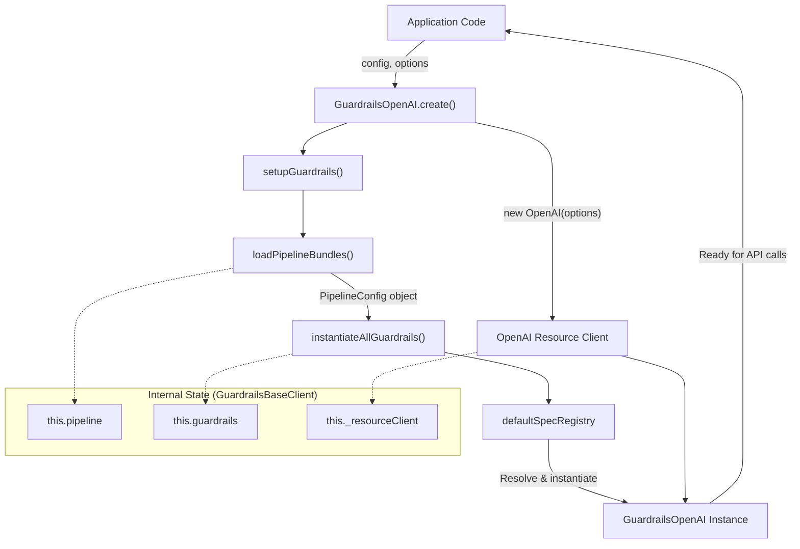
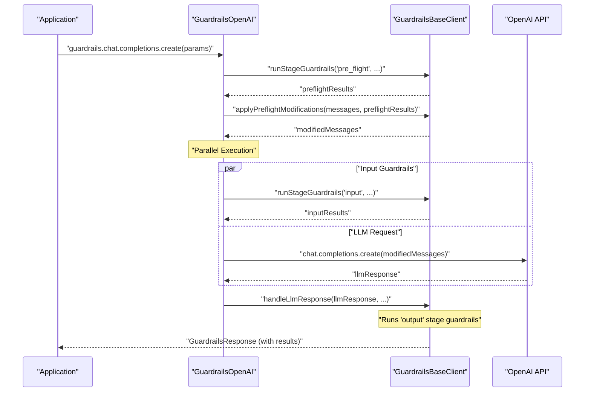
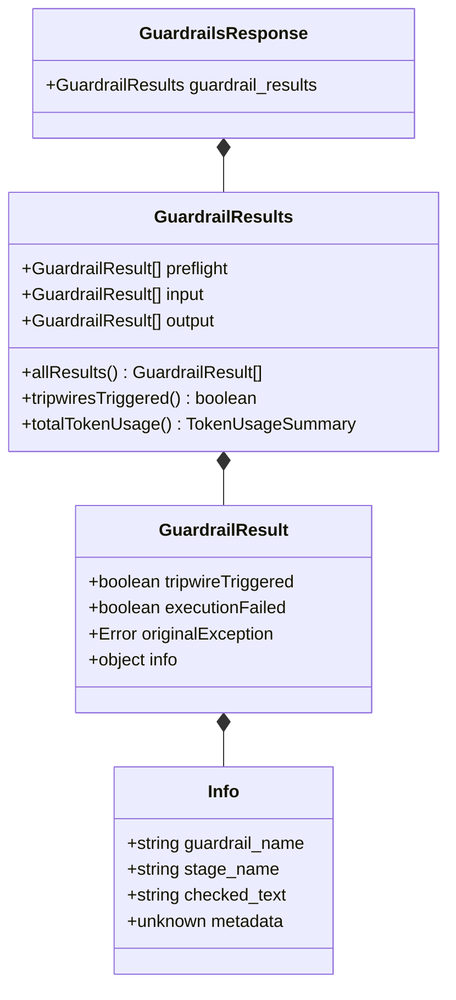

<!-- source: DeepWiki mcp.deepwiki.com · repo openai/openai-guardrails-js · page 3.1 GuardrailsOpenAI Client · fetched 2026-10-26 -->

# GuardrailsOpenAI Client

<details>
<summary>Relevant source files</summary>

The following files were used as context for generating this wiki page:

- [examples/basic/hello_world.ts](examples/basic/hello_world.ts)
- [examples/basic/local_model.ts](examples/basic/local_model.ts)
- [examples/basic/multiturn_with_prompt_injection_detection.ts](examples/basic/multiturn_with_prompt_injection_detection.ts)
- [examples/basic/streaming.ts](examples/basic/streaming.ts)
- [src/__tests__/unit/chat-resources.test.ts](src/__tests__/unit/chat-resources.test.ts)
- [src/base-client.ts](src/base-client.ts)
- [src/resources/chat/chat.ts](src/resources/chat/chat.ts)
- [src/resources/responses/responses.ts](src/resources/responses/responses.ts)
- [src/types.ts](src/types.ts)

</details>


## Purpose and Scope

This document covers the `GuardrailsOpenAI` class, which provides a drop-in replacement for the standard OpenAI TypeScript client with integrated guardrail validation. The class implements the same API surface as OpenAI's client while automatically applying configured guardrails to requests and responses. It handles the orchestration of pre-flight, input, and output validation stages, including concurrent execution of input guardrails with LLM calls.

For Azure OpenAI deployments, see [Azure OpenAI Integration](#3.2). For Agents SDK integration, see [Agents SDK Integration](#3.3). For evaluation workflows, see [Evaluation Framework](#6).

---

## Client Initialization

### Basic Initialization

The `GuardrailsOpenAI.create()` static method initializes a guardrailed client instance. It accepts a pipeline configuration and returns a fully configured client.

```typescript
const client = await GuardrailsOpenAI.create(config, options?, raiseGuardrailErrors?);
```

**Parameters:**

| Parameter | Type | Required | Description |
|-----------|------|----------|-------------|
| `config` | `PipelineConfig \| string` | Yes | Pipeline configuration object or file path to JSON configuration |
| `options` | `ClientOptions` | No | OpenAI client options (baseURL, apiKey, etc.) |
| `raiseGuardrailErrors` | `boolean` | No | Enable fail-secure mode (default: false) |

**Sources:** [src/base-client.ts:191-199](), [examples/basic/hello_world.ts:116-116]()

### Configuration Formats

The client accepts two configuration formats via the `setupGuardrails` method called during creation:

**Inline Configuration:**
```typescript
const client = await GuardrailsOpenAI.create({
  version: 1,
  output: {
    version: 1,
    guardrails: [
      { name: 'Moderation', config: { categories: ['hate', 'violence'] } }
    ]
  }
});
```

**File Path Configuration:**
```typescript
const client = await GuardrailsOpenAI.create('./guardrails_config.json');
```

### Client Initialization Flow



**Sources:** [src/base-client.ts:145-151](), [src/base-client.ts:191-199](), [examples/basic/hello_world.ts:14-57]()

---

## Client Options

### Standard OpenAI Options

The `options` parameter in `GuardrailsOpenAI.create` accepts standard `OpenAI.ClientOptions`. This allows the client to work with local models or third-party OpenAI-compatible APIs.

| Option | Type | Description |
|--------|------|-------------|
| `baseURL` | `string` | Custom API endpoint (e.g., for Ollama or LocalAI) |
| `apiKey` | `string` | API authentication key |

**Example with Custom Base URL (Ollama):**
```typescript
const client = await GuardrailsOpenAI.create(
  config,
  {
    baseURL: "http://127.0.0.1:11434/v1/",
    apiKey: "ollama"
  }
);
```

**Sources:** [examples/basic/local_model.ts:71-74]()

### Error Handling Mode

The `raiseGuardrailErrors` property on the client (inherited from `GuardrailsBaseClient`) controls behavior when guardrails fail to execute (e.g., network error during a check):

| Mode | Value | Behavior |
|------|-------|----------|
| Fail-Safe (Default) | `false` | Logs error but continues execution; `executionFailed` is set to `true` in results. |
| Fail-Secure | `true` | Throws the original exception if a guardrail fails to run. |

**Sources:** [src/base-client.ts:150-150](), [src/types.ts:54-57]()

---

## Making API Calls

### Supported Methods

The `GuardrailsOpenAI` client provides namespaced resources that wrap standard OpenAI endpoints:

*   `client.guardrails.responses.create(params)`: Wraps the OpenAI Responses API.
*   `client.guardrails.chat.completions.create(params)`: Wraps standard Chat Completions.

### API Call Execution Flow

The framework follows a specific execution order defined in the resource classes:

1.  **Pre-flight**: Sequential execution. Can modify the input (e.g., PII masking).
2.  **Input & LLM (Parallel)**: `Promise.all` is used to run Input stage guardrails concurrently with the actual OpenAI API call to minimize latency.
3.  **Output**: Sequential execution on the text returned by the LLM.



**Sources:** [src/resources/chat/chat.ts:70-113](), [src/resources/responses/responses.ts:73-116](), [src/base-client.ts:174-189]()

---

## Response Structure

### GuardrailsResponse Type

All calls return a `GuardrailsResponse`, which is the standard OpenAI response type intersected with a `guardrail_results` property.

```typescript
export type GuardrailsResponse<T extends OpenAIResponseType = OpenAIResponseType> = T & {
  guardrail_results: GuardrailResults;
};
```

### GuardrailResults Interface

The `guardrail_results` object provides access to results from every stage and aggregated metrics.

| Property | Type | Description |
|----------|------|-------------|
| `preflight` | `GuardrailResult[]` | Results from the pre-flight stage. |
| `input` | `GuardrailResult[]` | Results from the input stage. |
| `output` | `GuardrailResult[]` | Results from the output stage. |
| `allResults` | `GuardrailResult[]` | Flattened list of all results. |
| `tripwiresTriggered`| `boolean` | `true` if any result has `tripwireTriggered: true`. |
| `totalTokenUsage` | `TokenUsageSummary`| Aggregated token usage from LLM-based guardrails. |

**Sources:** [src/base-client.ts:79-87](), [src/base-client.ts:92-114](), [src/base-client.ts:119-121]()

### GuardrailResult Entity Mapping



**Sources:** [src/base-client.ts:92-114](), [src/types.ts:51-74]()

---

## Streaming Responses

When `stream: true` is passed, the client returns an `AsyncIterableIterator<GuardrailsResponse>`.

1.  **Pre-flight and Input** stages run normally before the stream begins.
2.  **Output** stage guardrails run once the stream is exhausted (accumulated) or as chunks are processed, depending on the guardrail type.
3.  The final chunk in the stream typically contains the full `guardrail_results` and token usage summary.

**Sources:** [src/resources/chat/chat.ts:116-128](), [examples/basic/streaming.ts:88-106]()

---

## Error Handling: Tripwires

### GuardrailTripwireTriggered Exception

If a guardrail triggers a tripwire and `suppressTripwire` is not enabled, the client throws a `GuardrailTripwireTriggered` error. This error contains the specific `GuardrailResult` that caused the block.

```typescript
try {
  await client.guardrails.chat.completions.create({ ... });
} catch (error) {
  if (error instanceof GuardrailTripwireTriggered) {
    console.log(error.guardrailResult.info.guardrail_name); // e.g., "Jailbreak"
  }
}
```

**Sources:** [examples/basic/hello_world.ts:145-151](), [src/base-client.ts:103-105]()

### Conversation Context in Exceptions

For multi-turn detection (like Prompt Injection), the client automatically extracts conversation history from the `input` or `messages` parameter and previous response IDs to provide context to the guardrails.

**Sources:** [src/resources/responses/responses.ts:56-63](), [examples/basic/multiturn_with_prompt_injection_detection.ts:12-14]()

---

