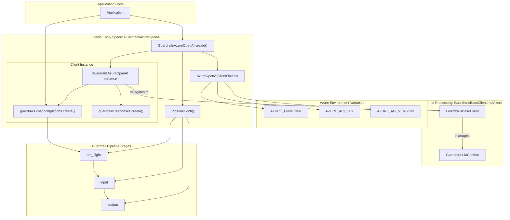
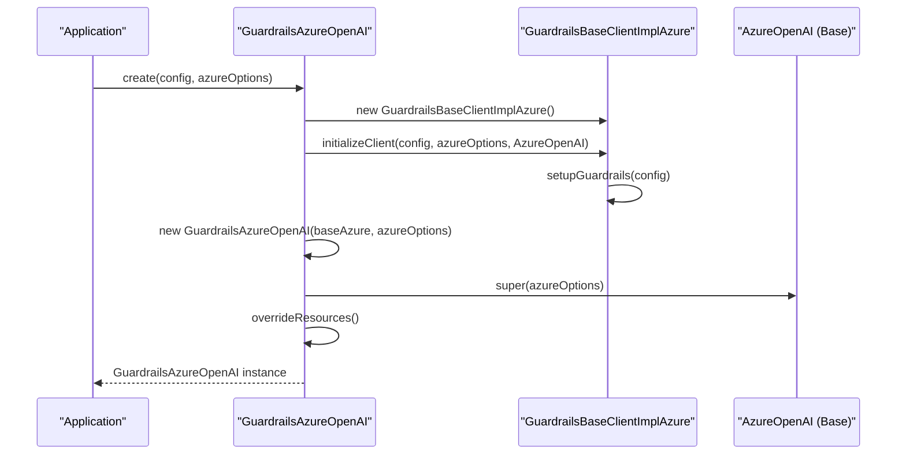
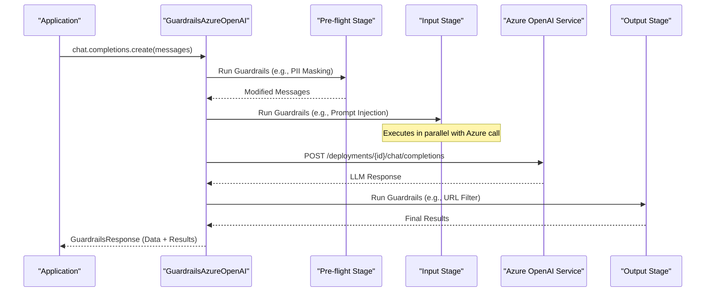

<!-- source: DeepWiki mcp.deepwiki.com · repo openai/openai-guardrails-js · page 3.2 Azure OpenAI Integration · fetched 2026-10-26 -->

# Azure OpenAI Integration

<details>
<summary>Relevant source files</summary>

The following files were used as context for generating this wiki page:

- [examples/basic/agents_sdk.ts](examples/basic/agents_sdk.ts)
- [examples/basic/azure_example.ts](examples/basic/azure_example.ts)
- [examples/basic/suppress_tripwire.ts](examples/basic/suppress_tripwire.ts)
- [src/base-client.ts](src/base-client.ts)
- [src/client.ts](src/client.ts)
- [src/types.ts](src/types.ts)

</details>


This page documents the `GuardrailsAzureOpenAI` client, which provides Azure OpenAI-specific integration with full guardrails support. This client is a drop-in replacement for the Azure OpenAI TypeScript client that automatically applies pipeline configurations to all API calls.

---

## Overview

The `GuardrailsAzureOpenAI` class extends the guardrails framework to Azure OpenAI deployments, which use a different authentication model and endpoint structure than the standard OpenAI API. Azure deployments require:

- **Azure-specific endpoint**: `https://your-resource.openai.azure.com/`
- **API key**: Azure subscription key (not OpenAI API key)
- **API version**: Azure API version string (e.g., `2025-01-01-preview`)
- **Deployment name**: Specific model deployment name configured in Azure

The client provides the same guardrail pipeline functionality as the standard client but handles Azure's authentication and routing requirements automatically.

**Sources**: [src/client.ts:123-134](), [examples/basic/azure_example.ts:1-182]()

---

## Azure Client Architecture

The following diagram bridges the Natural Language concepts of Azure configuration to the specific code entities in the `openai-guardrails-js` framework.



**Sources**: [src/client.ts:123-175](), [src/base-client.ts:145-199](), [examples/basic/azure_example.ts:121-139]()

---

## Configuration Parameters

### Required Environment Variables

Azure deployments require four environment variables. The `GuardrailsAzureOpenAI` client expects these to be mapped to the constructor options.

| Variable | Purpose | Example Value |
|----------|---------|---------------|
| `AZURE_ENDPOINT` | Azure resource endpoint | `https://your-resource.openai.azure.com/` |
| `AZURE_API_KEY` | Azure subscription key | `your-azure-key` |
| `AZURE_API_VERSION` | API version string | `2025-01-01-preview` |
| `AZURE_DEPLOYMENT` | Model deployment name | `gpt-4-deployment` |

**Sources**: [examples/basic/azure_example.ts:121-131]()

---

### Azure Client Options

The `GuardrailsAzureOpenAI.create` method accepts the standard `AzureOpenAI` constructor parameters as its second argument.

[src/client.ts:161-165]()

```typescript
// From src/client.ts
static async create(
  config: string | PipelineConfig,
  azureOptions: ConstructorParameters<typeof AzureOpenAI>[0],
  raiseGuardrailErrors: boolean = false
): Promise<GuardrailsAzureOpenAI>
```

**Sources**: [src/client.ts:161-165]()

---

## Client Initialization

The initialization process involves instantiating a `GuardrailsBaseClientImplAzure` which handles the specific logic for Azure's resource mapping before returning the main `GuardrailsAzureOpenAI` instance.



**Sources**: [src/client.ts:161-180](), [src/base-client.ts:191-199]()

---

## Making API Calls

### API Call Structure

The client overrides the `chat` and `responses` namespaces to provide guardrail-aware methods. Use the `guardrails` namespace for explicit access to the enhanced resources.

```typescript
const response = await guardrailsClient.guardrails.chat.completions.create({
  model: process.env.AZURE_DEPLOYMENT!,
  messages: [{ role: 'user', content: 'Hello' }],
});
```

**Sources**: [src/client.ts:131-134](), [examples/basic/azure_example.ts:74-77]()

### Response Structure

The response is a `GuardrailsResponse`, which merges the standard Azure OpenAI response with a `guardrail_results` property of type `GuardrailResults`.

[src/base-client.ts:79-87]()

```typescript
export interface GuardrailResults {
  preflight: GuardrailResult[];
  input: GuardrailResult[];
  output: GuardrailResult[];
  readonly allResults: GuardrailResult[];
  readonly tripwiresTriggered: boolean;
  readonly triggeredResults: GuardrailResult[];
  readonly totalTokenUsage: TokenUsageSummary;
}
```

**Sources**: [src/base-client.ts:79-114](), [src/types.ts:51-74]()

---

## Deployment-Specific Considerations

### Model Deployment Names

In Azure OpenAI, the `model` parameter in API calls must be the **Deployment Name** created in the Azure AI Studio, not the base model name (e.g., use `my-gpt-4-deploy` instead of `gpt-4`).

This applies to both the main API call and any LLM-based guardrails configured in the pipeline:

[examples/basic/azure_example.ts:33-40]()

```typescript
input: {
  guardrails: [
    {
      name: 'Custom Prompt Check',
      config: {
        model: process.env.AZURE_DEPLOYMENT!, // Deployment name
        // ...
      },
    },
  ],
},
```

**Sources**: [examples/basic/azure_example.ts:33-40](), [examples/basic/azure_example.ts:75]()

---

### Pipeline Configuration with Azure

When defining a `PipelineConfig` for Azure, ensure that guardrails requiring an LLM (like `Custom Prompt Check` or `Jailbreak Detection`) are configured with valid Azure deployment names.

[examples/basic/azure_example.ts:15-53]()

| Guardrail | Config Property | Requirement |
|-----------|-----------------|-------------|
| `Custom Prompt Check` | `config.model` | Azure Deployment Name |
| `Moderation` | N/A | Uses OpenAI Moderation API (not Azure-specific) |
| `PII Detection` | N/A | Local Regex/Logic |

**Sources**: [examples/basic/azure_example.ts:15-53](), [src/base-client.ts:126-131]()

---

## Complete Example Walkthrough

The following sequence shows how `GuardrailsAzureOpenAI` processes a request through the three-stage pipeline.



**Sources**: [src/base-client.ts:174-189](), [src/client.ts:180-210](), [examples/basic/azure_example.ts:68-96]()

---

## Comparison: Standard vs Azure Client

| Feature | `GuardrailsOpenAI` | `GuardrailsAzureOpenAI` |
|---------|--------------------|-------------------------|
| **Base Class** | `OpenAI` | `AzureOpenAI` |
| **Auth** | `apiKey` | `apiKey` + `endpoint` + `apiVersion` |
| **Resource Logic** | `GuardrailsBaseClientImpl` | `GuardrailsBaseClientImplAzure` |
| **Model Param** | Model ID (e.g. `gpt-4o`) | Deployment Name |
| **Pipeline Support** | Full | Full |

**Sources**: [src/client.ts:33-116](), [src/client.ts:123-212]()

---

