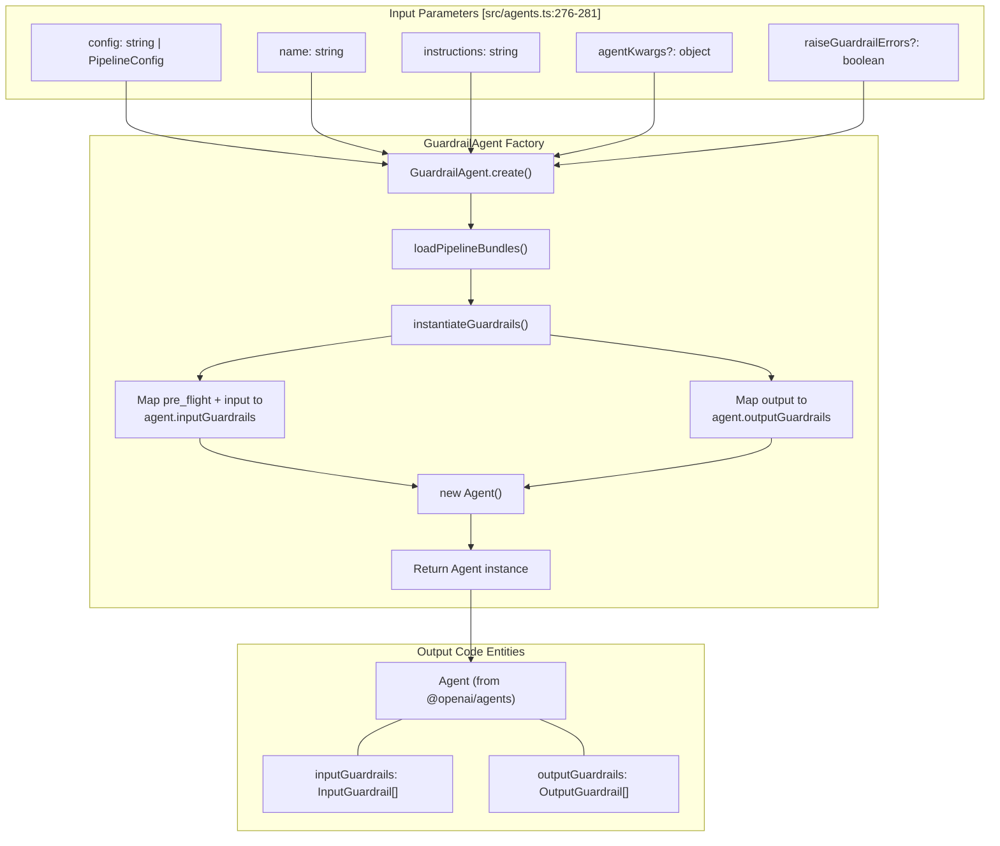
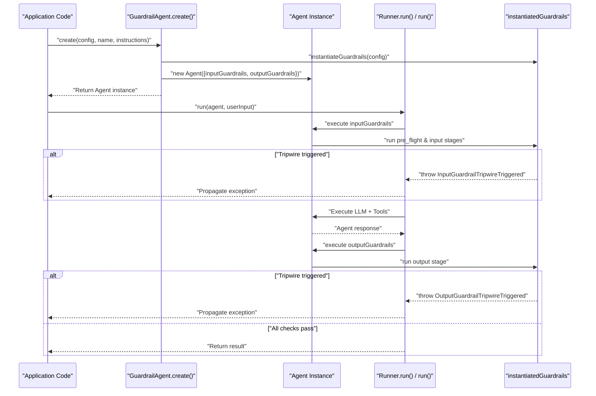

<!-- source: DeepWiki mcp.deepwiki.com · repo openai/openai-guardrails-js · page 3.3 Agents SDK Integration · fetched 2026-10-26 -->

# Agents SDK Integration

<details>
<summary>Relevant source files</summary>

The following files were used as context for generating this wiki page:

- [docs/agents_sdk_integration.md](docs/agents_sdk_integration.md)
- [docs/quickstart.md](docs/quickstart.md)
- [examples/basic/agents_sdk.ts](examples/basic/agents_sdk.ts)
- [examples/basic/azure_example.ts](examples/basic/azure_example.ts)
- [examples/basic/suppress_tripwire.ts](examples/basic/suppress_tripwire.ts)
- [src/__tests__/unit/agents.test.ts](src/__tests__/unit/agents.test.ts)
- [src/__tests__/unit/types.test.ts](src/__tests__/unit/types.test.ts)
- [src/agents.ts](src/agents.ts)
- [src/client.ts](src/client.ts)
- [src/utils/content.ts](src/utils/content.ts)

</details>


## Purpose and Scope

This page documents the `GuardrailAgent` class, which provides integration between the Guardrails framework and OpenAI's Agents SDK (`@openai/agents`). The `GuardrailAgent` class acts as a factory that wraps the standard `Agent` class from the Agents SDK and automatically applies guardrail validation to agent inputs and outputs by wiring them into the agent's internal guardrail lifecycle.

For general guardrail configuration patterns, see [Pipeline Configuration Basics](). For the drop-in OpenAI client replacement pattern, see [GuardrailsOpenAI Client](). For evaluation of guardrail configurations, see section [6]().

**Sources:** [src/agents.ts:2-7](), [docs/agents_sdk_integration.md:1-106]()

---

## Overview

The `GuardrailAgent` class provides the simplest integration for users of the OpenAI Agents SDK. It translates a standard Guardrails `PipelineConfig` into the specific `InputGuardrail` and `OutputGuardrail` functions required by the `@openai/agents` framework.

### Key Characteristics

| Characteristic | Description |
|---------------|-------------|
| **Pattern** | Factory method `GuardrailAgent.create()` that returns a standard `Agent` instance [src/agents.ts:275-300]() |
| **Compatibility** | Works with all Agents SDK features, including the `Runner` or `run()` function [src/__tests__/unit/agents.test.ts:97-101]() |
| **Configuration** | Accepts the same pipeline configuration format as `GuardrailsOpenAI` [src/agents.ts:276-277]() |
| **Tool-Level Checking** | Prompt Injection Detection runs at the tool level, checking each tool call and output [docs/agents_sdk_integration.md:12-13]() |
| **Agent-Level Checking** | Other guardrails run at the agent level for efficiency [docs/agents_sdk_integration.md:13-14]() |
| **Exception Types** | Uses specialized `InputGuardrailTripwireTriggered` and `OutputGuardrailTripwireTriggered` exceptions [examples/basic/agents_sdk.ts:127-135]() |

**Sources:** [src/agents.ts:1-30](), [docs/agents_sdk_integration.md:6-16]()

---

## GuardrailAgent Class Structure

The `GuardrailAgent` class provides a static `create()` method that returns a configured `Agent` instance. Internally, it maps the three-stage pipeline (`pre_flight`, `input`, `output`) to the agent's guardrail arrays.



**Diagram: GuardrailAgent.create() Implementation Flow**
**Sources:** [src/agents.ts:275-340](), [src/__tests__/unit/agents.test.ts:84-107]()

### Method Signature

The `GuardrailAgent.create()` static method accepts the following parameters:

| Parameter | Type | Required | Description |
|-----------|------|----------|-------------|
| `config` | `string \| PipelineConfig` | Yes | Pipeline configuration (file path or object) [src/agents.ts:276]() |
| `name` | `string` | Yes | Agent name passed to the underlying constructor [src/agents.ts:277]() |
| `instructions` | `string` | Yes | Agent instructions/system prompt [src/agents.ts:278]() |
| `agentKwargs` | `object` | No | Additional options (model, temperature, etc.) [src/agents.ts:279]() |
| `raiseGuardrailErrors` | `boolean` | No | If `true`, execution errors throw exceptions (default: `false`) [src/agents.ts:280]() |

**Sources:** [src/agents.ts:275-281](), [src/__tests__/unit/agents.test.ts:159-184]()

---

## Basic Usage Pattern

The integration pattern involves creating a `GuardrailAgent` and using it with the Agents SDK's `run()` function.



**Diagram: GuardrailAgent Runtime Execution Flow**
**Sources:** [src/agents.ts:311-340](), [examples/basic/agents_sdk.ts:111-135]()

### Code Example

The following example demonstrates how to create the agent and handle specialized tripwire exceptions:

```typescript
import { GuardrailAgent } from '@openai/guardrails';
import { run, InputGuardrailTripwireTriggered, OutputGuardrailTripwireTriggered } from '@openai/agents';

const agent = await GuardrailAgent.create(
  './guardrails_config.json',
  "Support Agent",
  "You help customers."
);

try {
  const result = await run(agent, "User input");
  console.log(result.finalOutput);
} catch (error) {
  if (error instanceof InputGuardrailTripwireTriggered) {
    console.log("Input blocked:", error.guardrailResult.info);
  } else if (error instanceof OutputGuardrailTripwireTriggered) {
    console.log("Output blocked:", error.guardrailResult.info);
  }
}
```

**Sources:** [examples/basic/agents_sdk.ts:75-135](), [docs/agents_sdk_integration.md:26-67]()

---

## Tool-Level vs Agent-Level Guardrails

The `GuardrailAgent` implementation differentiates between guardrails that run once per turn and those that must run for every tool interaction.

### Execution Granularity

| Guardrail Type | Execution Level | Frequency | Rationale |
|---------------|-----------------|-----------|-----------|
| **Prompt Injection Detection** | Tool-level | Each tool call and output | Prevents malicious tool usage and output manipulation during multi-step reasoning [docs/agents_sdk_integration.md:12-13]() |
| **All Other Guardrails** | Agent-level | Once per agent turn | Efficiency - avoid redundant checks on every tool interaction for standard safety [docs/agents_sdk_integration.md:13-14]() |

**Sources:** [docs/agents_sdk_integration.md:12-14]()

---

## Exception Handling and Token Usage

When using `GuardrailAgent`, the framework uses specialized exception types from `@openai/agents-core`.

### Exception Types

| Exception Type | Stage | Description |
|---------------|-------|-------------|
| `InputGuardrailTripwireTriggered` | `pre_flight` or `input` | Triggered before or during LLM execution. No assistant response is available [examples/basic/agents_sdk.ts:128-131]() |
| `OutputGuardrailTripwireTriggered` | `output` | Triggered after LLM execution. The assistant response was generated but blocked [examples/basic/agents_sdk.ts:132-135]() |

### Token Usage Limitation

!!! warning "JavaScript Agents SDK Limitation"
    The JavaScript Agents SDK (`@openai/agents`) does not currently return guardrail results in the standard `RunResult` object. Token usage for passing guardrails is not easily accessible via `totalGuardrailTokenUsage()` when using `GuardrailAgent`. [docs/agents_sdk_integration.md:117-120]()

However, when a guardrail **triggers**, token usage is available in the error's result object:

```typescript
try {
  const result = await run(agent, userInput);
} catch (error) {
  if (error instanceof InputGuardrailTripwireTriggered) {
    // Access token usage from the triggered guardrail info
    const usage = error.result?.output?.outputInfo?.token_usage;
    console.log(`Tokens used by guardrail: ${usage?.total_tokens}`);
  }
}
```

**Sources:** [docs/agents_sdk_integration.md:115-138]()

---

## Implementation Details

The `GuardrailAgent` maps the pipeline stages to agent guardrails using the following logic:

1.  **Input Mapping:** Guardrails in the `pre_flight` and `input` stages of the `PipelineConfig` are combined and converted into `InputGuardrail` functions [src/__tests__/unit/agents.test.ts:84-107]().
2.  **Output Mapping:** Guardrails in the `output` stage are converted into `OutputGuardrail` functions [src/__tests__/unit/agents.test.ts:109-128]().
3.  **Conversation Context:** The agent uses `loadAgentConversation()` to ensure that guardrails have access to the full message history for context-aware checks (like Hallucination Detection) [src/agents.ts:116-139]().

### Conversation Synchronization

The framework uses `ensureConversationIncludes()` to merge the current agent turn with the session history, preventing safety violations from polluting the long-term memory if they are blocked [src/agents.ts:160-190]().

**Sources:** [src/agents.ts:116-210](), [src/__tests__/unit/agents.test.ts:84-157]()

---

## Summary

`GuardrailAgent` provides a seamless way to apply OpenAI Guardrails to agents built with the `@openai/agents` SDK:

- **Drop-in:** Replace `new Agent()` with `await GuardrailAgent.create()` [docs/agents_sdk_integration.md:19-26]().
- **Integrated Safety:** Automatically handles stage mapping and conversation context [src/agents.ts:311-340]().
- **Native Exceptions:** Leverages Agents SDK exception types for standard error handling [examples/basic/agents_sdk.ts:124-140]().

For more information on the individual guardrails available for use in the configuration, see the [Built-in Guardrails Reference]().

**Sources:** [src/agents.ts:1-340](), [docs/agents_sdk_integration.md:1-139]()

---

