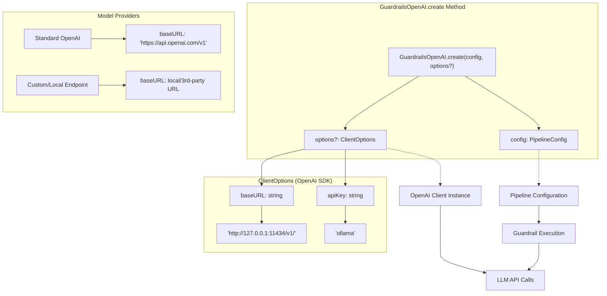
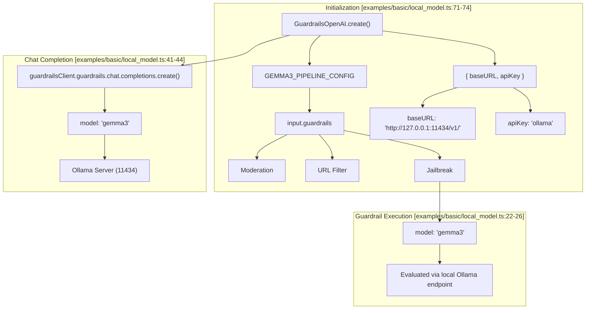
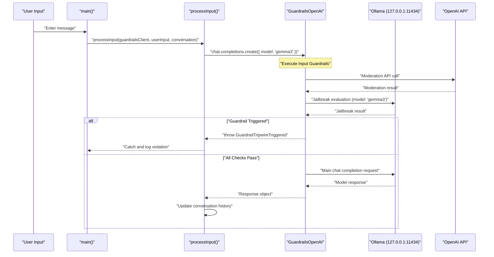
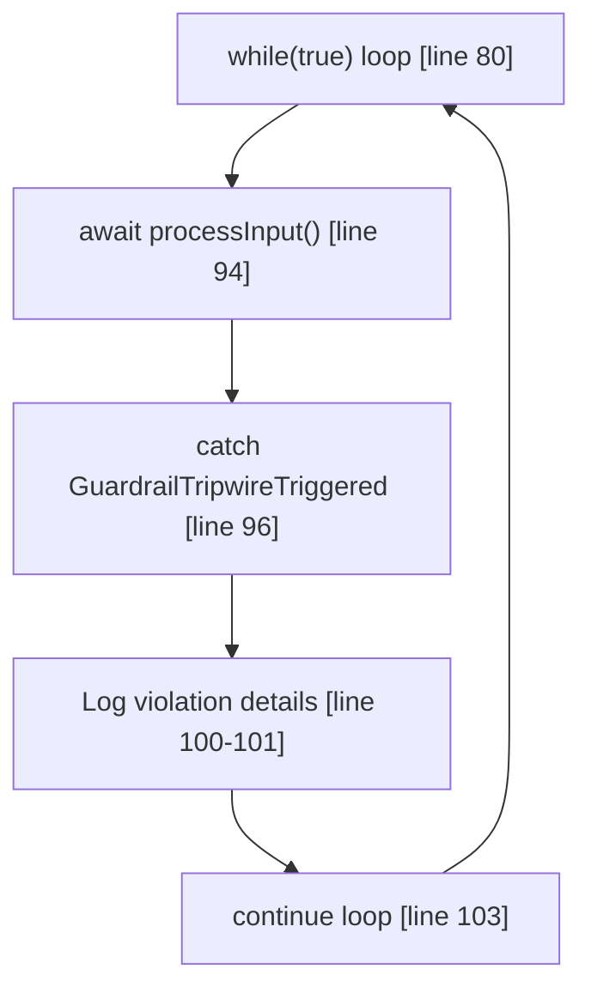

<!-- source: DeepWiki mcp.deepwiki.com · repo openai/openai-guardrails-js · page 3.4 Local and Third-Party Models · fetched 2026-10-26 -->

# Local and Third-Party Models

<details>
<summary>Relevant source files</summary>

The following files were used as context for generating this wiki page:

- [examples/basic/hello_world.ts](examples/basic/hello_world.ts)
- [examples/basic/local_model.ts](examples/basic/local_model.ts)
- [examples/basic/multiturn_with_prompt_injection_detection.ts](examples/basic/multiturn_with_prompt_injection_detection.ts)
- [examples/basic/streaming.ts](examples/basic/streaming.ts)

</details>


This document explains how to use guardrails with local models (such as Ollama) and third-party OpenAI-compatible APIs. The framework supports any API endpoint that implements the OpenAI-compatible interface by allowing custom `baseURL` and `apiKey` configuration.

For standard OpenAI API usage, see [GuardrailsOpenAI Client](#3.1). For Azure OpenAI deployments, see [Azure OpenAI Integration](#3.2).

## Overview

The `GuardrailsOpenAI` class supports connecting to any OpenAI-compatible API by accepting optional client configuration parameters. This enables guardrail validation with:

- **Local model servers** (e.g., Ollama, LocalAI, LM Studio)
- **Third-party hosted models** with OpenAI-compatible endpoints
- **Custom model deployments** behind compatible API gateways

The guardrail pipeline executes identically regardless of the underlying model provider. The framework remains agnostic to the LLM backend, focusing solely on input/output validation.

**Sources:** [examples/basic/local_model.ts:71-74](), [examples/basic/hello_world.ts:116]()

## Configuration Mechanism

### Client Initialization

The `GuardrailsOpenAI.create()` method accepts an optional second parameter for client configuration. This configuration is passed to the underlying OpenAI client.

Title: GuardrailsOpenAI Configuration Flow


The `baseURL` parameter overrides the default OpenAI API endpoint, while `apiKey` provides authentication for the target service.

**Sources:** [examples/basic/local_model.ts:71-74]()

### Parameter Details

| Parameter | Type | Purpose | Default |
|-----------|------|---------|---------|
| `baseURL` | `string` | API endpoint URL, must end with `/v1/` for compatibility | `https://api.openai.com/v1` |
| `apiKey` | `string` | Authentication key for the API provider | `process.env.OPENAI_API_KEY` |

**Sources:** [examples/basic/local_model.ts:71-74]()

## Ollama Integration Example

### Complete Configuration

Ollama provides a local model server with OpenAI-compatible API endpoints. The following example demonstrates a complete setup with the `gemma3` model.

Title: Local Model Request Pipeline


The pipeline configuration at [examples/basic/local_model.ts:10-29]() defines input guardrails. The Jailbreak guardrail specifies `model: 'gemma3'`, directing that specific check to use the local model.

**Sources:** [examples/basic/local_model.ts:10-29](), [examples/basic/local_model.ts:41-44](), [examples/basic/local_model.ts:71-74]()

### Request Flow

Title: Sequential Execution with Local Model


The execution flow at [examples/basic/local_model.ts:34-64]() demonstrates how guardrails integrate with the chat completion process. The `processInput` function wraps the completion call in a try-catch to handle `GuardrailTripwireTriggered` exceptions.

**Sources:** [examples/basic/local_model.ts:34-64](), [examples/basic/local_model.ts:96-104]()

## Other Third-Party Providers

### Generic OpenAI-Compatible APIs

Any service implementing the OpenAI API specification can be used by setting the appropriate `baseURL`:

| Provider Type | Example baseURL | Authentication |
|--------------|----------------|----------------|
| LocalAI | `http://localhost:8080/v1/` | `apiKey: "local"` |
| LM Studio | `http://localhost:1234/v1/` | `apiKey: "lm-studio"` |
| Custom Gateway | `https://your-gateway.example.com/v1/` | Provider-specific |

**Sources:** [examples/basic/local_model.ts:71-74]()

### Model Name Mapping

When using third-party providers, ensure model names in both the pipeline configuration and API calls match the provider's supported models. LLM-based guardrails (Jailbreak, NSFW, Off Topic, Custom Prompt Check) require a `model` field in their configuration [examples/basic/local_model.ts:22-26]().

## Limitations and Considerations

### OpenAI-Specific Services

Certain guardrails depend on OpenAI-specific APIs that are not available from third-party providers:

| Guardrail | Service Dependency | Behavior with Third-Party Models |
|-----------|-------------------|----------------------------------|
| Moderation | OpenAI Moderation API | Always calls `api.openai.com/v1/moderations` |
| Hallucination Detection | OpenAI FileSearch API | Requires OpenAI vector store service |

**Sources:** [examples/basic/local_model.ts:15]() (Moderation is used alongside a local model).

### Error Handling Pattern

The example implements a continuous input loop at [examples/basic/local_model.ts:80-107]() with try-catch blocks:

Title: REPL Error Handling Strategy


This pattern ensures that a safety violation does not crash the application and that the conversation history remains clean (only updated on success) [examples/basic/local_model.ts:55-56]().

**Sources:** [examples/basic/local_model.ts:55-61](), [examples/basic/local_model.ts:80-107]()

## Running the Example

The complete working example is located at [examples/basic/local_model.ts:1-118]().

1. **Ollama Setup**: Pull the required model (e.g., `ollama pull gemma3`).
2. **OpenAI API Key**: Ensure `OPENAI_API_KEY` is set for the Moderation guardrail.
3. **Execution**:
   ```bash
   npx tsx examples/basic/local_model.ts
   ```

**Sources:** [examples/basic/local_model.ts:1-118]()

---

