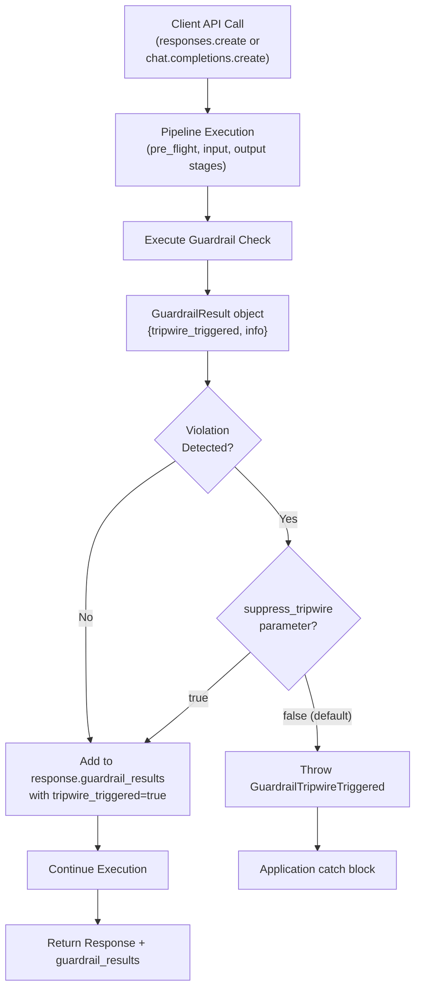
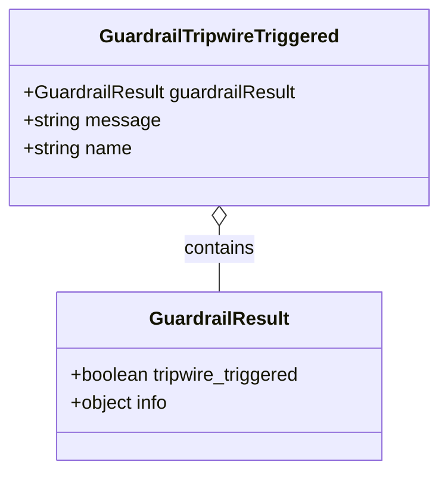

<!-- source: DeepWiki mcp.deepwiki.com · repo openai/openai-guardrails-js · page 4 Tripwires and Error Handling · fetched 2026-10-26 -->

# Tripwires and Error Handling

<details>
<summary>Relevant source files</summary>

The following files were used as context for generating this wiki page:

- [README.md](README.md)
- [docs/assets/images/guardrails-js-config-screenshot-100pct-q70.webp](docs/assets/images/guardrails-js-config-screenshot-100pct-q70.webp)
- [docs/index.md](docs/index.md)
- [docs/ref/exceptions-typescript.md](docs/ref/exceptions-typescript.md)
- [docs/tripwires.md](docs/tripwires.md)
- [package-lock.json](package-lock.json)
- [package.json](package.json)
- [src/exceptions.ts](src/exceptions.ts)

</details>


This page explains the tripwire mechanism, which is how the Guardrails framework enforces safety policies by blocking execution when violations are detected. It covers default blocking behavior, exception handling, suppression patterns, and the distinction between guardrail violations (tripwires) and guardrail execution errors.

For information about specific guardrail checks and their configuration, see [Built-in Guardrails Reference](#5). For details on pipeline stages and when guardrails execute, see [Pipeline Stage Selection](#7.1).

## Overview of the Tripwire Mechanism

A **tripwire** is triggered when a guardrail check detects a violation. The framework provides two modes for handling tripwires:

1. **Blocking mode (default)**: Throws a `GuardrailTripwireTriggered` exception, halting execution. [src/exceptions.ts:25-34]()
2. **Suppressed mode**: Returns results without blocking, allowing manual violation handling via the `suppress_tripwire` parameter. [docs/tripwires.md:45-63]()

All guardrail checks return a `GuardrailResult` object containing metadata about the check execution. [src/exceptions.ts:26-32]()

### Tripwire Flow Diagram



Sources: [docs/tripwires.md:1-11](), [README.md:49-62](), [src/exceptions.ts:25-34]()

## Default Blocking Behavior

By default, tripwires throw exceptions that halt execution. This ensures safety violations cannot be accidentally ignored. [docs/tripwires.md:12-14]()

### Exception Types

The framework uses several custom error classes for different failure scenarios:

| Exception Type | Purpose | File Pointer |
|-------|---------------|----------------|
| `GuardrailTripwireTriggered` | Thrown when a safety check identifies a critical failure | [src/exceptions.ts:25-34]() |
| `GuardrailConfigurationError` | Issues with invalid specs or missing parameters | [src/exceptions.ts:39-44]() |
| `GuardrailNotFoundError` | Referenced guardrail name is not registered | [src/exceptions.ts:49-54]() |
| `GuardrailExecutionError` | Runtime failure within a guardrail check itself | [src/exceptions.ts:59-67]() |

### Basic Exception Handling Example

```typescript
import { GuardrailsOpenAI, GuardrailTripwireTriggered } from '@openai/guardrails';

const client = await GuardrailsOpenAI.create({
  version: 1,
  output: {
    version: 1,
    guardrails: [
      { name: 'Moderation', config: { categories: ['hate', 'violence'] } }
    ]
  }
});

try {
  const response = await client.responses.create({
    model: 'gpt-4o',
    input: 'Tell me a secret'
  });
} catch (err) {
  if (err instanceof GuardrailTripwireTriggered) {
    // Access the specific result that triggered the tripwire
    console.log(`Guardrail triggered: ${err.guardrailResult.info.guardrail_name}`);
  }
}
```

Sources: [src/exceptions.ts:1-67](), [README.md:51-63](), [docs/tripwires.md:16-43]()

## GuardrailTripwireTriggered Exception Structure

The `GuardrailTripwireTriggered` exception provides access to detailed information about the violation through its `guardrailResult` property. [src/exceptions.ts:26-32]()

### Code Entity Association



The `info` object inside `GuardrailResult` contains check-specific metadata, such as:
- `guardrail_name`: The name of the check that fired. [src/exceptions.ts:29-29]()
- `stage_name`: The pipeline stage (pre_flight, input, output).
- `flagged`: Boolean status.
- `checked_text`: The actual text that was evaluated.

Sources: [src/exceptions.ts:25-34](), [docs/tripwires.md:65-81]()

## Suppressing Tripwires for Manual Handling

Setting `suppress_tripwire: true` in the API call prevents exceptions from being thrown. Instead, violation information is returned in the response's `guardrail_results` property. [docs/tripwires.md:45-47]()

### Suppression Pattern

```typescript
const response = await client.responses.create({
  model: 'gpt-4o',
  input: 'User input text',
  suppress_tripwire: true  // Prevent exceptions [docs/tripwires.md:54]
});

// Check guardrail results manually [docs/tripwires.md:58-62]
for (const result of response.guardrail_results.all_results) {
  if (result.tripwire_triggered) {
    console.log(`Guardrail '${result.info.guardrail_name}' triggered!`);
  }
}
```

Sources: [docs/tripwires.md:45-63](), [README.md:153]()

## Fail-Safe vs Fail-Secure Modes

The framework distinguishes between policy violations (tripwires) and runtime errors (execution failures). [docs/ref/exceptions-typescript.md:21-24]()

### Comparison Table

| Mode | Behavior on Execution Error | Class Used |
|------|----------------------------|----------|
| **Fail-Safe** | Logs error, continues execution, sets `tripwire_triggered: false` | `GuardrailExecutionError` (logged) |
| **Fail-Secure** | Throws exception, halts execution immediately | `GuardrailExecutionError` (thrown) |

Runtime failures like API timeouts or invalid model configurations throw a `GuardrailExecutionError`, which can wrap the original error in its `cause` property. [src/exceptions.ts:59-67]()

Sources: [src/exceptions.ts:59-67](), [docs/ref/exceptions-typescript.md:16-24]()

## Integration with GuardrailAgent

When using `GuardrailAgent` with the Agents SDK, tripwires behave identically to the `GuardrailsOpenAI` client. Exceptions are thrown on violations unless suppressed. [README.md:69-90]()

```typescript
import { GuardrailAgent } from '@openai/guardrails';

const agent = new GuardrailAgent({
  config: { /* guardrail config */ },
  name: 'Support Agent',
  instructions: 'Help users.'
});

// Use like a regular agent; throws GuardrailTripwireTriggered on violation
```

Sources: [README.md:69-90](), [package.json:47]()

## Related Documentation

- For details on how tripwires block execution by default, see [Default Blocking Behavior](#4.1)
- For patterns on manual violation handling, see [Suppressing Tripwires](#4.2)
- For the impact of the `raiseGuardrailErrors` parameter, see [Fail-Safe vs Fail-Secure Modes](#4.3)
- For complete API details on exception types, see [Exception Types](#9.5)

---

