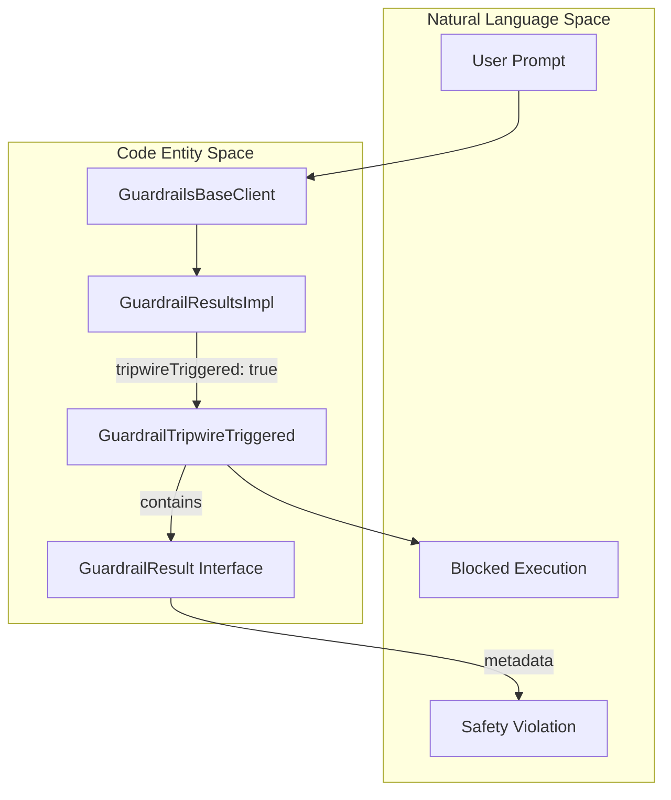
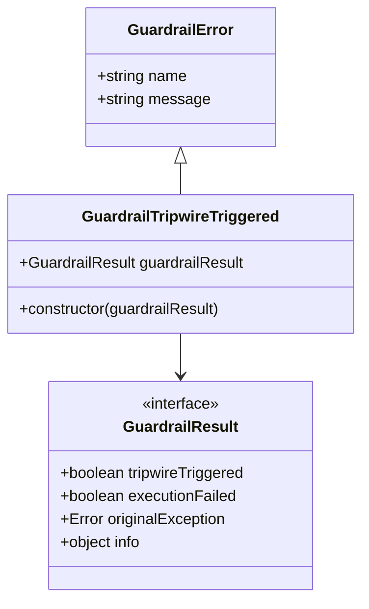

<!-- source: DeepWiki mcp.deepwiki.com · repo openai/openai-guardrails-js · page 4.1 Default Blocking Behavior · fetched 2026-10-26 -->

# Default Blocking Behavior

<details>
<summary>Relevant source files</summary>

The following files were used as context for generating this wiki page:

- [docs/ref/exceptions-typescript.md](docs/ref/exceptions-typescript.md)
- [package-lock.json](package-lock.json)
- [package.json](package.json)
- [src/base-client.ts](src/base-client.ts)
- [src/exceptions.ts](src/exceptions.ts)
- [src/types.ts](src/types.ts)

</details>


This document describes the default blocking mechanism that occurs when a guardrail detects a violation. When a tripwire is triggered, execution is halted by raising a `GuardrailTripwireTriggered` exception. For information about suppressing this behavior and handling violations manually, see [4.2 Suppressing Tripwires](). For information about guardrail execution errors (as opposed to safety violations), see [4.3 Fail-Safe vs Fail-Secure Modes]().

## Tripwire Mechanism Overview

By default, when any guardrail detects a violation that exceeds its configured threshold, a tripwire is immediately triggered. This halts the request pipeline and raises an exception before returning control to the application. The logic for checking these tripwires is encapsulated in the `GuardrailResultsImpl.tripwiresTriggered` getter [src/base-client.ts:103-105]().

### Data Flow to Code Entity Space

The following diagram maps the conceptual pipeline stages to the internal implementation classes and result handling logic.


**Mapping: Natural Language Concepts to Code Entities**

Sources: [src/base-client.ts:92-114](), [src/exceptions.ts:25-34](), [src/types.ts:51-74]()

### Blocking Characteristics

- **Immediate halt**: Execution stops as soon as a violation is detected.
- **No LLM response**: For pre-flight and input violations, the LLM is never called or the response is discarded.
- **No partial results**: The application receives only the exception, not any partial response.
- **Stage-specific timing**: Pre-flight blocks before the LLM call, input blocks in parallel, output blocks after the LLM responds.

Sources: [src/base-client.ts:145-150](), [src/types.ts:67-68]()

## GuardrailTripwireTriggered Exception

All tripwire exceptions inherit from the base `GuardrailTripwireTriggered` class, which extends `GuardrailError` [src/exceptions.ts:25-34](). It contains a `guardrailResult` property [src/exceptions.ts:26]() that conforms to the `GuardrailResult` interface [src/types.ts:51-74]().


**Exception Class Hierarchy and Data Association**

Sources: [src/exceptions.ts:12-34](), [src/types.ts:51-74]()

### Exception Structure

The `GuardrailTripwireTriggered` constructor automatically sets a descriptive message using the guardrail name found in the `info` object: `Guardrail tripwire triggered: ${guardrailResult.info?.guardrail_name || 'Unknown'}` [src/exceptions.ts:29]().

Sources: [src/exceptions.ts:28-33]()

## GuardrailResult Structure

The `guardrailResult` property on the exception contains detailed information about what triggered the violation, structured via the `GuardrailResult` interface [src/types.ts:51-74]().

### Core Properties

| Property | Type | Description |
| :--- | :--- | :--- |
| `tripwireTriggered` | `boolean` | True if the guardrail identified a critical failure [src/types.ts:53](). |
| `executionFailed` | `boolean` | True if the guardrail itself failed to run (e.g., timeout) [src/types.ts:55](). |
| `info` | `object` | Structured metadata about the check [src/types.ts:60-73](). |

### Accessing guardrailResult.info

The `info` object provides the technical details necessary for debugging or user-facing error messages:

- `guardrail_name`: The unique identifier of the guardrail (e.g., "Moderation") [src/types.ts:69-70]().
- `stage_name`: Where it happened ("pre_flight", "input", "output") [src/types.ts:67-68]().
- `checked_text`: The specific string that was evaluated [src/types.ts:61-62]().
- `[key: string]: unknown`: Guardrail-specific metadata like confidence scores or detected PII types [src/types.ts:71-72]().

Sources: [src/types.ts:51-74]()

## Exception Handling Patterns

### Basic Exception Handling

When using the `GuardrailsOpenAI` client, you should wrap calls in a try-catch block to handle violations.

```typescript
import { GuardrailTripwireTriggered } from '@openai/guardrails';

try {
  const response = await client.chat.completions.create({
    model: 'gpt-4',
    messages: [{ role: 'user', content: 'Some sensitive input' }]
  });
} catch (err) {
  if (err instanceof GuardrailTripwireTriggered) {
    // Access the specific guardrail that blocked the request
    console.error(err.guardrailResult.info.guardrail_name); 
    // Access the text that triggered the block
    console.error(err.guardrailResult.info.checked_text);
  }
}
```

Sources: [src/exceptions.ts:25-34](), [src/types.ts:60-73]()

### Handling Execution Errors vs. Violations

The framework distinguishes between a **policy violation** (tripwire) and a **runtime error** (execution failure). If a guardrail fails to execute (e.g., network error to a sidecar service), it may set `executionFailed: true` [src/types.ts:55](). The behavior in this scenario depends on whether `raiseGuardrailErrors` is enabled on the client [src/base-client.ts:150]().

Sources: [src/types.ts:51-57](), [src/base-client.ts:150]()

## Performance and Pipeline Impact

The blocking behavior depends on the stage defined in the `PipelineConfig` [src/base-client.ts:126-131]().

| Stage | Impact | Code Entity |
| :--- | :--- | :--- |
| **Pre-flight** | Blocks before LLM call; modifies content if needed. | `StageGuardrails.pre_flight` [src/base-client.ts:137]() |
| **Input** | Runs in parallel with LLM; blocks return if tripwire fires. | `StageGuardrails.input` [src/base-client.ts:138]() |
| **Output** | Blocks after LLM response; validates assistant output. | `StageGuardrails.output` [src/base-client.ts:139]() |

Sources: [src/base-client.ts:136-140](), [src/base-client.ts:174-189]()

---

