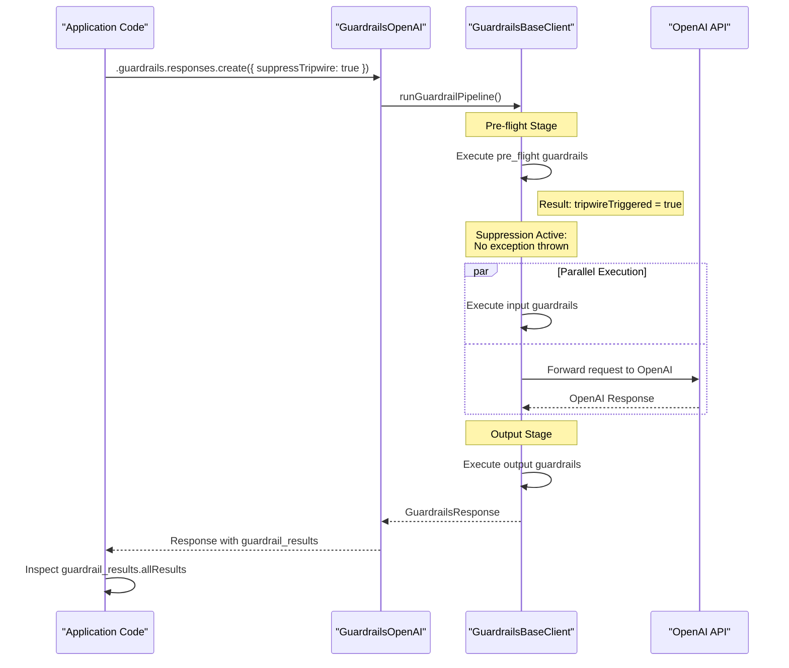
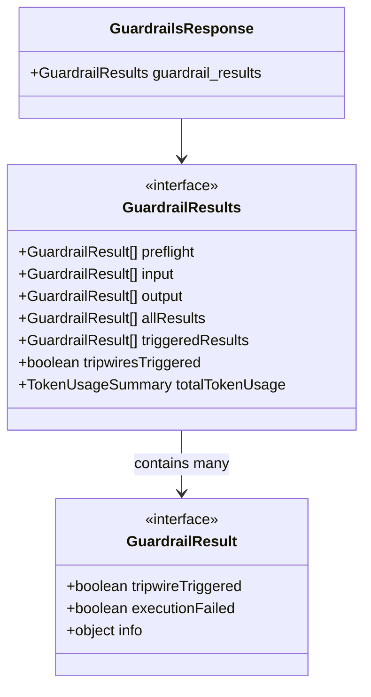
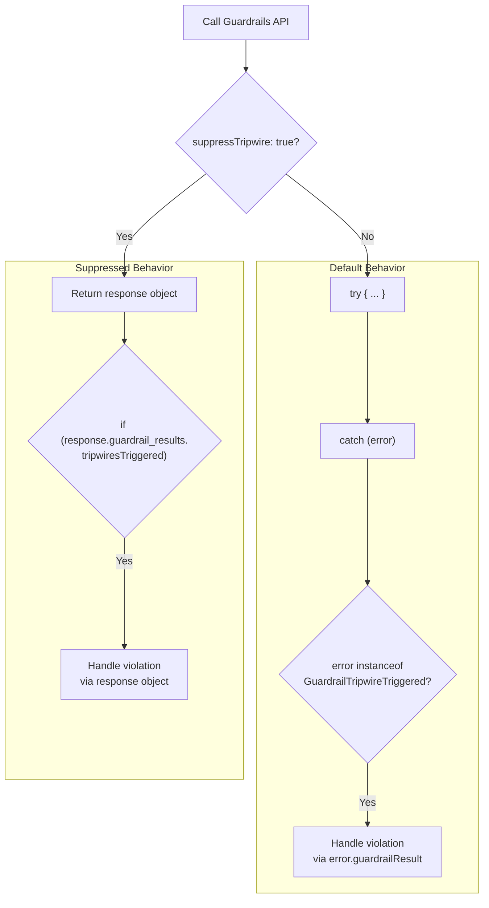

<!-- source: DeepWiki mcp.deepwiki.com · repo openai/openai-guardrails-js · page 4.2 Suppressing Tripwires · fetched 2026-10-26 -->

# Suppressing Tripwires

<details>
<summary>Relevant source files</summary>

The following files were used as context for generating this wiki page:

- [examples/basic/agents_sdk.ts](examples/basic/agents_sdk.ts)
- [examples/basic/azure_example.ts](examples/basic/azure_example.ts)
- [examples/basic/suppress_tripwire.ts](examples/basic/suppress_tripwire.ts)
- [src/base-client.ts](src/base-client.ts)
- [src/client.ts](src/client.ts)
- [src/types.ts](src/types.ts)

</details>


This page explains how to disable automatic exception-throwing behavior when guardrails detect violations, allowing manual handling of guardrail results. When `suppressTripwire` is enabled, API calls return normally with violation information embedded in the response instead of raising `GuardrailTripwireTriggered` exceptions.

For information about the default blocking behavior and exception structure, see [Default Blocking Behavior](4.1). For error handling during guardrail execution failures (as opposed to safety violations), see [Fail-Safe vs Fail-Secure Modes](4.3).

---

## The suppressTripwire Parameter

The `suppressTripwire` parameter (camelCase in the TypeScript SDK) disables automatic exception-throwing when tripwires are triggered. Instead of raising a `GuardrailTripwireTriggered` exception, the system returns a normal response with guardrail results included.

### Parameter Location

The `suppressTripwire` parameter is passed as an optional field in the API call request object for guardrail-aware resources:

| Integration Pattern | Resource Path | Parameter Usage |
|-------------------|-------------------|-------------------|
| `GuardrailsOpenAI` | `client.guardrails.responses` | `create({ suppressTripwire: true, ... })` |
| `GuardrailsOpenAI` | `client.guardrails.chat.completions` | `create({ suppressTripwire: true, ... })` |
| `GuardrailAgent` | N/A | Not supported (uses exception handling) |

**Sources:** [src/resources/responses.ts:46-52](), [src/resources/chat.ts:40-46](), [examples/basic/suppress_tripwire.ts:37-42]()

---

## Execution Flow with Suppression

The following diagram illustrates how the execution flow changes when `suppressTripwire: true` is set. Note how the system name `GuardrailsBaseClient` manages the orchestration between the `PipelineConfig` and the `OpenAI` client.

### Suppressed Tripwire Execution Flow



**Sources:** [src/base-client.ts:174-189](), [examples/basic/suppress_tripwire.ts:37-54]()

---

## Accessing Guardrail Results

When `suppressTripwire: true` is set, guardrail violation information is included in the response object rather than thrown as exceptions. The results are encapsulated in the `GuardrailResultsImpl` class.

### Response Structure

The response object is a `GuardrailsResponse`, which extends the standard OpenAI response types with a `guardrail_results` property.



### GuardrailResult Fields

Each element in `allResults` is a `GuardrailResult` object [src/types.ts:51-74]():

| Field | Type | Description |
|-------|------|-------------|
| `tripwireTriggered` | `boolean` | Whether this specific guardrail identified a critical failure. |
| `executionFailed` | `boolean` | True if the guardrail function itself crashed during execution. |
| `info` | `object` | Metadata including `guardrail_name`, `stage_name`, and check-specific data. |

### GuardrailResults Convenience Properties

The `GuardrailResultsImpl` class provides computed properties to simplify manual handling [src/base-client.ts:92-114]():

- `allResults`: A flattened array of results from all three stages (preflight, input, output).
- `tripwiresTriggered`: A boolean that is `true` if *any* result in any stage has `tripwireTriggered: true`.
- `triggeredResults`: A filtered array containing only the results that triggered tripwires.

**Sources:** [src/base-client.ts:79-114](), [src/types.ts:51-74]()

---

## Manual Violation Handling Patterns

With suppression enabled, applications must manually inspect the `guardrail_results` to detect and handle violations.

### Basic Inspection Pattern

```typescript
// From examples/basic/suppress_tripwire.ts
const response = await guardrailsClient.guardrails.responses.create({
  input: userInput,
  model: 'gpt-4.1-mini-2025-04-14',
  suppressTripwire: true,
});

// Check if any guardrails were triggered using the convenience property
if (response.guardrail_results.tripwiresTriggered) {
  for (const result of response.guardrail_results.triggeredResults) {
    const name = result.info?.guardrail_name;
    console.log(`🛑 Violation detected by ${name}`);
    // Access metadata like confidence or detected entities
    console.log(`Details: ${JSON.stringify(result.info)}`);
  }
}
```

**Sources:** [examples/basic/suppress_tripwire.ts:37-57](), [src/base-client.ts:103-109]()

### Common Handling Strategies

| Strategy | Use Case | Implementation |
|----------|----------|----------------|
| **Log and Continue** | Passive monitoring | Log `result.info` to an observability platform but show the LLM output. |
| **Fallback Response** | User safety | If `tripwiresTriggered` is true, discard `response.output_text` and return a canned safety message. |
| **Partial Redaction** | Data Privacy | Use `result.info.checked_text` (if provided by a masking guardrail) instead of the raw input. |

---

## Comparison: Suppressed vs Default Behavior

The following diagram contrasts the logic within the application code when suppression is toggled.

### Suppressed vs Default Tripwire Logic



### Behavior Comparison Table

| Aspect | Default Behavior | Suppressed Behavior |
|--------|------------------|---------------------|
| **On Violation** | Throws `GuardrailTripwireTriggered` | Returns `GuardrailsResponse` |
| **LLM Output** | Not returned if Input/Preflight triggers | Always returned (if LLM call succeeded) |
| **Control Flow** | Uses `try/catch` blocks | Uses `if/else` on response properties |
| **Metadata Access** | Via `error.guardrailResult` | Via `response.guardrail_results` |

**Sources:** [src/base-client.ts:99-114](), [examples/basic/suppress_tripwire.ts:35-65](), [examples/basic/azure_example.ts:168-176]()

---

## Integration with GuardrailAgent

The `GuardrailAgent` class, which wraps the `@openai/agents` SDK, **does not support suppression**. Because the Agents SDK relies on internal control loops, safety violations are always communicated via exceptions to prevent the agent from proceeding with a compromised state.

When using `GuardrailAgent`, you must catch `InputGuardrailTripwireTriggered` or `OutputGuardrailTripwireTriggered` from the `@openai/agents` package.

**Sources:** [examples/basic/agents_sdk.ts:124-140]()

---

