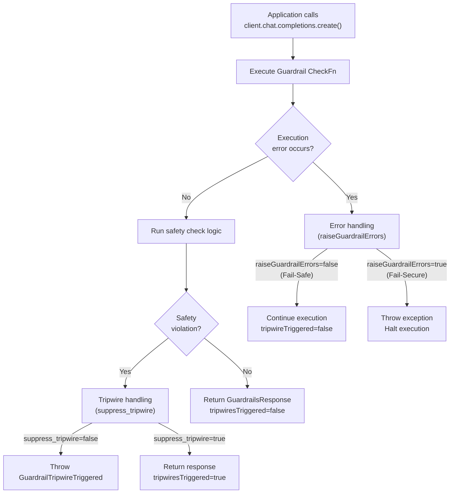
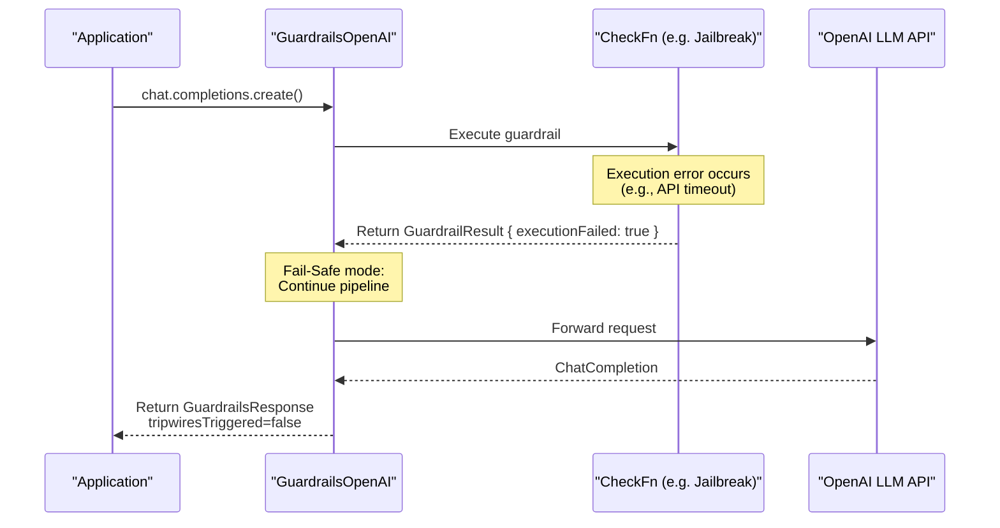
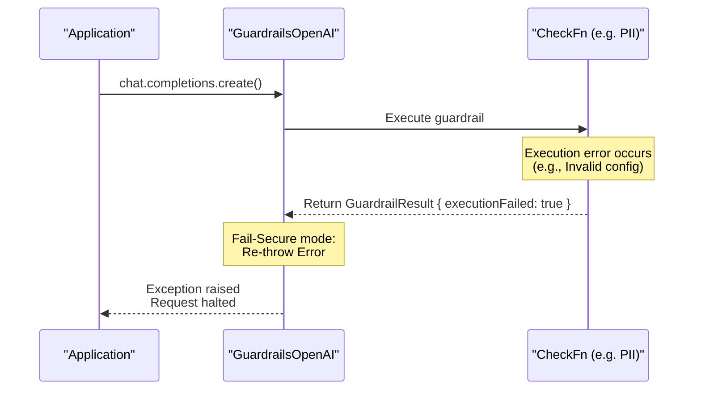
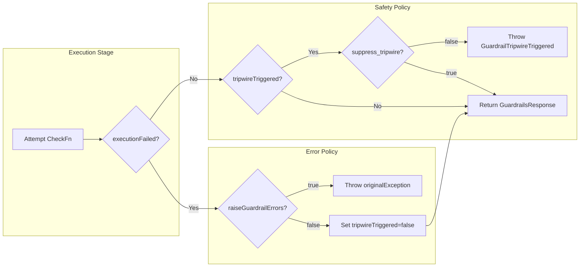

<!-- source: DeepWiki mcp.deepwiki.com · repo openai/openai-guardrails-js · page 4.3 Fail-Safe vs Fail-Secure Modes · fetched 2026-10-26 -->

# Fail-Safe vs Fail-Secure Modes

<details>
<summary>Relevant source files</summary>

The following files were used as context for generating this wiki page:

- [src/__tests__/unit/agents.test.ts](src/__tests__/unit/agents.test.ts)
- [src/__tests__/unit/types.test.ts](src/__tests__/unit/types.test.ts)
- [src/agents.ts](src/agents.ts)
- [src/base-client.ts](src/base-client.ts)
- [src/types.ts](src/types.ts)
- [src/utils/content.ts](src/utils/content.ts)

</details>


This page explains how the Guardrails framework handles **guardrail execution errors** (failures in running the guardrail checks themselves) through the `raiseGuardrailErrors` parameter. This is distinct from handling **safety violations** (when guardrails successfully detect policy violations), which is covered in [Default Blocking Behavior](#4.1) and [Suppressing Tripwires](#4.2).

**Key Distinction:**
- **Guardrail execution errors**: Technical failures when attempting to run a check (e.g., invalid model name, API timeout, configuration error). These are represented by the `executionFailed` property in a `GuardrailResult` [src/types.ts:55-55]().
- **Safety violations**: Successfully detected policy violations (e.g., hate speech detected by Moderation check). These are represented by the `tripwireTriggered` property in a `GuardrailResult` [src/types.ts:53-53]().

The `raiseGuardrailErrors` parameter controls only guardrail execution errors, not safety violations.

---

## Error Types in Guardrails

The framework distinguishes between two fundamentally different error scenarios:

| Error Type | Description | Example Scenarios | Controlled By |
|------------|-------------|-------------------|---------------|
| **Execution Error** | Guardrail check fails to run properly | Invalid model name, API timeout, missing configuration, network failure | `raiseGuardrailErrors` parameter [src/base-client.ts:150-150]() |
| **Safety Violation** | Guardrail check runs successfully and detects a violation | Hate speech detected, PII found, jailbreak attempt identified | `suppress_tripwire` parameter |

### Execution Error Flow



Sources: [src/types.ts:51-74](), [src/base-client.ts:145-150](), [src/agents.ts:201-216]()

---

## Fail-Safe Mode (Default)

**Default behavior**: `raiseGuardrailErrors = false` [src/base-client.ts:150-150]()

In Fail-Safe mode, the system prioritizes availability over strict enforcement. If a guardrail check encounters an execution error, the system:

1. Captures the original exception in `GuardrailResult.originalException` [src/types.ts:57-57]().
2. Sets `executionFailed` to `true` [src/types.ts:55-55]().
3. Continues processing the request.
4. Returns `tripwireTriggered = false` for the failed check.
5. Does not raise an exception to the application.

This mode assumes that a failure to execute a guardrail should not block the entire application flow.

### Configuration

```typescript
import { GuardrailsOpenAI } from '@openai/guardrails';

// Explicit Fail-Safe mode (same as default)
const client = await GuardrailsOpenAI.create({
    config,
    raiseGuardrailErrors: false // default
});

// Or simply omit the parameter
const client = await GuardrailsOpenAI.create({ config });
```

### Behavior on Execution Errors



Sources: [src/base-client.ts:145-150](), [src/types.ts:51-74]()

---

## Fail-Secure Mode

**Strict enforcement**: `raiseGuardrailErrors = true`

In Fail-Secure mode, the system prioritizes security and correctness over availability. If a guardrail check encounters an execution error, the system:

1. Immediately raises an exception (or re-throws the `originalException`).
2. Halts request processing.
3. Prevents potentially unsafe content from being processed or returned.

This mode assumes that if guardrails cannot execute properly, the request should not proceed.

### Configuration

```typescript
import { GuardrailsOpenAI } from '@openai/guardrails';

// Enable Fail-Secure mode
const client = await GuardrailsOpenAI.create({
    config,
    raiseGuardrailErrors: true
});
```

### Behavior on Execution Errors



Sources: [src/base-client.ts:150-150](), [src/agents.ts:210-216]()

---

## Mode Comparison

| Aspect | Fail-Safe Mode (Default) | Fail-Secure Mode |
|--------|-------------------------|------------------|
| **Parameter** | `raiseGuardrailErrors=false` | `raiseGuardrailErrors=true` |
| **On Execution Error** | Continue processing | Raise exception |
| **Availability** | Higher (errors don't block) | Lower (errors block) |
| **Security** | Lower (unvalidated content may pass) | Higher (no content passes without validation) |
| **Production Use** | Recommended for non-critical checks | Recommended for critical checks |
| **Error Visibility** | `executionFailed` set in result | Exception surfaces to application |
| **LLM Call** | Proceeds even if guardrail fails | Blocked if guardrail fails |

---

## Interaction with Tripwire Suppression

The `raiseGuardrailErrors` and `suppress_tripwire` parameters are **orthogonal** and control different error scenarios.

### Logic Flow for Guardrail Results



### Configuration Matrix

| `raiseGuardrailErrors` | `suppress_tripwire` | Execution Error Behavior | Safety Violation Behavior |
|------------------------|---------------------|--------------------------|---------------------------|
| `false` (default) | `false` (default) | Continue, `executionFailed: true` | Throw `GuardrailTripwireTriggered` |
| `false` (default) | `true` | Continue, `executionFailed: true` | Return result with `tripwiresTriggered: true` |
| `true` | `false` (default) | Throw exception | Throw `GuardrailTripwireTriggered` |
| `true` | `true` | Throw exception | Return result with `tripwiresTriggered: true` |

Sources: [src/base-client.ts:79-114](), [src/types.ts:51-74]()

---

## Integration with GuardrailAgent

The `GuardrailAgent` class also respects the `raiseGuardrailErrors` parameter during creation. This affects both `inputGuardrails` and `outputGuardrails` created by the agent factory [src/agents.ts:210-216]().

```typescript
import { GuardrailAgent } from '@openai/guardrails';

// Agent with Fail-Secure mode
const agent = await GuardrailAgent.create(
    config,
    "Support Agent",
    "Instructions...",
    {},         // agentKwargs
    true        // raiseGuardrailErrors = true
);
```

In `GuardrailAgent.create`, the parameter is passed to the underlying runtime to ensure that if any `CheckFn` fails to execute during agent tool calls or input processing, the agent execution halts immediately [src/agents.ts:201-221]().

Sources: [src/agents.ts:201-221](), [src/__tests__/unit/agents.test.ts:201-216]()

---

## Deciding Which Mode to Use

### Recommendations by Use Case

| Use Case | Recommended Mode | Rationale |
|----------|-----------------|-----------|
| **PII Detection** | Fail-Secure | Privacy-critical; content must not leak if check fails. |
| **Jailbreak Detection** | Fail-Secure | Security-critical; adversarial inputs must be blocked. |
| **Hallucination Detection** | Fail-Safe | Performance-heavy; transient vector store timeouts shouldn't block user experience. |
| **Keyword Filter** | Fail-Safe | Lower criticality; missing a banned word is less risky than service downtime. |
| **Development/CI** | Fail-Secure | Catch configuration errors (invalid YAML, missing keys) immediately. |

Sources: [src/types.ts:51-74](), [src/base-client.ts:145-150]()

---

