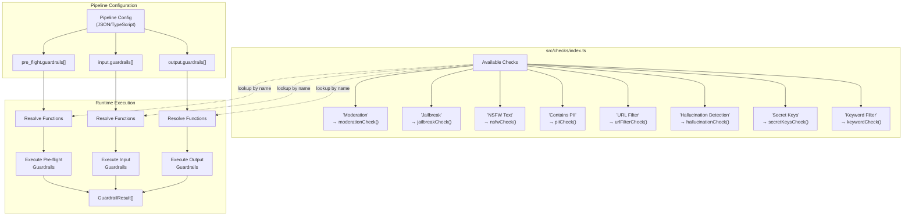
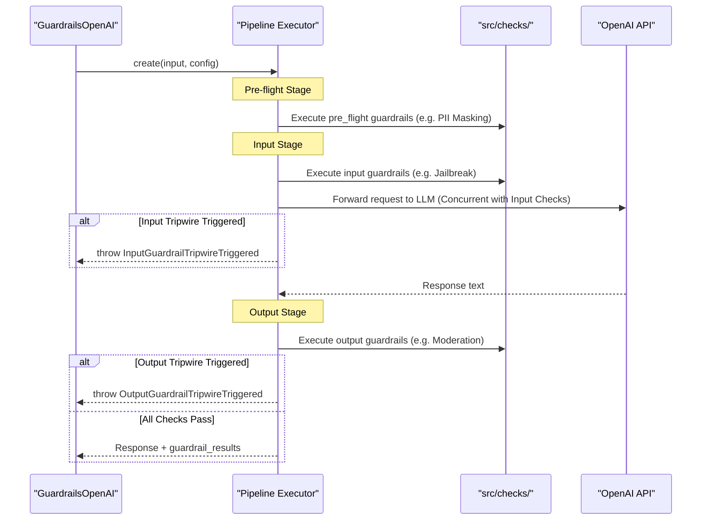

<!-- source: DeepWiki mcp.deepwiki.com · repo openai/openai-guardrails-js · page 5 Built-in Guardrails Reference · fetched 2026-10-26 -->

# Built-in Guardrails Reference

<details>
<summary>Relevant source files</summary>

The following files were used as context for generating this wiki page:

- [README.md](README.md)
- [docs/assets/images/guardrails-js-config-screenshot-100pct-q70.webp](docs/assets/images/guardrails-js-config-screenshot-100pct-q70.webp)
- [docs/index.md](docs/index.md)
- [docs/tripwires.md](docs/tripwires.md)
- [src/checks/index.ts](src/checks/index.ts)

</details>


This page catalogs all built-in guardrail checks provided by the framework, organized by functional category. Each guardrail validates specific aspects of LLM inputs or outputs and returns standardized results that can trigger tripwires or be handled manually.

For detailed configuration and usage of individual guardrails, see the category-specific pages: [Content Safety Guardrails](#5.1), [Data Protection Guardrails](#5.2), [Content Quality Guardrails](#5.3), and [Content Filtering Guardrails](#5.4). For information on configuring pipelines and stages, see [Pipeline Configuration Basics](#2.3). For tripwire behavior and exception handling, see [Tripwires and Error Handling](#4).

---

## Guardrail Categories

The framework organizes guardrails into four functional categories based on their validation purpose:

| Category | Purpose | Use Cases |
|----------|---------|-----------|
| **Content Safety** | Detect harmful, unsafe, or adversarial content | Moderation, jailbreak detection, NSFW filtering, prompt injection |
| **Data Protection** | Prevent exposure of sensitive information | PII detection, URL filtering, Secret Keys |
| **Content Quality** | Validate output accuracy and relevance | Hallucination detection, topic relevance, custom business logic |
| **Content Filtering** | Block specific patterns or competitor mentions | Keyword filtering, competitor detection |

All guardrails follow a consistent interface: they accept configuration parameters, execute validation logic, and return results that the pipeline uses to determine whether to trigger tripwires.

**Sources:** [README.md:181-190](), [docs/index.md:21-25](), [src/checks/index.ts:1-24]()

---

## Quick Reference Table

This table summarizes all available guardrails. Each guardrail name corresponds to the `name` field used in pipeline configurations.

| Guardrail Name | Category | Description | Typical Stage | Key Config Parameters |
|----------------|----------|-------------|---------------|----------------------|
| **Moderation** | Content Safety | OpenAI Moderation API for policy violations | `input`, `output` | `categories` |
| **Jailbreak** | Content Safety | Detects adversarial attempts to bypass safety measures | `input` | `model`, `confidence_threshold` |
| **NSFW Text** | Content Safety | Workplace-inappropriate content detection | `output` | `model`, `confidence_threshold` |
| **Prompt Injection Detection** | Content Safety | Tool-level prompt injection attacks | `input` | `model` |
| **Contains PII** | Data Protection | Personally Identifiable Information detection | `pre_flight`, `input`, `output` | `entities`, `masking_mode` |
| **URL Filter** | Data Protection | Domain allowlist/blocklist filtering | `output` | `allowed_domains`, `blocked_domains` |
| **Secret Keys** | Data Protection | Detects API keys and credentials | `output` | `threshold` |
| **Hallucination Detection** | Content Quality | Vector store-based factual validation | `output` | `vector_store_id`, `confidence_threshold` |
| **Off Topic Prompts** | Content Quality | Business scope validation | `input` | `allowed_topics`, `model` |
| **Custom Prompt Check** | Content Quality | User-defined LLM-based validation | `input`, `output` | `system_prompt`, `model` |
| **Keyword Filter** | Content Filtering | Banned word/phrase detection | `input`, `output` | `keywords` |
| **Competitor Detection** | Content Filtering | Flags mentions of competitor names | `output` | `competitors` |

**Sources:** [README.md:181-190](), [docs/index.md:21-25](), [src/checks/index.ts:12-23]()

---

## Guardrail Registry Architecture

The guardrail system uses a centralized registry pattern to manage available checks. The module exports in `src/checks/index.ts` expose the individual check functions that are mapped to configuration names.



**Diagram: Guardrail Registry Resolution and Execution Flow**

The architecture ensures:
- **Declarative Configuration**: Users specify guardrails by name in JSON/TypeScript configs [README.md:47]().
- **Loose Coupling**: Pipeline logic is decoupled from specific guardrail implementations.
- **Stage Specificity**: Guardrails can be targeted at specific lifecycle stages (pre-flight, input, or output) [README.md:45-48]().

**Sources:** [src/checks/index.ts:1-24](), [README.md:38-49](), [docs/index.md:33-41]()

---

## Configuration Structure

Each guardrail in a pipeline configuration follows this structure:

```json
{
  "name": "GuardrailName",
  "config": {
    "param1": "value1",
    "param2": "value2"
  }
}
```

### Common Configuration Patterns

| Pattern | Description | Example |
|---------|-------------|---------|
| **Model Selection** | LLM-based guardrails accept a `model` parameter | `"model": "gpt-4o"` |
| **Confidence Thresholds** | LLM-based guardrails use `confidence_threshold` (0.0-1.0) | `"confidence_threshold": 0.7` |
| **Category Filters** | Some guardrails filter by category/type | `"categories": ["hate", "violence"]` |
| **External Resources** | Some guardrails reference external resources | `"vector_store_id": "vs_abc123"` |
| **List-based Filters** | Allow/block lists for filtering | `"allowed_domains": ["example.com"]` |

**Sources:** [README.md:47](), [docs/tripwires.md:25](), [docs/index.md:38]()

---

## GuardrailResult Structure

All guardrails return a standardized result. The pipeline aggregates these and uses them to determine tripwire behavior.

### Standard Fields

When a guardrail triggers a tripwire, the `GuardrailTripwireTriggered` exception provides access to the result info:

```typescript
{
  guardrail_name: string;      // Name of the guardrail that executed
  stage_name: string;           // Pipeline stage: "pre_flight", "input", or "output"
  flagged: boolean;             // Whether the guardrail detected a violation
}
```

### Example Result Handling

```typescript
try {
  const response = await client.responses.create({
    model: 'gpt-4o',
    input: 'Hello world',
  });
} catch (error) {
  if (error.constructor.name === 'GuardrailTripwireTriggered') {
    // Access guardrailResult.info for metadata
    console.log(`Guardrail triggered: ${error.guardrailResult.info.guardrail_name}`);
  }
}
```

**Sources:** [README.md:59-63](), [docs/tripwires.md:67-81]()

---

## Execution Flow and Result Aggregation

This diagram shows how guardrails execute across pipeline stages.



**Diagram: Guardrail Execution Flow Across Pipeline Stages**

### Stage Timing

| Stage | Timing | Typical Use Cases |
|-------|--------|-------------------|
| **pre_flight** | Before LLM call | Input transformation (e.g., PII masking) |
| **input** | Concurrent with LLM | Adversarial detection (jailbreak, injection) |
| **output** | After LLM response | Content safety and quality (moderation, hallucination) |

**Sources:** [README.md:45-48](), [docs/index.md:11](), [docs/tripwires.md:7-10]()

---

## Category-Specific Details

For detailed information on each guardrail, see the following child pages:

- **[Content Safety Guardrails](#5.1)**: Focuses on protecting the model from adversarial attacks and ensuring safe content generation.
- **[Data Protection Guardrails](#5.2)**: Focuses on privacy, preventing data leaks, and securing credentials.
- **[Content Quality Guardrails](#5.3)**: Focuses on the accuracy, relevance, and business-alignment of the output.
- **[Content Filtering Guardrails](#5.4)**: Focuses on specific pattern matching, such as keyword blocking and competitor mentions.

**Sources:** [README.md:181-190](), [src/checks/index.ts:12-23]()

---

## Implementation Files

Built-in guardrails are located in the `src/checks/` directory:

- [src/checks/moderation.ts]() - Moderation guardrail
- [src/checks/jailbreak.ts]() - Jailbreak detection
- [src/checks/nsfw.ts]() - NSFW text detection
- [src/checks/pii.ts]() - PII detection
- [src/checks/urls.ts]() - URL filtering
- [src/checks/hallucination-detection.ts]() - Hallucination detection
- [src/checks/topical-alignment.ts]() - Off topic detection
- [src/checks/user-defined-llm.ts]() - Custom prompt check
- [src/checks/keywords.ts]() - Keyword filter
- [src/checks/competitors.ts]() - Competitor detection
- [src/checks/secret-keys.ts]() - Secret keys detection
- [src/checks/prompt_injection_detection.ts]() - Prompt injection detection

**Sources:** [src/checks/index.ts:12-23](), [README.md:140]()

---

