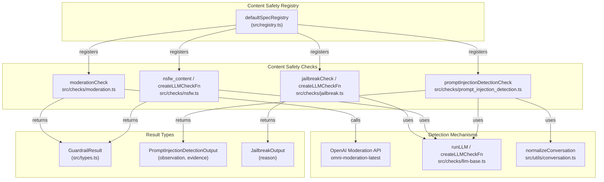
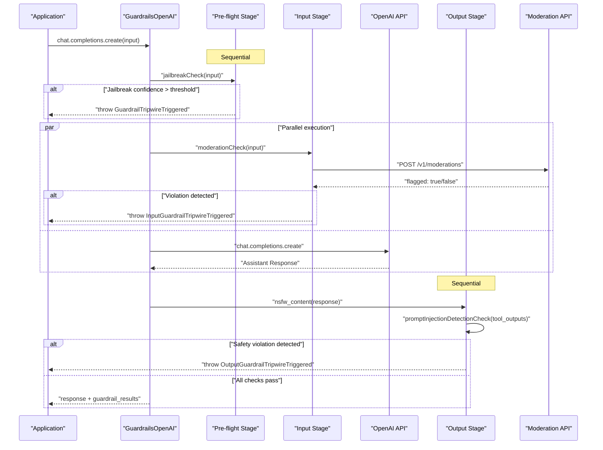

<!-- source: DeepWiki mcp.deepwiki.com · repo openai/openai-guardrails-js · page 5.1 Content Safety Guardrails · fetched 2026-10-26 -->

# Content Safety Guardrails

Relevant source files

The following files were used as context for generating this wiki page:

- [src/__tests__/unit/checks/moderation-secret-keys.test.ts](src/__tests__/unit/checks/moderation-secret-keys.test.ts)
- [src/checks/jailbreak.ts](src/checks/jailbreak.ts)
- [src/checks/moderation.ts](src/checks/moderation.ts)
- [src/checks/nsfw.ts](src/checks/nsfw.ts)
- [src/checks/prompt_injection_detection.ts](src/checks/prompt_injection_detection.ts)

Content Safety guardrails protect LLM applications from generating or processing harmful, inappropriate, or policy-violating content. This category includes four built-in checks that detect different types of unsafe content: policy violations, jailbreak attempts, workplace-inappropriate material, and prompt injection attacks.

For data privacy checks (PII, URLs), see [Data Protection Guardrails](#5.2). For output quality checks, see [Content Quality Guardrails](#5.3).

## Overview

Content Safety guardrails focus on preventing harm and policy violations. They operate at different layers of safety enforcement:

| Guardrail | Purpose | Enforcement Level | Primary Stage |
|-----------|---------|-------------------|---------------|
| **Moderation** | Detect strict policy violations (hate, violence, self-harm, sexual content) | Hard policy boundary | Input/Output |
| **Jailbreak Detection** | Identify adversarial attempts to bypass safety measures | Attack pattern detection | Input |
| **NSFW Text Detection** | Flag workplace-inappropriate content | Soft professional boundary | Output |
| **Prompt Injection Detection** | Detect tool-level prompt manipulation in agent systems | Tool security | Input/Output (Tools) |

**Sources:** [src/checks/moderation.ts:4-19](), [src/checks/jailbreak.ts:1-8](), [src/checks/nsfw.ts:1-7](), [src/checks/prompt_injection_detection.ts:1-11]()

## Content Safety Checks Architecture

The following diagram maps the high-level safety concepts to the specific code entities that implement them.

**Sources:** [src/checks/moderation.ts:141-145](), [src/checks/jailbreak.ts:12-19](), [src/checks/nsfw.ts:75-81](), [src/checks/prompt_injection_detection.ts:167-172](), [src/registry.ts:1-10]()

## When to Use Each Check

Content Safety guardrails serve complementary purposes and are often used together:

### Moderation
- **Use for:** Strict policy enforcement (hate speech, violence, sexual content, self-harm).
- **Typical stage:** Both input and output.
- **Enforcement:** Hard boundary - blocks content violating OpenAI usage policies using the `omni-moderation-latest` model [src/checks/moderation.ts:115-117]().
- **Detection method:** OpenAI Moderation API.
- **Configuration:** Category-based selection via `ModerationConfig` [src/checks/moderation.ts:55-60]().

For details, see [Moderation](#5.1.1).

**Sources:** [src/checks/moderation.ts:33-47](), [src/checks/moderation.ts:141-145]()

### Jailbreak Detection
- **Use for:** Detecting adversarial attempts to bypass safety measures.
- **Typical stage:** Input (pre-flight or input stage).
- **Focus:** Attack patterns like character-level obfuscation, competing objectives, and multi-turn escalation [src/checks/jailbreak.ts:44-118]().
- **Detection method:** LLM-based analysis using a specialized taxonomy.
- **Configuration:** `model` selection and `confidence_threshold` (default: 0.7) [src/checks/jailbreak.ts:17-19]().

For details, see [Jailbreak Detection](#5.1.2).

**Sources:** [src/checks/jailbreak.ts:37-160]()

### NSFW Text Detection
- **Use for:** Workplace appropriateness and professional content filtering.
- **Typical stage:** Output.
- **Focus:** Profanity, explicit sexual content, adult themes, and inappropriate workplace content [src/checks/nsfw.ts:47-67]().
- **Detection method:** LLM-based analysis via `createLLMCheckFn` [src/checks/nsfw.ts:75-81]().
- **Relationship to Moderation:** A "softer" filter that flags content which might be professionaly inappropriate even if not strictly violating legal/safety policies.

For details, see [NSFW Text Detection](#5.1.3).

**Sources:** [src/checks/nsfw.ts:1-7](), [src/checks/nsfw.ts:75-81]()

### Prompt Injection Detection
- **Use for:** Tool-calling agents where external tool outputs might contain malicious instructions.
- **Typical stage:** Pre-flight (tool calls) and Output (tool outputs) [src/checks/prompt_injection_detection.ts:9-11]().
- **Focus:** Detecting when tool calls or outputs override the user's original goal [src/checks/prompt_injection_detection.ts:105-115]().
- **Detection method:** LLM-based multi-turn analysis of conversation history [src/checks/prompt_injection_detection.ts:5-7]().

For details, see [Prompt Injection Detection](#5.1.4).

**Sources:** [src/checks/prompt_injection_detection.ts:1-11](), [src/checks/prompt_injection_detection.ts:105-165]()

## Execution Flow

The following sequence diagram illustrates how safety checks are orchestrated within the `GuardrailsOpenAI` client lifecycle.

**Sources:** [src/checks/moderation.ts:141-145](), [src/checks/jailbreak.ts:12-19](), [src/checks/prompt_injection_detection.ts:167-172]()

## GuardrailResult and Tripwires

All Content Safety guardrails return a `GuardrailResult` [src/types.ts:114-135](). If `tripwireTriggered` is true, the framework will throw an exception unless `suppress_tripwire` is configured.

### Common Metadata
LLM-based checks (Jailbreak, NSFW, Prompt Injection) include confidence scores and reasoning in the `info` object:
- `flagged`: Boolean result of the check.
- `confidence`: Numerical score (0.0 to 1.0).
- `reasoning`: (Optional) The LLM's justification for the decision [src/checks/prompt_injection_detection.ts:88-98]().

### Moderation Metadata
The `moderationCheck` returns specific category flags:
- `flagged_categories`: List of categories that triggered the tripwire [src/__tests__/unit/checks/moderation-secret-keys.test.ts:54]().
- `category_details`: Full map of category results from the OpenAI API [src/__tests__/unit/checks/moderation-secret-keys.test.ts:56-59]().

**Sources:** [src/types.ts:114-135](), [src/checks/moderation.ts:141-145](), [src/checks/prompt_injection_detection.ts:88-98]()

## Next Steps

- [Moderation](#5.1.1) — OpenAI API categories and configuration.
- [Jailbreak Detection](#5.1.2) — Tuning thresholds and adversarial taxonomy.
- [NSFW Text Detection](#5.1.3) — Content categories and professional filtering.
- [Prompt Injection Detection](#5.1.4) — Protecting tool-calling agents and multi-turn analysis.

---

