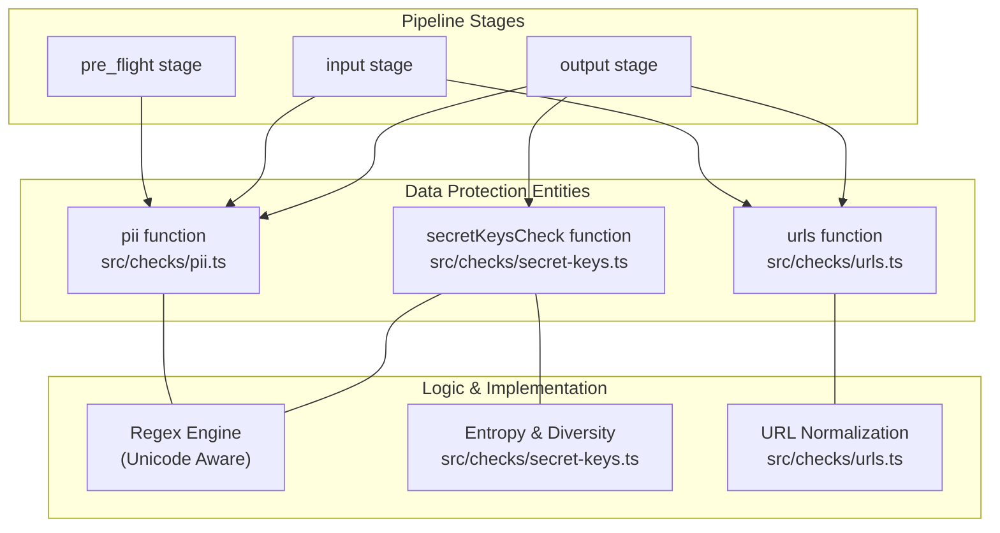
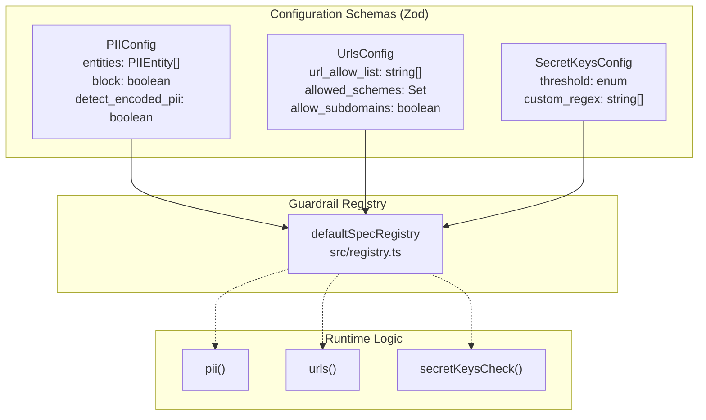

<!-- source: DeepWiki mcp.deepwiki.com · repo openai/openai-guardrails-js · page 5.2 Data Protection Guardrails · fetched 2026-10-26 -->

# Data Protection Guardrails

Relevant source files

The following files were used as context for generating this wiki page:

- [docs/ref/checks/pii.md](docs/ref/checks/pii.md)
- [src/__tests__/unit/checks/keywords-urls.test.ts](src/__tests__/unit/checks/keywords-urls.test.ts)
- [src/__tests__/unit/checks/pii.test.ts](src/__tests__/unit/checks/pii.test.ts)
- [src/checks/keywords.ts](src/checks/keywords.ts)
- [src/checks/pii.ts](src/checks/pii.ts)
- [src/checks/secret-keys.ts](src/checks/secret-keys.ts)
- [src/checks/urls.ts](src/checks/urls.ts)

## Purpose and Scope

This page provides an overview of the **Data Protection** category of built-in guardrails, which focus on privacy and security validation. These guardrails protect against the exposure or processing of sensitive information by detecting personally identifiable information (PII), filtering URL access patterns, and identifying secret keys or credentials.

The Data Protection category includes three guardrails:
- **Contains PII**: Detects and optionally masks personally identifiable information using regex patterns.
- **URL Filter**: Validates URLs against allowlists and blocklists with scheme enforcement.
- **Secret Keys**: Scans for API keys, tokens, and credentials using entropy and pattern analysis.

For detailed implementation guides, see [PII Detection](#5.2.1), [URL Filter](#5.2.2), and [Secret Keys Detection](#5.2.3).

**Sources:** [src/checks/pii.ts:2-11](), [src/checks/urls.ts:2-6](), [src/checks/secret-keys.ts:2-7]()

---

## Data Protection Guardrails Summary

The following table summarizes the available data protection guardrails:

| Guardrail Name | Primary Function | Key Features | Typical Stage Placement |
|----------------|-----------------|--------------|------------------------|
| **Contains PII** | Detect and mask PII entities | 40+ entity types; Masking or blocking modes; Encoded PII detection. | `pre_flight` (for masking) `output` (for blocking) |
| **URL Filter** | Validate URL domains | Allowlist/Blocklist; Scheme restriction (HTTPS default); Subdomain support. | `output` (validate generated URLs) |
| **Secret Keys** | Detect credentials | Entropy & diversity checks; Common prefix matching; Custom regex support. | `output` (prevent leakage) |

**Sources:** [src/checks/pii.ts:13-16](), [src/checks/urls.ts:64-75](), [src/checks/secret-keys.ts:16-21]()

---

## Data Protection Pipeline Architecture

The following diagram illustrates how data protection guardrails associate with specific code entities and integrate into the pipeline:

**Sources:** [src/checks/pii.ts:27](), [src/checks/urls.ts:252](), [src/checks/secret-keys.ts:277-284]()

---

## Configuration Structure Mapping

This diagram maps configuration schemas (defined via Zod) to the guardrail execution logic:

**Sources:** [src/checks/pii.ts:164-176](), [src/checks/urls.ts:64-75](), [src/checks/secret-keys.ts:16-21](), [src/checks/pii.ts:743-752]()

---

## Configuration Highlights

### Contains PII: Masking vs. Blocking
The PII guardrail behavior is controlled by the `block` parameter. 
- **Masking (`block: false`)**: Replaces sensitive data with tokens like `<EMAIL_ADDRESS>`. This is **only supported in the `pre_flight` stage** [src/checks/pii.ts:13-16]().
- **Blocking (`block: true`)**: Triggers a tripwire if PII is found. Recommended for the `output` stage to prevent leakage [src/checks/pii.ts:15-16]().

### URL Filter: Security Defaults
The `UrlsConfig` defaults to `allowed_schemes: ['https']` and `block_userinfo: true` to prevent credential injection and insecure redirects [src/checks/urls.ts:67-72]().

### Secret Keys: Sensitivity Levels
The Secret Keys guardrail uses three presets: `strict`, `balanced`, and `permissive`. These adjust the Shannon entropy and character diversity requirements for a string to be flagged as a secret [src/checks/secret-keys.ts:109-136]().

---

## Guardrail Comparison Table

| Aspect | Contains PII | URL Filter | Secret Keys |
|--------|-------------|------------|-------------|
| **Detection mechanism** | Regex patterns | Domain/IP parsing | Entropy + Patterns |
| **Supports Masking** | Yes (`<ENTITY>`) | No | Yes (`<SECRET>`) |
| **Encoded Detection** | Yes (Base64/Hex/URL) | No | No |
| **Customization** | Entity selection | Allowlists/Blocklists | Custom Regex |
| **Key Source File** | `src/checks/pii.ts` | `src/checks/urls.ts` | `src/checks/secret-keys.ts` |

**Sources:** [src/checks/pii.ts:172-175](), [src/checks/urls.ts:64-75](), [src/checks/secret-keys.ts:19-20, 248-254]()

---

## Next Steps

- **[PII Detection](#5.2.1)**: Learn about supported `PIIEntity` types and encoded PII detection.
- **[URL Filter](#5.2.2)**: Configure domain allowlists and scheme restrictions.
- **[Secret Keys Detection](#5.2.3)**: Understand entropy thresholds and custom credential patterns.

---

