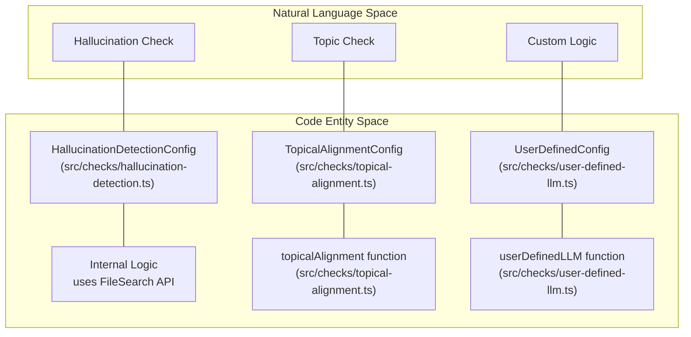
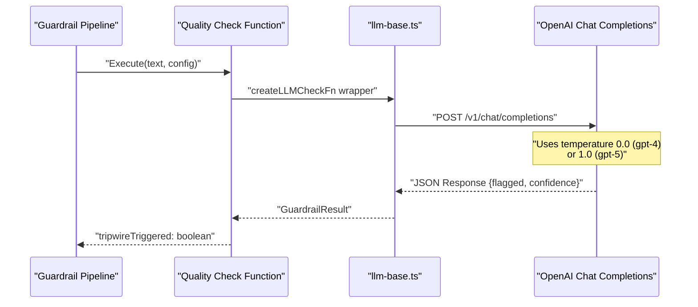

<!-- source: DeepWiki mcp.deepwiki.com · repo openai/openai-guardrails-js · page 5.3 Content Quality Guardrails · fetched 2026-10-26 -->

# Content Quality Guardrails

<details>
<summary>Relevant source files</summary>

The following files were used as context for generating this wiki page:

- [docs/ref/checks/hallucination_detection.md](docs/ref/checks/hallucination_detection.md)
- [src/__tests__/unit/checks/topical-alignment.test.ts](src/__tests__/unit/checks/topical-alignment.test.ts)
- [src/__tests__/unit/checks/user-defined-llm.test.ts](src/__tests__/unit/checks/user-defined-llm.test.ts)
- [src/checks/hallucination-detection.ts](src/checks/hallucination-detection.ts)
- [src/checks/topical-alignment.ts](src/checks/topical-alignment.ts)
- [src/checks/user-defined-llm.ts](src/checks/user-defined-llm.ts)

</details>


## Purpose and Scope

Content Quality Guardrails validate the accuracy, relevance, and appropriateness of LLM outputs. Unlike Content Safety Guardrails ([Content Safety Guardrails](#5.1)) which focus on policy violations and harmful content, or Data Protection Guardrails ([Data Protection Guardrails](#5.2)) which handle sensitive information, this category ensures model responses meet quality standards for factual accuracy, topic alignment, and custom business requirements.

This page provides an overview of the three content quality checks. For detailed configuration and benchmarking information, see the individual child pages:
- **Hallucination Detection ([Hallucination Detection](#5.3.1))**: Validates claims against reference documents.
- **Off Topic Prompts ([Off Topic Prompts](#5.3.2))**: Ensures conversations stay within business scope.
- **Custom Prompt Check ([Custom Prompt Check](#5.3.3))**: Implements arbitrary LLM-based validation logic.

**Sources:** [docs/ref/checks/hallucination_detection.md:1-7](), [src/checks/hallucination-detection.ts:4-7](), [src/checks/topical-alignment.ts:4-7](), [src/checks/user-defined-llm.ts:4-7]()

## Overview of Content Quality Guardrails

The framework includes three content quality guardrails, each serving distinct validation purposes:

| Guardrail | Primary Purpose | Implementation Method | Typical Stage |
|-----------|----------------|----------------------|---------------|
| **Hallucination Detection** | Validates factual accuracy against a knowledge base | OpenAI FileSearch API + Vector Stores | Output |
| **Off Topic Prompts** | Ensures responses stay within defined business scope | LLM-based topic classification | Input or Output |
| **Custom Prompt Check** | Implements user-defined validation logic | LLM-based with custom system prompts | Input or Output |

**Sources:** [src/checks/hallucination-detection.ts:37-57](), [src/checks/topical-alignment.ts:18-21](), [src/checks/user-defined-llm.ts:18-21]()

## Code-to-Logic Mapping

The following diagram maps the high-level quality concepts to the specific classes and files that implement them.



**Diagram 1: Mapping Quality Concepts to Code Entities**

**Sources:** [src/checks/hallucination-detection.ts:37-57](), [src/checks/topical-alignment.ts:53-60](), [src/checks/user-defined-llm.ts:45-52]()

## Configuration Patterns

### Basic Configuration Example

Each content quality guardrail requires specific configuration parameters. Note that Hallucination Detection specifically requires a `knowledge_source` (Vector Store ID).

```json
{
  "version": 1,
  "output": {
    "version": 1,
    "guardrails": [
      {
        "name": "Hallucination Detection",
        "config": {
          "knowledge_source": "vs_abc123",
          "model": "gpt-4o-mini",
          "confidence_threshold": 0.7,
          "include_reasoning": true
        }
      },
      {
        "name": "Off Topic Prompts",
        "config": {
          "system_prompt_details": "customer support for banking services",
          "model": "gpt-4o-mini",
          "confidence_threshold": 0.7
        }
      },
      {
        "name": "Custom Prompt Check",
        "config": {
          "system_prompt_details": "Evaluate if the response contains medical advice.",
          "model": "gpt-4o-mini",
          "confidence_threshold": 0.8
        }
      }
    ]
  }
}
```

**Sources:** [docs/ref/checks/hallucination_detection.md:11-21](), [src/checks/hallucination-detection.ts:37-57](), [src/checks/topical-alignment.ts:18-21](), [src/checks/user-defined-llm.ts:18-21]()

## Execution Flow and API Integration

The quality guardrails often rely on LLM-based evaluation. The `createLLMCheckFn` utility standardizes how these checks call the OpenAI API.



**Diagram 2: LLM-Based Quality Check Sequence**

**Sources:** [src/checks/topical-alignment.ts:53-60](), [src/__tests__/unit/checks/topical-alignment.test.ts:112-151](), [src/__tests__/unit/checks/user-defined-llm.test.ts:114-151]()

## Common Configuration Parameters

All content quality guardrails share a base configuration pattern:

| Parameter | Type | Purpose | Default | Tuning Guidance |
|-----------|------|---------|---------|-----------------|
| `model` | string | LLM model for detection | Required | Use `gpt-4o-mini` for cost-effective quality checks. |
| `confidence_threshold` | number | Minimum confidence to trigger | 0.7 | Increase to 0.8+ to reduce false flags in Hallucination detection. |
| `include_reasoning` | boolean | Include explanation in `info` | false | Set to `true` during development to debug quality failures. |

**Guardrail-Specific Parameters:**

| Guardrail | Unique Parameters | Description |
|-----------|------------------|-------------|
| Hallucination Detection | `knowledge_source` | Vector store ID (must start with `vs_`) containing reference documents. |
| Off Topic Prompts | `system_prompt_details` | Natural language description of allowed business scope. |
| Custom Prompt Check | `system_prompt_details` | User-defined instructions for arbitrary moderation logic. |

**Sources:** [src/checks/hallucination-detection.ts:37-57](), [src/checks/topical-alignment.ts:18-21](), [src/checks/user-defined-llm.ts:18-21](), [docs/ref/checks/hallucination_detection.md:25-31]()

## Performance and Latency

Performance varies significantly based on the check type:

- **Hallucination Detection**: Highest latency due to the [OpenAI FileSearch API](https://platform.openai.com/docs/guides/tools-file-search) requirements. Disabling `include_reasoning` can reduce median latency by ~40%. [docs/ref/checks/hallucination_detection.md:31-33]()
- **Off Topic & Custom Checks**: Standard LLM inference latency. Performance depends on the complexity of the `system_prompt_details` and the chosen `model`. [src/checks/topical-alignment.ts:40-45]()

## Next Steps

- **Factual Validation**: See [Hallucination Detection](#5.3.1) for vector store setup and FileSearch API details.
- **Domain Enforcement**: See [Off Topic Prompts](#5.3.2) to define business scopes.
- **Custom Logic**: See [Custom Prompt Check](#5.3.3) to implement specialized validation rules.

**Sources:** [docs/ref/checks/hallucination_detection.md:1-33](), [src/checks/topical-alignment.ts:1-7](), [src/checks/user-defined-llm.ts:1-7]()

---

