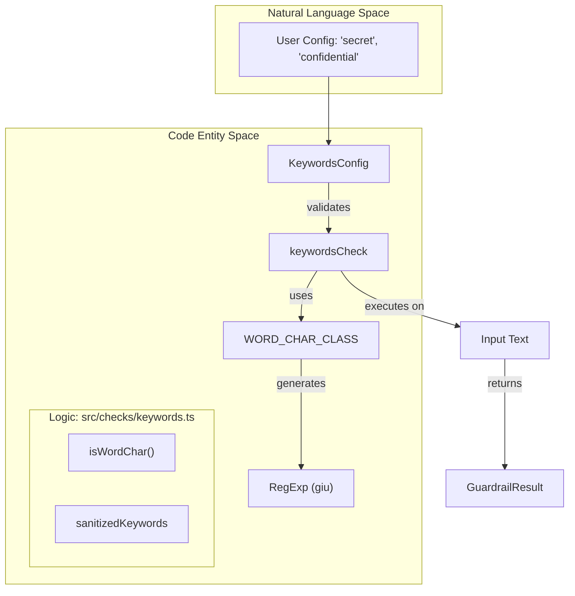
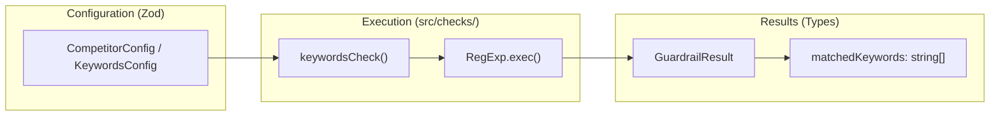

<!-- source: DeepWiki mcp.deepwiki.com · repo openai/openai-guardrails-js · page 5.4 Content Filtering Guardrails · fetched 2026-10-26 -->

# Content Filtering Guardrails

Relevant source files

The following files were used as context for generating this wiki page:

- [docs/ref/checks/keywords.md](docs/ref/checks/keywords.md)
- [docs/ref/checks/moderation.md](docs/ref/checks/moderation.md)
- [docs/ref/checks/secret_keys.md](docs/ref/checks/secret_keys.md)
- [src/__tests__/unit/checks/keywords-urls.test.ts](src/__tests__/unit/checks/keywords-urls.test.ts)
- [src/checks/competitors.ts](src/checks/competitors.ts)
- [src/checks/keywords.ts](src/checks/keywords.ts)
- [src/checks/urls.ts](src/checks/urls.ts)

Content filtering guardrails provide a robust mechanism for detecting and blocking specific text patterns, banned words, or competitor mentions within LLM inputs and outputs. Unlike LLM-based checks that rely on probabilistic reasoning, these guardrails primarily utilize high-performance, Unicode-aware regular expressions to ensure deterministic safety boundaries.

The framework provides two primary guardrails in this category:
1.  **Keyword Filter**: A general-purpose tool for blocking specific terms or phrases.
2.  **Competitor Detection**: A specialized implementation of the keyword filter designed to prevent the mention of rival products or companies.

### Architectural Integration

These guardrails are registered in the `defaultSpecRegistry` [src/checks/keywords.ts:127-135]() and [src/checks/competitors.ts:68-76]() and can be used in any stage of the pipeline (`pre_flight`, `input`, or `output`).

#### Natural Language to Code Entity Space: Filtering Flow
This diagram illustrates how a user-defined list of "banned words" is transformed into a regex-based `CheckFn` within the guardrails engine.

**Sources:** [src/checks/keywords.ts:15-20](), [src/checks/keywords.ts:43-50](), [src/checks/keywords.ts:52-60]()

---

### Keyword Filter

The **Keyword Filter** is designed to identify and block specific strings. It is highly optimized for accuracy, using Unicode-aware word boundaries to prevent "partial matches" (e.g., it will not flag "password" if you are only looking for "pass").

Key features include:
*   **Sanitization**: Automatically strips trailing punctuation from keywords (e.g., "secret!!!" becomes "secret") to ensure matches even when words appear at the end of sentences [src/checks/keywords.ts:61-62]().
*   **Unicode Support**: Uses `\p{L}` and `\p{N}` categories to support non-Latin scripts like Chinese or Arabic [src/checks/keywords.ts:43-50]().
*   **Case Insensitivity**: Matches are found regardless of casing using the `giu` regex flags [src/checks/keywords.ts:97]().

For detailed configuration and examples, see [Keyword Filter](#5.4.1).

**Sources:** [src/checks/keywords.ts:52-124](), [src/__tests__/unit/checks/keywords-urls.test.ts:11-206]()

---

### Competitor Detection

The **Competitor Detection** guardrail is a specialized wrapper around the Keyword Filter. It is specifically intended for output validation to ensure that an LLM does not inadvertently promote or mention competing brands or products.

While it shares the underlying regex engine with the Keyword Filter, it is registered as a distinct entity in the system to allow for cleaner configuration and specific reporting in the `guardrail_name` field of the `GuardrailResult` [src/checks/competitors.ts:57-64]().

For implementation details and use cases, see [Competitor Detection](#5.4.2).

**Sources:** [src/checks/competitors.ts:45-65](), [src/checks/competitors.ts:68-76]()

---

### Data Flow: Filtering Logic

The following diagram bridges the configuration objects defined in TypeScript to the runtime execution logic used during a request.

**Sources:** [src/checks/keywords.ts:15-20](), [src/checks/keywords.ts:114-123](), [src/checks/competitors.ts:19-22]()

### Summary Table

| Guardrail | Purpose | Implementation | Typical Stage |
| :--- | :--- | :--- | :--- |
| **Keyword Filter** | Block specific banned terms/phrases | Regex (Unicode-aware) | Input or Output |
| **Competitor Detection** | Prevent mention of rival brands | Wrapper for `keywordsCheck` | Output |

**Sources:** [src/checks/keywords.ts:127-135](), [src/checks/competitors.ts:68-76]()

---

