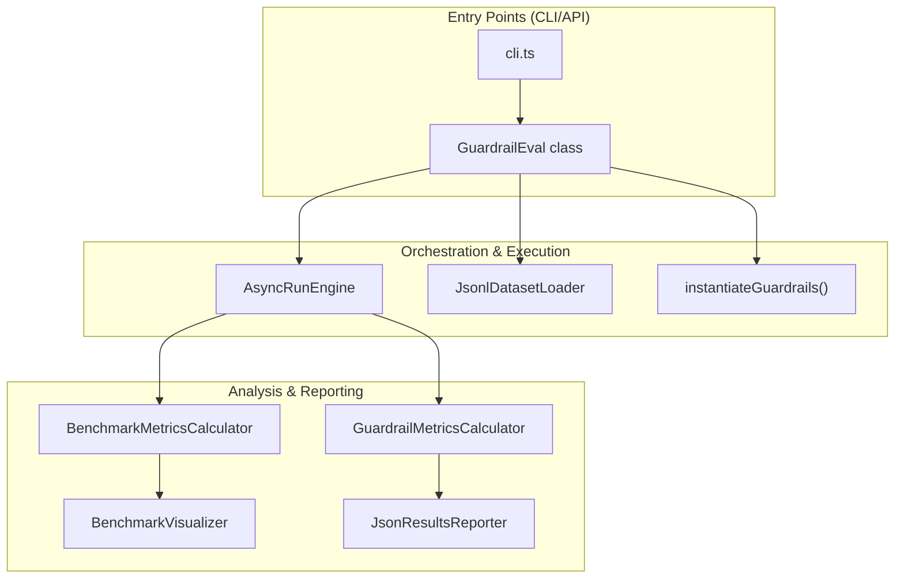
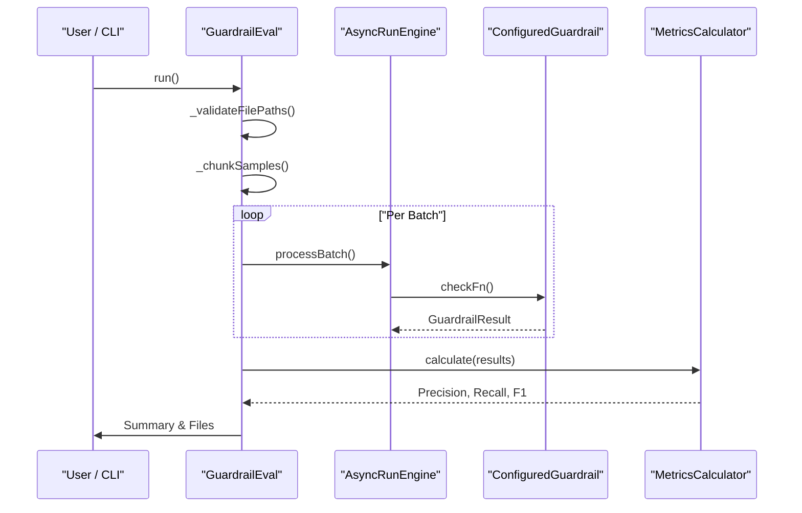

<!-- source: DeepWiki mcp.deepwiki.com · repo openai/openai-guardrails-js · page 6 Evaluation Framework · fetched 2026-10-26 -->

# Evaluation Framework

Relevant source files

The following files were used as context for generating this wiki page:

- [docs/evals.md](docs/evals.md)
- [src/cli.ts](src/cli.ts)
- [src/evals/guardrail-evals.ts](src/evals/guardrail-evals.ts)
- [src/spec.ts](src/spec.ts)

## Purpose and Scope

The Evaluation Framework provides systematic testing and benchmarking capabilities for guardrail configurations. It enables developers to validate guardrail effectiveness against labeled datasets and measure performance using standard metrics (precision, recall, F1 scores, and ROC AUC). This document introduces the evaluation system architecture and workflow.

*   For CLI usage details, see **[CLI Evaluation Tool](#6.1)**.
*   For programmatic integration, see **[Programmatic Evaluation](#6.2)**.
*   For dataset specifications, see **[Dataset Format](#6.3)**.
*   For metrics interpretation, see **[Metrics and Benchmarking](#6.4)**.

## Overview

The evaluation framework tests guardrail configurations by running them against labeled datasets where each example specifies which guardrails should trigger. The system compares actual guardrail behavior against expected triggers and calculates classification metrics to quantify performance. It supports standard evaluation for single configurations and a specialized **Benchmark Mode** for comparing performance across different LLM models [docs/evals.md:12-15]().

### Usage Patterns

| Pattern | Entry Point | Use Case |
|---------|-------------|----------|
| **CLI Tool** | `guardrails eval` | Quick testing, CI/CD pipelines, one-off evaluations [src/cli.ts:71-72]() |
| **Programmatic API** | `GuardrailEval` class | Custom evaluation workflows, integration testing, automated benchmarking [src/evals/guardrail-evals.ts:36]() |

**Sources:** [docs/evals.md:5-15](), [src/cli.ts:1-17](), [src/evals/guardrail-evals.ts:1-36]()

## Evaluation Architecture

The evaluation system consists of the `GuardrailEval` class, which orchestrates data loading via `JsonlDatasetLoader`, execution via `AsyncRunEngine`, and reporting through specialized classes like `BenchmarkReporter` and `BenchmarkVisualizer` [src/evals/guardrail-evals.ts:7-15]().

### Evaluation System Space

The framework reuses `instantiateGuardrails` and `loadPipelineBundles` from the runtime to ensure that the evaluation environment perfectly matches the production execution environment [src/evals/guardrail-evals.ts:16-21]().

**Sources:** [src/evals/guardrail-evals.ts:7-21](), [src/evals/guardrail-evals.ts:36-51]()

## Evaluation Workflow

The evaluation process follows a structured sequence, processing datasets in configurable batches (default: 32) [src/evals/guardrail-evals.ts:29]().

### Execution Sequence

The workflow supports **Multi-turn Evaluation** using the `--multi-turn` flag, which processes conversation-aware guardrails turn-by-turn rather than in a single pass [docs/evals.md:78-86]().

**Sources:** [src/evals/guardrail-evals.ts:72-129](), [src/evals/guardrail-evals.ts:175-188](), [docs/evals.md:29-31]()

## Dataset Structure

Evaluation datasets use JSONL format. Each line represents a `Sample` containing an `id`, the `data` (string or conversation array), and `expected_triggers` [docs/evals.md:52-72]().

### Standard vs. Multi-turn Data

*   **Standard**: A simple string for single-turn text validation [docs/evals.md:61]().
*   **Multi-turn**: A JSON array representing conversation history, allowing guardrails like **Jailbreak Detection** or **Prompt Injection Detection** to analyze adversarial patterns across turns [docs/evals.md:74-77]().

**Sources:** [docs/evals.md:58-67](), [docs/evals.md:97-103](), [src/spec.ts:23-24]()

## Benchmark Mode

Benchmark mode allows for model comparison by running the same guardrail configuration across multiple models (e.g., `gpt-4o`, `gpt-4o-mini`) [docs/evals.md:144](). It generates:
*   **ROC Curves**: Visualizing the trade-off between true positive and false positive rates [docs/evals.md:126]().
*   **Latency Comparisons**: Measuring the performance impact of guardrails across different providers [docs/evals.md:129]().
*   **Advanced Metrics**: Precision at specific recall thresholds [docs/evals.md:161]().

**Sources:** [docs/evals.md:12-15](), [docs/evals.md:116-130](), [src/evals/guardrail-evals.ts:82-84]()

## Performance and Parallelism

The framework includes several optimizations for large-scale evaluation:
*   **Batch Processing**: `batchSize` controls parallel execution of samples within a single model run [src/evals/guardrail-evals.ts:59]().
*   **Parallel Benchmarking**: `maxParallelModels` allows running evaluations for different models concurrently, defaulting to the system CPU count [src/evals/guardrail-evals.ts:124-127]().
*   **Memory-efficient Chunking**: `benchmarkChunkSize` allows processing large datasets in smaller slices to prevent memory exhaustion during long benchmark runs [src/evals/guardrail-evals.ts:175-188]().

**Sources:** [src/evals/guardrail-evals.ts:152-166](), [docs/evals.md:38-39]()

## Next Steps

*   **[CLI Evaluation Tool](#6.1)**: Command-line interface details and options.
*   **[Programmatic Evaluation](#6.2)**: `GuardrailEval` API reference and usage patterns.
*   **[Dataset Format](#6.3)**: JSONL structure, field specifications, and multi-turn examples.
*   **[Metrics and Benchmarking](#6.4)**: Interpretation of ROC AUC, F1, and latency results.

---

