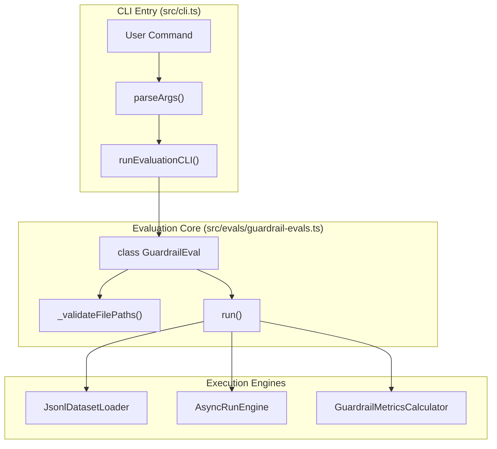
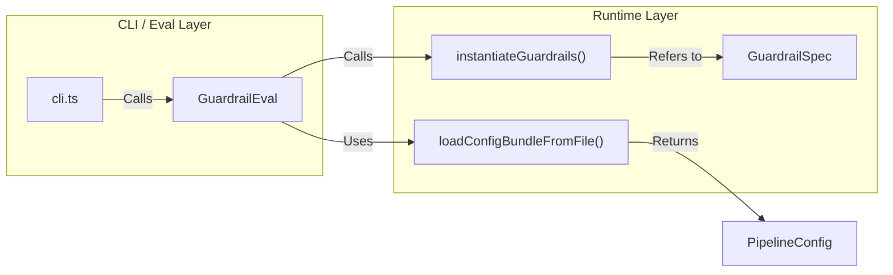

<!-- source: DeepWiki mcp.deepwiki.com · repo openai/openai-guardrails-js · page 6.1 CLI Evaluation Tool · fetched 2026-10-26 -->

# CLI Evaluation Tool

<details>
<summary>Relevant source files</summary>

The following files were used as context for generating this wiki page:

- [docs/evals.md](docs/evals.md)
- [src/cli.ts](src/cli.ts)
- [src/evals/guardrail-evals.ts](src/evals/guardrail-evals.ts)
- [src/spec.ts](src/spec.ts)

</details>


The CLI evaluation tool provides a command-line interface for evaluating guardrail performance against labeled datasets. It allows developers to measure precision, recall, and F1 metrics, and compare different models in benchmark mode.

---

## Overview

The evaluation tool is accessible via the `eval` subcommand of the unified CLI. It automates the process of loading a pipeline configuration, processing a JSONL dataset, and calculating performance metrics across different pipeline stages (`pre_flight`, `input`, `output`).

The CLI serves as a wrapper for the `GuardrailEval` class [src/evals/guardrail-evals.ts:36-129](), providing a standardized way to execute evaluations from a terminal or CI/CD environment.

**Sources:** [docs/evals.md:1-15](), [src/cli.ts:1-22]()

---

## Command Syntax and Arguments

The basic syntax for running an evaluation is:

```bash
npm run eval -- --config-path <CONFIG_PATH> --dataset-path <DATASET_PATH> [options]
```

### Required Arguments
- `--config-path`: Path to the JSON pipeline configuration file exported from the Guardrails Wizard or created manually [src/cli.ts:75-76]().
- `--dataset-path`: Path to the evaluation dataset in JSONL format [src/cli.ts:77-78]().

### Optional Arguments
| Argument | Default | Description |
|----------|---------|-------------|
| `--mode` | `evaluate` | Set to `benchmark` to compare multiple models [src/cli.ts:99-105](). |
| `--stages` | (all) | Specific stages to evaluate: `pre_flight`, `input`, `output` [src/cli.ts:106-110](). |
| `--batch-size` | `32` | Number of samples to process in parallel [src/cli.ts:79-80](). |
| `--output-dir` | `results/` | Directory where JSONL results and metric summaries are saved [src/cli.ts:81-82](). |
| `--multi-turn` | `false` | If true, processes conversation history turn-by-turn for supported guardrails [src/cli.ts:83-84](). |
| `--models` | (standard) | List of models to test in benchmark mode [src/cli.ts:111-115](). |
| `--api-key` | - | API key for OpenAI, Azure, or compatible providers [src/cli.ts:123-124](). |
| `--base-url` | - | Base URL for OpenAI-compatible APIs (e.g., Ollama, vLLM) [src/cli.ts:125-126](). |

**Sources:** [docs/evals.md:21-40](), [src/cli.ts:58-137]()

---

## CLI Implementation Architecture

The CLI parses user input into a `CliArgs` interface and instantiates the `GuardrailEval` class to handle the heavy lifting of the evaluation logic.

### CLI Data Flow and Code Entity Mapping



**Sources:** [src/cli.ts:22-50](), [src/evals/guardrail-evals.ts:36-143]()

---

## Evaluation Modes

### 1. Standard Evaluation (`--mode evaluate`)
The default mode calculates precision, recall, and F1 for the guardrails defined in your config. It is used to verify that a specific configuration meets safety and quality requirements.

```bash
npm run eval -- --config-path config.json --dataset-path data.jsonl
```

### 2. Benchmark Mode (`--mode benchmark`)
Benchmark mode compares the performance of multiple LLMs (e.g., `gpt-4o` vs `gpt-4o-mini`) acting as the backend for the guardrails. It generates:
- **ROC AUC Curves**: To visualize trade-offs between true positive and false positive rates.
- **Latency Results**: To compare the execution time across different models.
- **Precision at Recall Thresholds**: To understand how models perform under specific constraints.

```bash
npm run eval -- --config-path config.json --dataset-path data.jsonl --mode benchmark --models gpt-4o gpt-4o-mini
```

**Sources:** [docs/evals.md:7-15](), [docs/evals.md:116-132](), [src/evals/guardrail-evals.ts:120-128]()

---

## Multi-Turn Evaluation

For guardrails that analyze conversation history (like **Prompt Injection Detection** or **Jailbreak Detection**), the CLI supports a `--multi-turn` flag [src/cli.ts:83-84]().

- **Single-pass (Default)**: The entire conversation history provided in the `data` field of the dataset is analyzed once.
- **Turn-by-turn (`--multi-turn`)**: The evaluator breaks the conversation into incremental steps, evaluating the guardrail at each turn to see exactly when a violation is triggered.

**Sources:** [docs/evals.md:74-87](), [src/spec.ts:23-24]()

---

## Relationship between CLI and Runtime

The CLI interacts with the framework's runtime by loading configuration bundles and instantiating guardrail checks registered in the `defaultSpecRegistry`.

### Code Interaction Diagram



**Sources:** [src/cli.ts:22-24](), [src/evals/guardrail-evals.ts:16-21](), [src/spec.ts:43-79]()

---

## Output Structure

Results are organized into timestamped directories within the configured `--output-dir` (default: `results/`).

- **Evaluation Mode**: Contains `eval_metrics.json` (summary) and `eval_results_{stage}.jsonl` (per-sample details) [docs/evals.md:107-114]().
- **Benchmark Mode**: Contains `performance_metrics.json`, `latency_results.json`, and a `graphs/` directory with ROC curves and latency comparison charts [docs/evals.md:116-132]().

**Sources:** [docs/evals.md:105-132](), [src/evals/guardrail-evals.ts:77-78]()

---

