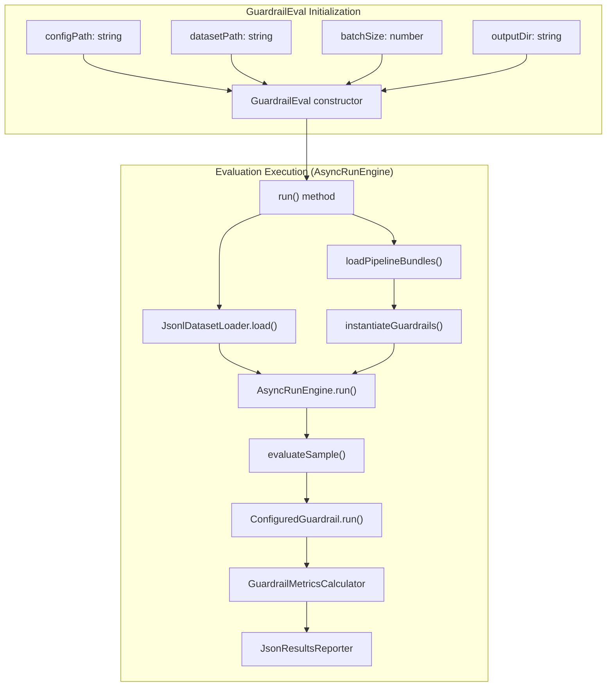
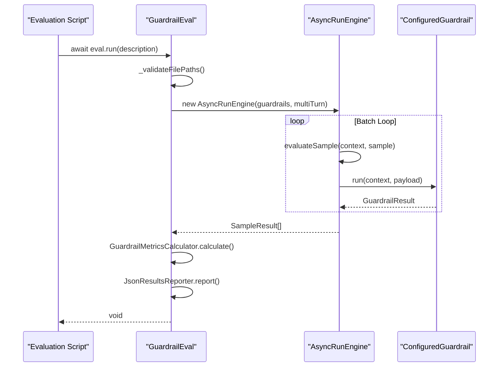
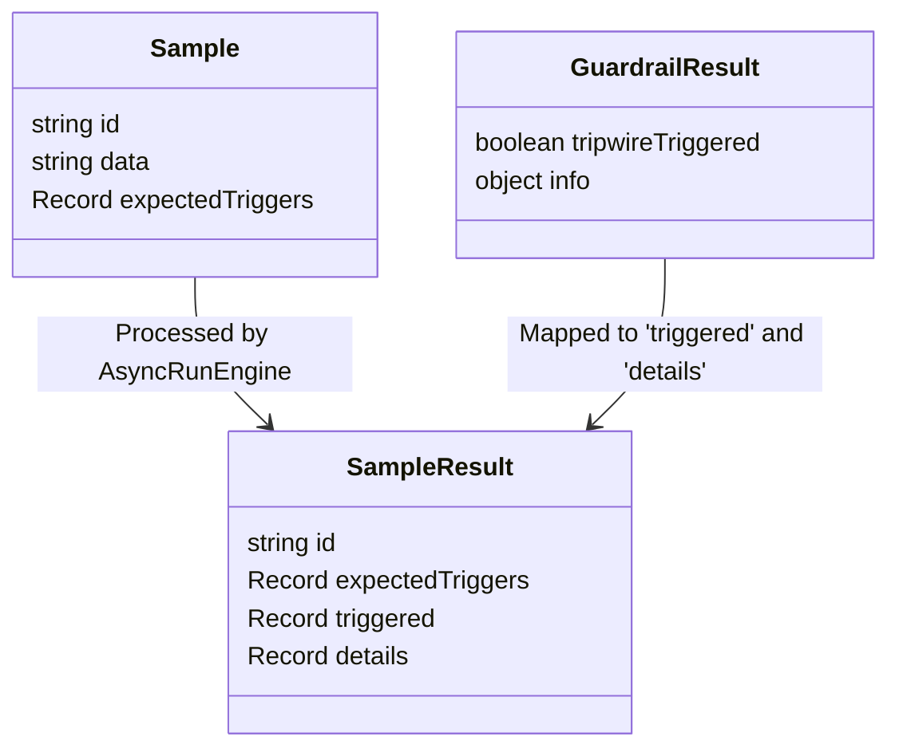

<!-- source: DeepWiki mcp.deepwiki.com · repo openai/openai-guardrails-js · page 6.2 Programmatic Evaluation · fetched 2026-10-26 -->

# Programmatic Evaluation

<details>
<summary>Relevant source files</summary>

The following files were used as context for generating this wiki page:

- [src/__tests__/unit/evals/async-engine.test.ts](src/__tests__/unit/evals/async-engine.test.ts)
- [src/cli.ts](src/cli.ts)
- [src/evals/core/async-engine.ts](src/evals/core/async-engine.ts)
- [src/evals/guardrail-evals.ts](src/evals/guardrail-evals.ts)
- [src/spec.ts](src/spec.ts)

</details>


## Purpose and Scope

This page covers the `GuardrailEval` class, which provides programmatic access to the evaluation framework for testing guardrail configurations against labeled datasets. The `GuardrailEval` class allows developers to integrate evaluation workflows directly into their testing pipelines, automation scripts, or continuous integration systems.

For information about using the command-line evaluation tool, see [CLI Evaluation Tool](#6.1). For details on the JSONL dataset format required by the evaluation system, see [Dataset Format](#6.3). For explanations of the metrics produced by evaluations, see [Metrics and Benchmarking](#6.4).

**Sources:** [src/evals/guardrail-evals.ts:36-71](), [src/cli.ts:71-72]()

---

## GuardrailEval Class Overview

The `GuardrailEval` class is the programmatic interface to the evaluation framework. It loads a pipeline configuration and a labeled dataset, executes the configured guardrails against each dataset entry, and compares the actual results to the expected triggers to calculate performance metrics.

### Core Responsibilities

| Responsibility | Description |
|---------------|-------------|
| **Configuration Loading** | Parses and validates the pipeline configuration JSON via `loadPipelineBundles` [src/evals/guardrail-evals.ts:18-21]() |
| **Dataset Processing** | Reads JSONL datasets via `JsonlDatasetLoader` [src/evals/guardrail-evals.ts:8-8]() |
| **Guardrail Execution** | Applies configured guardrails using the `AsyncRunEngine` [src/evals/core/async-engine.ts:64-64]() |
| **Result Comparison** | Compares actual guardrail triggers to expected triggers in `evaluateSample` [src/evals/core/async-engine.ts:120-172]() |
| **Metrics Calculation** | Computes precision, recall, and F1 using `GuardrailMetricsCalculator` [src/evals/core/calculator.ts:10-10]() |
| **Output Generation** | Writes detailed results via `JsonResultsReporter` [src/evals/core/json-reporter.ts:11-11]() |

### Evaluation Architecture



**Sources:** [src/evals/guardrail-evals.ts:36-129](), [src/evals/core/async-engine.ts:86-111](), [src/evals/core/async-engine.ts:193-193]()

---

## Constructor Parameters

The `GuardrailEval` constructor provides extensive configuration for both standard evaluation and benchmarking.

```typescript
constructor(
    configPath: string,
    datasetPath: string,
    stages: string[] | null = null,
    batchSize: number = 32,
    outputDir: string = 'results',
    apiKey: string | null = null,
    baseUrl: string | null = null,
    azureEndpoint: string | null = null,
    azureApiVersion: string = '2025-01-01-preview',
    mode: 'evaluate' | 'benchmark' = 'evaluate',
    models: string[] | null = null,
    latencyIterations: number = 25,
    multiTurn: boolean = false,
    maxParallelModels: number | null = null,
    benchmarkChunkSize: number | null = null
)
```

### Parameter Details

| Parameter | Type | Default | Description |
|-----------|------|---------|-------------|
| `configPath` | `string` | Required | Path to pipeline configuration file [src/evals/guardrail-evals.ts:73-73]() |
| `datasetPath` | `string` | Required | Path to JSONL dataset [src/evals/guardrail-evals.ts:74-74]() |
| `stages` | `string[]` | `null` | Specific stages (`pre_flight`, `input`, `output`) to evaluate [src/evals/guardrail-evals.ts:75-75]() |
| `batchSize` | `number` | `32` | Samples to process in parallel [src/evals/guardrail-evals.ts:76-76]() |
| `multiTurn` | `boolean` | `false` | Whether to evaluate guardrails on multi-turn conversations [src/evals/guardrail-evals.ts:85-85]() |
| `mode` | `string` | `'evaluate'` | Either `'evaluate'` or `'benchmark'` [src/evals/guardrail-evals.ts:82-82]() |
| `maxParallelModels` | `number` | `null` | Max models to benchmark concurrently (defaults to CPU count) [src/evals/guardrail-evals.ts:124-127]() |

**Sources:** [src/evals/guardrail-evals.ts:72-129]()

---

## Running Evaluations with the run() Method

The `run()` method executes the evaluation workflow. It supports two primary modes: standard evaluation and model benchmarking.

### Execution Flow



### Multi-Turn vs. Single-Pass
The `multiTurn` parameter significantly changes how conversation data is processed:
- **Single-Pass (`multiTurn: false`):** The engine extracts the latest user payload from the conversation history and runs the guardrail once [src/evals/core/async-engine.ts:192-193]().
- **Multi-Turn (`multiTurn: true`):** For guardrails that support conversation history (`usesConversationHistory: true`), the engine runs the guardrail incrementally for every turn in the conversation [src/evals/core/async-engine.ts:184-185]().

**Sources:** [src/evals/core/async-engine.ts:174-194](), [src/evals/guardrail-evals.ts:191-200]()

---

## Understanding Evaluation Results

The evaluation produces `SampleResult` objects which are then aggregated into metrics.

### Result Mapping



### Metrics Interpretation

The `GuardrailMetricsCalculator` processes the `SampleResult` array to produce:
- **Precision:** `TP / (TP + FP)`
- **Recall:** `TP / (TP + FN)`
- **F1 Score:** Harmonic mean of precision and recall.

If a guardrail execution throws an error, the `AsyncRunEngine` catches it, sets `triggered[name] = false`, and records the error message in the `details` field for that sample [src/evals/core/async-engine.ts:144-151]().

**Sources:** [src/evals/core/async-engine.ts:120-172](), [src/evals/core/types.ts:1-30]()

---

## Example Usage Patterns

### Basic Programmatic Evaluation

```typescript
import { GuardrailEval } from './evals/guardrail-evals';

async function main() {
  const evaluator = new GuardrailEval(
    './my-config.json',
    './my-dataset.jsonl',
    ['input', 'output'], // stages
    20,                  // batchSize
    './results-dir'
  );

  await evaluator.run('Production Guardrail Eval');
}
```

### Turn-by-Turn Conversation Evaluation
To evaluate how a guardrail performs across a full dialogue (e.g., detecting prompt injection that spans multiple messages), enable `multiTurn`:

```typescript
const evaluator = new GuardrailEval(
  configPath,
  datasetPath,
  null,
  32,
  'results',
  process.env.OPENAI_API_KEY,
  null, null, '2025-01-01-preview',
  'evaluate',
  null,
  25,
  true // multiTurn enabled
);
```

**Sources:** [src/evals/guardrail-evals.ts:72-129](), [src/evals/core/async-engine.ts:182-186]()

---

## Batching and Parallelism

The `GuardrailEval` class manages two levels of concurrency:
1. **Sample Batching:** Controlled by `batchSize`. The `AsyncRunEngine` uses `Promise.all` to process a batch of samples simultaneously [src/evals/core/async-engine.ts:101-108]().
2. **Model Parallelism:** In `benchmark` mode, `maxParallelModels` determines how many different model configurations are tested concurrently. By default, this is limited by the number of CPU cores available (`os.cpus().length`) [src/evals/guardrail-evals.ts:152-166]().

**Sources:** [src/evals/guardrail-evals.ts:152-166](), [src/evals/core/async-engine.ts:92-111]()

---

