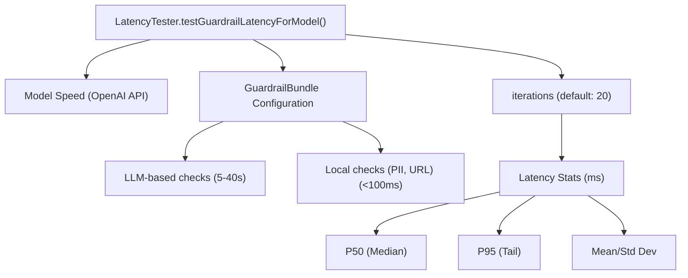
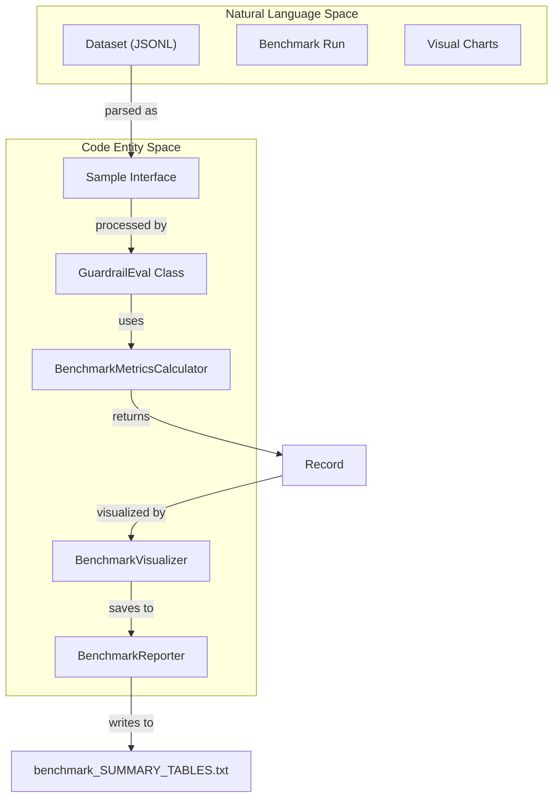
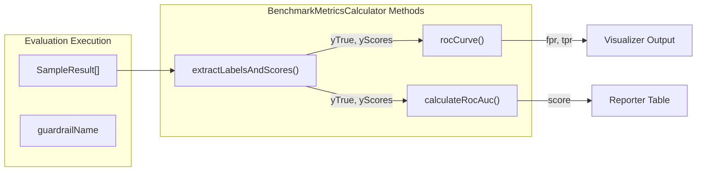

<!-- source: DeepWiki mcp.deepwiki.com · repo openai/openai-guardrails-js · page 6.4 Metrics and Benchmarking · fetched 2026-10-26 -->

# Metrics and Benchmarking

<details>
<summary>Relevant source files</summary>

The following files were used as context for generating this wiki page:

- [docs/benchmarking/Jailbreak_roc_curves.png](docs/benchmarking/Jailbreak_roc_curves.png)
- [docs/benchmarking/NSFW_roc_curve.png](docs/benchmarking/NSFW_roc_curve.png)
- [docs/benchmarking/alignment_roc_curves.png](docs/benchmarking/alignment_roc_curves.png)
- [docs/benchmarking/hallucination_detection_roc_curves.png](docs/benchmarking/hallucination_detection_roc_curves.png)
- [src/__tests__/unit/evals/guardrail-evals.test.ts](src/__tests__/unit/evals/guardrail-evals.test.ts)
- [src/evals/core/benchmark-calculator.ts](src/evals/core/benchmark-calculator.ts)
- [src/evals/core/benchmark-reporter.ts](src/evals/core/benchmark-reporter.ts)
- [src/evals/core/latency-tester.ts](src/evals/core/latency-tester.ts)
- [src/evals/core/visualizer.ts](src/evals/core/visualizer.ts)
- [src/utils/conversation.ts](src/utils/conversation.ts)

</details>


## Purpose and Scope

This page explains the metrics calculated by the evaluation framework and how to interpret benchmark results. The evaluation system (`GuardrailEval`) processes datasets and produces quantitative metrics that measure guardrail accuracy and performance. This page covers metric definitions, implementation details for advanced benchmarking, and how to use benchmark data to tune guardrail configurations.

For information about running evaluations programmatically or via CLI, see [CLI Evaluation Tool](#6.1) and [Programmatic Evaluation](#6.2).

---

## Evaluation Metrics

The evaluation framework calculates metrics by comparing actual guardrail triggers against expected triggers defined in the dataset. The `BenchmarkMetricsCalculator` class implements the logic for advanced statistical analysis [src/evals/core/benchmark-calculator.ts:13-13]().

### Accuracy Metrics

#### Precision
**Definition**: Proportion of flagged instances that were correctly identified as violations.
```
Precision = True Positives / (True Positives + False Positives)
```
**Interpretation**: High precision means the guardrail rarely flags content incorrectly (low false positive rate).

#### Recall
**Definition**: Proportion of actual violations that were correctly flagged by the guardrail.
```
Recall = True Positives / (True Positives + False Negatives)
```
**Interpretation**: High recall means the guardrail catches most violations.

#### F1 Score
**Definition**: Harmonic mean of precision and recall.
```
F1 = 2 × (Precision × Recall) / (Precision + Recall)
```

#### ROC AUC (Area Under ROC Curve)
**Definition**: Measures the guardrail's ability to discriminate between violations and non-violations across all confidence thresholds.
**Implementation**: Calculated using the trapezoidal rule on sorted confidence scores [src/evals/core/benchmark-calculator.ts:126-162]().

### Advanced Benchmarking Metrics

The `BenchmarkMetricsCalculator` provides specific metrics for high-precision tuning [src/evals/core/benchmark-calculator.ts:101-121]():

| Metric | Definition | Code Entity |
|--------|------------|-------------|
| `prec_at_r80` | Precision when recall is 80% | `precisionAtRecall(p, r, 0.8)` |
| `prec_at_r90` | Precision when recall is 90% | `precisionAtRecall(p, r, 0.9)` |
| `prec_at_r95` | Precision when recall is 95% | `precisionAtRecall(p, r, 0.95)` |
| `recall_at_fpr01` | Recall when False Positive Rate is 1% | `recallAtFpr(fpr, tpr, 0.01)` |

**Sources**: [src/evals/core/benchmark-calculator.ts:90-124](), [src/evals/core/benchmark-calculator.ts:232-240]()

---

## Latency Metrics

The `LatencyTester` measures execution time for guardrail checks, aggregated into percentile statistics [src/evals/core/latency-tester.ts:14-14]().

### Time to Completion (TTC)

*   **TTC P50 (Median)**: 50% of requests complete within this time. Typical latency.
*   **TTC P95**: 95% of requests complete within this time. Worst-case latency.

**Implementation**: The `testGuardrailLatencyForModel` method runs a configured number of iterations (default 20) and calculates stats using `performance.now()` [src/evals/core/latency-tester.ts:64-101]().

### Latency Measurement Factors



**Sources**: [src/evals/core/latency-tester.ts:22-52](), [src/evals/core/latency-tester.ts:84-91]()

---

## Benchmark Results Structure

### Data Flow to Visualization

The framework organizes benchmark data through several specialized classes before generating reports.

**Diagram: Natural Language Space to Code Entity Space**



**Sources**: [src/evals/core/benchmark-calculator.ts:22-42](), [src/evals/core/visualizer.ts:37-43](), [src/evals/core/benchmark-reporter.ts:38-45]()

### Organized Output Format

The `BenchmarkReporter` saves results in a timestamped directory structure [src/evals/core/benchmark-reporter.ts:46-55]():

*   `/results/eval_results_[guardrail]_[model].jsonl`: Raw per-sample outcomes.
*   `/results/performance_metrics.json`: Aggregated precision/recall/AUC data.
*   `/results/latency_results.json`: P50/P95 timing data.
*   `/graphs/`: Visualizations (ROC curves, precision-recall plots).
*   `benchmark_summary.txt`: Human-readable text summary.

**Sources**: [src/evals/core/benchmark-reporter.ts:58-84]()

---

## Interpreting Results

### ROC Curve Analysis

ROC curves plot True Positive Rate vs. False Positive Rate. The framework generates these to compare model discrimination capabilities.

**Code Entity Association Diagram**



**Sources**: [src/evals/core/benchmark-calculator.ts:44-68](), [src/evals/core/benchmark-calculator.ts:126-162](), [src/evals/core/benchmark-calculator.ts:204-230]()

### Performance Metrics Table

The `BenchmarkReporter` generates a standardized performance table [src/evals/core/benchmark-reporter.ts:101-121]():

| Model | Precision | Recall | F1 Score | ROC AUC |
|-------|-----------|--------|----------|---------|
| `gpt-4o` | 0.9200 | 0.8500 | 0.8837 | 0.9450 |
| `gpt-4o-mini` | 0.8800 | 0.8200 | 0.8491 | 0.8920 |

### Latency Comparison Table

Latency results are reported in milliseconds for completion time [src/evals/core/benchmark-reporter.ts:124-152]():

| Model | TTC P50 (ms) | TTC P95 (ms) |
|-------|--------------|--------------|
| `gpt-4o` | 1240.5 | 2150.2 |
| `gpt-4o-mini` | 450.2 | 890.1 |

---

## Using Metrics for Guardrail Tuning

### Confidence Threshold Optimization

When a guardrail returns a `confidence` score (standard for LLM-based checks like Hallucination or Jailbreak detection), metrics can be used to pick the optimal `confidence_threshold`.

1.  **Extract Scores**: `BenchmarkMetricsCalculator.getConfidenceScore` retrieves the raw score from `result.details` [src/evals/core/benchmark-calculator.ts:70-88]().
2.  **Analyze Precision at Recall**: If your application requires catching 95% of violations, look at `prec_at_r95`. If the precision is too low (too many false positives), you may need a more capable model.
3.  **Tune Threshold**: Use the `precisionRecallCurve` output to find the exact score threshold that yields your desired balance [src/evals/core/benchmark-calculator.ts:164-202]().

### Parallelism and Resource Limits

The evaluation framework includes internal logic to determine optimal parallelism based on hardware and user constraints. `GuardrailEval._determineParallelModelLimit` will default to the CPU count (`os.cpus()`) unless `maxParallelModels` is explicitly provided [src/__tests__/unit/evals/guardrail-evals.test.ts:41-51]().

**Sources**: [src/evals/core/benchmark-calculator.ts:13-124](), [src/evals/core/latency-tester.ts:14-101](), [src/evals/core/benchmark-reporter.ts:15-182](), [src/__tests__/unit/evals/guardrail-evals.test.ts:32-56]()

---

