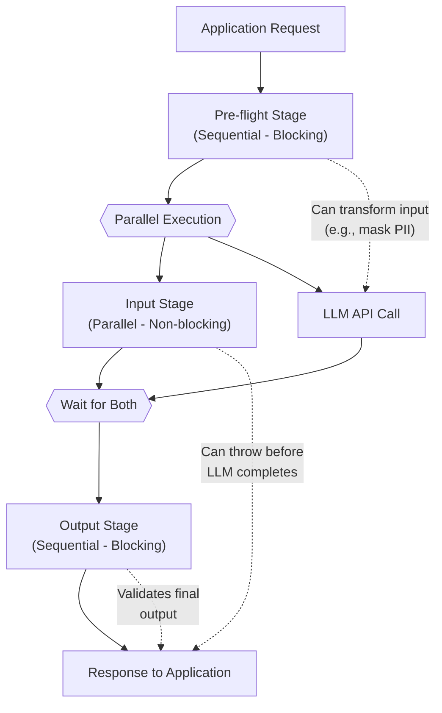
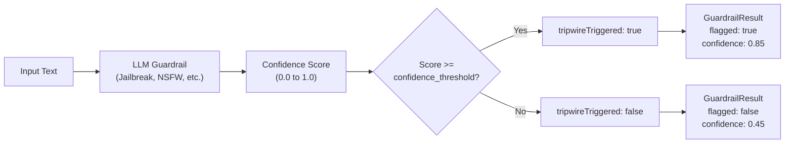
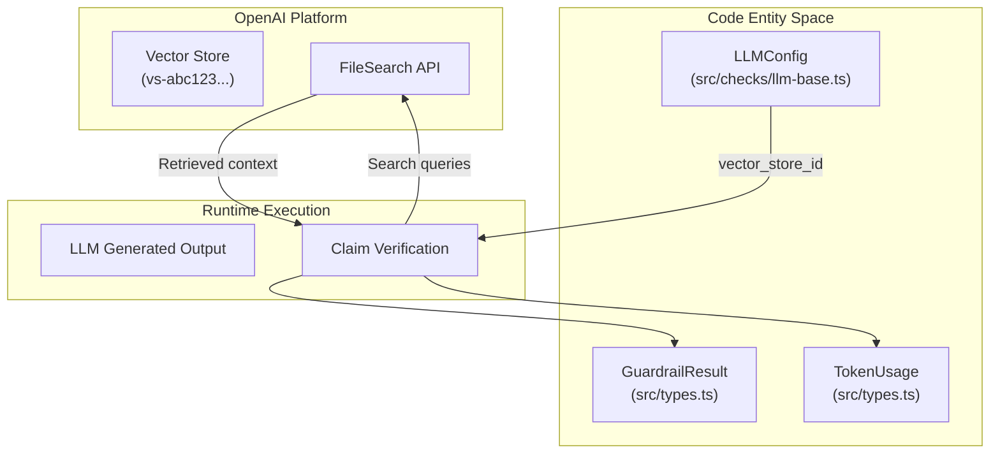
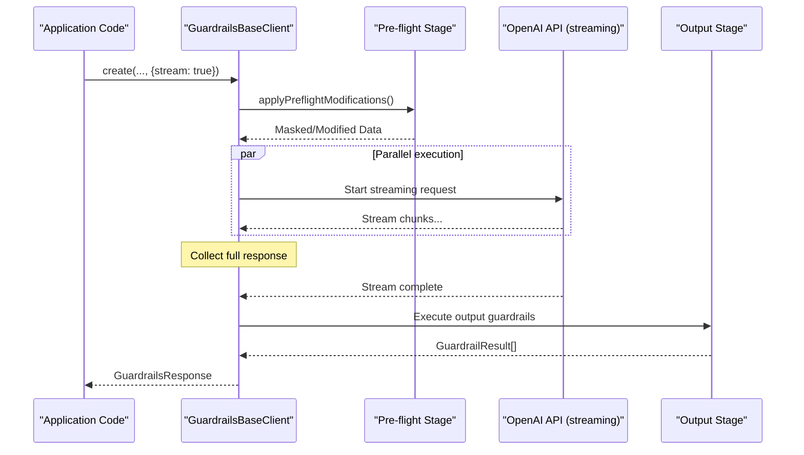

<!-- source: DeepWiki mcp.deepwiki.com · repo openai/openai-guardrails-js · page 7 Advanced Topics · fetched 2026-10-26 -->

# Advanced Topics

Relevant source files

The following files were used as context for generating this wiki page:

- [src/base-client.ts](src/base-client.ts)
- [src/checks/llm-base.ts](src/checks/llm-base.ts)
- [src/types.ts](src/types.ts)

This page covers advanced usage patterns, configuration strategies, and optimization techniques for the OpenAI Guardrails framework. It assumes familiarity with basic concepts covered in [Architecture Overview](#1.1) and [Integration Patterns](#3).

---

## Pipeline Stage Selection

The guardrails pipeline supports three distinct stages, each with different execution characteristics and use cases. Understanding when to use each stage is critical for both safety and performance optimization.

### Stage Execution Model

**Stage Execution Characteristics**

| Stage | Execution Mode | Can Transform Input | Can Access Output | Typical Latency Impact | Use Case |
|-------|----------------|---------------------|-------------------|------------------------|----------|
| `pre_flight` | Sequential (before LLM) | Yes | No | Adds full guardrail latency | Input sanitization, PII masking |
| `input` | Parallel (with LLM) | No | No | Minimal if LLM slower | Fast safety checks, jailbreak detection |
| `output` | Sequential (after LLM) | No | Yes | Adds full guardrail latency | Output validation, fact-checking |

Sources: [src/base-client.ts:126-131](), [src/base-client.ts:136-140](), [src/base-client.ts:201-204]()

For details, see [Pipeline Stage Selection](#7.1).

---

## Confidence Threshold Tuning

LLM-based guardrails (`Jailbreak`, `NSFW Text`, `Custom Prompt Check`) return confidence scores between 0.0 and 1.0. The `confidence_threshold` parameter determines when to trigger a tripwire.

### Confidence Score Architecture

Sources: [src/checks/llm-base.ts:35-46](), [src/checks/llm-base.ts:80-85](), [src/types.ts:51-53]()

### Precision vs Recall Trade-offs

The `LLMConfig` schema defines the `confidence_threshold` which defaults to `0.7` [src/checks/llm-base.ts:35-46]().

| Threshold | Precision | Recall | Use Case |
|-----------|-----------|--------|----------|
| 0.5 | Lower | Higher | Maximum safety, tolerate over-flagging |
| 0.7 (default) | Balanced | Balanced | General purpose, recommended starting point |
| 0.9 | Higher | Lower | Minimize user friction, tolerate some risk |

For details, see [Confidence Threshold Tuning](#7.2).

---

## Vector Store Management

The `Hallucination Detection` guardrail uses OpenAI's FileSearch API with vector stores to verify generated content against reference documents.

### Vector Store Architecture

Sources: [src/checks/llm-base.ts:35-71](), [src/types.ts:51-74](), [src/types.ts:162-167]()

For details, see [Vector Store Management](#7.3).

---

## Streaming Responses

Streaming responses present unique challenges for guardrail execution due to the incremental nature of content generation.

### Streaming Execution Model

Sources: [src/base-client.ts:119-121](), [src/base-client.ts:174-189](), [src/base-client.ts:201-204]()

### Key Streaming Behaviors

*   **Pre-flight and Input Stages**: Execute before or during the stream. `applyPreflightModifications` is used to handle PII masking or other text overrides before the LLM call [src/base-client.ts:201-204]().
*   **Output Stage**: Executes after the entire stream completes. The `GuardrailResultsImpl` aggregates all results, including those from the final output validation [src/base-client.ts:92-114]().
*   **Latency**: Output guardrails add latency at the end of the stream because they require the full text for analysis.

For details, see [Streaming Responses](#7.4).

Sources: [src/base-client.ts:79-87](), [src/base-client.ts:92-114](), [src/base-client.ts:201-204]()

---

