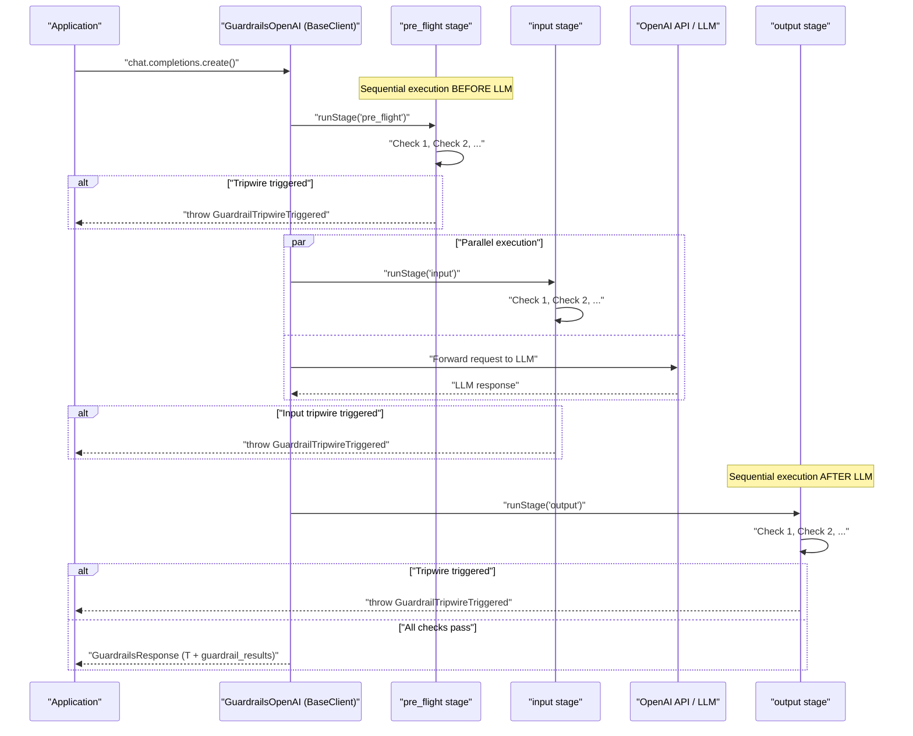
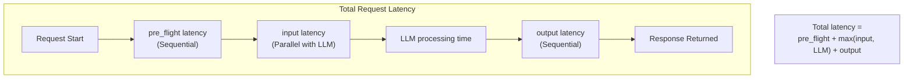
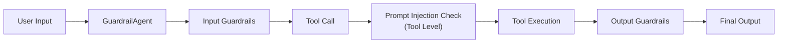

<!-- source: DeepWiki mcp.deepwiki.com · repo openai/openai-guardrails-js · page 7.1 Pipeline Stage Selection · fetched 2026-10-26 -->

# Pipeline Stage Selection

<details>
<summary>Relevant source files</summary>

The following files were used as context for generating this wiki page:

- [docs/agents_sdk_integration.md](docs/agents_sdk_integration.md)
- [docs/quickstart.md](docs/quickstart.md)
- [src/base-client.ts](src/base-client.ts)
- [src/types.ts](src/types.ts)

</details>


## Purpose and Scope

This page explains how to select the appropriate pipeline stage (pre-flight, input, or output) for each guardrail in your configuration. Understanding stage selection is critical for optimizing both safety coverage and application performance.

The pipeline stages are defined in the `PipelineConfig` interface [src/base-client.ts:126-131](). Each stage corresponds to a `GuardrailBundle` containing a list of configured guardrails [src/runtime.ts:22-26]().

---

## Pipeline Stage Architecture

The guardrails pipeline executes in three distinct stages, each with different timing and execution characteristics relative to the LLM call. The `GuardrailsBaseClient` manages these stages through its core lifecycle methods.

### Execution Flow Diagram



**Sources:** [src/base-client.ts:126-140](), [docs/quickstart.md:42-50](), [src/types.ts:51-74]()

---

## Stage Characteristics

The following table compares the execution characteristics of each pipeline stage as implemented in `GuardrailsBaseClient` [src/base-client.ts:145-150]():

| Characteristic | pre_flight | input | output |
|---|---|---|---|
| **Execution Order** | First (before LLM) | Second (with LLM) | Third (after LLM) |
| **Execution Model** | Sequential | Parallel with LLM | Sequential |
| **Adds Latency** | Yes (blocks LLM call) | No (runs concurrently) | Yes (delays response) |
| **Can Transform Input** | Yes (via `applyPreflightModifications`) | No | N/A |
| **Access to LLM Response** | No | No | Yes |
| **Use Case** | PII masking, critical blocking | Parallel safety checks | Fact checking, compliance |
| **Configuration Field** | `pre_flight` | `input` | `output` |

**Sources:** [docs/quickstart.md:42-50](), [src/base-client.ts:201-204]()

---

## Stage Selection Guidelines

### When to Use pre_flight Stage

Use `pre_flight` for guardrails that must execute **before** the LLM receives the request. This stage is unique because it allows for data modification via `applyPreflightModifications` [src/base-client.ts:201-232]().

1. **Input transformation needed**: Guardrails that mask PII (e.g., SSN, Email) using regex or LLM detection.
2. **Critical blocking checks**: Violations that should prevent LLM processing entirely to save costs or prevent high-risk prompts.
3. **Cost optimization**: Blocking inappropriate requests before incurring API costs.

**Tradeoffs:**
- **Adds latency**: Every guardrail in `pre_flight` delays the LLM call.
- **Cannot parallelize**: Checks run sequentially, blocking the pipeline.

**Sources:** [docs/quickstart.md:46](), [src/base-client.ts:209-223]()

### When to Use input Stage

Use `input` for guardrails that validate user input but don't need to block the LLM call initiation.

1. **Performance optimization**: Checks run while LLM is processing.
2. **Advisory checks**: Violations logged but LLM can still provide response.
3. **Complex analysis**: LLM-based guardrails like Jailbreak Detection that take time to compute.

**Tradeoffs:**
- **No latency added**: Runs in parallel with LLM call.
- **Cannot transform input**: LLM receives original request.
- **May waste LLM call**: If input guardrail fails, LLM response is discarded and `GuardrailTripwireTriggered` is thrown.

**Sources:** [docs/quickstart.md:47](), [src/types.ts:51-53]()

### When to Use output Stage

Use `output` for guardrails that validate the LLM's generated response.

1. **Response validation**: Check for hallucinations, PII leaks in assistant output, or policy violations.
2. **Compliance**: Verify output meets business or regulatory requirements.
3. **Quality assurance**: Ensure responses are on-topic and appropriate.

**Tradeoffs:**
- **Adds latency**: Delays final response to user.
- **Post-LLM cost**: API call already made even if output fails.

**Sources:** [docs/quickstart.md:48]()

---

## Guardrail-Specific Stage Recommendations

The following table provides stage selection guidance for built-in guardrails:

| Guardrail | Recommended Stage(s) | Rationale |
|---|---|---|
| **Moderation** | `input` or `output` | Input: Check user content; Output: Check LLM responses. |
| **Jailbreak Detection** | `input` | LLM-based check benefits from parallel execution. |
| **PII Detection** | `pre_flight` | Essential for masking before data leaves the client [src/base-client.ts:209-223](). |
| **URL Filter** | `input` or `output` | Filter malicious links in both directions. |
| **Hallucination Detection** | `output` | Requires LLM response + vector store comparison. |
| **Off Topic Prompts** | `input` | Validate scope before LLM processes. |
| **Prompt Injection** | Tool-level | Automatic in `GuardrailAgent` for tool calls [docs/agents_sdk_integration.md:12](). |

**Sources:** [docs/quickstart.md:23-39](), [docs/agents_sdk_integration.md:12-13]()

---

## Configuration Examples

### Multi-Stage Configuration

Example showing guardrails distributed across all three stages in a `PipelineConfig` [src/base-client.ts:126-131]():

```typescript
const config = {
    version: 1,
    pre_flight: {
        version: 1,
        guardrails: [
            { 
                name: 'Contains PII', 
                config: { 
                    entities: ['PHONE_NUMBER', 'EMAIL_ADDRESS'],
                    mask: true 
                } 
            }
        ]
    },
    input: {
        version: 1,
        guardrails: [
            { name: 'Jailbreak', config: { confidence_threshold: 0.8 } }
        ]
    },
    output: {
        version: 1,
        guardrails: [
            { name: 'Moderation', config: {} },
            { name: 'Hallucination Detection', config: { vector_store_id: 'vs_123' } }
        ]
    }
};
```

**Sources:** [docs/quickstart.md:23-39](), [src/base-client.ts:126-131]()

---

## Performance Considerations

### Latency Impact by Stage



The `GuardrailResults` interface provides `totalTokenUsage` which aggregates usage from all stages via `aggregateTokenUsageFromInfos` [src/base-client.ts:86, 111-113]().

### Stage Selection for Latency Optimization

1. **Minimize pre_flight guardrails**: Each check directly increases time-to-first-token.
2. **Maximize input stage usage**: Checks run "for free" during LLM processing if they complete faster than the LLM.
3. **Optimize output stage**: Use only essential quality checks to avoid delaying the final response.

**Sources:** [src/base-client.ts:79-114](), [docs/quickstart.md:42-50]()

---

## Integration with GuardrailAgent

When using `GuardrailAgent`, stage selection follows the same principles, but with special handling for Prompt Injection Detection.

- **Prompt Injection Detection**: Automatically runs at the tool level, checking each tool call and output [docs/agents_sdk_integration.md:12]().
- **Other guardrails**: Run at the agent level for efficiency, configured via the standard `PipelineConfig` [docs/agents_sdk_integration.md:13]().



**Sources:** [docs/agents_sdk_integration.md:9-15](), [src/base-client.ts:126-140]()

---

