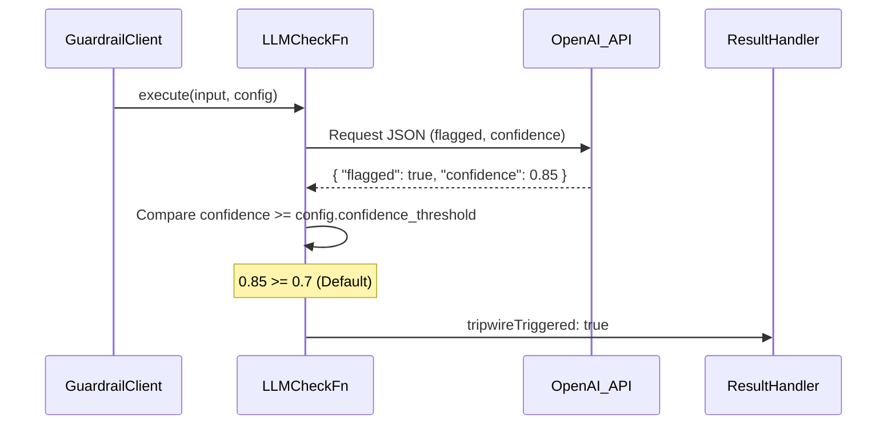
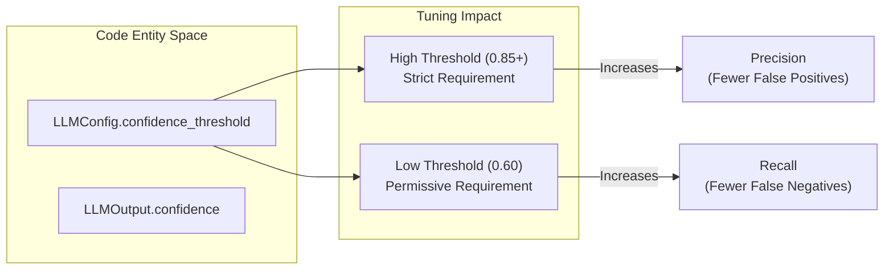
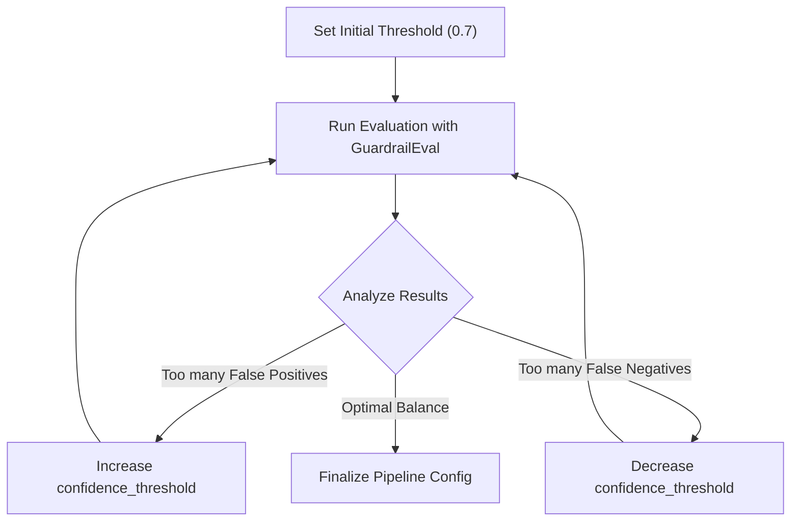

<!-- source: DeepWiki mcp.deepwiki.com · repo openai/openai-guardrails-js · page 7.2 Confidence Threshold Tuning · fetched 2026-10-26 -->

# Confidence Threshold Tuning

<details>
<summary>Relevant source files</summary>

The following files were used as context for generating this wiki page:

- [docs/ref/checks/llm_base.md](docs/ref/checks/llm_base.md)
- [src/__tests__/unit/llm-base.test.ts](src/__tests__/unit/llm-base.test.ts)
- [src/checks/llm-base.ts](src/checks/llm-base.ts)

</details>


Confidence threshold tuning adjusts the sensitivity of LLM-based guardrails to balance precision (avoiding false positives) against recall (catching actual violations). This page explains how confidence thresholds work, which guardrails support them, and how to tune them for your specific use case.

## Overview of Confidence Thresholds

LLM-based guardrails in this framework return a confidence score between 0.0 and 1.0 indicating the likelihood of a violation. The `confidence_threshold` parameter in the `LLMConfig` schema determines when a guardrail triggers a tripwire.

- **Tripwire triggers**: When `confidence >= confidence_threshold`.
- **No trigger**: When `confidence < confidence_threshold`.

The default threshold across all LLM-based guardrails is **0.7**, as defined in the `LLMConfig` Zod schema [src/checks/llm-base.ts:35-46]().

### Data Flow for Confidence Evaluation



Sources: [src/checks/llm-base.ts:35-46](), [src/checks/llm-base.ts:80-85]()

## Guardrails with Configurable Thresholds

All guardrails that utilize the `LLMConfig` base configuration support `confidence_threshold` tuning. These are primarily found in the `src/checks/` directory.

| Guardrail Name | Implementation Class/Function | Config Schema |
|----------------|-------------------------------|---------------|
| Hallucination Detection | `createHallucinationDetectionCheck` | `HallucinationDetectionConfig` |
| Jailbreak Detection | `createJailbreakDetectionCheck` | `LLMConfig` |
| NSFW Text Detection | `createNSFWTextDetectionCheck` | `LLMConfig` |
| Custom Prompt Check | `createCustomPromptCheck` | `LLMConfig` |
| Prompt Injection | `createPromptInjectionDetectionCheck` | `LLMConfig` |

**Non-tunable guardrails** (fixed thresholds or deterministic logic):
- **Moderation**: Uses OpenAI's Moderation API categorical flags.
- **PII Detection**: Uses deterministic regex-based entity recognition.
- **URL Filter**: Uses allowlist/blocklist matching.

Sources: [src/checks/llm-base.ts:35-71](), [src/checks/llm-base.ts:233-250]()

## The Precision-Recall Tradeoff

Tuning the threshold shifts the balance between two competing metrics:



### Threshold Selection Guidelines

1.  **High Threshold (0.8-0.9): Precision-First**
    - **Use Case**: User-facing applications where blocking a legitimate request (False Positive) is highly disruptive to UX.
    - **Configuration**: Set `confidence_threshold` to `0.85` in your pipeline JSON [docs/ref/checks/llm_base.md:14]().

2.  **Low Threshold (0.6-0.65): Recall-First**
    - **Use Case**: High-security environments or internal auditing where missing a violation (False Negative) carries significant risk.
    - **Configuration**: Set `confidence_threshold` to `0.6`.

3.  **Default Threshold (0.7): Balanced**
    - **Use Case**: General purpose deployments. This is the default value assigned by `LLMConfig` [src/checks/llm-base.ts:43]().

Sources: [src/checks/llm-base.ts:35-46](), [docs/ref/checks/llm_base.md:24-29]()

## Model-Specific Considerations

The quality of the confidence score depends heavily on the model specified in `LLMConfig.model`.

- **Larger Models (e.g., GPT-4o)**: Generally exhibit better "calibration"—their 0.7 confidence actually means a ~70% probability of a violation.
- **Smaller/Mini Models**: May be "overconfident" or "underconfident." When using `gpt-4o-mini`, it is often recommended to use a slightly higher threshold (e.g., `0.75`) to filter out noise [src/__tests__/unit/llm-base.test.ts:28-35]().

### Performance Impact of Reasoning
The `include_reasoning` parameter [src/checks/llm-base.ts:53-58]() allows the LLM to explain its decision. While this increases token costs and latency, it can improve the accuracy of the confidence score by forcing the model to perform "Chain of Thought" before outputting the final `LLMOutput` [docs/ref/checks/llm_base.md:25-29]().

Sources: [src/checks/llm-base.ts:53-58](), [docs/ref/checks/llm_base.md:25-29]()

## Tuning Process and Best Practices

Tuning should be an iterative process using the `GuardrailEval` framework.



### Step 1: Baseline Evaluation
Run a benchmark using the CLI tool to establish baseline precision and recall:
```bash
npx guardrails eval --config-path ./config.json --dataset-path ./dataset.jsonl
```

### Step 2: Analyze LLMOutput
Examine the `confidence` and `reason` (if enabled) in the `GuardrailResult.info` object [src/checks/llm-base.ts:137-144](). If the model consistently flags benign content with a confidence of 0.72, increasing the threshold to 0.75 will eliminate those false positives.

### Step 3: Multi-Turn Context
If violations are being missed, consider increasing `max_turns` [src/checks/llm-base.ts:63-70](). LLM-based checks often provide more accurate confidence scores when they have the full context of the `conversationHistory` [src/checks/llm-base.ts:161-204]().

Sources: [src/checks/llm-base.ts:132-146](), [src/checks/llm-base.ts:161-204](), [src/__tests__/unit/llm-base.test.ts:161-204]()

## Summary of Configuration Parameters

| Parameter | Type | Default | Role in Tuning |
|-----------|------|---------|----------------|
| `confidence_threshold` | `number` | `0.7` | The primary lever for precision/recall balance [src/checks/llm-base.ts:39](). |
| `include_reasoning` | `boolean` | `false` | Enable for debugging or to potentially improve score accuracy via CoT [src/checks/llm-base.ts:53](). |
| `max_turns` | `number` | `10` | Provides more context for multi-turn analysis, improving detection reliability [src/checks/llm-base.ts:63](). |

Sources: [src/checks/llm-base.ts:35-71](), [docs/ref/checks/llm_base.md:21-33]()

---

