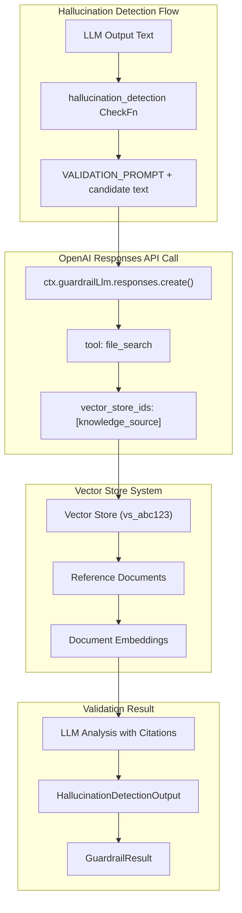
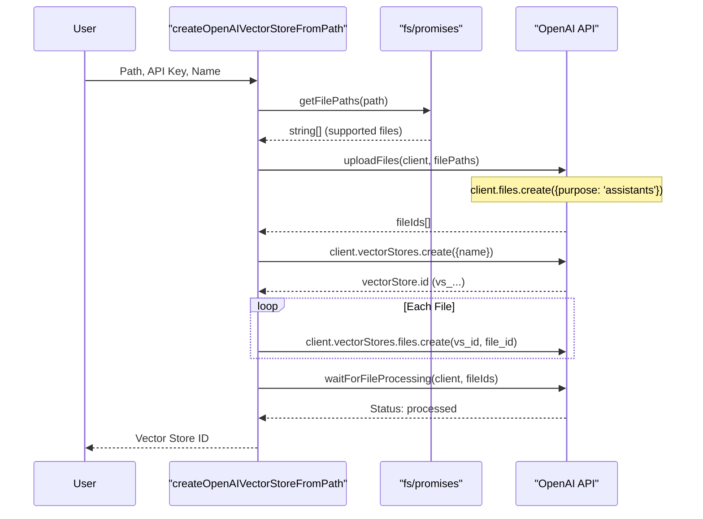

<!-- source: DeepWiki mcp.deepwiki.com · repo openai/openai-guardrails-js · page 7.3 Vector Store Management · fetched 2026-10-26 -->

# Vector Store Management

<details>
<summary>Relevant source files</summary>

The following files were used as context for generating this wiki page:

- [src/__tests__/unit/utils/openai-vector-store.test.ts](src/__tests__/unit/utils/openai-vector-store.test.ts)
- [src/utils/openai-vector-store.ts](src/utils/openai-vector-store.ts)
- [src/utils/vector-store.ts](src/utils/vector-store.ts)

</details>


Vector stores are OpenAI-managed knowledge bases that enable the Hallucination Detection guardrail to validate LLM outputs against reference documents. This page covers vector store creation via programmatic utilities, management through the OpenAI Dashboard, and optimization strategies for scaling.

---

## Vector Store Basics

### Purpose

Vector stores serve as the knowledge base for the Hallucination Detection guardrail. They store document embeddings that the FileSearch API uses to validate factual claims in LLM-generated text against authoritative reference documents.

### ID Format

All vector store IDs must start with the `vs_` prefix (e.g., `vs_abc123`). The Hallucination Detection guardrail validates this format at runtime and throws an error if an invalid ID is provided.

### Integration with FileSearch API

Vector stores are accessed through OpenAI's FileSearch API, which is invoked during hallucination detection to retrieve semantically relevant documents and validate factual claims.

**Diagram: Vector Store Integration Architecture**



**Sources:** [src/utils/openai-vector-store.ts:63-77](), [src/utils/vector-store.ts:23-32]()

---

## Creating Vector Stores

### Programmatic Creation

The framework provides the `createOpenAIVectorStoreFromPath` utility to automate the creation of vector stores from local files or directories.

**Diagram: Programmatic Data Flow**



**Implementation Details:**
- **Supported Formats:** The utility supports a wide range of extensions including `.pdf`, `.docx`, `.txt`, `.md`, `.json`, and various code files (`.ts`, `.py`, `.java`, etc.) [src/utils/openai-vector-store.ts:92-114]().
- **File Upload:** Files are uploaded with the `purpose: 'assistants'` to be compatible with File Search [src/utils/openai-vector-store.ts:168-171]().
- **Polling:** The function includes `waitForFileProcessing`, which polls the OpenAI API every 1 second until all files reach the `processed` status [src/utils/openai-vector-store.ts:186-207]().

### OpenAI Dashboard

You can also manage vector stores through the [OpenAI Dashboard](https://platform.openai.com/storage/vector_stores) to visually upload documents and monitor storage usage.

**Sources:** [src/utils/openai-vector-store.ts:34-83](), [src/utils/openai-vector-store.ts:88-152]()

---

## Configuring Guardrails with Vector Stores

### Configuration Schema

The `knowledge_source` parameter in the Hallucination Detection configuration must reference a valid vector store ID:

```typescript
{
  "name": "Hallucination Detection",
  "config": {
    "model": "gpt-4.1-mini",
    "confidence_threshold": 0.7,
    "knowledge_source": "vs_abc123" 
  }
}
```

### Vector Store Interfaces

The codebase defines a generic `VectorStore` interface to allow for future extensibility beyond OpenAI's managed service.

| Interface | Method | Description |
|-----------|--------|-------------|
| `VectorStore` | `addDocuments` | Adds `Document` objects to the store [src/utils/vector-store.ts:25]() |
| `VectorStore` | `search` | Performs similarity search returning `SearchResult[]` [src/utils/vector-store.ts:27]() |
| `Document` | `id`, `content`, `metadata` | Represents the data structure for indexed items [src/utils/vector-store.ts:37-46]() |

Currently, `createVectorStore` supports `memory`, `pinecone`, `weaviate`, and `chroma` types, though non-memory types are currently placeholders [src/utils/vector-store.ts:64-77]().

**Sources:** [src/utils/vector-store.ts:11-32](), [src/utils/vector-store.ts:64-77]()

---

## Performance and Optimization

### Latency and Accuracy Trade-offs

Vector store size significantly affects response time and accuracy. Larger stores increase coverage but can introduce noise, reducing the signal-to-noise ratio during retrieval.

| Metric | Impact of Large Store | Recommendation |
|--------|-----------------------|----------------|
| **Latency** | Increases as retrieval space grows | Use `gpt-4.1-mini` for faster processing [src/utils/openai-vector-store.ts:7-10]() |
| **Accuracy** | May decrease due to irrelevant matches | Curate documents and use focused stores per domain |
| **Cost** | Higher storage and per-token retrieval costs | Use `uploadFiles` selectively for high-value data [src/utils/openai-vector-store.ts:157-181]() |

### Optimization Strategies

1. **Document Selection:** Only upload authoritative, concise sources to improve precision.
2. **Chunking:** Ensure documents are split into focused sections before upload to improve semantic search granularity.
3. **Polling Efficiency:** When programmatically creating stores, `waitForFileProcessing` ensures the store is ready before the guardrail attempts to use it [src/utils/openai-vector-store.ts:186-207]().

**Sources:** [src/utils/openai-vector-store.ts:186-207](), [src/utils/vector-store.ts:97-110]()

---

## Troubleshooting

### Common Issues

| Issue | Cause | Solution |
|-------|-------|----------|
| `Path does not exist` | Invalid local path provided to utility | Verify the path via `fs.access` [src/utils/openai-vector-store.ts:41-46]() |
| `No supported files found` | Directory contains unsupported extensions | Check file extensions against the supported list [src/utils/openai-vector-store.ts:92-114]() |
| `No files were successfully uploaded` | OpenAI API error or empty directory | Check network connectivity and API key permissions [src/utils/openai-vector-store.ts:59-61]() |
| `Unsupported vector store type` | Invalid type in `VectorStoreConfig` | Use `memory` or ensure OpenAI-specific utilities are used [src/utils/vector-store.ts:75]() |

**Sources:** [src/utils/openai-vector-store.ts:41-61](), [src/utils/vector-store.ts:75]()

---

