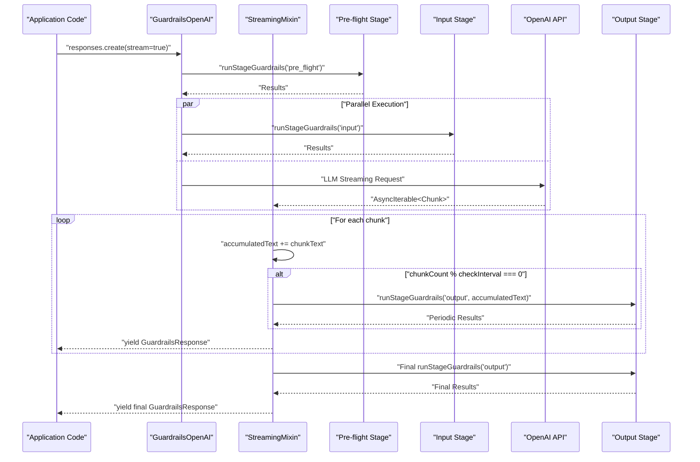
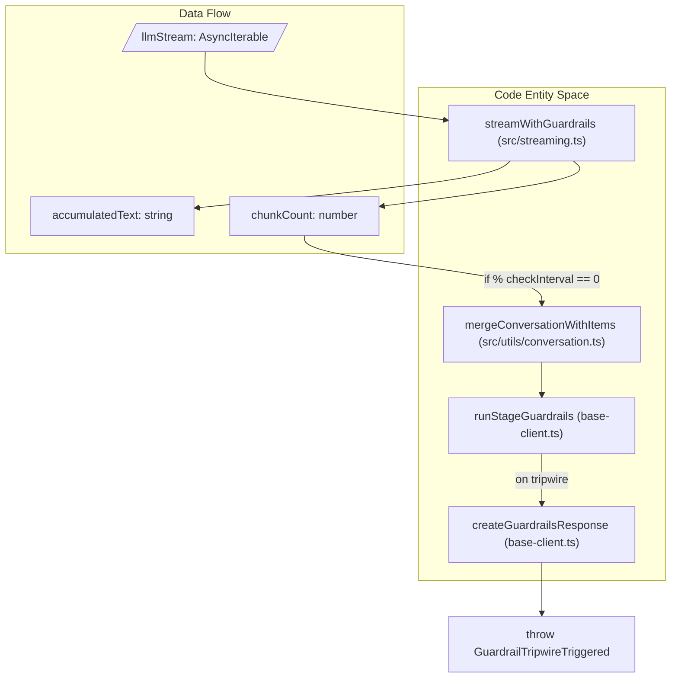

<!-- source: DeepWiki mcp.deepwiki.com · repo openai/openai-guardrails-js · page 7.4 Streaming Responses · fetched 2026-10-26 -->

# Streaming Responses

<details>
<summary>Relevant source files</summary>

The following files were used as context for generating this wiki page:

- [LICENSE](LICENSE)
- [docs/examples.md](docs/examples.md)
- [docs/streaming_output.md](docs/streaming_output.md)
- [examples/README.md](examples/README.md)
- [examples/basic/hello_world.ts](examples/basic/hello_world.ts)
- [examples/basic/local_model.ts](examples/basic/local_model.ts)
- [examples/basic/multiturn_with_prompt_injection_detection.ts](examples/basic/multiturn_with_prompt_injection_detection.ts)
- [examples/basic/streaming.ts](examples/basic/streaming.ts)
- [src/streaming.ts](src/streaming.ts)
- [vercel.json](vercel.json)

</details>


## Purpose and Scope

This document explains how guardrails behave when used with streaming responses from the OpenAI API. It covers the execution timing of different pipeline stages, the implementation details of the `StreamingMixin`, how to access guardrail results during streaming, and the trade-offs between safety and latency.

## Overview

Guardrails support streaming responses through the standard OpenAI streaming interface. When `stream: true` is passed to the client, the framework balances progressive content delivery with comprehensive validation. The key difference from non-streaming mode is that output guardrails cannot execute until the complete response has been received or at periodic intervals, as they require context for validation [docs/streaming_output.md:25-36]().

### Streaming Execution Model

The `StreamingMixin` class handles the logic for wrapping an LLM stream with guardrail checks [src/streaming.ts:16-17]().



Sources: [src/streaming.ts:20-103](), [docs/streaming_output.md:25-36]()

## Pipeline Stage Behavior

### Pre-flight Stage
Pre-flight guardrails execute **before** the streaming request is sent to the API. This stage blocks the request if a tripwire is triggered, ensuring no unsafe input ever reaches the LLM [src/streaming.ts:23](), [examples/streaming.ts:13-30]().

### Input Stage
Input guardrails execute **in parallel** with the streaming response initialization. While the LLM begins generating tokens, the framework validates the input [src/streaming.ts:24](), [docs/streaming_output.md:31-33]().

### Output Stage
Output guardrails in streaming mode have a dual behavior implemented in `streamWithGuardrails` [src/streaming.ts:20-103]():
1.  **Periodic Checks**: Every `checkInterval` (default 100 chunks), the current `accumulatedText` is validated against output guardrails [src/streaming.ts:39-44]().
2.  **Final Validation**: Once the stream is exhausted, a final validation pass is performed on the complete `accumulatedText` [src/streaming.ts:70-80]().

Sources: [src/streaming.ts:20-103](), [docs/streaming_output.md:25-36](), [examples/streaming.ts:42-60]()

## Implementation Details

The `StreamingMixin` provides the core logic for handling asynchronous streams with guardrails.

### Key Functions and Classes

| Entity | Location | Role |
| :--- | :--- | :--- |
| `StreamingMixin` | [src/streaming.ts:16]() | Mixin providing `streamWithGuardrails` logic to the base client. |
| `streamWithGuardrails` | [src/streaming.ts:20]() | Async generator that iterates over LLM chunks, accumulates text, and runs output guardrails. |
| `streamWithGuardrailsSync` | [src/streaming.ts:108]() | Static wrapper to initialize the mixin and call the generator. |
| `mergeConversationWithItems` | [src/utils/conversation.ts]() | Used to combine history with the streaming assistant response for context-aware guardrails [src/streaming.ts:41-43](). |

### Data Flow in `streamWithGuardrails`

The following diagram maps the code entities to the streaming data flow.



Sources: [src/streaming.ts:20-127](), [src/utils/conversation.ts:11]()

## Code Patterns

### Basic Streaming Implementation
To use streaming, set `stream: true` in the `create` call. The returned object is an `AsyncIterable` of `GuardrailsResponse` [examples/streaming.ts:74-79]().

```typescript
const stream = await guardrailsClient.guardrails.responses.create({
  input: userInput,
  model: 'gpt-4.1-mini',
  stream: true,
});

for await (const chunk of stream) {
  if ('delta' in chunk && chunk.delta) {
    process.stdout.write(chunk.delta);
  }
}
```
Sources: [examples/streaming.ts:74-106]()

### Accessing Results and Usage
Token usage and final guardrail results are typically found in the final chunk of the stream [examples/streaming.ts:110-115]().

```typescript
// Inside the for-await loop
if (typeof chunk === 'object' && 'response' in chunk) {
  const responseId = (chunk.response).id;
}

// After the loop
const usage = totalGuardrailTokenUsage(lastChunk);
```
Sources: [examples/streaming.ts:97-115](), [src/streaming.ts:82-88]()

## Performance and Safety Trade-offs

| Mode | Latency (TTFT) | Safety | Implementation |
| :--- | :--- | :--- | :--- |
| **Blocking** | High | **Maximum**: All checks pass before any output. | `stream: false` (Default) |
| **Streaming** | Low | **Balanced**: Pre-flight/Input block; Output validates during/after. | `stream: true` |

### Latency Profile
1.  **Pre-flight**: Adds sequential delay to the Time-To-First-Token (TTFT) [docs/streaming_output.md:9-14]().
2.  **Input**: No impact on TTFT as it runs in parallel with the LLM call [docs/streaming_output.md:31-33]().
3.  **Output**: Adds periodic small delays (if `checkInterval` is low) and a final delay after the stream ends to finalize validation [src/streaming.ts:39-44](), [src/streaming.ts:70-80]().

### Safety Risk
In streaming mode, violative content may briefly appear to the user before an output guardrail triggers a tripwire and throws an exception [docs/streaming_output.md:34](). When a tripwire is triggered during streaming, the `StreamingMixin` yields the final guardrail result and throws `GuardrailTripwireTriggered` [src/streaming.ts:46-55]().

Sources: [src/streaming.ts:20-103](), [docs/streaming_output.md:1-45]()

## Related Documentation
- [Default Blocking Behavior](#4.1)
- [Suppressing Tripwires](#4.2)
- [Pipeline Stage Selection](#7.1)

Sources: [examples/streaming.ts:1-176](), [src/streaming.ts:1-128]()

---

