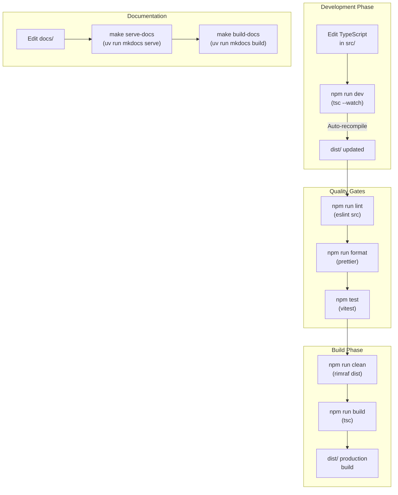
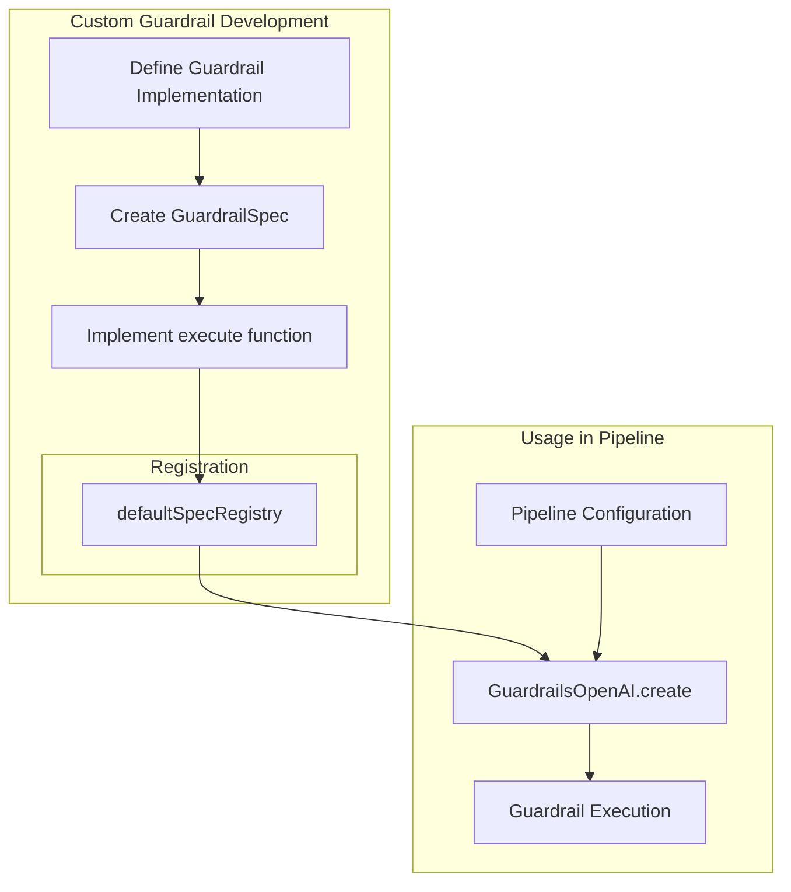

<!-- source: DeepWiki mcp.deepwiki.com · repo openai/openai-guardrails-js · page 8 Development and Contributing · fetched 2026-10-26 -->

# Development and Contributing

<details>
<summary>Relevant source files</summary>

The following files were used as context for generating this wiki page:

- [.github/workflows/ci.yml](.github/workflows/ci.yml)
- [.github/workflows/docs.yml](.github/workflows/docs.yml)
- [.github/workflows/publish.yml](.github/workflows/publish.yml)
- [Makefile](Makefile)
- [docs/ref/exceptions-typescript.md](docs/ref/exceptions-typescript.md)
- [mkdocs.yml](mkdocs.yml)
- [package-lock.json](package-lock.json)
- [package.json](package.json)

</details>


This document provides a guide for developers who want to contribute to the OpenAI Guardrails TypeScript framework or extend it with custom functionality. It covers the repository structure, development workflow, and integration points for custom guardrails.

For specific topics:
- **Setting up your development environment**: See [Development Setup](#8.1)
- **Understanding the build pipeline**: See [Build System](#8.2)
- **Code quality standards and tools**: See [Code Quality Tools](#8.3)
- **Working with documentation**: See [Documentation System](#8.4)
- **Implementing custom guardrail checks**: See [Creating Custom Guardrails](#8.5)

## Repository Structure

The repository follows a standard TypeScript package layout with dedicated directories for source code, compiled output, documentation, and examples.

```mermaid
graph TB
    subgraph "Repository Root"
        Root["/"]
        
        subgraph "Source Code"
            Src["src/<br/>(TypeScript source)"]
            Checks["src/checks/<br/>(Built-in guardrails)"]
            Evals["src/evals/<br/>(Evaluation framework)"]
            Index["src/index.ts<br/>(Main exports)"]
            CLI["src/cli.ts<br/>(CLI entry point)"]
        end
        
        subgraph "Build Output"
            Dist["dist/<br/>(Compiled JavaScript)"]
            DistIndex["dist/index.js<br/>(Package entry)"]
            DistCLI["dist/cli.js<br/>(CLI binary)"]
            DistTypes["dist/index.d.ts<br/>(Type definitions)"]
        end
        
        subgraph "Documentation"
            Docs["docs/<br/>(Markdown files)"]
            MkDocsYML["mkdocs.yml<br/>(MkDocs config)"]
            Site["site/<br/>(Built static site)"]
        end
        
        subgraph "Examples"
            Examples["examples/<br/>(Usage examples)"]
        end
        
        subgraph "Configuration"
            PackageJSON["package.json<br/>(npm config)"]
            Makefile["Makefile<br/>(Dev shortcuts)"]
        end
    end
    
    Root --> Src
    Src --> Checks
    Src --> Evals
    Src --> Index
    Src --> CLI
    
    Root --> Dist
    Dist --> DistIndex
    Dist --> DistCLI
    Dist --> DistTypes
    
    Root --> Docs
    Docs --> MkDocsYML
    Docs --> Site
    
    Root --> Examples
    
    Root --> PackageJSON
    Root --> Makefile
```

**Sources:** [package.json:1-12](), [mkdocs.yml:1-33]()

### Key Directories and Files

| Path | Purpose | Contents |
|------|---------|----------|
| `src/` | TypeScript source code | All framework implementation code |
| `src/index.ts` | Main entry point | Public API exports for the package |
| `src/cli.ts` | CLI implementation | Command-line evaluation tool |
| `dist/` | Compiled JavaScript | Auto-generated from TypeScript compilation |
| `dist/index.js` | Package entry point | Specified in `package.json` `main` field |
| `dist/cli.js` | CLI binary | Specified in `package.json` `bin` field |
| `docs/` | Documentation source | Markdown files for MkDocs |
| `examples/` | Usage examples | Demonstrates integration patterns |

**Sources:** [package.json:5-9](), [mkdocs.yml:33-54]()

## Development Workflow Overview

The development workflow follows a standard TypeScript package development cycle with additional documentation build steps.



**Sources:** [package.json:13-26](), [Makefile:1-36]()

### Common Development Commands

The repository provides both `npm` scripts and `Makefile` targets for convenience.

| Command | Makefile | npm Script | Purpose |
|---------|----------|------------|---------|
| Install dependencies | `make install` | `npm install` | Install all dependencies |
| Build for production | `make build` | `npm run build` | Compile TypeScript to `dist/` |
| Development mode | N/A | `npm run dev` | Watch mode compilation |
| Run tests | `make test` | `npm test` | Execute test suite with Vitest |
| Lint code | `make lint` | `npm run lint` | Check code quality with ESLint |
| Format code | `make format` | `npm run format` | Format files with Prettier |
| Clean build | N/A | `npm run clean` | Remove `dist/` directory |
| Run evaluations | N/A | `npm run eval` | Execute evaluation command |

**Sources:** [package.json:13-27](), [Makefile:1-20]()

## Testing Your Changes

After making code changes, you should verify them using the available testing and validation tools.

### Running Unit Tests

The project uses Vitest for testing. Test scripts are defined in the package configuration.

```bash
# Run tests once
npm test

# Run tests in watch mode
npm run test:watch

# Run tests without watch mode
npm run test:run
```

**Sources:** [package.json:17-19]()

### Testing the CLI

The CLI tool is available after building and can be used to run evaluations.

```bash
# Build first
npm run build

# Run the CLI
npm run cli -- --help

# Run evaluation
npm run eval
```

**Sources:** [package.json:24-25]()

## Integration Points for Custom Guardrails

The framework provides specific integration points for developers to add custom guardrails.



Detailed implementation guidance is available in [Creating Custom Guardrails](#8.5).

## Contributing Guidelines

### Code Quality Standards

All contributions must pass the following quality gates:

1. **Linting**: Code must pass ESLint checks [package.json:20]().
2. **Formatting**: Code must be formatted with Prettier [package.json:22]().
3. **Testing**: All tests must pass using Vitest [package.json:17]().

### Pre-publication Checks

Before publishing to npm, the `prepublishOnly` hook automatically runs a clean build:

```bash
npm run clean && npm run build
```

**Sources:** [package.json:23]()

## Documentation Development

The repository uses MkDocs for documentation. Python dependencies are managed by `uv`.

### Documentation Commands

| Command | Purpose |
|---------|---------|
| `make sync` | Install Python dependencies with `uv sync` |
| `make serve-docs` | Start local documentation server |
| `make build-docs` | Build static documentation site |
| `make deploy-docs` | Deploy to GitHub Pages |

**Sources:** [Makefile:21-36](), [.github/workflows/docs.yml:26-33]()

For detailed information about the documentation system, see [Documentation System](#8.4).

---

