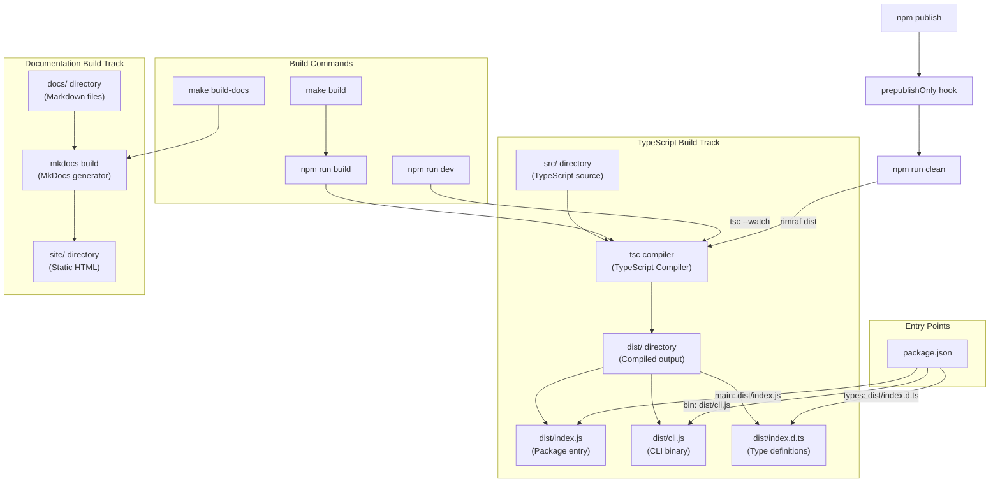
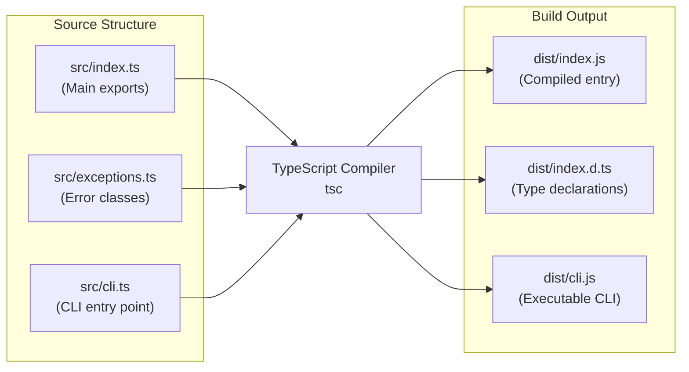
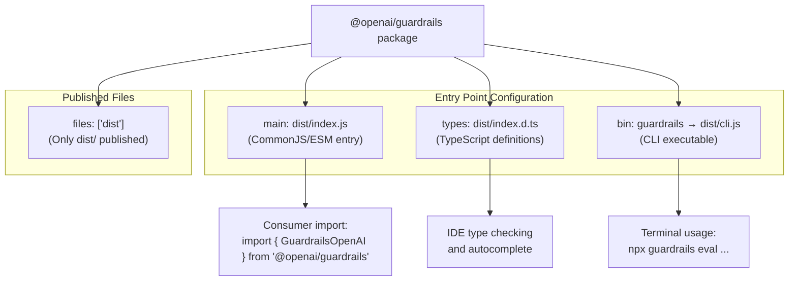

<!-- source: DeepWiki mcp.deepwiki.com · repo openai/openai-guardrails-js · page 8.2 Build System · fetched 2026-10-26 -->

# Build System

<details>
<summary>Relevant source files</summary>

The following files were used as context for generating this wiki page:

- [Makefile](Makefile)
- [docs/ref/exceptions-typescript.md](docs/ref/exceptions-typescript.md)
- [mkdocs.yml](mkdocs.yml)
- [package-lock.json](package-lock.json)
- [package.json](package.json)

</details>


## Purpose and Scope

This document describes the build pipeline for the OpenAI Guardrails TypeScript package, including TypeScript compilation, npm scripts, Makefile automation, and the dual-track build system for both the JavaScript package and its documentation.

The system is designed to transform the TypeScript source code into a distributable package while simultaneously maintaining a Python-based documentation site.

---

## Build Pipeline Overview

The build system operates on two parallel tracks: a TypeScript-to-JavaScript compilation track for the npm package, and a Python-based MkDocs track for documentation generation. The TypeScript track is the primary build system for the distributable package.

**Build Pipeline Flow**



**Sources:** [package.json:1-68](), [Makefile:1-36](), [mkdocs.yml:1-70]()

---

## npm Scripts Reference

The build system is primarily controlled through npm scripts defined in `package.json`. These scripts handle compilation, development workflows, testing, and package publishing.

### Core Build Scripts

| Script | Command | Purpose |
|--------|---------|---------|
| `build` | `tsc` | Compile TypeScript source to JavaScript in `dist/` |
| `dev` | `tsc --watch` | Continuous compilation in watch mode for development |
| `clean` | `rimraf dist` | Remove all compiled output before fresh builds |
| `prepublishOnly` | `npm run clean && npm run build` | Automatic clean build before npm publishing |

### Quality Assurance Scripts

| Script | Command | Purpose |
|--------|---------|---------|
| `test` | `vitest` | Run unit and integration tests |
| `test:watch` | `vitest --watch` | Explicit watch mode for tests |
| `test:run` | `vitest run` | One-time test execution (CI/CD) |
| `lint` | `eslint src --ext .ts` | Check code for linting errors |
| `lint:fix` | `eslint src --ext .ts --fix` | Auto-fix linting issues |
| `format` | `prettier --write ...` | Format all code files using Prettier |

### CLI and Evaluation Scripts

| Script | Command | Purpose |
|--------|---------|---------|
| `cli` | `node dist/cli.js` | Run the guardrails CLI tool |
| `eval` | `node dist/cli.js eval` | Run guardrail evaluation on datasets |
| `eval:example` | `node dist/examples/run-eval.js` | Run example evaluation script |

**Sources:** [package.json:13-27]()

---

## TypeScript Compilation Process

The build process transforms TypeScript source code in `src/` into distributable JavaScript and type definitions in `dist/`.

### Compilation Workflow



The compiler generates:
- **JavaScript files** (`.js`): Executable code for Node.js runtimes.
- **Type declaration files** (`.d.ts`): TypeScript type information for consumers [package.json:6-6]().
- **CLI Executable**: The `dist/cli.js` file which is mapped to the `guardrails` command [package.json:7-9]().

**Sources:** [package.json:5-9](), [package.json:14-14](), [docs/ref/exceptions-typescript.md:26-26]()

---

## Build Outputs and Package Structure

The compiled package follows npm conventions with well-defined entry points and file inclusions.

### Package Entry Points



The `files` field in `package.json` ensures only the `dist/` directory is published to npm, excluding source code, tests, and development files [package.json:10-12]().

**Sources:** [package.json:5-12]()

---

## Makefile Automation

The Makefile provides convenient shortcuts for both npm-based TypeScript builds and Python-based documentation builds. It serves as a unified interface to the dual-track build system.

### Makefile Targets

| Target | Command | Purpose |
|--------|---------|---------|
| `install` | `npm install` | Install Node.js dependencies [Makefile:2-3]() |
| `build` | `npm run build` | Compile TypeScript to JavaScript [Makefile:18-19]() |
| `format` | `npm run format` | Format code with Prettier [Makefile:6-7]() |
| `lint` | `npm run lint` | Lint code with ESLint [Makefile:10-11]() |
| `test` | `npm test` | Run test suite [Makefile:14-15]() |
| `sync` | `uv sync` | Synchronize Python dependencies for docs [Makefile:22-23]() |
| `build-docs` | `uv run mkdocs build --site-dir site` | Build documentation static site [Makefile:26-27]() |
| `serve-docs` | `uv run mkdocs serve` | Serve docs locally for preview [Makefile:30-31]() |
| `deploy-docs` | `uv run mkdocs gh-deploy ...` | Deploy docs to GitHub Pages [Makefile:34-35]() |

**Sources:** [Makefile:1-36]()

---

## Development Workflow

### Watch Mode for Rapid Development

For active development, use watch mode to automatically recompile on file changes:

```bash
npm run dev
```

This runs `tsc --watch`, which continuously monitors the source and recompiles only changed files [package.json:15-15]().

### Cleaning the Environment

To ensure a clean state before building, the `clean` script removes the `dist` directory using `rimraf` [package.json:16-16]().

**Sources:** [package.json:15-16]()

---

## Build Hooks and Publishing

### prepublishOnly Hook

The `prepublishOnly` script ensures a clean, fresh build before every npm publish operation:

```bash
"prepublishOnly": "npm run clean && npm run build"
```

This hook:
1. **Removes old artifacts** via `npm run clean`.
2. **Compiles from scratch** via `npm run build`.

This ensures that the published `dist/` folder always matches the latest source code [package.json:23-23]().

### publishConfig

The package is configured for public access on the npm registry:

```json
"publishConfig": {
  "access": "public"
}
```

**Sources:** [package.json:23-23](), [package.json:65-67]()

---

## Documentation Build System

Documentation uses a Python-based stack with MkDocs, configured via `mkdocs.yml`. The `uv` tool manages Python dependencies.

### Documentation Build Configuration

The `mkdocs.yml` file defines the site structure and theme:
- **Theme**: Material theme with code copy/annotate features [mkdocs.yml:4-16]().
- **Plugins**: Search and i18n [mkdocs.yml:25-32]().
- **Navigation**: Structured mapping of Markdown files in the `docs/` folder [mkdocs.yml:33-54]().
- **Extensions**: Support for Mermaid diagrams via `pymdownx.superfences` [mkdocs.yml:19-23]().

### Makefile Integration

- `make sync` - Install Python dependencies via `uv sync` [Makefile:22-23]().
- `make build-docs` - Build static site to `site/` directory [Makefile:26-27]().
- `make deploy-docs` - Deploy to GitHub Pages via `mkdocs gh-deploy` [Makefile:34-35]().

**Sources:** [mkdocs.yml:1-70](), [Makefile:21-36]()

---

## Engine Requirements

The package requires Node.js 18.0.0 or higher:

```json
"engines": {
  "node": ">=18.0.0"
}
```

**Sources:** [package.json:62-64]()

---

