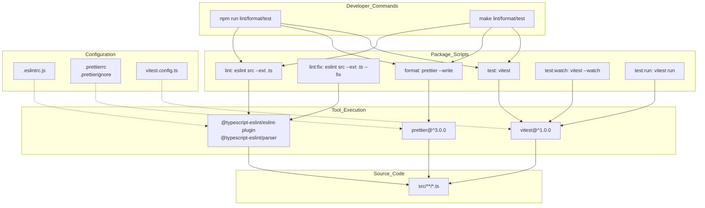
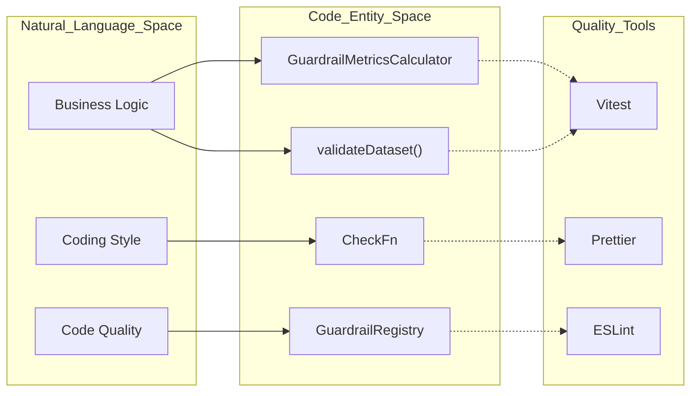
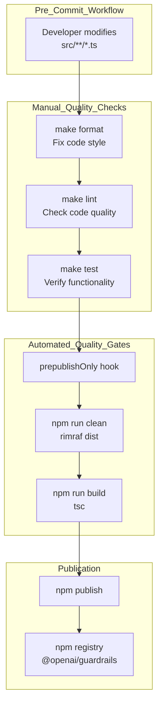

<!-- source: DeepWiki mcp.deepwiki.com · repo openai/openai-guardrails-js · page 8.3 Code Quality Tools · fetched 2026-10-26 -->

# Code Quality Tools

<details>
<summary>Relevant source files</summary>

The following files were used as context for generating this wiki page:

- [.eslintrc.js](.eslintrc.js)
- [.prettierignore](.prettierignore)
- [.prettierrc](.prettierrc)
- [src/__tests__/unit/evals.test.ts](src/__tests__/unit/evals.test.ts)
- [src/__tests__/unit/registry.test.ts](src/__tests__/unit/registry.test.ts)
- [vitest.config.ts](vitest.config.ts)

</details>


## Purpose and Scope

This page documents the code quality tools used in the OpenAI Guardrails repository: ESLint for code linting, Prettier for code formatting, and Vitest for unit and integration testing. These tools enforce code quality standards and ensure consistent code style across the codebase.

For information about the overall build system and compilation process, see [Build System](#8.2). For documentation generation tools, see [Documentation System](#8.4).

---

## Overview

The repository uses three primary quality assurance tools that operate on the TypeScript source code in `src/`:

| Tool | Purpose | Configuration Files | npm Script | Makefile Target |
|------|---------|-------------------|------------|----------------|
| ESLint | TypeScript linting and code quality | `.eslintrc.js` | `lint`, `lint:fix` | `lint` |
| Prettier | Code formatting | `.prettierrc`, `.prettierignore` | `format` | `format` |
| Vitest | Unit and integration testing | `vitest.config.ts` | `test`, `test:watch`, `test:run` | `test` |

All three tools are configured as `devDependencies` in [package.json:51-59]() and can be invoked via npm scripts or Makefile shortcuts.

**Sources:** [package.json:1-67](), [Makefile:1-36]()

---

## Tool Execution Flow



**Tool Execution Flow Diagram:** Shows how developer commands route through npm scripts to the underlying quality tools, which operate on source code using their respective configuration files.

**Sources:** [package.json:13-26](), [Makefile:5-15](), [.eslintrc.js:1-22](), [vitest.config.ts:1-31]()

---

## ESLint Configuration

### Overview

ESLint provides TypeScript-specific linting rules via the `@typescript-eslint/eslint-plugin` and `@typescript-eslint/parser` packages. The linter analyzes all `.ts` files in the `src/` directory for code quality issues, type safety violations, and style inconsistencies.

### Dependencies

The following ESLint-related packages are installed as development dependencies:

```
@typescript-eslint/eslint-plugin: ^6.0.0
@typescript-eslint/parser: ^6.0.0
eslint: ^8.0.0
```

**Sources:** [package.json:53-55]()

### Configuration Details

The project uses a JavaScript-based configuration file [.eslintrc.js:1-22](). Key settings include:

*   **Parser**: `@typescript-eslint/parser` is used to allow ESLint to understand TypeScript syntax [.eslintrc.js:2]().
*   **Plugins**: Uses the `@typescript-eslint` plugin [.eslintrc.js:4]().
*   **Environment**: Configured for `node` and `es2020` [.eslintrc.js:5-8]().
*   **Rules**:
    *   `no-unused-vars` is disabled in favor of the TypeScript version [.eslintrc.js:14]().
    *   `@typescript-eslint/no-unused-vars` is set to `warn`, ignoring variables or arguments starting with an underscore (`_`) [.eslintrc.js:15]().
    *   `@typescript-eslint/no-explicit-any` is set to `warn` to discourage the use of the `any` type [.eslintrc.js:18]().
    *   `no-redeclare` and `@typescript-eslint/no-redeclare` are disabled [.eslintrc.js:19-20]().

**Sources:** [.eslintrc.js:1-22]()

### Running ESLint

ESLint can be executed in two modes:

| Mode | Command | Behavior |
|------|---------|----------|
| Check-only | `npm run lint` or `make lint` | Reports violations without modifying files |
| Auto-fix | `npm run lint:fix` | Automatically fixes violations where possible |

The lint command is defined as `eslint src --ext .ts` in [package.json:20]().

**Sources:** [package.json:20-21](), [Makefile:9-11]()

---

## Prettier Configuration

### Overview

Prettier enforces consistent code formatting across all JavaScript, TypeScript, and JSON files. It operates as an opinionated code formatter with minimal configuration options, ensuring uniform style without manual intervention.

### Dependencies

```
prettier: ^3.0.0
```

**Sources:** [package.json:56]()

### Configuration Details

Prettier configuration is defined in [.prettierrc:1-12]():

| Setting | Value | Description |
|---------|-------|-------------|
| `printWidth` | 100 | Maximum line length before wrapping |
| `tabWidth` | 2 | Number of spaces per indentation level |
| `useTabs` | false | Use spaces instead of tabs |
| `semi` | true | Add semicolons at end of statements |
| `singleQuote` | true | Use single quotes instead of double quotes |
| `trailingComma` | "es5" | Add trailing commas where valid in ES5 |
| `bracketSpacing` | true | Add spaces inside object literal braces |
| `arrowParens` | "always" | Always include parentheses around arrow function arguments |
| `endOfLine` | "lf" | Use Unix-style line endings |

**Sources:** [.prettierrc:1-12]()

### Ignored Files

Files and directories excluded from Prettier formatting are specified in [.prettierignore:1-5]():

```
node_modules
package-lock.json
dist
build
coverage
```

**Sources:** [.prettierignore:1-5]()

### Running Prettier

Execute Prettier with `npm run format` or `make format`. The script targets all JavaScript and TypeScript variants, as well as JSON files [package.json:22]().

**Sources:** [package.json:22](), [Makefile:5-7]()

---

## Vitest Testing Framework

### Overview

Vitest serves as the unit and integration testing framework. It provides a fast, Vite-powered test runner with TypeScript support out of the box.

### Dependencies

```
vitest: ^1.0.0
```

**Sources:** [package.json:59]()

### Configuration

Vitest configuration is managed in [vitest.config.ts:1-31]().

*   **Environment**: Uses the `node` environment [vitest.config.ts:6]().
*   **Inclusion Patterns**: Matches files ending in `.test.ts` or `.spec.ts` within `src/` and `tests/` directories [vitest.config.ts:7]().
*   **Coverage**:
    *   **Provider**: Uses `v8` for coverage reporting [vitest.config.ts:9]().
    *   **Reporters**: Outputs `text`, `json`, and `html` reports [vitest.config.ts:10]().
    *   **Thresholds**: Enforces minimum coverage for statements (30%), branches (25%), functions (30%), and lines (30%) [vitest.config.ts:23-28]().
    *   **Exclusions**: Specifically excludes `node_modules`, `dist`, `coverage`, `examples`, and internal test utility files like `src/test-registration.ts` [vitest.config.ts:12-22]().

**Sources:** [vitest.config.ts:1-31]()

### Test Structure Example

The evaluation framework tests in [src/__tests__/unit/evals.test.ts:31-205]() demonstrate standard Vitest usage:
*   **Mocking**: Uses `vi.mock` for file system and path modules [src/__tests__/unit/evals.test.ts:19-29]().
*   **Organization**: Uses `describe` blocks to group tests for specific classes like `GuardrailMetricsCalculator` [src/__tests__/unit/evals.test.ts:32]() and functions like `validateDataset` [src/__tests__/unit/evals.test.ts:104]().
*   **Assertions**: Uses `expect` to verify logic, such as calculating precision and recall [src/__tests__/unit/evals.test.ts:71-73]().

The registry module tests in [src/__tests__/unit/registry.test.ts:45-207]() show how to test guardrail registration and instantiation using Zod schemas for validation.

**Sources:** [src/__tests__/unit/evals.test.ts:1-205](), [src/__tests__/unit/registry.test.ts:1-207]()

---

## Integration with Build Pipeline

### Code Entity to Quality Tool Mapping



**Entity Mapping Diagram:** Bridges the gap between abstract quality goals, specific code entities (classes/functions), and the tools used to verify them.

**Sources:** [src/__tests__/unit/evals.test.ts:12](), [src/registry.ts:14](), [src/types.ts:16]()

### Quality Gates Diagram



**Quality Gates Integration Diagram:** Shows how quality tools integrate into the development workflow, from manual developer checks through automated pre-publish hooks.

**Sources:** [package.json:23](), [Makefile:1-20]()

### Pre-Publish Hook

The `prepublishOnly` script in [package.json:23]() ensures code quality before publication:

```json
"prepublishOnly": "npm run clean && npm run build"
```

This hook cleans the `dist/` directory and rebuilds from source using the TypeScript compiler.

**Sources:** [package.json:23]()

### Makefile Shortcuts

The [Makefile:1-20]() provides convenient shortcuts for quality tools:

```makefile
.PHONY: lint
lint: 
	npm run lint

.PHONY: format
format: 
	npm run format

.PHONY: test
test: 
	npm test
```

**Sources:** [Makefile:5-15]()

---

## Engine Requirements

The repository requires Node.js version 18.0.0 or higher, as specified in [package.json:61-63]():

```json
"engines": {
  "node": ">=18.0.0"
}
```

This ensures compatibility with modern TypeScript features and Vitest's requirements.

**Sources:** [package.json:61-63]()

---

