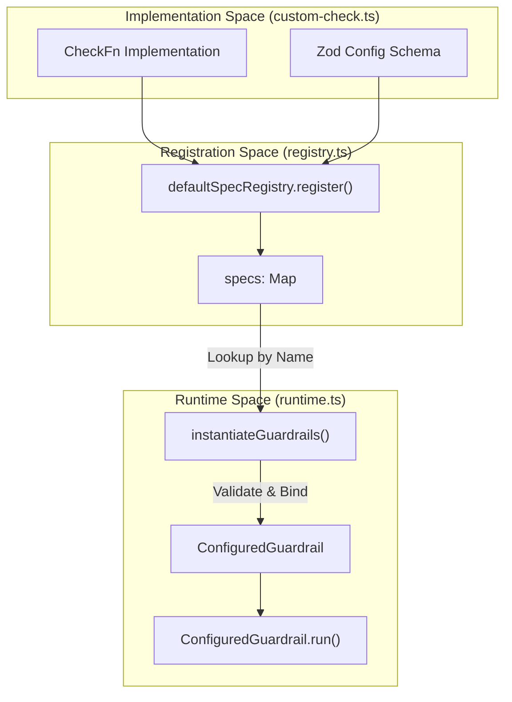
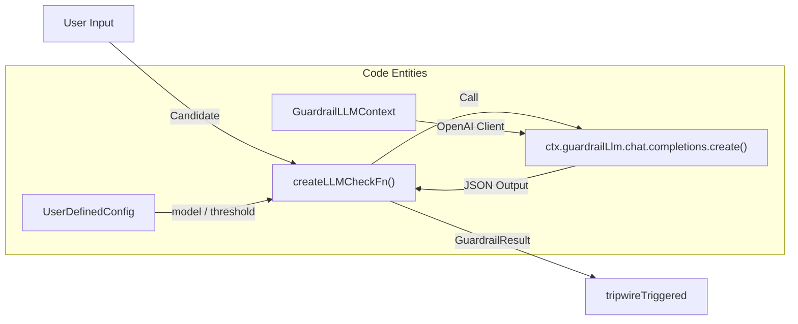

<!-- source: DeepWiki mcp.deepwiki.com · repo openai/openai-guardrails-js · page 8.5 Creating Custom Guardrails · fetched 2026-10-26 -->

# Creating Custom Guardrails

<details>
<summary>Relevant source files</summary>

The following files were used as context for generating this wiki page:

- [src/__tests__/unit/checks/topical-alignment.test.ts](src/__tests__/unit/checks/topical-alignment.test.ts)
- [src/__tests__/unit/checks/user-defined-llm.test.ts](src/__tests__/unit/checks/user-defined-llm.test.ts)
- [src/checks/topical-alignment.ts](src/checks/topical-alignment.ts)
- [src/checks/user-defined-llm.ts](src/checks/user-defined-llm.ts)
- [src/registry.ts](src/registry.ts)
- [src/runtime.ts](src/runtime.ts)

</details>


## Purpose and Scope

This page guides developers through implementing custom guardrail checks that extend the OpenAI Guardrails framework. It covers the core interfaces, type system, registration mechanism, and best practices for creating guardrails that integrate seamlessly with the existing pipeline.

For information about using built-in guardrails, see [Built-in Guardrails Reference](#5). For general development setup, see [Development Setup](#8.1).

---

## Overview

The Guardrails framework is designed to be extensible. Custom guardrails follow the same patterns as built-in guardrails and can be registered with the `defaultSpecRegistry` to make them available throughout the framework. Once registered, custom guardrails can be configured in pipeline configurations alongside built-in checks.

### Guardrail Registration and Runtime Flow

This diagram illustrates how a custom guardrail moves from registration in the code to execution within the runtime environment.


**Sources:** [src/registry.ts:55-92](), [src/runtime.ts:189-215](), [src/runtime.ts:88-91]()

---

## Core Interfaces

### CheckFn Type

All guardrails implement the `CheckFn` interface, which is a generic function type. This is the primary entry point for custom logic.

```typescript
CheckFn<Context, Candidate, Config>
```

| Type Parameter | Purpose | Example |
|----------------|---------|---------|
| `Context` | Runtime context provided to the check | `GuardrailLLMContext` |
| `Candidate` | Type of data being validated | `string` (for text checks) |
| `Config` | Configuration schema type (from Zod) | `UserDefinedConfig` |

The function signature is defined as:
`async (ctx: Context, candidate: Candidate, config: Config) => Promise<GuardrailResult>`

**Sources:** [src/types.ts:11-12](), [src/checks/user-defined-llm.ts:45-52]()

### GuardrailResult Structure

Every check function must return a `GuardrailResult` object. The `runtime.ts` orchestration logic uses the `tripwireTriggered` field to determine if the pipeline should block.

| Field | Type | Purpose |
|-------|------|---------|
| `tripwireTriggered` | `boolean` | Whether this result should trigger the tripwire mechanism |
| `info` | `object` | Detailed information about the check result |
| `info.flagged` | `boolean` | Whether the content was flagged |
| `info.confidence` | `number` | Confidence score (0.0-1.0) |
| `info.reasoning` | `string` | Human-readable explanation of the result |
| `executionFailed` | `boolean` | Set by runtime if the function throws an error |

**Sources:** [src/runtime.ts:148-162](), [src/__tests__/unit/checks/user-defined-llm.test.ts:116-118]()

---

## Configuration Schema Definition

Custom guardrails use **Zod** to define and validate configuration schemas. This ensures that parameters passed in the `PipelineConfig` match the requirements of the check function.

### Example Schema Extension
Most custom LLM-based guardrails extend `LLMConfig` to inherit parameters like `model` and `confidence_threshold`.

```typescript
// From user-defined-llm.ts
export const UserDefinedConfig = LLMConfig.omit({ system_prompt_details: true }).extend({
  /** Free-form instructions describing content moderation requirements */
  system_prompt_details: z.string().describe('Free-form instructions describing content moderation requirements'),
});

export type UserDefinedConfig = z.infer<typeof UserDefinedConfig>;
```
**Sources:** [src/checks/user-defined-llm.ts:18-23](), [src/checks/topical-alignment.ts:18-21]()

---

## Implementation Patterns

### Using the LLM Helper
The framework provides `createLLMCheckFn` in `llm-base.ts` to simplify the creation of guardrails that require an LLM call. This helper handles system prompt formatting, JSON response parsing, and confidence threshold comparison.

### LLM Check Entity Association
This diagram associates the conceptual "Safety Check" with the specific code entities involved in an LLM-based guardrail execution.


**Sources:** [src/checks/llm-base.ts:11-12](), [src/checks/user-defined-llm.ts:45-52](), [src/__tests__/unit/checks/user-defined-llm.test.ts:70-79]()

### Implementation Example: Topical Alignment
The `topicalAlignment` guardrail demonstrates how to use a custom system prompt template with the `createLLMCheckFn` utility.

```typescript
const SYSTEM_PROMPT = `You are a content analysis system... 
BUSINESS SCOPE: {system_prompt_details}...`;

export const topicalAlignment: CheckFn<TopicalAlignmentContext, string, TopicalAlignmentConfig> =
  createLLMCheckFn(
    'Off Topic Prompts',
    'Checks that the content stays within the defined business scope',
    SYSTEM_PROMPT,
    undefined,
    TopicalAlignmentConfig as unknown as typeof LLMConfig
  ) as CheckFn<TopicalAlignmentContext, string, TopicalAlignmentConfig>;
```
**Sources:** [src/checks/topical-alignment.ts:40-60]()

---

## Registry Integration

To make a guardrail available in the `PipelineConfig` JSON, it must be registered with the `defaultSpecRegistry`.

### Registration API
The `register` method in `GuardrailRegistry` stores a `GuardrailSpec` which includes the logic and the validation schemas.

```typescript
// src/registry.ts
register<TContext, TIn, TCfg>(
    name: string,
    checkFn: CheckFn<TContext, TIn, TCfg>,
    description: string,
    mediaType: string = 'text/plain',
    configSchema?: z.ZodType<TCfg>,
    ctxRequirements?: z.ZodType<TContext>,
    metadata?: GuardrailSpecMetadata
): void
```

### Registry Lifecycle
1. **Registration**: The module calls `defaultSpecRegistry.register()` during initialization.
2. **Lookup**: The `instantiateGuardrails` function in `runtime.ts` calls `defaultSpecRegistry.get(name)`.
3. **Validation**: The `GuardrailSpec.configSchema` is used to parse the incoming JSON configuration.

**Sources:** [src/registry.ts:69-92](), [src/runtime.ts:194-204]()

---

## Error Handling Best Practices

### Runtime Execution Failures
The framework differentiates between a **Safety Violation** (tripwire triggered) and an **Execution Error** (API failure, timeout).

- **Execution Errors**: By default, if a guardrail throws an exception, the runtime catches it and returns a result with `executionFailed: true` but `tripwireTriggered: false`. This ensures the application remains available even if a safety check fails.
- **Fail-Secure Mode**: If `raiseGuardrailErrors` is set to `true` in `runGuardrails`, the first execution failure will be re-thrown.

```typescript
// src/runtime.ts implementation logic
try {
  return await guardrail.run(context, data);
} catch (error) {
  return {
    tripwireTriggered: false, 
    executionFailed: true,
    originalException: error,
    info: { error: error.message }
  };
}
```
**Sources:** [src/runtime.ts:148-162](), [src/runtime.ts:167-175]()

---

## Summary Checklist for Custom Guardrails

1. **Define a Zod Config Schema**: Extend `LLMConfig` if using an LLM.
2. **Implement the Check Logic**: Use `createLLMCheckFn` for standard LLM patterns or implement `CheckFn` directly for custom logic (e.g., regex, external API).
3. **Register the Guardrail**: Call `defaultSpecRegistry.register()` at the module level.
4. **Export Types**: Export the Config and Context types for use in TypeScript consumers.
5. **Add Unit Tests**: Mock the LLM context to verify the logic triggers `tripwireTriggered` correctly based on simulated LLM outputs.

**Sources:** [src/checks/user-defined-llm.ts:1-53](), [src/__tests__/unit/checks/user-defined-llm.test.ts:84-119]()

---

