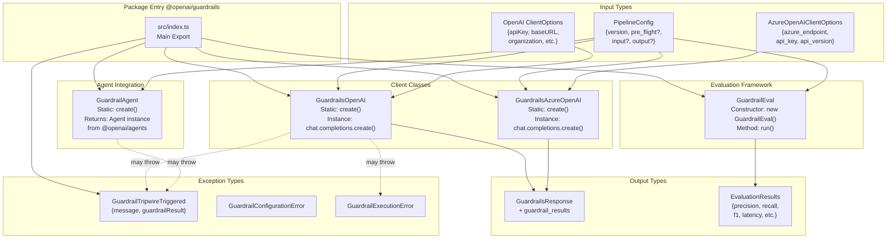

<!-- source: DeepWiki mcp.deepwiki.com · repo openai/openai-guardrails-js · page 9 API Reference · fetched 2026-10-26 -->

# API Reference

<details>
<summary>Relevant source files</summary>

The following files were used as context for generating this wiki page:

- [docs/ref/types-typescript.md](docs/ref/types-typescript.md)
- [src/index.ts](src/index.ts)

</details>


This section provides comprehensive API documentation for the `@openai/guardrails` package. It covers all exported classes, methods, configuration schemas, and type definitions required to integrate guardrails into TypeScript applications.

For implementation details on specific built-in guardrails (Moderation, PII Detection, etc.), see [Built-in Guardrails Reference](#5). For conceptual information about tripwires and error handling mechanisms, see [Tripwires and Error Handling](#4).

**Sources:** [src/index.ts:1-69]()

---

## Package Exports

The package exports four primary classes and associated types through its main entry point at `src/index.ts`:

| Export | Purpose | Subsection Reference |
|--------|---------|---------------------|
| `GuardrailsOpenAI` | Drop-in replacement for OpenAI client with guardrails | [GuardrailsOpenAI](#9.1) |
| `GuardrailsAzureOpenAI` | Azure-specific client with guardrails | [GuardrailsAzureOpenAI](#9.2) |
| `GuardrailAgent` | Agents SDK integration with guardrails | [GuardrailAgent](#9.3) |
| `GuardrailEval` | Evaluation framework for testing guardrail configurations | [GuardrailEval](#9.4) |
| Exception types | `GuardrailTripwireTriggered`, `GuardrailConfigurationError`, `GuardrailExecutionError` | [Exception Types](#9.5) |
| Configuration types | `PipelineConfig`, `GuardrailConfig`, and `GuardrailBundle` | [Configuration Schemas](#9.6) |

**Sources:** [src/index.ts:12-19](), [src/index.ts:34-37](), [src/index.ts:40-45](), [src/index.ts:59-62]()

---

## API Class Architecture

The following diagram maps the exported classes to their code entities and relationships:



**Sources:** [src/index.ts:9-65](), [src/types.ts:25-41](), [src/exceptions.ts:1-50]()

---

## Core Type Definitions

The library relies on several key interfaces to handle guardrail execution and results.

### GuardrailResult

Standard result returned by every guardrail check.

```typescript
export interface GuardrailResult {
  tripwireTriggered: boolean;
  executionFailed?: boolean;
  originalException?: Error;
  info: {
    checked_text?: string;
    media_type?: string;
    detected_content_type?: string;
    stage_name?: string;
    guardrail_name?: string;
    [key: string]: unknown;
  };
}
```

The `executionFailed` field indicates if the guardrail itself failed to execute (e.g., invalid model name). These fields are used by the `raiseGuardrailErrors` parameter to control error handling behavior.

**Sources:** [docs/ref/types-typescript.md:25-43](), [src/types.ts:114-131]()

### CheckFn

The callable signature implemented by all guardrails.

```typescript
export type CheckFn<TContext = object, TIn = TextInput, TCfg = object> =
  (ctx: TContext, input: TIn, config: TCfg) => GuardrailResult | Promise<GuardrailResult>;
```

**Sources:** [docs/ref/types-typescript.md:45-50](), [src/types.ts:145-146]()

---

## Method Signatures Overview

This table summarizes the primary methods across all exported classes:

| Class | Method | Signature | Returns | Async |
|-------|--------|-----------|---------|-------|
| `GuardrailsOpenAI` | `create()` | `(config: PipelineConfig \| string, options?: ClientOptions, raiseGuardrailErrors?: boolean)` | `Promise<GuardrailsOpenAI>` | Yes |
| `GuardrailsOpenAI` | `chat.completions.create()` | `(params: ChatCompletionCreateParams)` | `Promise<ChatCompletion & {guardrail_results}>` | Yes |
| `GuardrailsAzureOpenAI` | `create()` | `(config: PipelineConfig \| string, options: AzureOpenAIClientOptions, raiseGuardrailErrors?: boolean)` | `Promise<GuardrailsAzureOpenAI>` | Yes |
| `GuardrailAgent` | `create()` | `(config: PipelineConfig \| string, agent: Agent, options?: GuardrailAgentOptions)` | `Promise<Agent>` | Yes |
| `GuardrailEval` | `run()` | `(description?: string)` | `Promise<EvaluationResults>` | Yes |

**Sources:** [src/index.ts:40-45](), [src/index.ts:62-63](), [src/client.ts:1-150](), [src/agents.ts:1-100]()

---

## Common Parameters

### `config` Parameter

Accepts either:
- **String path**: Path to a JSON configuration file.
- **Object**: Inline `PipelineConfig` object.

### `raiseGuardrailErrors` Parameter

Controls guardrail execution error handling (default: `false`):
- `false` (Fail-Safe): Continues execution if guardrails fail to execute, returns `tripwireTriggered=false` but sets `executionFailed=true`.
- `true` (Fail-Secure): Throws `GuardrailExecutionError` exceptions on guardrail execution failures.

**Sources:** [docs/ref/types-typescript.md:43-44](), [src/runtime.ts:10-50]()

---

## Response Extensions

All API responses from `GuardrailsOpenAI` and `GuardrailsAzureOpenAI` extend standard OpenAI responses with `guardrail_results`:

```typescript
export interface GuardrailResults {
  all_results: GuardrailResult[];
  tripwire_triggered: boolean;
}
```

**Sources:** [src/index.ts:44-45](), [src/client.ts:25-30]()

---

## Subsection Navigation

For detailed API documentation on specific classes and types, refer to:

- **[GuardrailsOpenAI](#9.1)** — Complete API reference for GuardrailsOpenAI class: create method, configuration options, and instance methods
- **[GuardrailsAzureOpenAI](#9.2)** — API reference for Azure-specific client: AzureOpenAIClientOptions and usage patterns
- **[GuardrailAgent](#9.3)** — API reference for GuardrailAgent: create method, configuration, and integration with @openai/agents
- **[GuardrailEval](#9.4)** — API reference for evaluation framework: constructor, run method, and result structures
- **[Exception Types](#9.5)** — Document GuardrailTripwireTriggered, InputGuardrailTripwireTriggered, OutputGuardrailTripwireTriggered with structure details
- **[Configuration Schemas](#9.6)** — Document the structure of pipeline configurations, guardrail-specific config objects, and validation rules

**Sources:** [src/index.ts:1-69]()

---

