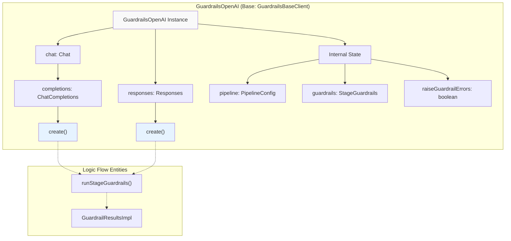
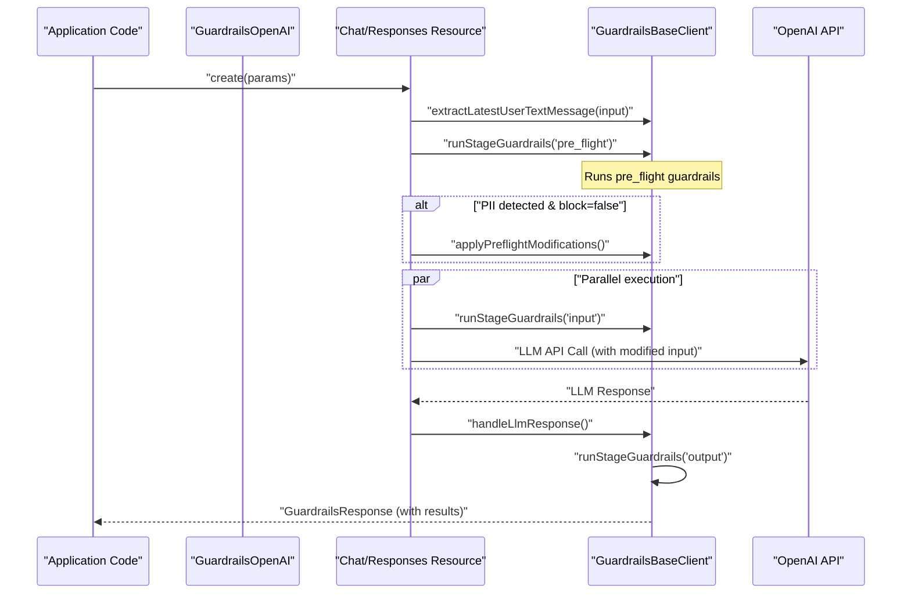

<!-- source: DeepWiki mcp.deepwiki.com · repo openai/openai-guardrails-js · page 9.1 GuardrailsOpenAI · fetched 2026-10-26 -->

# GuardrailsOpenAI

<details>
<summary>Relevant source files</summary>

The following files were used as context for generating this wiki page:

- [src/__tests__/unit/chat-resources.test.ts](src/__tests__/unit/chat-resources.test.ts)
- [src/base-client.ts](src/base-client.ts)
- [src/resources/chat/chat.ts](src/resources/chat/chat.ts)
- [src/resources/responses/responses.ts](src/resources/responses/responses.ts)
- [src/types.ts](src/types.ts)

</details>


## Purpose and Scope

This page provides complete API reference documentation for the `GuardrailsOpenAI` class, which serves as a drop-in replacement for the standard OpenAI TypeScript client with automatic guardrail validation. This class is the primary integration pattern for adding guardrails to OpenAI API calls.

For Azure OpenAI deployments, see [GuardrailsAzureOpenAI](#9.2). For Agents SDK integration, see [GuardrailAgent](#9.3). For evaluation workflows, see [GuardrailEval](#9.4).

**Sources:** [src/base-client.ts:145-150](), [src/resources/chat/chat.ts:17-23](), [src/resources/responses/responses.ts:14-15]()

---

## Class Overview

`GuardrailsOpenAI` is a client factory that creates configured OpenAI client instances with embedded guardrail validation. The class provides a static `create` method that returns a client instance compatible with the OpenAI TypeScript SDK, automatically applying guardrails at the configured pipeline stages (pre-flight, input, output).

The returned client instance supports standard OpenAI API methods (`responses.create`, `chat.completions.create`) with additional guardrail validation logic injected transparently via the `GuardrailsBaseClient` logic.

**Sources:** [src/base-client.ts:145-150](), [src/resources/chat/chat.ts:28-35](), [src/resources/responses/responses.ts:23-43]()

---

## GuardrailsOpenAI.create Method

### Method Signature

```typescript
static async create(
    config: PipelineConfig | string,
    clientOptions?: OpenAIClientOptions,
    raiseGuardrailErrors?: boolean
): Promise<GuardrailsOpenAI>
```

The `create` method is the primary entry point for instantiating a guardrailed OpenAI client. It accepts a pipeline configuration (either as an object or file path), optional OpenAI client options, and an error handling mode flag.

**Sources:** [src/base-client.ts:191-199](), [src/base-client.ts:126-131]()

---

### Parameters

| Parameter | Type | Required | Description |
|-----------|------|----------|-------------|
| `config` | `PipelineConfig` \| `string` | Yes | Pipeline configuration object or path to JSON configuration file. Defines which guardrails to apply at each stage. |
| `clientOptions` | `OpenAIClientOptions` | No | Standard OpenAI client configuration options (e.g., `apiKey`, `baseURL`, `organization`). |
| `raiseGuardrailErrors` | `boolean` | No | Error handling mode flag. `false` (default) = fail-safe mode, continues on guardrail execution errors. `true` = fail-secure mode, throws exceptions. |

**Sources:** [src/base-client.ts:126-131](), [src/base-client.ts:150-150](), [src/base-client.ts:191-199]()

---

## GuardrailsOpenAI Instance

### Instance Structure Diagram



**Sources:** [src/base-client.ts:145-150](), [src/resources/chat/chat.ts:17-28](), [src/resources/responses/responses.ts:14-15]()

---

### Instance Methods

#### responses.create()

Primary method for creating guardrailed responses. It executes `pre_flight` guardrails first, followed by concurrent execution of `input` guardrails and the LLM call.

```typescript
async responses.create(params: ResponseCreateParams): Promise<GuardrailsResponse>
```

**Parameters:**

| Parameter | Type | Required | Description |
|-----------|------|----------|-------------|
| `input` | `string` \| `Message[]` | Yes | User input text or message history. |
| `model` | `string` | Yes | Model identifier (e.g., `'gpt-4o'`). |
| `stream` | `boolean` | No | Whether to stream the response. |
| `suppressTripwire` | `boolean` | No | If true, returns results instead of throwing on violations. |

**Sources:** [src/resources/responses/responses.ts:23-53](), [src/resources/responses/responses.ts:74-116]()

---

#### chat.completions.create()

Standard OpenAI chat completions interface with guardrails.

```typescript
async chat.completions.create(params: ChatCompletionCreateParams): Promise<GuardrailsResponse>
```

**Sources:** [src/resources/chat/chat.ts:37-63](), [src/resources/chat/chat.ts:71-113]()

---

### Response Object Structure

The response object extends standard OpenAI responses with the `guardrail_results` property.

| Field | Type | Description |
|-------|------|-------------|
| `guardrail_results` | `GuardrailResults` | Container for all stage results. |
| `guardrail_results.preflight` | `GuardrailResult[]` | Results from the pre-flight stage. |
| `guardrail_results.input` | `GuardrailResult[]` | Results from the input stage. |
| `guardrail_results.output` | `GuardrailResult[]` | Results from the output stage. |
| `guardrail_results.allResults` | `GuardrailResult[]` | Flattened list of all results. |
| `guardrail_results.tripwiresTriggered` | `boolean` | Boolean flag indicating if any tripwire fired. |

**Sources:** [src/base-client.ts:79-87](), [src/base-client.ts:92-114](), [src/base-client.ts:119-121]()

---

## API Call Flow Diagram



**Sources:** [src/resources/chat/chat.ts:67-136](), [src/resources/responses/responses.ts:66-138](), [src/base-client.ts:201-223]()

---

## Configuration Structure

### Pipeline Configuration Schema

The `PipelineConfig` object defines which guardrails to execute at each stage:

| Field | Type | Required | Description |
|-------|------|----------|-------------|
| `version` | `number` | No | Configuration schema version. |
| `pre_flight` | `GuardrailBundle` | No | Stage configuration for pre-flight checks. |
| `input` | `GuardrailBundle` | No | Stage configuration for input checks. |
| `output` | `GuardrailBundle` | No | Stage configuration for output checks. |

**Sources:** [src/base-client.ts:126-131]()

---

### GuardrailBundle Schema

A bundle represents a collection of guardrails for a specific stage.

| Field | Type | Required | Description |
|-------|------|----------|-------------|
| `version` | `number` | Yes | Bundle version. |
| `guardrails` | `GuardrailSpec[]` | Yes | List of guardrails to instantiate. |

**Sources:** [src/runtime.ts:40-44]()

---

## Error Handling Modes

### raiseGuardrailErrors Parameter

The `raiseGuardrailErrors` property on the client determines behavior when a guardrail **fails to execute** (e.g., a network error during a remote check).

| Mode | Behavior |
|------|----------|
| **Fail-Safe** (`false`) | Execution continues. The `GuardrailResult` will have `executionFailed: true` and the original error in `originalException`. |
| **Fail-Secure** (`true`) | The client re-throws the internal guardrail error immediately, halting the request. |

**Sources:** [src/base-client.ts:150-150](), [src/types.ts:54-57](), [src/resources/chat/chat.ts:79-80]()

---

## Data Extraction and Masking

### extractLatestUserTextMessage

This internal method is used by the client to identify the specific string to be checked by text-based guardrails. It iterates backwards through the message history to find the most recent 'user' role message.

**Sources:** [src/base-client.ts:158-172]()

### applyPreflightModifications

If a `pre_flight` guardrail (like PII detection) identifies content that should be masked, this method updates the `input` or `messages` before they are sent to the OpenAI API.

**Sources:** [src/base-client.ts:201-223]()

---

## Related Classes and Methods

- **GuardrailsAzureOpenAI** ([GuardrailsAzureOpenAI](#9.2)) - Azure OpenAI-specific client variant.
- **GuardrailAgent** ([GuardrailAgent](#9.3)) - Agents SDK integration class.
- **GuardrailResult** ([Exception Types](#9.5)) - The structure of individual check outcomes.
- **TokenUsageSummary** ([GuardrailsOpenAI](#9.1)) - Aggregated usage from LLM-based guardrails.

**Sources:** [src/types.ts:51-74](), [src/types.ts:172-176](), [src/base-client.ts:111-113]()

---

