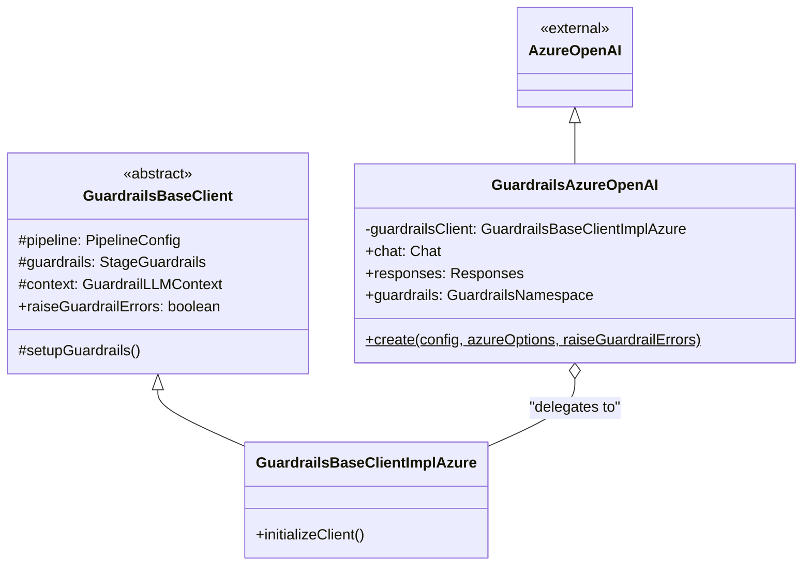
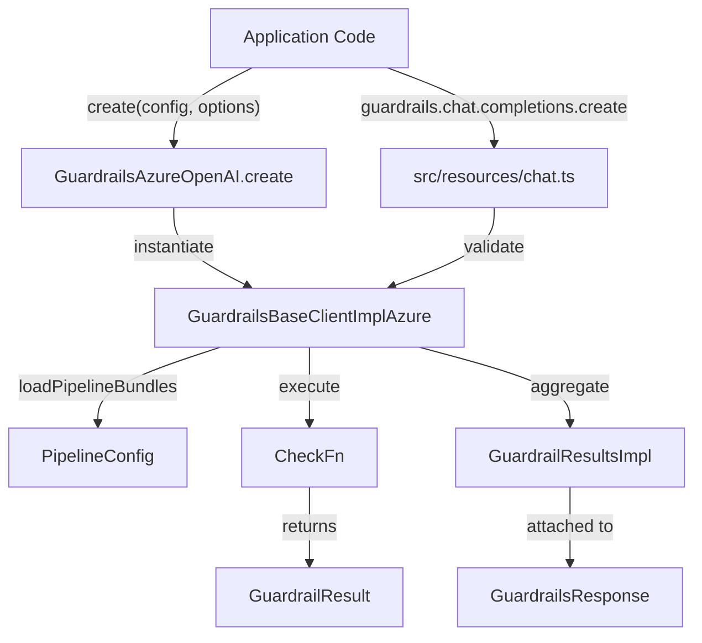

<!-- source: DeepWiki mcp.deepwiki.com · repo openai/openai-guardrails-js · page 9.2 GuardrailsAzureOpenAI · fetched 2026-10-26 -->

# GuardrailsAzureOpenAI

<details>
<summary>Relevant source files</summary>

The following files were used as context for generating this wiki page:

- [examples/basic/agents_sdk.ts](examples/basic/agents_sdk.ts)
- [examples/basic/azure_example.ts](examples/basic/azure_example.ts)
- [examples/basic/suppress_tripwire.ts](examples/basic/suppress_tripwire.ts)
- [src/base-client.ts](src/base-client.ts)
- [src/client.ts](src/client.ts)
- [src/types.ts](src/types.ts)

</details>


This page provides the API reference for the `GuardrailsAzureOpenAI` class, which is the Azure OpenAI-specific drop-in client for integrating guardrails with Azure OpenAI deployments. This class provides the same guardrail functionality as `GuardrailsOpenAI` but with Azure-specific configuration and authentication.

For the standard OpenAI client integration, see [GuardrailsOpenAI](#9.1). For general integration patterns, see [Azure OpenAI Integration](#3.2).

**Sources:** [src/client.ts:123-134](), [examples/basic/azure_example.ts:1-197]()

---

## Overview

`GuardrailsAzureOpenAI` is a specialized client class that wraps Azure OpenAI API calls with guardrail validation. It serves as a drop-in replacement for Azure OpenAI clients while automatically applying the configured guardrail pipeline to all API interactions.

### Key Characteristics

| Aspect | Description |
|--------|-------------|
| **Inheritance** | Extends `AzureOpenAI` from the official `openai` package [src/client.ts:123]() |
| **Primary Method** | `GuardrailsAzureOpenAI.create()` (static factory) [src/client.ts:161-175]() |
| **Compatibility** | Overrides `chat` and `responses` with guardrail-aware versions [src/client.ts:180-205]() |
| **Namespace** | Provides a dedicated `.guardrails` namespace for explicit guardrail calls [src/client.ts:131-134]() |
| **Internal Client** | Uses `GuardrailsBaseClientImplAzure` to manage pipeline state [src/client.ts:167-168]() |

**Sources:** [src/client.ts:123-205](), [examples/basic/azure_example.ts:113-118]()

---

## Class Structure

The following diagram maps the `GuardrailsAzureOpenAI` class structure to code entities and relationships within the `src/client.ts` and `src/base-client.ts` files:

### Code Entity Mapping: Client Hierarchy

**Sources:** [src/client.ts:123-134](), [src/base-client.ts:145-151]()

### Code Entity Mapping: Data Flow

**Sources:** [src/client.ts:161-175](), [src/base-client.ts:92-114](), [src/types.ts:51-74]()

---

## Static Method: `create()`

The `create()` method is the primary factory method for instantiating `GuardrailsAzureOpenAI` clients. It handles the asynchronous initialization of the guardrail pipeline and the underlying Azure client.

### Method Signature
[src/client.ts:161-175]()
```typescript
static async create(
    config: string | PipelineConfig,
    azureOptions: ConstructorParameters<typeof AzureOpenAI>[0],
    raiseGuardrailErrors: boolean = false
): Promise<GuardrailsAzureOpenAI>
```

### Parameters

| Parameter | Type | Description |
|-----------|------|-------------|
| `config` | `string \| PipelineConfig` | Pipeline configuration (file path, object, or JSON string) [src/client.ts:162]() |
| `azureOptions` | `ConstructorParameters<typeof AzureOpenAI>[0]` | Azure OpenAI client options (endpoint, apiKey, etc.) [src/client.ts:163]() |
| `raiseGuardrailErrors` | `boolean` | If `true`, throws on guardrail execution failure. Defaults to `false` [src/client.ts:164-168]() |

**Sources:** [src/client.ts:161-175](), [src/base-client.ts:191-199]()

---

## GuardrailResults and Response Structure

Every guardrail-aware method returns a `GuardrailsResponse`, which extends the standard OpenAI response type with a `guardrail_results` property.

### GuardrailResultsImpl
The `GuardrailResultsImpl` class [src/base-client.ts:92-114]() provides the following structure:

| Property | Type | Description |
|----------|------|-------------|
| `preflight` | `GuardrailResult[]` | Results from the pre-flight modification stage [src/base-client.ts:94]() |
| `input` | `GuardrailResult[]` | Results from the input validation stage [src/base-client.ts:95]() |
| `output` | `GuardrailResult[]` | Results from the output validation stage [src/base-client.ts:96]() |
| `allResults` | `GuardrailResult[]` | Flattened array of all results [src/base-client.ts:99-101]() |
| `tripwiresTriggered` | `boolean` | `true` if any result has `tripwireTriggered: true` [src/base-client.ts:103-105]() |
| `totalTokenUsage` | `TokenUsageSummary` | Aggregated token usage from LLM-based guardrails [src/base-client.ts:111-113]() |

**Sources:** [src/base-client.ts:79-114](), [src/types.ts:51-74]()

---

## Implementation Detail: Resource Overriding

To maintain drop-in compatibility, `GuardrailsAzureOpenAI` uses `Object.defineProperty` to override the standard `chat` and `responses` properties with guardrail-enhanced versions during instantiation.

[src/client.ts:180-205]()
```typescript
private overrideResources(): void {
  const { Chat } = require('./resources/chat');
  const { Responses } = require('./resources/responses');

  Object.defineProperty(this, 'chat', {
    value: new Chat(this.guardrailsClient),
    writable: false,
    configurable: false,
  });
  // ... similar for responses and guardrails namespace
}
```

This ensures that calls to `client.chat.completions.create()` are intercepted and passed through the guardrail pipeline managed by `GuardrailsBaseClientImplAzure`.

**Sources:** [src/client.ts:180-205](), [src/client.ts:143-148]()

---

## Complete Usage Example

This example demonstrates using `GuardrailsAzureOpenAI` with environment variables and a pipeline configuration.

```typescript
import { GuardrailsAzureOpenAI } from '@openai/guardrails';

const PIPELINE_CONFIG = {
  version: 1,
  input: {
    guardrails: [{ name: 'Moderation', config: { categories: ['hate'] } }]
  }
};

async function main() {
  const client = await GuardrailsAzureOpenAI.create(PIPELINE_CONFIG, {
    endpoint: process.env.AZURE_ENDPOINT!,
    apiKey: process.env.AZURE_API_KEY!,
    apiVersion: process.env.AZURE_API_VERSION!,
  });

  try {
    const response = await client.guardrails.chat.completions.create({
      model: process.env.AZURE_DEPLOYMENT!, // Azure requires deployment name
      messages: [{ role: 'user', content: 'Hello!' }],
    });
    
    console.log(response.choices[0].message.content);
    console.log('Guardrail results:', response.guardrail_results.allResults);
  } catch (error) {
    // Handle GuardrailTripwireTriggered
  }
}
```

**Sources:** [examples/basic/azure_example.ts:112-180](), [src/client.ts:161-175]()

---

## Error Handling Modes

`GuardrailsAzureOpenAI` supports two modes for handling errors that occur *during the execution* of a guardrail (e.g., a network timeout while calling the Moderation API).

### Fail-Safe (Default)
When `raiseGuardrailErrors` is `false`, the framework logs the error but allows the request to proceed. The `GuardrailResult` will have `executionFailed: true` and the `originalException` attached.
[src/types.ts:54-57]()

### Fail-Secure
When `raiseGuardrailErrors` is `true`, any error during guardrail execution will throw immediately, preventing the LLM call or blocking the response.
[src/client.ts:171]()

**Note:** This is distinct from a **Tripwire Trigger**, which occurs when a guardrail successfully runs and detects a violation. Tripwires always throw a `GuardrailTripwireTriggered` error unless `suppressTripwire: true` is passed in the request options. [examples/basic/suppress_tripwire.ts:37-42]()

**Sources:** [src/base-client.ts:150](), [src/types.ts:51-57](), [src/client.ts:161-175]()

---

