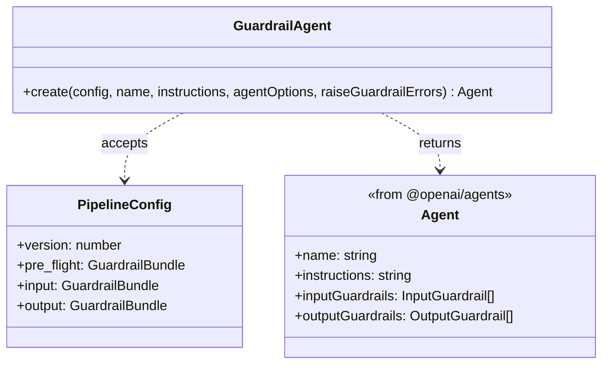
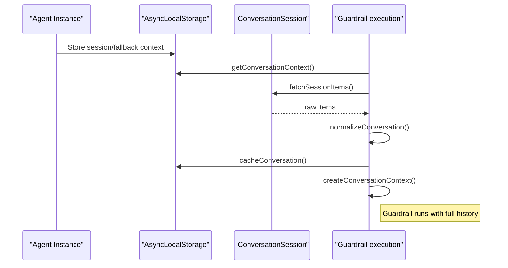

<!-- source: DeepWiki mcp.deepwiki.com · repo openai/openai-guardrails-js · page 9.3 GuardrailAgent · fetched 2026-10-26 -->

# GuardrailAgent

<details>
<summary>Relevant source files</summary>

The following files were used as context for generating this wiki page:

- [src/__tests__/unit/agents.test.ts](src/__tests__/unit/agents.test.ts)
- [src/__tests__/unit/types.test.ts](src/__tests__/unit/types.test.ts)
- [src/agents.ts](src/agents.ts)
- [src/utils/content.ts](src/utils/content.ts)

</details>


This page provides a complete API reference for the `GuardrailAgent` class, which integrates guardrails with the OpenAI Agents SDK. `GuardrailAgent` serves as a drop-in replacement for the `Agent` class from `@openai/agents`, automatically applying guardrail checks to agent inputs and outputs.

For information about using `GuardrailAgent` in practice, see [Agents SDK Integration](#3.3). For details on the other integration patterns, see [GuardrailsOpenAI](#9.1) and [GuardrailEval](#9.4). For exception handling specifics, see [Exception Types](#9.5).

---

## Overview

`GuardrailAgent` is a factory class that creates standard `Agent` instances from the `@openai/agents` package with guardrails pre-configured [src/agents.ts:4-7](). It accepts a pipeline configuration and agent parameters, then returns a fully-functional `Agent` that can be used with all Agents SDK features, including the `run()` function [src/agents.ts:285-291]().

**Key Characteristics:**

- **Drop-in Compatibility**: Returns a standard `Agent` instance, not a wrapper class [src/agents.ts:285-291]().
- **Automatic Configuration**: Parses pipeline config and wires guardrails to the agent's `inputGuardrails` and `outputGuardrails` arrays [src/agents.ts:269-283]().
- **Tool-Level Prompt Injection**: Prompt Injection Detection can be applied at the tool level via the `inputGuardrails` of the agent [src/agents.ts:269-271]().
- **Agent-Level Guardrails**: Guardrails run at the agent level for efficiency, mapped from the `pre_flight`, `input`, and `output` stages of the configuration [src/agents.ts:269-283]().
- **Native Exception Handling**: Uses `InputGuardrailTripwireTriggered` and `OutputGuardrailTripwireTriggered` from the Agents SDK [src/agents.ts:11-15]().

**Sources:** [src/agents.ts:4-7](), [src/agents.ts:269-291](), [src/agents.ts:11-15]()

---

## Class Structure



**Diagram: GuardrailAgent Class Relationships**

This diagram shows how `GuardrailAgent` acts as a factory that accepts a `PipelineConfig` and returns a standard `Agent` instance. The agent instance is populated with guardrail execution logic derived from the configuration [src/agents.ts:269-291]().

**Sources:** [src/agents.ts:255-291](), [src/agents.ts:42-46](), [src/__tests__/unit/agents.test.ts:12-30]()

---

## GuardrailAgent.create Method

The static `create` method is the primary interface for creating guardrailed agents.

### Method Signature

```typescript
static async create(
  config: PipelineConfig | object,
  name: string,
  instructions: string,
  agentOptions: object = {},
  raiseGuardrailErrors: boolean = false
): Promise<Agent>
```
[src/agents.ts:255-261]()

### Parameters

| Parameter | Type | Required | Description |
|-----------|------|----------|-------------|
| `config` | `PipelineConfig` \| `object` | Yes | Pipeline configuration defining guardrails for pre-flight, input, and output stages [src/agents.ts:256]() |
| `name` | `string` | Yes | Agent name [src/agents.ts:257]() |
| `instructions` | `string` | Yes | System instructions for the agent's behavior [src/agents.ts:258]() |
| `agentOptions` | `object` | No | Additional options passed to the Agent constructor (model, tools, etc.) [src/agents.ts:259]() |
| `raiseGuardrailErrors` | `boolean` | No | If `true`, throws exceptions when guardrail execution fails (fail-secure mode). Defaults to `false` [src/agents.ts:260]() |

### Return Value

Returns a `Promise<Agent>` - a fully configured `Agent` instance from `@openai/agents` with guardrails applied to its `inputGuardrails` and `outputGuardrails` properties [src/agents.ts:285-291]().

**Sources:** [src/agents.ts:255-291](), [src/__tests__/unit/agents.test.ts:84-107]()

---

## Pipeline Stage Mapping

`GuardrailAgent` maps the standard pipeline stages to the specific guardrail hooks provided by the Agents SDK:

| Pipeline Stage | Agent SDK Property | Execution Timing |
|----------------|--------------------|------------------|
| `pre_flight` | `inputGuardrails` | Runs before the agent starts processing [src/agents.ts:269-271]() |
| `input` | `inputGuardrails` | Runs in parallel with agent processing [src/agents.ts:269-271]() |
| `output` | `outputGuardrails` | Runs after the agent generates a response [src/agents.ts:279-281]() |

**Sources:** [src/agents.ts:269-283](), [src/__tests__/unit/agents.test.ts:84-157]()

---

## Data Flow and Conversation Context

`GuardrailAgent` manages conversation history to ensure guardrails have access to the full context of the interaction.



**Diagram: Conversation Context Flow**

`GuardrailAgent` uses `AsyncLocalStorage` to propagate conversation context to guardrails [src/agents.ts:54-62](). It fetches session items from the agent's session, normalizes them, and provides a `getConversationHistory()` helper within the guardrail context [src/agents.ts:98-114](), [src/agents.ts:192-210]().

**Sources:** [src/agents.ts:54-83](), [src/agents.ts:98-114](), [src/agents.ts:192-210]()

---

## Execution Logic

When `create` is called, the following implementation steps occur:

1. **Load Pipeline**: The `loadPipelineBundles` function is called to parse the configuration [src/agents.ts:264]().
2. **Instantiate Guardrails**: Guardrails for each stage (`pre_flight`, `input`, `output`) are instantiated using `instantiateGuardrails` [src/agents.ts:269-283]().
3. **Wrap in Agent Hooks**: Each instantiated guardrail is wrapped in a function compatible with `InputGuardrail` or `OutputGuardrail` interfaces [src/agents.ts:10-15]().
4. **Context Management**: The wrapped functions use `runWithConversationContext` to ensure the guardrail has access to the agent's state [src/agents.ts:64-76]().
5. **Construct Agent**: A new `Agent` is instantiated with the merged `agentOptions` and the generated guardrail arrays [src/agents.ts:285-291]().

**Sources:** [src/agents.ts:264-291](), [src/agents.ts:64-76]()

---

## Exception Handling

GuardrailAgent utilizes the native exception types from the `@openai/agents-core` package.

### InputGuardrailTripwireTriggered

Thrown when a guardrail in the `pre_flight` or `input` stage triggers a tripwire. The agent execution is halted if a tripwire is triggered [src/agents.ts:11]().

### OutputGuardrailTripwireTriggered

Thrown when a guardrail in the `output` stage triggers a tripwire based on the assistant's generated response [src/agents.ts:12]().

### Exception Structure

Both exceptions provide access to the `guardrailResult`, which contains:
- `tripwireTriggered`: A boolean indicating a violation [src/types.ts:25]().
- `info`: An object containing the `guardrail_name` and additional metadata like `checked_text` or `reason` [src/types.ts:26-28]().

**Sources:** [src/agents.ts:11-15](), [src/types.ts:24-32](), [src/__tests__/unit/types.test.ts:22-32]()

---

## Integration with @openai/agents

The `GuardrailAgent` relies on the `Agent` class from the `@openai/agents` package. If the package is not installed, `GuardrailAgent.create` will throw an error [src/agents.ts:243-252]().

```typescript
// Internal check for @openai/agents availability
try {
  const { Agent } = require('@openai/agents');
  return new Agent({ ... });
} catch (e) {
  throw new Error('The @openai/agents package is required...');
}
```
[src/agents.ts:243-252]()

**Sources:** [src/agents.ts:243-252](), [src/__tests__/unit/agents.test.ts:243-255]()

---

