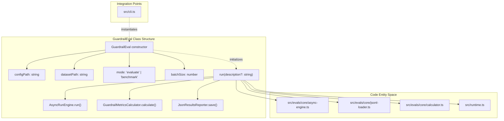
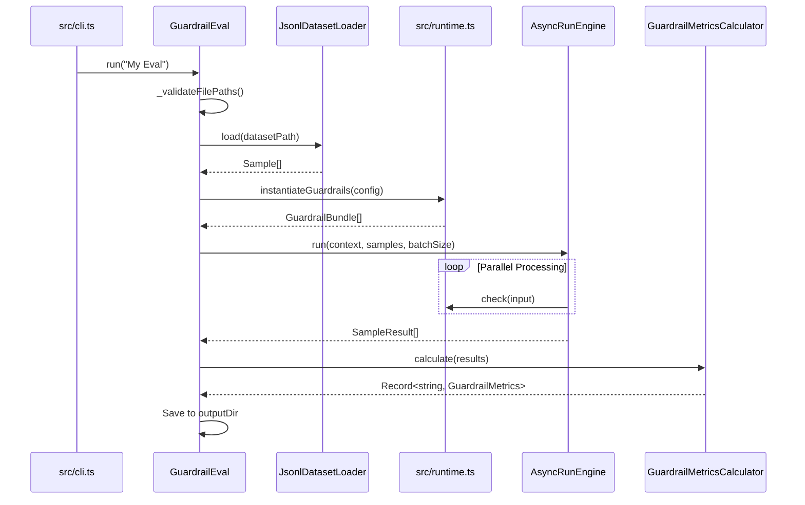
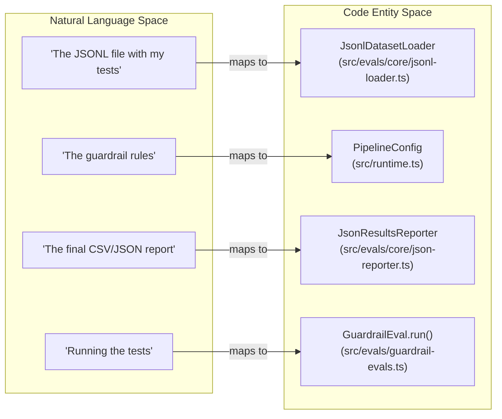

<!-- source: DeepWiki mcp.deepwiki.com · repo openai/openai-guardrails-js · page 9.4 GuardrailEval · fetched 2026-10-26 -->

# GuardrailEval

<details>
<summary>Relevant source files</summary>

The following files were used as context for generating this wiki page:

- [src/cli.ts](src/cli.ts)
- [src/evals/core/types.ts](src/evals/core/types.ts)
- [src/evals/guardrail-evals.ts](src/evals/guardrail-evals.ts)
- [src/spec.ts](src/spec.ts)

</details>


## Purpose and Scope

This page provides the API reference documentation for the `GuardrailEval` class, which implements the evaluation framework for testing guardrail configurations against labeled datasets. This documentation covers the class constructor, methods, parameters, return types, and result structures.

For conceptual information about evaluation workflows, see [Evaluation Framework](#6). For CLI usage, see [CLI Evaluation Tool](#6.1). For dataset format specifications, see [Dataset Format](#6.3). For interpretation of evaluation metrics, see [Metrics and Benchmarking](#6.4).

---

## Class Overview

The `GuardrailEval` class provides programmatic access to the evaluation framework. It processes JSONL datasets containing labeled examples, executes guardrail checks, and computes performance metrics including precision, recall, F1 scores, and latency measurements [src/evals/guardrail-evals.ts:36-51]().



**Sources:** [src/evals/guardrail-evals.ts:36-51](), [src/cli.ts:71-72](), [src/evals/core/types.ts:95-144]()

---

## Constructor

### Signature

The constructor initializes the evaluation environment, including API credentials and execution modes [src/evals/guardrail-evals.ts:72-88]().

```typescript
constructor(
  configPath: string,
  datasetPath: string,
  stages: string[] | null = null,
  batchSize: number = 32,
  outputDir: string = 'results',
  apiKey: string | null = null,
  baseUrl: string | null = null,
  azureEndpoint: string | null = null,
  azureApiVersion: string = '2025-01-01-preview',
  mode: 'evaluate' | 'benchmark' = 'evaluate',
  models: string[] | null = null,
  latencyIterations: number = 25,
  multiTurn: boolean = false,
  maxParallelModels: number | null = null,
  benchmarkChunkSize: number | null = null
)
```

### Parameters

| Parameter | Type | Required | Default | Description |
|-----------|------|----------|---------|-------------|
| `configPath` | `string` | Yes | - | Path to pipeline configuration file (JSON format) [src/evals/guardrail-evals.ts:56](). |
| `datasetPath` | `string` | Yes | - | Path to evaluation dataset (JSONL) [src/evals/guardrail-evals.ts:57](). |
| `stages` | `string[]` | No | `null` | Specific stages to evaluate: `pre_flight`, `input`, `output` [src/evals/guardrail-evals.ts:58](). |
| `batchSize` | `number` | No | `32` | Number of samples to process in parallel [src/evals/guardrail-evals.ts:76](). |
| `mode` | `'evaluate' \| 'benchmark'` | No | `'evaluate'` | Evaluation mode. Benchmark mode tests multiple models [src/evals/guardrail-evals.ts:82](). |
| `multiTurn` | `boolean` | No | `false` | Whether to evaluate guardrails on multi-turn conversations [src/evals/guardrail-evals.ts:85](). |
| `apiKey` | `string` | No | `null` | API key for OpenAI or Azure [src/evals/guardrail-evals.ts:78](). |

**Sources:** [src/evals/guardrail-evals.ts:72-129]()

---

## Methods

### run()

Executes the evaluation pipeline. It validates file paths, loads the dataset, instantiates the guardrails, and runs the evaluation engine [src/evals/guardrail-evals.ts:190-200]().

#### Signature

```typescript
async run(description?: string): Promise<void>
```

#### Behavior

1. **Validation**: Checks if `configPath` and `datasetPath` exist using `_validateFilePaths()` [src/evals/guardrail-evals.ts:131-143]().
2. **Loading**: Uses `JsonlDatasetLoader` to parse the dataset [src/evals/core/jsonl-loader.ts:8-20]().
3. **Execution**:
    - In `evaluate` mode: Runs the `AsyncRunEngine` against the samples [src/evals/core/async-engine.ts:9-11]().
    - In `benchmark` mode: Iterates through `models`, testing latency and metrics for each [src/evals/guardrail-evals.ts:28-30]().
4. **Reporting**: Calculates metrics via `GuardrailMetricsCalculator` and saves results using `JsonResultsReporter` [src/evals/core/calculator.ts:10](), [src/evals/core/json-reporter.ts:11]().



**Sources:** [src/evals/guardrail-evals.ts:190-300](), [src/evals/core/types.ts:97-113]()

---

## Data Structures

### Sample

Represents a single entry in the evaluation dataset [src/evals/core/types.ts:14-21]().

| Field | Type | Description |
|-------|------|-------------|
| `id` | `string` | Unique identifier for the sample. |
| `data` | `string` | The text or data to be evaluated. |
| `expectedTriggers` | `Record<string, boolean>` | Map of guardrail names to expected trigger status. |

### SampleResult

The outcome of running a sample through the guardrail pipeline [src/evals/core/types.ts:40-49]().

| Field | Type | Description |
|-------|------|-------------|
| `id` | `string` | Matches the input Sample ID. |
| `expectedTriggers` | `Record<string, boolean>` | Ground truth. |
| `triggered` | `Record<string, boolean>` | Actual results from the guardrail engine. |
| `details` | `Record<string, unknown>` | Info objects and error messages from the checks. |

### GuardrailMetrics

Performance statistics for a specific guardrail [src/evals/core/types.ts:54-71]().

| Field | Type | Description |
|-------|------|-------------|
| `precision` | `number` | True Positives / (True Positives + False Positives). |
| `recall` | `number` | True Positives / (True Positives + False Negatives). |
| `f1Score` | `number` | 2 * (P * R) / (P + R). |
| `totalSamples` | `number` | Count of samples processed for this guardrail. |

**Sources:** [src/evals/core/types.ts:14-71]()

---

## Data Flow: Natural Language to Code Entity

This diagram bridges how evaluation concepts map to specific classes and files in the codebase.



**Sources:** [src/evals/guardrail-evals.ts:7-25](), [src/runtime.ts:18-21]()

---

## CLI Integration

The `GuardrailEval` class is primarily invoked via `src/cli.ts`. The CLI parses arguments and maps them to the constructor parameters [src/cli.ts:71-136]().

### CLI Arguments Mapping

| CLI Argument | Class Parameter |
|--------------|-----------------|
| `--config-path` | `configPath` |
| `--dataset-path` | `datasetPath` |
| `--mode` | `mode` |
| `--batch-size` | `batchSize` |
| `--multi-turn` | `multiTurn` |
| `--max-parallel-models` | `maxParallelModels` |

**Sources:** [src/cli.ts:71-136](), [src/evals/guardrail-evals.ts:72-88]()

---

## Performance and Parallelism

### Model Benchmarking
When `mode` is set to `'benchmark'`, the class can test multiple models concurrently. The degree of parallelism is controlled by `maxParallelModels` [src/evals/guardrail-evals.ts:124-127](). If not provided, it defaults to the minimum of the model count and the system CPU count [src/evals/guardrail-evals.ts:164-165]().

### Sample Chunking
For large datasets, `GuardrailEval` uses `_chunkSamples` to yield contiguous slices of data, preventing memory exhaustion during massive evaluation runs [src/evals/guardrail-evals.ts:175-188]().

**Sources:** [src/evals/guardrail-evals.ts:152-188]()

---

