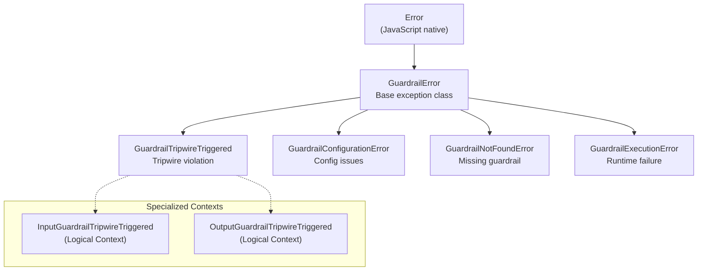
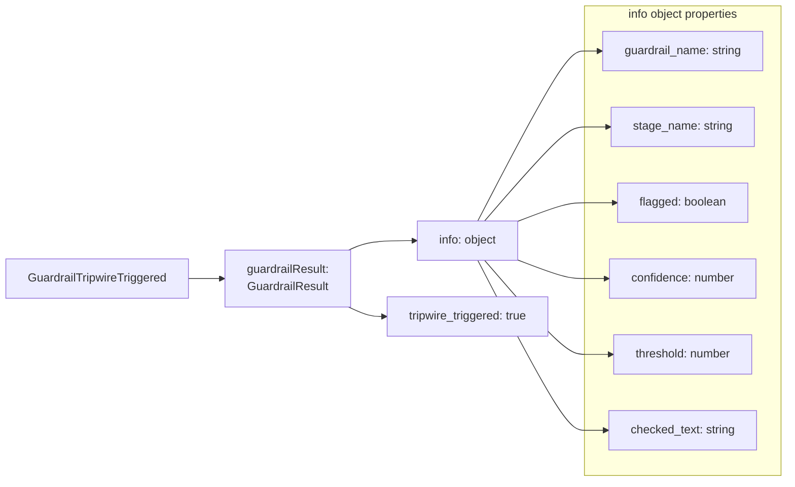
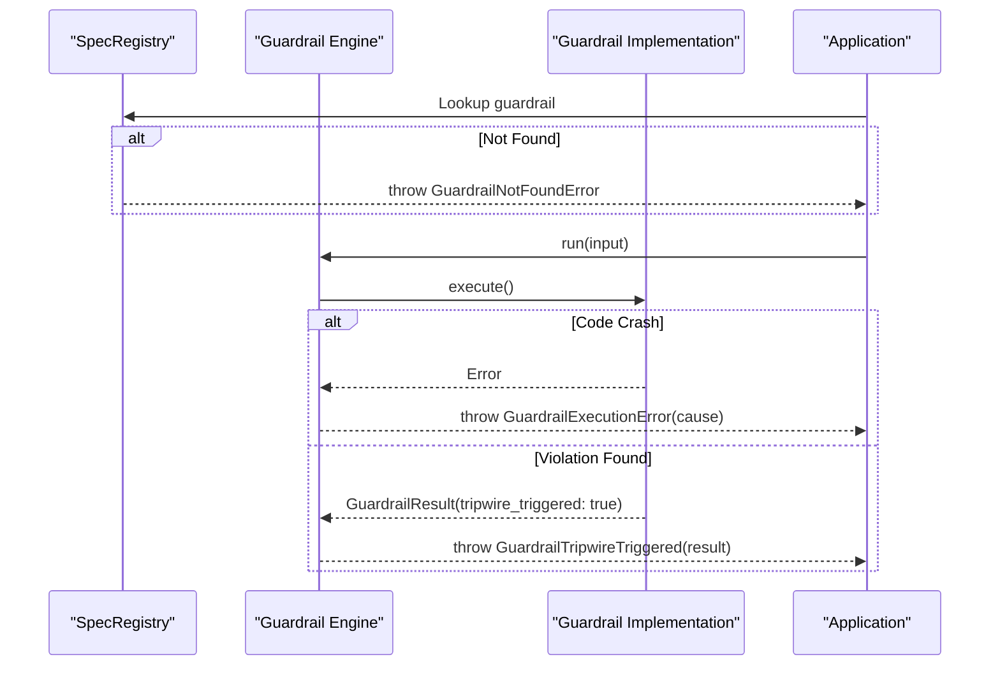

<!-- source: DeepWiki mcp.deepwiki.com · repo openai/openai-guardrails-js · page 9.5 Exception Types · fetched 2026-10-26 -->

# Exception Types

<details>
<summary>Relevant source files</summary>

The following files were used as context for generating this wiki page:

- [docs/ref/exceptions-typescript.md](docs/ref/exceptions-typescript.md)
- [package-lock.json](package-lock.json)
- [package.json](package.json)
- [src/exceptions.ts](src/exceptions.ts)

</details>


This page documents the exception types thrown by the OpenAI Guardrails framework when guardrail violations are detected. For information about tripwire behavior and suppression, see [Tripwires and Error Handling](#4).

## Overview

The guardrails framework uses custom exception types to signal when safety violations or execution errors occur. By default, guardrails operate in **blocking mode**, throwing exceptions that halt execution when a tripwire is triggered. This fail-secure behavior ensures that potentially unsafe content does not proceed through your application pipeline.

The framework provides a base exception class and several specialized types:

| Exception Type | Purpose | Thrown By |
|---------------|---------|-----------|
| `GuardrailError` | Base class for all guardrail errors | Internal utilities |
| `GuardrailTripwireTriggered` | Indicates a safety violation (tripwire) | Generic guardrail violations, pre-flight stage |
| `GuardrailConfigurationError` | Issues with pipeline or guardrail configuration | Client initialization, spec validation |
| `GuardrailNotFoundError` | Referenced guardrail name not registered | Registry lookups |
| `GuardrailExecutionError` | Runtime failure within a guardrail check | Guardrail execution engine |

**Sources:** [src/exceptions.ts:12-67](), [docs/ref/exceptions-typescript.md:6-24]()

## Exception Hierarchy



**Diagram: Exception Type Hierarchy**

The core hierarchy is defined in `src/exceptions.ts`. While `InputGuardrailTripwireTriggered` and `OutputGuardrailTripwireTriggered` are used logically to distinguish stages, they are often identified by checking the `stage_name` within the `GuardrailResult` attached to a `GuardrailTripwireTriggered` instance.

**Sources:** [src/exceptions.ts:12-67](), [docs/ref/exceptions-typescript.md:5-19]()

## GuardrailTripwireTriggered

This exception is raised when a guardrail check identifies a critical failure that should prevent further processing. It is the primary mechanism for enforcing safety boundaries.

### Exception Structure



**Diagram: GuardrailTripwireTriggered Structure**

### Properties

| Property | Type | Description |
|----------|------|-------------|
| `message` | `string` | Includes the name of the triggered guardrail [src/exceptions.ts:29-30]() |
| `name` | `string` | Set to `"GuardrailTripwireTriggered"` [src/exceptions.ts:31-31]() |
| `guardrailResult` | `GuardrailResult` | The raw result object from the guardrail engine [src/exceptions.ts:32-32]() |

### Implementation Detail
The constructor automatically formats the error message using the `guardrail_name` found in the `guardrailResult.info` object:
`const message = \`Guardrail tripwire triggered: ${guardrailResult.info?.guardrail_name || 'Unknown'}\`;` [src/exceptions.ts:29-29]()

**Sources:** [src/exceptions.ts:25-34](), [docs/ref/exceptions-typescript.md:21-21]()

## Configuration and Lifecycle Exceptions

Beyond safety violations, the framework defines exceptions for setup and runtime errors.

### GuardrailConfigurationError
Thrown when there are issues with the guardrail specification, such as missing parameters or invalid schemas.
- **Definition:** [src/exceptions.ts:39-44]()
- **Usage:** Validating the `PipelineConfig` during `GuardrailsOpenAI.create()`.

### GuardrailNotFoundError
Thrown when a configuration references a guardrail name that has not been registered in the `defaultSpecRegistry`.
- **Definition:** [src/exceptions.ts:49-54]()
- **Usage:** During pipeline initialization when mapping strings to guardrail implementations.

### GuardrailExecutionError
Thrown when a guardrail check itself fails to execute (e.g., network error to a moderation API, timeout).
- **Properties:** Includes a `cause` property of type `Error` to wrap the underlying failure [src/exceptions.ts:60-60]().
- **Definition:** [src/exceptions.ts:59-67]()

**Sources:** [src/exceptions.ts:36-67](), [docs/ref/exceptions-typescript.md:22-24]()

## Data Flow: From Check to Exception



**Diagram: Exception Data Flow**

**Sources:** [src/exceptions.ts:25-34](), [src/exceptions.ts:49-67]()

## Handling Exceptions

### TypeScript Example
When using TypeScript, you can catch specific error types to implement recovery logic:

```typescript
import { 
  GuardrailTripwireTriggered, 
  GuardrailExecutionError 
} from '@openai/guardrails';

try {
  const response = await guardrailsClient.chat.completions.create({ ... });
} catch (error) {
  if (error instanceof GuardrailTripwireTriggered) {
    // Access violation details
    const result = error.guardrailResult;
    console.error(`Violation in ${result.info?.stage_name}: ${result.info?.guardrail_name}`);
  } else if (error instanceof GuardrailExecutionError) {
    // Handle runtime failures (e.g., retry)
    console.error(`Internal error: ${error.message}`, error.cause);
  }
}
```

**Sources:** [src/exceptions.ts:25-34](), [src/exceptions.ts:59-67](), [docs/ref/exceptions-typescript.md:5-19]()

---

