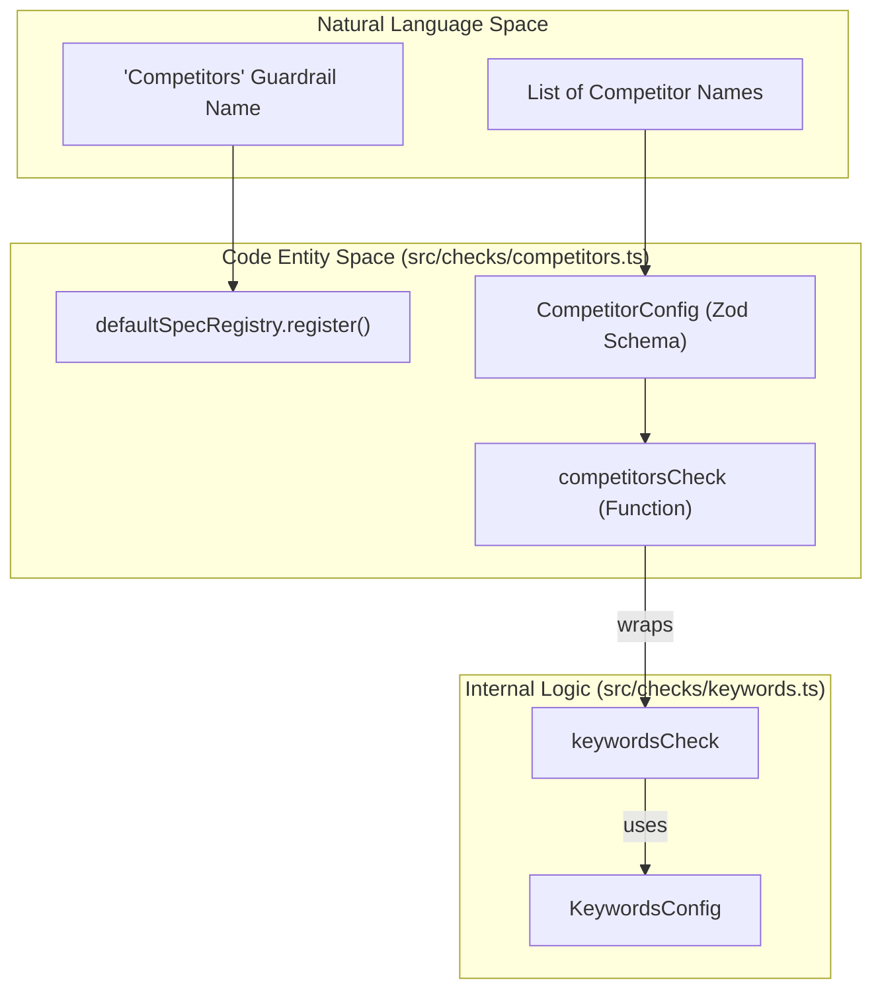
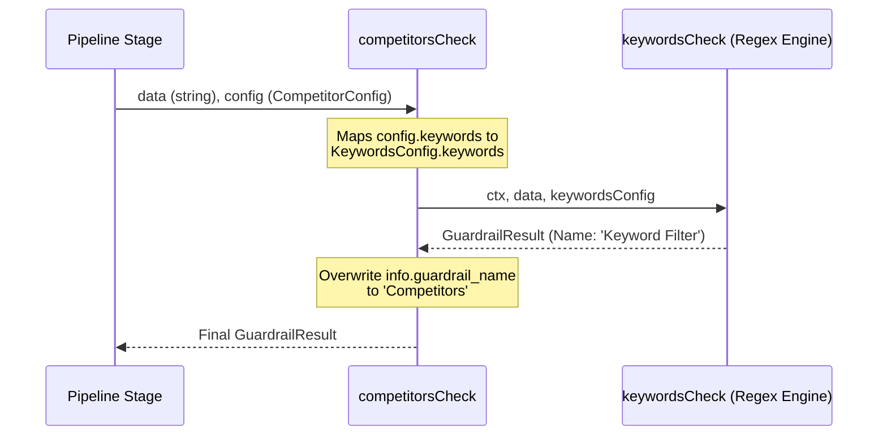

<!-- source: DeepWiki mcp.deepwiki.com · repo openai/openai-guardrails-js · extra page Competitor Detection · fetched 2026-10-26 -->

# Competitor Detection

<details>
<summary>Relevant source files</summary>

The following files were used as context for generating this wiki page:

- [docs/ref/checks/keywords.md](docs/ref/checks/keywords.md)
- [docs/ref/checks/moderation.md](docs/ref/checks/moderation.md)
- [docs/ref/checks/secret_keys.md](docs/ref/checks/secret_keys.md)
- [src/checks/competitors.ts](src/checks/competitors.ts)

</details>


The Competitor Detection guardrail is a specialized content filtering tool designed to identify and flag mentions of specific competitor names within LLM inputs or outputs. It is primarily used to ensure brand compliance, prevent the promotion of rival products in customer-facing chatbots, and maintain a neutral or brand-aligned conversational tone.

## Overview

The Competitor Detection guardrail leverages a case-insensitive, word-boundary-aware matching engine. Technically, it is implemented as a wrapper around the **Keyword Filter** guardrail, inheriting its robust regex-based detection logic while specializing the metadata and configuration schema for competitor-specific use cases [src/checks/competitors.ts:4-6]().

### Relationship to Keyword Filter
Instead of reimplementing the search logic, `competitorsCheck` transforms its configuration into a `KeywordsConfig` and delegates the heavy lifting to the `keywordsCheck` function [src/checks/competitors.ts:50-55](). The primary difference lies in the `guardrail_name` returned in the `GuardrailResult`, which is explicitly set to `"Competitors"` [src/checks/competitors.ts:62]().

### Use Cases
- **Sales Bots**: Prevent the AI from providing comparisons or positive reinforcement regarding a list of known competitors.
- **Support Agents**: Ensure support agents do not inadvertently suggest third-party services that compete with the internal ecosystem.
- **Brand Protection**: Monitor and block any output that might appear to endorse a rival brand.

## Implementation Details

### Code Entity Mapping
The following diagram bridges the natural language configuration to the underlying TypeScript implementation.

**Diagram: Competitor Detection Code Mapping**

Sources: [src/checks/competitors.ts:19-22](), [src/checks/competitors.ts:45-55](), [src/checks/competitors.ts:68-76]()

### Data Flow
When a text string is processed by this guardrail, it passes through a specialized configuration mapper before reaching the regex engine.

**Diagram: Competitor Detection Data Flow**

Sources: [src/checks/competitors.ts:45-65]()

## Configuration

The guardrail is configured using the `CompetitorConfig` schema, which requires a non-empty array of strings.

### Schema
- **`keywords`** (required): An array of strings representing competitor names to detect. Matching is case-insensitive [src/checks/competitors.ts:21]().

### Example Configuration
```json
{
  "name": "Competitors",
  "config": {
    "keywords": ["AcmeCorp", "GlobalSoft", "InterLink"]
  }
}
```

## Reference

### Function: `competitorsCheck`
The core logic resides in `competitorsCheck` [src/checks/competitors.ts:45](). It accepts:
1. `ctx`: The `CompetitorContext` (currently an empty object schema) [src/checks/competitors.ts:29]().
2. `data`: The text string to analyze.
3. `config`: The `CompetitorConfig` containing the list of names.

### Return Value
The guardrail returns a `GuardrailResult`. Because it wraps the Keyword Filter, the `info` object contains detailed metrics about the match:

| Field | Description |
| :--- | :--- |
| `guardrail_name` | Always set to `"Competitors"` [src/checks/competitors.ts:62](). |
| `matchedKeywords` | List of competitor names found in the text (deduplicated) [docs/ref/checks/keywords.md:35](). |
| `originalKeywords` | The full list of competitors provided in the config [docs/ref/checks/keywords.md:36](). |
| `textLength` | The length of the analyzed string [docs/ref/checks/keywords.md:39](). |

### Registration
The guardrail is auto-registered in the `defaultSpecRegistry` under the key `"Competitors"` with the following metadata:
- **Input Type**: `text/plain` [src/checks/competitors.ts:72]()
- **Engine**: `regex` [src/checks/competitors.ts:75]()

Sources: [src/checks/competitors.ts:45-76](), [docs/ref/checks/keywords.md:22-40]()

---

