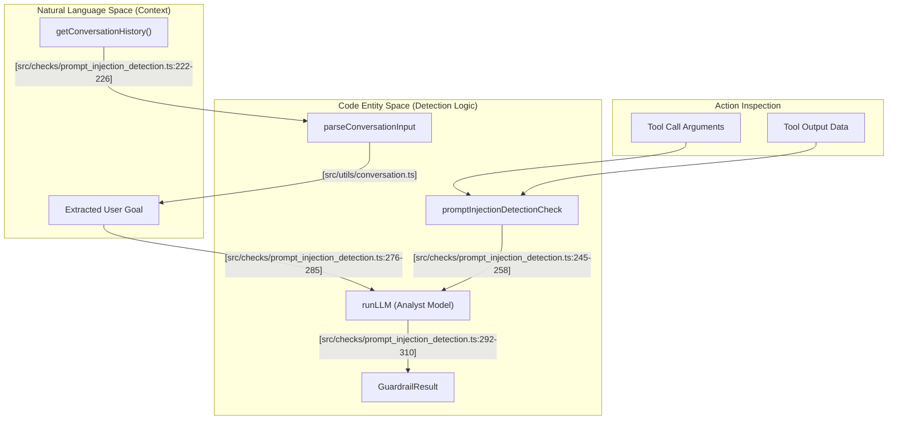
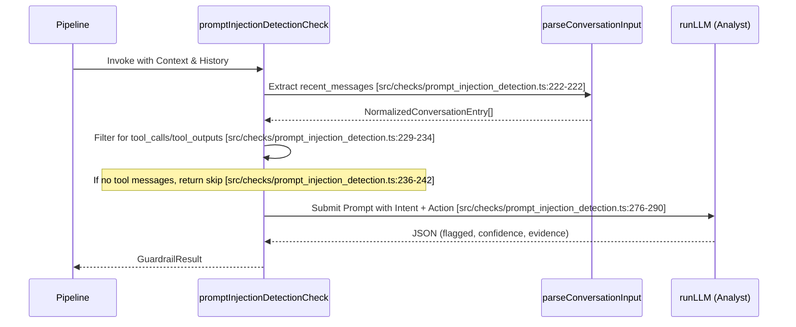

<!-- source: DeepWiki mcp.deepwiki.com · repo openai/openai-guardrails-js · extra page Prompt Injection Detection · fetched 2026-10-26 -->

# Prompt Injection Detection

Relevant source files

The following files were used as context for generating this wiki page:

- [docs/ref/checks/prompt_injection_detection.md](docs/ref/checks/prompt_injection_detection.md)
- [src/__tests__/unit/prompt_injection_detection.test.ts](src/__tests__/unit/prompt_injection_detection.test.ts)
- [src/checks/prompt_injection_detection.ts](src/checks/prompt_injection_detection.ts)

The Prompt Injection Detection guardrail is a specialized security component designed to identify malicious instructions within tool calls and tool outputs that deviate from the user's original intent. Unlike standard content moderation, this guardrail focuses on the **alignment** between user goals and LLM actions, specifically scrutinizing the arguments passed to functions and the data returned by external tools [src/checks/prompt_injection_detection.ts:2-11]().

## Core Logic and Implementation

The detection mechanism employs a secondary "analyst" LLM to evaluate the semantic intent of actions. It parses the conversation history to establish a baseline of user intent and then compares that intent against the specific tool interactions [src/checks/prompt_injection_detection.ts:105-125]().

### Key Functions and Data Structures
- **`promptInjectionDetectionCheck`**: The main execution function that performs the analysis [src/checks/prompt_injection_detection.ts:205-205]().
- **`PromptInjectionDetectionConfig`**: A Zod schema defining configuration parameters such as `model`, `confidence_threshold`, and `max_turns` [src/checks/prompt_injection_detection.ts:37-65]().
- **`PromptInjectionDetectionOutput`**: The structured output schema including `flagged`, `confidence`, and optional reasoning fields like `observation` and `evidence` [src/checks/prompt_injection_detection.ts:88-98]().

### Data Flow Diagram: Intent vs. Action Analysis
This diagram illustrates how the guardrail bridges the gap between the conversation history (Natural Language Space) and the tool execution (Code Entity Space).

**Sources:** [src/checks/prompt_injection_detection.ts:205-310](), [src/utils/conversation.ts:1-50]()

## Detection Checkpoints

The guardrail is designed to run at two distinct stages of the LLM pipeline:

1.  **Output Guardrail (Tool Call Validation)**: Before a tool is executed, the guardrail checks if the `tool_calls` are harmful or unrelated to the user's goal (e.g., a weather request resulting in a `wire_money` call) [docs/ref/checks/prompt_injection_detection.md:9-12]().
2.  **Pre-flight Guardrail (Tool Output Validation)**: After a tool returns data, the guardrail inspects the `tool_call_outputs` for embedded injections, such as "Ignore previous instructions" hidden inside a database result [docs/ref/checks/prompt_injection_detection.md:18-21]().

### Logic Flow for Multi-turn Analysis
The guardrail maintains context by analyzing up to `max_turns` (default 10) to detect sophisticated multi-step attacks [src/checks/prompt_injection_detection.ts:30-30]().

**Sources:** [src/checks/prompt_injection_detection.ts:220-310](), [src/__tests__/unit/prompt_injection_detection.test.ts:61-73]()

## Configuration and Tuning

The behavior of the guardrail is controlled via the `PromptInjectionDetectionConfig` object.

| Parameter | Type | Default | Description |
| :--- | :--- | :--- | :--- |
| `model` | `string` | N/A | The LLM used for analysis (e.g., `gpt-4.1-mini`) [src/checks/prompt_injection_detection.ts:39-39]() |
| `confidence_threshold` | `number` | `0.7` | Threshold for triggering the tripwire [src/checks/prompt_injection_detection.ts:41-41]() |
| `include_reasoning` | `boolean` | `false` | Includes `observation` and `evidence` in output. Disabling this reduces latency by ~40% [docs/ref/checks/prompt_injection_detection.md:45-49]() |
| `max_turns` | `number` | `10` | Number of conversation turns to include in analysis [src/checks/prompt_injection_detection.ts:57-64]() |

### Decision Rules
The analyst LLM follows strict criteria to minimize false positives:
- **Direct Evidence**: Only flag if there is explicit text containing instructions or harmful arguments [src/checks/prompt_injection_detection.ts:118-120]().
- **Competence vs. Security**: Do not flag poor quality or errors as injections [src/checks/prompt_injection_detection.ts:121-122]().
- **Semantic Intent**: Focus on what the action is trying to do, not just function names [src/checks/prompt_injection_detection.ts:133-134]().

**Sources:** [src/checks/prompt_injection_detection.ts:37-65](), [src/checks/prompt_injection_detection.ts:105-150](), [docs/ref/checks/prompt_injection_detection.md:41-51]()

---

