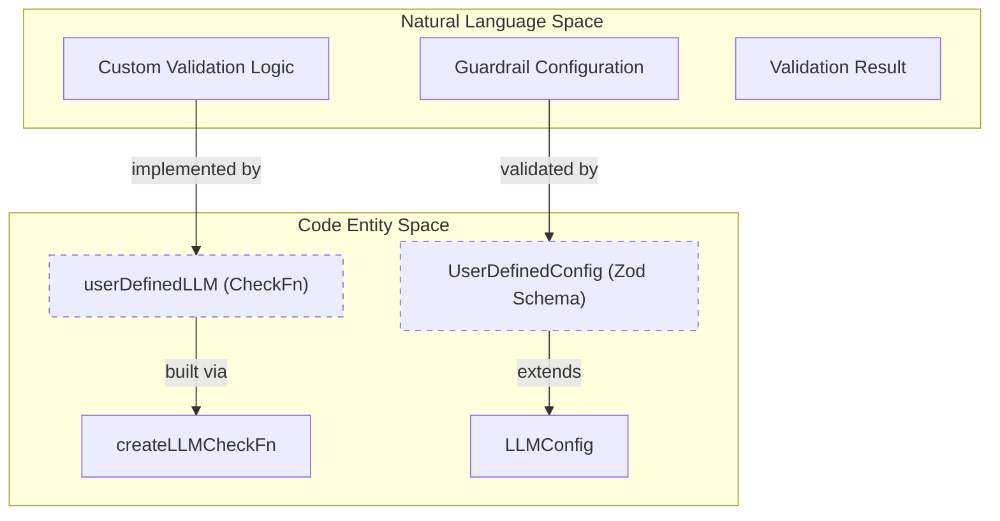
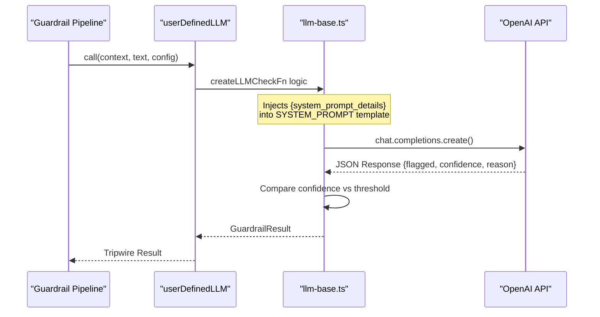

<!-- source: DeepWiki mcp.deepwiki.com · repo openai/openai-guardrails-js · extra page Custom Prompt Check · fetched 2026-10-26 -->

# Custom Prompt Check

<details>
<summary>Relevant source files</summary>

The following files were used as context for generating this wiki page:

- [docs/ref/checks/custom_prompt_check.md](docs/ref/checks/custom_prompt_check.md)
- [docs/ref/checks/off_topic_prompts.md](docs/ref/checks/off_topic_prompts.md)
- [src/__tests__/unit/checks/topical-alignment.test.ts](src/__tests__/unit/checks/topical-alignment.test.ts)
- [src/__tests__/unit/checks/user-defined-llm.test.ts](src/__tests__/unit/checks/user-defined-llm.test.ts)
- [src/checks/topical-alignment.ts](src/checks/topical-alignment.ts)
- [src/checks/user-defined-llm.ts](src/checks/user-defined-llm.ts)

</details>


## Purpose and Scope

The Custom Prompt Check is a flexible, LLM-based guardrail that enables developers to implement user-defined validation logic using custom system prompts. This guardrail allows arbitrary business-specific content validation by leveraging an LLM to evaluate text against custom criteria defined in natural language.

This page covers the technical implementation, configuration schemas, and data flow for the Custom Prompt Check.

---

## Overview

The Custom Prompt Check executes developer-specified validation logic against input or output text. Unlike fixed-purpose guardrails (such as Moderation or Jailbreak Detection), this check allows fully customizable validation criteria expressed as natural language prompts. 

**Key characteristics:**
- **LLM-based evaluation**: Uses a secondary LLM call to evaluate text against custom instructions [src/checks/user-defined-llm.ts:45-52]().
- **Configurable confidence**: Uses a threshold to determine if a tripwire should trigger based on the LLM's assessment [docs/ref/checks/custom_prompt_check.md:22-23]().
- **Multi-turn support**: Can analyze conversation history up to a configured `max_turns` [docs/ref/checks/custom_prompt_check.md:30-31]().
- **Performance Optimization**: Supports an `include_reasoning` flag to reduce token usage and latency when detailed explanations are not required [docs/ref/checks/custom_prompt_check.md:25-29]().

---

## Code Entity Map

The following diagram maps the natural language concepts to the specific code entities and files that implement them.



**Sources:** [src/checks/user-defined-llm.ts:18-21](), [src/checks/user-defined-llm.ts:45-52](), [src/checks/llm-base.ts:11-11]()

---

## Configuration Schema

### Configuration Parameters

The configuration extends the base `LLMConfig` but overrides `system_prompt_details` to be a required string.

| Parameter | Type | Required | Description |
|-----------|------|----------|-------------|
| `system_prompt_details` | string | Yes | Free-form instructions describing content moderation requirements [src/checks/user-defined-llm.ts:20-20](). |
| `model` | string | Yes | Model to use for the check (e.g., "gpt-4o") [docs/ref/checks/custom_prompt_check.md:22-22](). |
| `confidence_threshold` | number | Yes | Minimum confidence score (0.0 to 1.0) to trigger tripwire [docs/ref/checks/custom_prompt_check.md:23-23](). |
| `include_reasoning` | boolean | No | Whether to include detailed reasoning in the output (default: `false`) [docs/ref/checks/custom_prompt_check.md:25-25](). |
| `max_turns` | number | No | Max conversation turns to include for analysis (default: `10`) [docs/ref/checks/custom_prompt_check.md:30-30](). |

### Implementation Details

The schema is defined using Zod:
[src/checks/user-defined-llm.ts:18-21]()
```typescript
export const UserDefinedConfig = LLMConfig.omit({ system_prompt_details: true }).extend({
  /** Free-form instructions describing content moderation requirements */
  system_prompt_details: z.string().describe('Free-form instructions describing content moderation requirements'),
});
```

---

## Data Flow and Execution

The `userDefinedLLM` check is generated using the `createLLMCheckFn` factory. This factory handles the orchestration of the LLM call, prompt template injection, and response parsing.

### Execution Sequence



**Sources:** [src/checks/user-defined-llm.ts:33-52](), [src/__tests__/unit/checks/user-defined-llm.test.ts:109-119]()

### Internal Prompt Template
The guardrail uses a standardized system prompt wrapper to ensure the LLM follows the structured output format required for tripwire logic:
[src/checks/user-defined-llm.ts:33-37]()
```markdown
# Instructions

{system_prompt_details}

Flag any content that matches the criteria defined above.
```

---

## Technical Behavior Notes

### Model-Specific Handling
The underlying execution engine adjusts parameters based on the model specified in the config:
- **Temperature**: For most models (e.g., `gpt-4`, `gpt-3.5-turbo`), temperature is set to `0.0` for deterministic results [src/__tests__/unit/checks/user-defined-llm.test.ts:114-114]().
- **Advanced Models**: For models like `gpt-5`, the system may use a temperature of `1.0` if the model does not support zero-temperature JSON mode [src/__tests__/unit/checks/user-defined-llm.test.ts:151-151]().

### Return Structure
The check returns a `GuardrailResult` containing an `info` object with structured metadata:
[docs/ref/checks/custom_prompt_check.md:40-61]()
- `flagged`: Boolean indicating if the criteria were met.
- `confidence`: The LLM's confidence score (0.0 - 1.0).
- `reason`: Explanation (only if `include_reasoning` is `true`).
- `token_usage`: Metadata regarding the cost of the check.

---

## Example Usage

### Integration in Pipeline
```json
{
    "name": "Custom Prompt Check",
    "config": {
        "model": "gpt-4o",
        "confidence_threshold": 0.8,
        "system_prompt_details": "Flag any input that asks for medical diagnoses.",
        "include_reasoning": true
    }
}
```

### Programmatic Context
The check requires a `GuardrailLLMContext`, which provides the `guardrailLlm` client used to perform the validation call [src/checks/user-defined-llm.ts:28-28]().

**Sources:** [src/checks/user-defined-llm.ts:1-52](), [src/__tests__/unit/checks/user-defined-llm.test.ts:1-119](), [docs/ref/checks/custom_prompt_check.md:1-61]()

---

