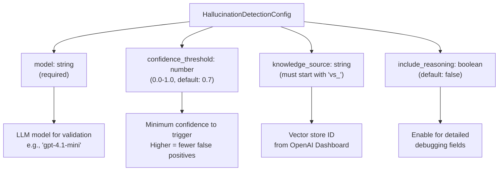
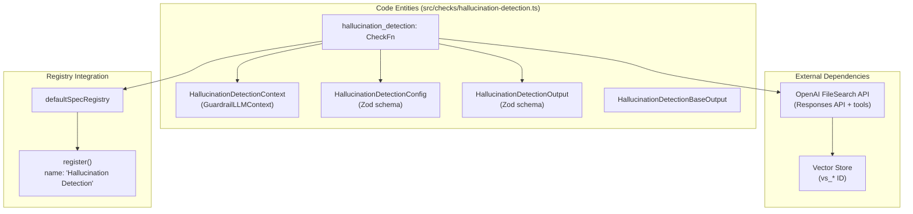
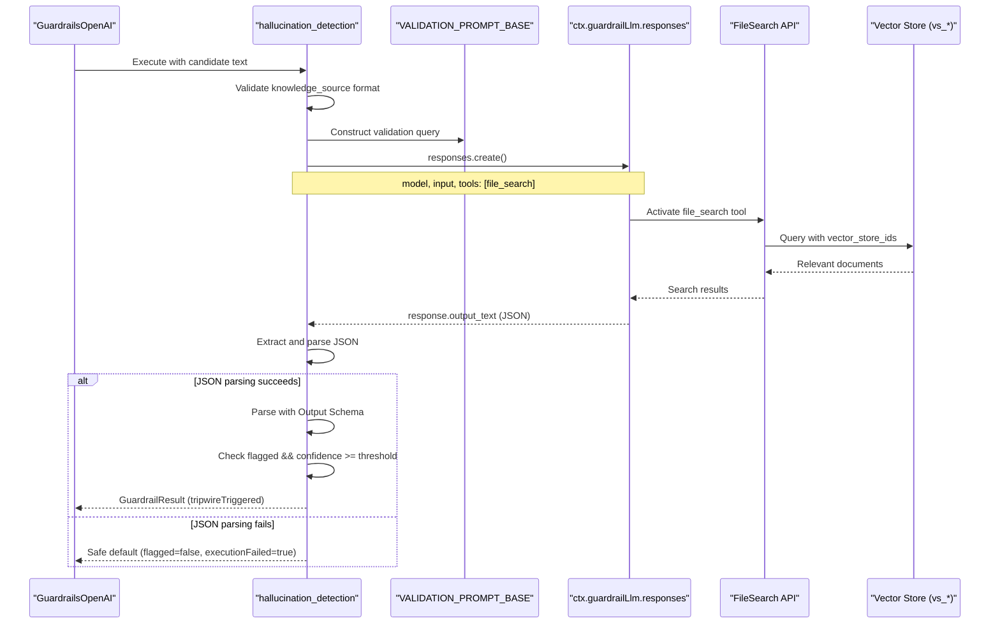
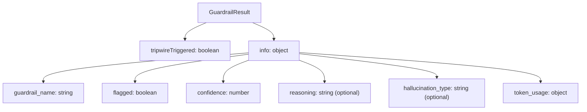

<!-- source: DeepWiki mcp.deepwiki.com · repo openai/openai-guardrails-js · extra page Hallucination Detection · fetched 2026-10-26 -->

# Hallucination Detection

<details>
<summary>Relevant source files</summary>

The following files were used as context for generating this wiki page:

- [docs/ref/checks/hallucination_detection.md](docs/ref/checks/hallucination_detection.md)
- [src/__tests__/unit/checks/hallucination-detection.test.ts](src/__tests__/unit/checks/hallucination-detection.test.ts)
- [src/checks/hallucination-detection.ts](src/checks/hallucination-detection.ts)

</details>


**Purpose**: This page provides comprehensive documentation for the Hallucination Detection guardrail, which validates factual claims in LLM-generated text against reference documents using OpenAI's FileSearch API. It covers vector store setup, configuration parameters, performance characteristics, and scaling behavior.

**Scope**: This document focuses specifically on the `hallucination_detection` guardrail implementation. For other content quality checks, see [Off Topic Prompts](5.3.2) and [Custom Prompt Check](5.3.3). For general guardrail concepts, see [Key Concepts](1.2).

## Overview

The Hallucination Detection guardrail identifies factual claims in AI-generated text that are contradicted or unsupported by a knowledge base of reference documents. Unlike content safety checks that focus on harmful content, this guardrail validates factual accuracy.

**Key Characteristics**:
- Validates factual claims against a vector store of reference documents [docs/ref/checks/hallucination_detection.md:3-3]()
- Uses OpenAI's FileSearch API with structured JSON output [src/checks/hallucination-detection.ts:5-6]()
- Provides confidence scores and optional detailed reasoning [src/checks/hallucination-detection.ts:46-56]()
- Distinguishes between supported, contradicted, and unsupported claims [src/checks/hallucination-detection.ts:141-145]()
- Does not flag opinions, questions, or conversational content [src/checks/hallucination-detection.ts:113-119]()

**Sources**: [docs/ref/checks/hallucination_detection.md:1-8](), [src/checks/hallucination-detection.ts:1-18]()

## Prerequisites: Vector Store Setup

Before using Hallucination Detection, you must create an OpenAI vector store containing your reference documents. The vector store ID must start with `vs_` and is provided as the `knowledge_source` configuration parameter [src/checks/hallucination-detection.ts:42-45]().

### Vector Store Creation Methods

| Method | Description | Documentation |
|--------|-------------|---------------|
| OpenAI Dashboard | Web interface for uploading files and creating vector stores | [platform.openai.com/storage/vector_stores](https://platform.openai.com/storage/vector_stores) |
| Guardrails Wizard | Visual configuration tool with vector store creation support | [guardrails.openai.com](https://guardrails.openai.com/) |
| OpenAI API | Programmatic creation via FileSearch API | [File Search Documentation](https://platform.openai.com/docs/guides/tools-file-search) |
| Utility Script | `create_vector_store.py` script provided in the repository | [src/checks/hallucination-detection.ts:15-15]() |

**Important**: Vector store quality directly impacts detection accuracy. Use concise, authoritative sources rather than large, noisy corpora [docs/ref/checks/hallucination_detection.md:37-37]().

**Sources**: [src/checks/hallucination-detection.ts:8-16](), [docs/ref/checks/hallucination_detection.md:41-51]()

## Configuration Schema

### Configuration Parameters


**Diagram**: Configuration schema structure showing parameters defined in `HallucinationDetectionConfig` [src/checks/hallucination-detection.ts:37-57]().

**Sources**: [src/checks/hallucination-detection.ts:37-57]()

### Parameter Details

| Parameter | Type | Required | Default | Description |
|-----------|------|----------|---------|-------------|
| `model` | `string` | Yes | - | OpenAI model for validation (e.g., `"gpt-4.1-mini"`) [src/checks/hallucination-detection.ts:39-39]() |
| `confidence_threshold` | `number` | Yes | `0.7` | Minimum confidence (0.0-1.0) to trigger tripwire [src/checks/hallucination-detection.ts:41-41]() |
| `knowledge_source` | `string` | Yes | - | Vector store ID starting with `vs_` [src/checks/hallucination-detection.ts:43-45]() |
| `include_reasoning` | `boolean` | No | `false` | Includes detailed fields (reasoning, types, statements) at the cost of higher latency [src/checks/hallucination-detection.ts:51-56]() |

**Performance Note**: Disabling `include_reasoning` reduces median latency by approximately 40% [docs/ref/checks/hallucination_detection.md:31-31]().

**Sources**: [docs/ref/checks/hallucination_detection.md:23-33](), [src/checks/hallucination-detection.ts:37-57]()

## Implementation Architecture

### Core Components


**Diagram**: Code entity mapping for hallucination detection implementation [src/checks/hallucination-detection.ts:152-267]().

**Sources**: [src/checks/hallucination-detection.ts:152-267]()

### Type Definitions

The implementation uses Zod schemas for type-safe configuration and output:

**Configuration Type**:
- Defined as `HallucinationDetectionConfig` [src/checks/hallucination-detection.ts:37-57]().
- Enforces regex pattern `^vs_` for `knowledge_source` [src/checks/hallucination-detection.ts:45-45]().

**Output Types**:
- `HallucinationDetectionBaseOutput`: Contains `flagged` and `confidence` [src/checks/hallucination-detection.ts:69-74]().
- `HallucinationDetectionOutput`: Extends base with `reasoning`, `hallucination_type`, `hallucinated_statements`, and `verified_statements` [src/checks/hallucination-detection.ts:81-90]().

**Context Type**:
- `HallucinationDetectionContext`: Alias for `GuardrailLLMContext`, providing access to `ctx.guardrailLlm` [src/checks/hallucination-detection.ts:64-64]().

**Sources**: [src/checks/hallucination-detection.ts:37-92]()

## Validation Process Flow


**Diagram**: Validation process sequence utilizing the `responses.create` call with `file_search` tools [src/checks/hallucination-detection.ts:166-175]().

**Sources**: [src/checks/hallucination-detection.ts:152-255]()

### Validation Steps

1. **Input Validation**: Validates `knowledge_source` format before proceeding [src/checks/hallucination-detection.ts:157-159]().
2. **Prompt Construction**: Uses `VALIDATION_PROMPT_BASE` to instruct the LLM on factual claim identification [src/checks/hallucination-detection.ts:97-149]().
3. **FileSearch API Call**: Executes `ctx.guardrailLlm.responses.create` with the `file_search` tool enabled for the specified `vector_store_ids` [src/checks/hallucination-detection.ts:166-175]().
4. **Response Processing**: Parses the JSON response from the LLM, using regex to handle potential markdown code blocks [src/checks/hallucination-detection.ts:178-194]().
5. **Tripwire Decision**: Triggers if `flagged` is true and `confidence` meets or exceeds the `confidence_threshold` [src/checks/hallucination-detection.ts:220-220]().

**Sources**: [src/checks/hallucination-detection.ts:152-255]()

## Validation Prompt Design

The `VALIDATION_PROMPT_BASE` [src/checks/hallucination-detection.ts:97-149]() provides the logic for the detection:

### Flagging Criteria

**DO Flag**:
- Factual claims clearly contradicted by documents [src/checks/hallucination-detection.ts:144-144]().
- Factual claims completely unsupported by documents [src/checks/hallucination-detection.ts:145-145]().

**DO NOT Flag**:
- Conversational content (greetings, pleasantries) [src/checks/hallucination-detection.ts:114-114]().
- Opinions or subjective statements [src/checks/hallucination-detection.ts:115-115]().
- Minor phrasing differences if core meaning is correct [src/checks/hallucination-detection.ts:122-123]().

**Sources**: [src/checks/hallucination-detection.ts:97-149]()

## Result Structure

### GuardrailResult Format


**Diagram**: Structure of the `GuardrailResult` returned by the `hallucination_detection` function [src/checks/hallucination-detection.ts:222-234]().

**Sources**: [src/checks/hallucination-detection.ts:222-234](), [docs/ref/checks/hallucination_detection.md:115-133]()

### Example Result (Reasoning Enabled)

```json
{
    "guardrail_name": "Hallucination Detection",
    "flagged": true,
    "confidence": 0.95,
    "reasoning": "The claim about pricing contradicts the documented information",
    "hallucination_type": "factual_error",
    "hallucinated_statements": ["Our premium plan costs $299/month"],
    "verified_statements": ["We offer customer support"],
    "threshold": 0.7,
    "token_usage": {
        "prompt_tokens": 200,
        "completion_tokens": 30,
        "total_tokens": 230
    }
}
```

**Sources**: [docs/ref/checks/hallucination_detection.md:117-133]()

## Error Handling

### Error Recovery Strategy

- **JSON Parsing Failures**: If the LLM returns malformed JSON, the guardrail returns a safe default (`flagged=false`, `confidence=0.0`) and records the error in `info.error_message` [src/checks/hallucination-detection.ts:196-215]().
- **API/Network Errors**: Exceptions during the API call are caught; the guardrail returns `executionFailed: true` and a safe default to prevent blocking the application [src/checks/hallucination-detection.ts:236-254]().
- **Configuration Validation**: If `knowledge_source` is invalid (e.g., does not start with `vs_`), the guardrail throws an error during execution [docs/ref/checks/hallucination_detection.md:109-109]().

**Sources**: [src/checks/hallucination-detection.ts:157-254](), [docs/ref/checks/hallucination_detection.md:106-110]()

## Performance and Scaling

### Benchmark Results

| Model | ROC AUC | TTC P50 (ms) | TTC P95 (ms) |
|-------|---------|--------------|--------------|
| **gpt-4.1-mini** | **0.876** | **7,069** | **43,174** |
| gpt-5-mini | 0.934 | 23,013 | 59,316 |
| gpt-5 | 0.854 | 34,135 | 525,854 |

**Sources**: [docs/ref/checks/hallucination_detection.md:165-203]()

### Vector Store Scaling

As vector store size increases, performance and latency are impacted:

- **Latency**: GPT-4.1 models maintain relatively consistent latency across scales (1MB to 105MB). GPT-5 models show significant latency spikes as store size grows [docs/ref/checks/hallucination_detection.md:216-226]().
- **Accuracy**: ROC AUC generally decreases as vector store size increases due to signal-to-noise ratio degradation [docs/ref/checks/hallucination_detection.md:228-274]().

**Sources**: [docs/ref/checks/hallucination_detection.md:216-274]()

## Best Practices

1. **Model Choice**: Use `gpt-4.1-mini` for the best balance of accuracy and latency [docs/ref/checks/hallucination_detection.md:25-25]().
2. **Reasoning Toggle**: Keep `include_reasoning: false` in production to minimize latency and token costs [docs/ref/checks/hallucination_detection.md:32-32]().
3. **Vector Store Curation**: Prefer concise, authoritative documents over large, noisy datasets to maintain high precision [docs/ref/checks/hallucination_detection.md:37-37]().
4. **Threshold Tuning**: Start at `0.7`. Increase (0.8-0.9) to avoid false positives; decrease (0.6) to catch subtle errors [docs/ref/checks/hallucination_detection.md:36-36]().

**Sources**: [docs/ref/checks/hallucination_detection.md:23-38](), [src/checks/hallucination-detection.ts:51-56]()

---

