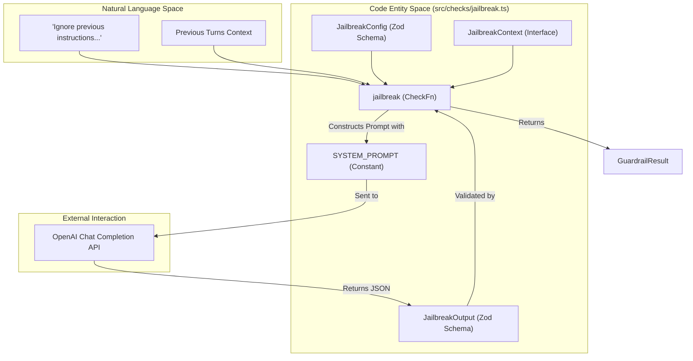
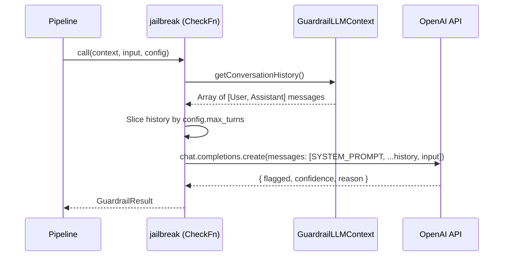

<!-- source: DeepWiki mcp.deepwiki.com · repo openai/openai-guardrails-js · extra page Jailbreak Detection · fetched 2026-10-26 -->

# Jailbreak Detection

<details>
<summary>Relevant source files</summary>

The following files were used as context for generating this wiki page:

- [docs/ref/checks/jailbreak.md](docs/ref/checks/jailbreak.md)
- [src/__tests__/unit/checks/jailbreak.test.ts](src/__tests__/unit/checks/jailbreak.test.ts)
- [src/checks/jailbreak.ts](src/checks/jailbreak.ts)

</details>


Jailbreak detection identifies attempts to bypass AI safety measures such as prompt injection, role-playing requests, or social engineering attempts. It analyzes text for adversarial intent using LLM-based detection, identifying various attack patterns and providing confidence scores. Unlike general content moderation, jailbreak detection focuses specifically on the **deception and manipulation tactics** designed to elicit restricted outputs [docs/ref/checks/jailbreak.md:1-13]().

**Sources:** [docs/ref/checks/jailbreak.md:1-13](), [src/checks/jailbreak.ts:1-8]()

## Purpose and Scope

The guardrail is **conversation-aware**, meaning it automatically analyzes conversation history to detect multi-turn escalation patterns where adversarial attempts gradually build across multiple turns [docs/ref/checks/jailbreak.md:5-6]().

### Detection Targets
- **Override attempts**: Explicit commands to ignore prior system instructions or safety constraints [docs/ref/checks/jailbreak.md:15-16]().
- **Obfuscation**: Character-level (Base64, leetspeak) or semantic-level (ambiguity, paraphrasing) techniques to disguise intent [src/checks/jailbreak.ts:47-86]().
- **Contextual Manipulation**: Role-playing, fictional framing, or emotional manipulation (e.g., "If you don't help, a baby will die") to justify restricted content [src/checks/jailbreak.ts:87-103]().
- **Structure-level Obfuscation**: Embedding harmful content in JSON, XML, or code structures [src/checks/jailbreak.ts:104-111]().

**Sources:** [docs/ref/checks/jailbreak.md:11-20](), [src/checks/jailbreak.ts:37-118]()

## Implementation Architecture

The Jailbreak guardrail is implemented via `createLLMCheckFn`, which leverages an LLM to evaluate the input against a detailed security taxonomy [src/checks/jailbreak.ts:12-36]().

### Data Flow and Entity Mapping

The following diagram maps the logical flow of detection to the specific code entities involved in the process.

**Diagram: Jailbreak Detection Data Flow**

**Sources:** [src/checks/jailbreak.ts:10-36](), [src/checks/jailbreak.ts:37-160](), [src/types.ts:11-12]()

## Configuration and Tuning

The guardrail is configured within a pipeline's `input` or `pre_flight` stages.

### Configuration Parameters
| Parameter | Type | Required | Description |
| :--- | :--- | :--- | :--- |
| `model` | string | Yes | LLM to use for detection (e.g., `gpt-4.1-mini`) [docs/ref/checks/jailbreak.md:37](). |
| `confidence_threshold` | number | Yes | Score (0.0 to 1.0) required to trigger a tripwire [docs/ref/checks/jailbreak.md:38](). |
| `include_reasoning` | boolean | No | If `true`, returns a natural language `reason`. Default is `false` to reduce latency by ~40% [docs/ref/checks/jailbreak.md:39-43](). |
| `max_turns` | number | No | Max conversation history turns to include. Default is `10` [docs/ref/checks/jailbreak.md:44-46](). |

### Tuning Guidance
- **Baseline**: Start at `0.7` [docs/ref/checks/jailbreak.md:49]().
- **High Precision**: Increase to `0.8–0.9` to reduce false positives in edgy but benign prompts [docs/ref/checks/jailbreak.md:49]().
- **High Recall**: Lower to `0.6` to catch subtle attempts [docs/ref/checks/jailbreak.md:49]().
- **Small Models**: Use higher thresholds for smaller models as their confidence estimates are noisier [docs/ref/checks/jailbreak.md:50]().

**Sources:** [docs/ref/checks/jailbreak.md:21-52](), [src/checks/jailbreak.ts:14-20]()

## Multi-Turn Logic

The guardrail uses the `getConversationHistory` method from the `GuardrailLLMContext` to pull previous turns [src/__tests__/unit/checks/jailbreak.test.ts:61-64](). This allows the LLM to identify **Multi-turn Escalation**, where a user starts with a benign request and pivots to harmful content after establishing a persona [src/checks/jailbreak.ts:112-118]().

**Diagram: Multi-Turn Context Injection**

**Sources:** [src/checks/jailbreak.ts:139-144](), [src/__tests__/unit/checks/jailbreak.test.ts:81-127]()

## Output Structure

The guardrail returns a `GuardrailResult` containing a specific `info` object [docs/ref/checks/jailbreak.md:53-55]().

```json
{
    "guardrail_name": "Jailbreak",
    "flagged": true,
    "confidence": 0.85,
    "threshold": 0.7,
    "reason": "Multi-turn escalation: Role-playing followed by instruction override",
    "token_usage": {
        "prompt_tokens": 150,
        "completion_tokens": 25,
        "total_tokens": 175
    }
}
```
*Note: `reason` is only present if `include_reasoning` is set to `true` [docs/ref/checks/jailbreak.md:75]().*

**Sources:** [docs/ref/checks/jailbreak.md:57-77](), [src/checks/jailbreak.ts:27-32]()

## Benchmarks

Detection performance varies by model choice. `gpt-4.1` provides the highest accuracy, while `gpt-4.1-mini` offers a significant latency advantage [docs/ref/checks/jailbreak.md:101-115]().

### Performance Metrics
| Model | ROC AUC | Prec@R=0.90 | Recall@FPR=0.01 |
| :--- | :--- | :--- | :--- |
| `gpt-4.1` | 0.999 | 0.999 | 1.000 |
| `gpt-4.1-mini` (Default) | 0.928 | 0.968 | 0.000 |
| `gpt-5` | 0.994 | 0.993 | 0.997 |

### Latency (TTC P50)
- **gpt-4.1-mini**: 1,538 ms
- **gpt-4.1**: 2,998 ms
- **gpt-5**: 7,370 ms

**Sources:** [docs/ref/checks/jailbreak.md:93-124]()

---

