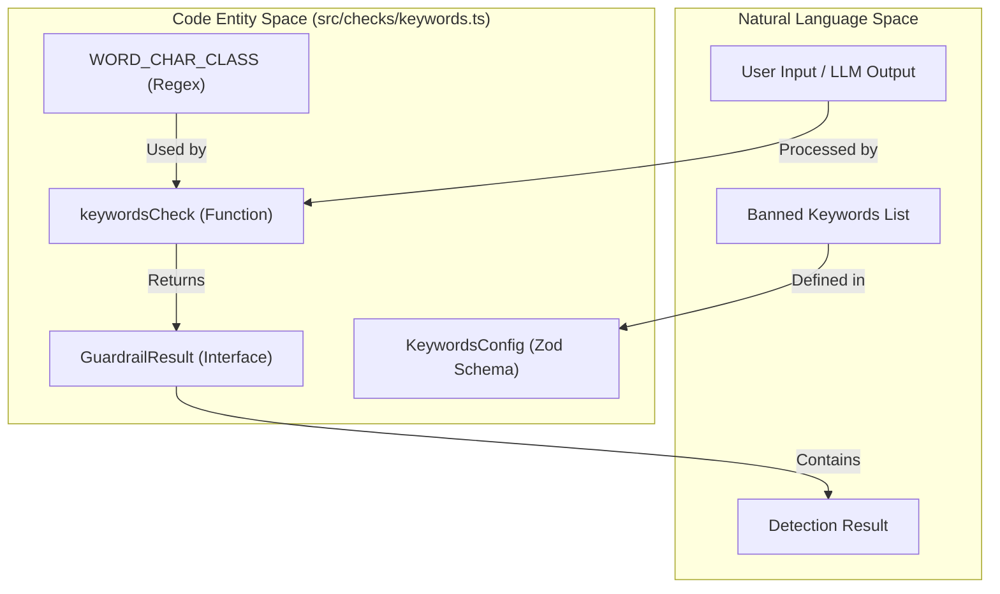
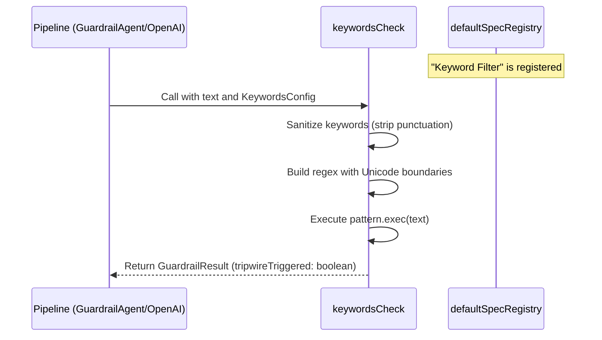

<!-- source: DeepWiki mcp.deepwiki.com · repo openai/openai-guardrails-js · extra page Keyword Filter · fetched 2026-10-26 -->

# Keyword Filter

<details>
<summary>Relevant source files</summary>

The following files were used as context for generating this wiki page:

- [docs/ref/checks/keywords.md](docs/ref/checks/keywords.md)
- [docs/ref/checks/moderation.md](docs/ref/checks/moderation.md)
- [docs/ref/checks/secret_keys.md](docs/ref/checks/secret_keys.md)
- [src/__tests__/unit/checks/keywords-urls.test.ts](src/__tests__/unit/checks/keywords-urls.test.ts)
- [src/checks/keywords.ts](src/checks/keywords.ts)
- [src/checks/urls.ts](src/checks/urls.ts)

</details>


The **Keyword Filter** guardrail is a content filtering mechanism designed to detect and block specific banned words or phrases within text [src/checks/keywords.ts:1-6](). It employs a robust, Unicode-aware regular expression engine to perform case-insensitive matching while strictly adhering to word boundaries [src/checks/keywords.ts:97-97]().

This guardrail is commonly used to prevent the leakage of internal project names, confidential terms, or to enforce basic content moderation by blocking a predefined list of prohibited strings [docs/ref/checks/keywords.md:1-3]().

## Implementation Details

The filter operates by transforming a list of user-provided keywords into a single optimized regular expression.

### Data Flow and Logic
1.  **Sanitization**: The guardrail first strips trailing punctuation (such as `.`, `,`, `!`, `?`, `;`, `:`) from the configured keywords to ensure that a match is found even if the keyword is at the end of a sentence [src/checks/keywords.ts:61-62]().
2.  **Boundary Detection**: For each keyword, the system determines if the first and last characters are "word characters" (letters, numbers, or underscores) [src/checks/keywords.ts:86-90]().
3.  **Regex Construction**: 
    *   If a keyword starts/ends with a word character, a Unicode-aware negative lookbehind/lookahead is added to ensure it isn't part of a larger word (e.g., "secret" will not match "secretary") [src/checks/keywords.ts:91-93]().
    *   If a keyword starts/ends with a non-word character (like `@` or `#`), boundaries are not enforced for that side, allowing matches like `@internal` inside an email address [src/__tests__/unit/checks/keywords-urls.test.ts:130-150]().
4.  **Execution**: The text is scanned using the `giu` (global, case-insensitive, unicode) flags [src/checks/keywords.ts:97-97]().

### Technical Entity Mapping: Natural Language to Code
The following diagram maps the logical concepts of keyword filtering to the specific TypeScript entities in the codebase.

**Diagram: Keyword Filter Entity Mapping**

Sources: [src/checks/keywords.ts:15-20](), [src/checks/keywords.ts:43-50](), [src/checks/keywords.ts:52-56]()

## Configuration

The guardrail is registered in the `defaultSpecRegistry` under the name `"Keyword Filter"` [src/checks/keywords.ts:127-129]().

### Schema
| Parameter | Type | Required | Description |
| :--- | :--- | :--- | :--- |
| `keywords` | `string[]` | Yes | A list of strings to detect. Must contain at least one entry. |

Sources: [src/checks/keywords.ts:15-18]()

### Example Configuration
```json
{
  "name": "Keyword Filter",
  "config": {
    "keywords": ["confidential", "internal use only", "top-secret"]
  }
}
```
Sources: [docs/ref/checks/keywords.md:7-14]()

## Guardrail Result
When a match is found, the `tripwireTriggered` property is set to `true` [src/checks/keywords.ts:112-115](). The `info` object provides detailed metadata about the match:

| Property | Type | Description |
| :--- | :--- | :--- |
| `matchedKeywords` | `string[]` | Unique list of actual strings found in the text. |
| `originalKeywords` | `string[]` | The raw keywords provided in the config. |
| `sanitizedKeywords` | `string[]` | Keywords after trailing punctuation removal. |
| `totalKeywords` | `number` | Total number of keywords being monitored. |
| `textLength` | `number` | The length of the input text scanned. |

Sources: [src/checks/keywords.ts:116-123](), [docs/ref/checks/keywords.md:24-40]()

## Behavioral Characteristics

### Word Boundary Logic
The filter uses the character class `[\p{L}\p{N}_]` (Unicode letters, numbers, and underscores) to define word boundaries [src/checks/keywords.ts:43-43]().

| Scenario | Keyword | Input Text | Match? | Reason |
| :--- | :--- | :--- | :--- | :--- |
| **Partial Word** | `orld` | `Hello world` | No | `d` is followed by a non-word boundary. |
| **Punctuation** | `secret!!!` | `This is secret!` | Yes | Sanitization strips `!!!` to `secret`. |
| **Special Char** | `@foo` | `test@foo.com` | Yes | `@` is not a word character; no left boundary enforced. |
| **Scripts** | `你好` | `你好123` | No | `好` is a word character; `1` is also a word character. |
| **Numbers** | `123` | `item123` | No | `1` is preceded by `m` (a word character). |

Sources: [src/__tests__/unit/checks/keywords-urls.test.ts:12-65](), [src/__tests__/unit/checks/keywords-urls.test.ts:130-139]()

### Component Interaction
The `keywordsCheck` function is a standard `CheckFn` that integrates into the wider Guardrails pipeline.

**Diagram: Keyword Filter Data Flow**

Sources: [src/checks/keywords.ts:52-56](), [src/checks/keywords.ts:127-135]()

---

