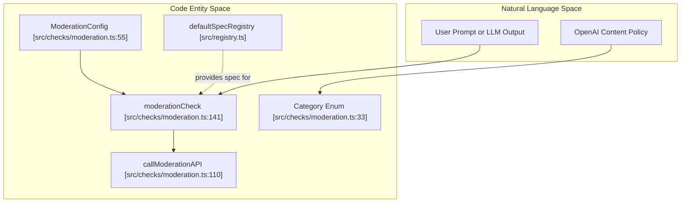
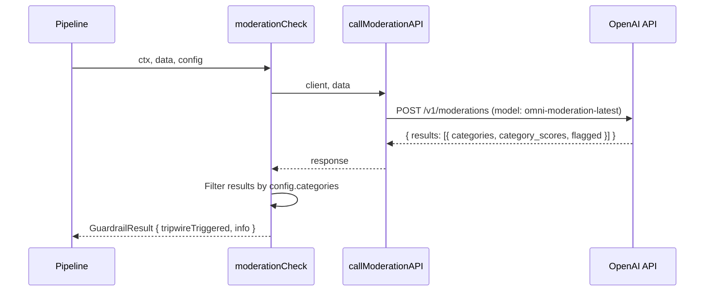

<!-- source: DeepWiki mcp.deepwiki.com · repo openai/openai-guardrails-js · extra page Moderation · fetched 2026-10-26 -->

# Moderation

<details>
<summary>Relevant source files</summary>

The following files were used as context for generating this wiki page:

- [docs/ref/checks/keywords.md](docs/ref/checks/keywords.md)
- [docs/ref/checks/moderation.md](docs/ref/checks/moderation.md)
- [docs/ref/checks/secret_keys.md](docs/ref/checks/secret_keys.md)
- [src/__tests__/unit/checks/moderation-secret-keys.test.ts](src/__tests__/unit/checks/moderation-secret-keys.test.ts)
- [src/checks/moderation.ts](src/checks/moderation.ts)

</details>


## Purpose and Scope

The Moderation guardrail uses OpenAI's [Moderation API](https://platform.openai.com/docs/guides/moderation) to detect potentially harmful content across multiple safety categories. This guardrail identifies content that violates OpenAI's usage policies, including hate speech, violence, self-harm, sexual content, and harassment.

This page covers the Moderation guardrail implementation, its configuration via `ModerationConfig`, and its execution flow using the `moderationCheck` function.

**Sources:** [src/checks/moderation.ts:1-7](), [docs/ref/checks/moderation.md:1-3]()

---

## Overview

The Moderation guardrail is a **Content Safety** check that validates text against OpenAI's content policy. It leverages the `omni-moderation-latest` model via the OpenAI `moderations.create` endpoint.

### Code-to-Entity Mapping

The following diagram maps the logical components of the moderation process to specific code entities in the `openai-guardrails-js` library.



**Diagram: Moderation Code Entity Mapping**

**Sources:** [src/checks/moderation.ts:33-47](), [src/checks/moderation.ts:110-127](), [src/checks/moderation.ts:141-145]()

---

## How It Works

### OpenAI Moderation API Integration

The `moderationCheck` function orchestrates the call to OpenAI. It attempts to use a provided client from the `ModerationContext` (typically passed during pipeline execution) before falling back to a default `new OpenAI()` instance if the context client fails (e.g., if using a third-party provider that lacks a `/moderations` endpoint) [src/checks/moderation.ts:153-175]().

#### Safety Identifier
When calling the official OpenAI API, the guardrail includes a `safety_identifier` set to `openai-guardrails-js` to help OpenAI improve safety systems [src/checks/moderation.ts:119-123]().

### Data Flow



**Diagram: Moderation Data Flow**

**Sources:** [src/checks/moderation.ts:110-127](), [src/checks/moderation.ts:211-235]()

---

## Configuration

### Configuration Schema

The `ModerationConfig` uses Zod for validation and defines which categories should trigger a tripwire.

| Parameter | Type | Default | Description |
|-----------|------|---------|-------------|
| `categories` | `Category[]` | All categories | List of categories to check. If any are flagged, `tripwireTriggered` is true. |

**Sources:** [src/checks/moderation.ts:55-58](), [src/checks/moderation.ts:63-70]()

### Supported Categories

The `Category` enum defines the available filters [src/checks/moderation.ts:33-47]():

*   `sexual`, `sexual/minors`
*   `hate`, `hate/threatening`
*   `harassment`, `harassment/threatening`
*   `self-harm`, `self-harm/intent`, `self-harm/instructions`
*   `violence`, `violence/graphic`
*   `illicit`, `illicit/violent`

### Example Configuration

```typescript
import { Category } from './src/checks/moderation';

const config = {
  name: 'Moderation',
  config: {
    categories: [Category.HATE, Category.VIOLENCE, Category.SELF_HARM]
  }
};
```

**Sources:** [src/checks/moderation.ts:13-18](), [docs/ref/checks/moderation.md:7-13]()

---

## Result Structure

The `GuardrailResult` returned by `moderationCheck` contains detailed metadata in the `info` field.

### Info Object Fields

| Field | Type | Description |
|-------|------|-------------|
| `flagged_categories` | `string[]` | Categories that were both configured and flagged by the API. |
| `categories_checked` | `string[]` | The list of categories the guardrail was configured to look for. |
| `category_details` | `Record<string, boolean>` | The raw binary flags for all categories returned by OpenAI. |
| `category_scores` | `Record<string, number>` | The raw confidence scores (0.0 to 1.0) for all categories. |
| `error` | `string` | Included only if `executionFailed` is true. |

**Sources:** [src/checks/moderation.ts:222-233](), [docs/ref/checks/moderation.md:43-62]()

---

## Error Handling and Fallbacks

The guardrail is designed to be resilient to different LLM providers:

1.  **Context Client**: It first attempts to use `ctx.guardrailLlm` [src/checks/moderation.ts:167-170]().
2.  **404 Fallback**: If the context client returns a 404 (common when using local models or providers like Ollama that don't implement moderation), it falls back to a standard OpenAI client using the `OPENAI_API_KEY` environment variable [src/checks/moderation.ts:173-175]().
3.  **Execution Failure**: If both attempts fail, it returns `executionFailed: true` and the `originalException`. This allows the pipeline to decide whether to block based on the `raiseGuardrailErrors` setting [src/checks/moderation.ts:179-188]().

**Sources:** [src/checks/moderation.ts:88-90](), [src/checks/moderation.ts:164-208](), [src/__tests__/unit/checks/moderation-secret-keys.test.ts:62-85]()

---

## Performance and Cost

*   **Latency**: The check requires a network round-trip to OpenAI.
*   **Cost**: As of current OpenAI policy, the Moderation API is free to use with a valid API key.
*   **Safety Identifier**: The implementation includes `safety_identifier: 'openai-guardrails-js'` in the API payload to assist OpenAI in monitoring safety trends [src/checks/moderation.ts:122]().

**Sources:** [src/checks/moderation.ts:119-123](), [docs/ref/checks/moderation.md:38-39]()

---

