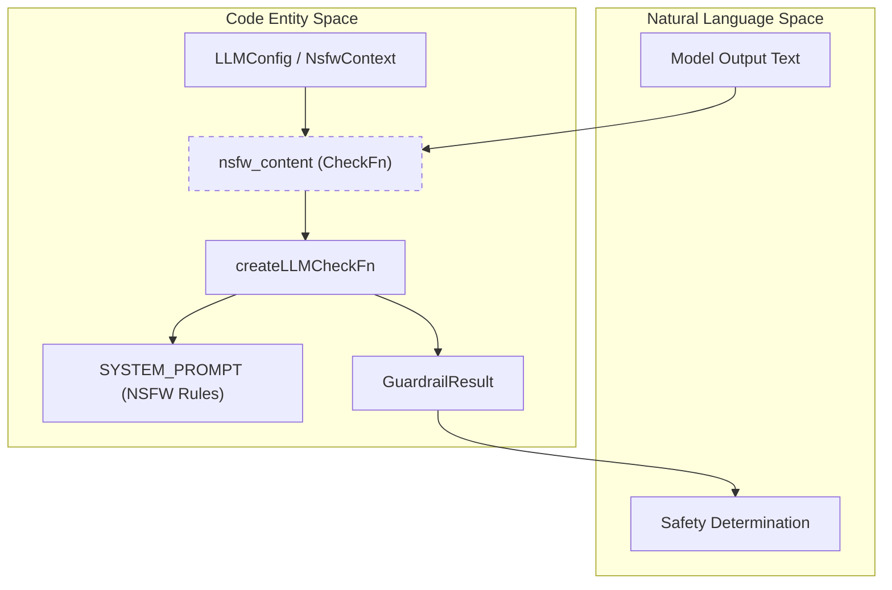
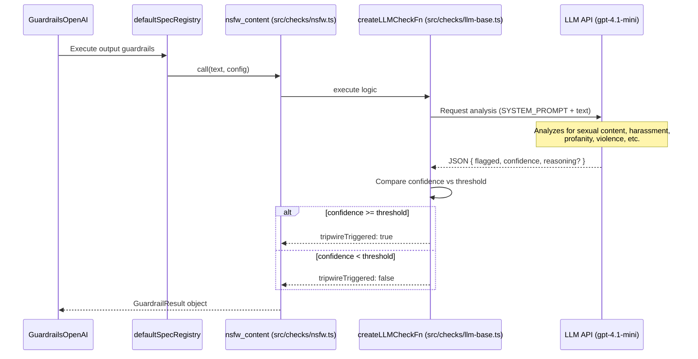

<!-- source: DeepWiki mcp.deepwiki.com · repo openai/openai-guardrails-js · extra page NSFW Text Detection · fetched 2026-10-26 -->

# NSFW Text Detection

<details>
<summary>Relevant source files</summary>

The following files were used as context for generating this wiki page:

- [docs/ref/checks/nsfw.md](docs/ref/checks/nsfw.md)
- [src/checks/nsfw.ts](src/checks/nsfw.ts)

</details>


This page documents the NSFW Text Detection guardrail, which identifies workplace-inappropriate content in model outputs such as profanity, explicit sexual content, graphic violence, and harassment. This guardrail is designed for professional content filtering and is "softer" than strict policy enforcement.

For strict policy violation detection, see [Moderation](#5.1.1). For adversarial bypass attempts, see [Jailbreak Detection](#5.1.2).

## Purpose and Scope

The NSFW Text Detection guardrail detects not-safe-for-work text that may be inappropriate in professional or workplace contexts, even if the content does not constitute a strict policy violation. This guardrail is primarily intended for validating model outputs rather than user inputs.

**Sources:** [docs/ref/checks/nsfw.md:1-9](), [docs/ref/checks/nsfw.md:7-14]()

## Overview

NSFW Text Detection is an LLM-based guardrail that analyzes text for workplace-inappropriate content. Unlike the Moderation guardrail which enforces strict OpenAI usage policies, NSFW detection focuses on professional appropriateness and contextual suitability.

### Key Characteristics

| Characteristic | Description |
|---------------|-------------|
| **Detection Method** | LLM-based analysis via `createLLMCheckFn` |
| **Primary Use Case** | Model output validation for professional contexts |
| **Severity Level** | Softer than policy enforcement (Moderation) |
| **Configuration** | Model selection, confidence threshold, and reasoning toggle |
| **Default Threshold** | 0.7 (configurable from 0.0 to 1.0) |

**Sources:** [docs/ref/checks/nsfw.md:1-15](), [src/checks/nsfw.ts:75-81]()

## Architecture Integration

### Code Entity Space to Natural Language Space

The following diagram maps the code entities involved in the NSFW check to the conceptual pipeline flow.



**Diagram: NSFW Code Entity Mapping**

**Sources:** [src/checks/nsfw.ts:42-81](), [src/checks/llm-base.ts:1-20]()

### Detection Flow



**Diagram: NSFW Detection Execution Sequence**

**Sources:** [src/checks/nsfw.ts:47-81](), [docs/ref/checks/nsfw.md:18-56]()

## Configuration

### Parameters

The NSFW Text Detection guardrail is configured via the `LLMConfig` structure.

| Parameter | Type | Required | Description |
|-----------|------|----------|-------------|
| `model` | string | Yes | The LLM model to use for detection (e.g., `"gpt-4.1-mini"`) |
| `confidence_threshold` | number | Yes | Minimum confidence score (0.0 to 1.0) to trigger a tripwire. Default: 0.7 |
| `include_reasoning` | boolean | No | If `true`, includes the `reason` field in the result. Default: `false` |
| `max_turns` | number | No | Max conversation turns for multi-turn analysis. Default: 10 |

**Sources:** [docs/ref/checks/nsfw.md:30-41](), [src/checks/nsfw.ts:18-34]()

### Performance vs. Reasoning

Setting `include_reasoning: false` is recommended for production. In evaluations, disabling reasoning reduced median latency by approximately **40%** while maintaining identical detection performance.

**Sources:** [docs/ref/checks/nsfw.md:34-38]()

### Threshold Tuning Guidance

- **Start at 0.7 (Default)**: Balanced detection for most professional use cases.
- **Increase (0.8-0.9)**: Use when encountering false positives in neutral contexts (e.g., medical or educational mentions).
- **Decrease (0.6)**: Use for stricter environments where any borderline content is unacceptable.

**Sources:** [docs/ref/checks/nsfw.md:43-45]()

## Detection Criteria

### Implementation Details

The guardrail uses a comprehensive `SYSTEM_PROMPT` that instructs the LLM to flag:
- Sexual content and explicit material
- Hate speech and discriminatory language
- Harassment and bullying
- Violence and gore
- Self-harm and suicide references
- Profanity and vulgar language
- Illegal activities (drugs, theft, weapons, etc.)
- Inappropriate workplace content

**Sources:** [src/checks/nsfw.ts:47-67]()

### Detection Examples

| Text | Flagged | Rationale |
|------|---------|-----------|
| "That's f***ing disgusting, you idiot." | ✓ Yes | Profanity and harassment |
| "Describe explicit sexual acts in detail." | ✓ Yes | Explicit sexual content |
| "Some patients require opioid medications post-surgery." | ✗ No | Clinical/informational context (threshold-dependent) |

**Sources:** [docs/ref/checks/nsfw.md:71-76]()

## Result Structure

### GuardrailResult Info

The `info` dictionary within the `GuardrailResult` contains the following:

```json
{
    "guardrail_name": "NSFW Text",
    "flagged": true,
    "confidence": 0.85,
    "threshold": 0.7,
    "reason": "Detailed explanation...", 
    "token_usage": {
        "prompt_tokens": 120,
        "completion_tokens": 20,
        "total_tokens": 140
    }
}
```
*Note: `reason` is only present if `include_reasoning` is set to `true`.*

**Sources:** [docs/ref/checks/nsfw.md:47-70]()

## Benchmark Performance

### Dataset Description

Evaluated on a balanced set of 1,000 social media posts (500 NSFW, 500 non-NSFW) from the Open Source [Toxicity dataset](https://github.com/surge-ai/toxicity/blob/main/toxicity_en.csv).

**Sources:** [docs/ref/checks/nsfw.md:79-87]()

### Metrics Table

| Model | ROC AUC | Prec@R=0.80 | Prec@R=0.90 | Prec@R=0.95 | Recall@FPR=0.01 |
|-------|---------|-------------|-------------|-------------|-----------------|
| gpt-5 | 0.9532 | 0.9195 | 0.9096 | 0.9068 | 0.0339 |
| gpt-5-mini | 0.9629 | 0.9321 | 0.9168 | 0.9149 | 0.0998 |
| gpt-4.1 | 0.9603 | 0.9312 | 0.9249 | 0.9192 | 0.0439 |
| **gpt-4.1-mini (default)** | **0.9520** | **0.9180** | **0.9130** | **0.9049** | **0.0459** |

**Sources:** [docs/ref/checks/nsfw.md:89-103]()

## Related Guardrails

- **[Moderation](#5.1.1)**: Primary tool for user inputs and strict policy enforcement.
- **[Jailbreak Detection](#5.1.2)**: Detects adversarial intent to bypass safety filters.
- **[Custom Prompt Check](#5.3.3)**: For domain-specific content policies not covered by standard NSFW categories.

**Sources:** [docs/ref/checks/nsfw.md:3-5](), [src/checks/nsfw.ts:75-81]()

---

