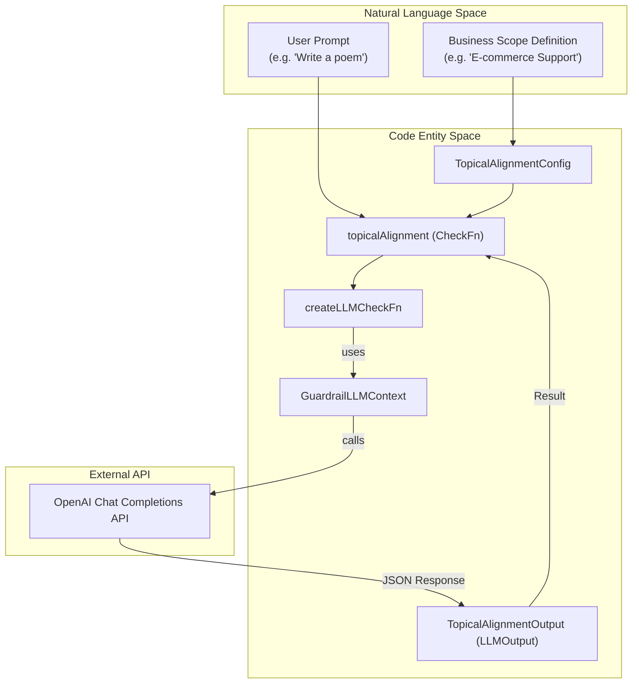
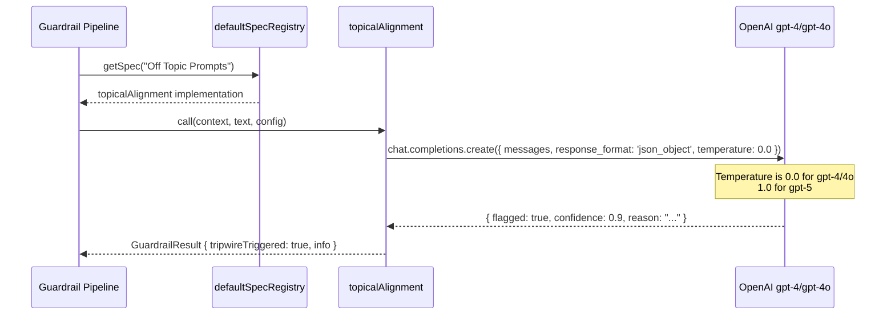

<!-- source: DeepWiki mcp.deepwiki.com · repo openai/openai-guardrails-js · extra page Off Topic Prompts · fetched 2026-10-26 -->

# Off Topic Prompts

<details>
<summary>Relevant source files</summary>

The following files were used as context for generating this wiki page:

- [docs/ref/checks/custom_prompt_check.md](docs/ref/checks/custom_prompt_check.md)
- [docs/ref/checks/off_topic_prompts.md](docs/ref/checks/off_topic_prompts.md)
- [src/__tests__/unit/checks/topical-alignment.test.ts](src/__tests__/unit/checks/topical-alignment.test.ts)
- [src/__tests__/unit/checks/user-defined-llm.test.ts](src/__tests__/unit/checks/user-defined-llm.test.ts)
- [src/checks/topical-alignment.ts](src/checks/topical-alignment.ts)
- [src/checks/user-defined-llm.ts](src/checks/user-defined-llm.ts)

</details>


The Off Topic Prompts guardrail (implemented as `topicalAlignment`) validates that user inputs and model outputs remain within the intended business scope of an application. This guardrail prevents the model from responding to requests outside its designated purpose, such as a customer support bot being asked to write code or a medical assistant being asked about financial advice.

## Purpose and Scope

The Off Topic Prompts guardrail ensures that conversations stay within the defined business context. It uses LLM-based analysis to detect when text falls outside the intended scope of use, allowing developers to maintain focus on core functionality and prevent scope creep or unintended use cases.

This guardrail is part of the Content Quality category and is specifically designed for business scope validation [src/checks/topical-alignment.ts:4-7]().

**Sources:** [src/checks/topical-alignment.ts:1-7](), [docs/ref/checks/off_topic_prompts.md:1-3]()

## Technical Implementation

The guardrail is implemented using the `createLLMCheckFn` factory, which standardizes LLM-based validation logic [src/checks/topical-alignment.ts:53-60]().

### Configuration Schema

The configuration extends the base `LLMConfig` but requires `system_prompt_details` to define the business scope [src/checks/topical-alignment.ts:18-21]().

| Parameter | Type | Required | Description |
|-----------|------|----------|-------------|
| `model` | `string` | Yes | OpenAI model used for analysis (e.g., `gpt-4o`, `gpt-4`) [docs/ref/checks/off_topic_prompts.md:22]() |
| `confidence_threshold` | `number` | Yes | Minimum score (0.0 to 1.0) to trigger a tripwire [docs/ref/checks/off_topic_prompts.md:23]() |
| `system_prompt_details` | `string` | Yes | Detailed description of the allowed business scope [src/checks/topical-alignment.ts:20]() |
| `include_reasoning` | `boolean` | No | If `true`, returns an explanation for the decision. Default is `false` [docs/ref/checks/off_topic_prompts.md:25]() |
| `max_turns` | `number` | No | Number of conversation turns to include for context. Default is `10` [docs/ref/checks/off_topic_prompts.md:30]() |

### Detection Logic

The guardrail uses a specialized system prompt to instruct the LLM [src/checks/topical-alignment.ts:40-45]():

```text
You are a content analysis system that determines if text stays on topic.

BUSINESS SCOPE: {system_prompt_details}

Determine if the text stays within the defined business scope. Flag any content
that strays from the allowed topics.
```

**Sources:** [src/checks/topical-alignment.ts:18-60](), [docs/ref/checks/off_topic_prompts.md:7-32]()

## Execution Flow

The following diagram bridges the Natural Language business requirements to the Code Entity space, showing how the `topicalAlignment` function interacts with the OpenAI API.



**Diagram: Off Topic Detection Data Flow**

**Sources:** [src/checks/topical-alignment.ts:11-60](), [src/checks/llm-base.ts:1-11](), [src/__tests__/unit/checks/topical-alignment.test.ts:60-80]()

## Internal Runtime Sequence

This diagram details how the `topicalAlignment` check is resolved and executed within the pipeline.



**Diagram: Off Topic Runtime Resolution**

**Sources:** [src/checks/topical-alignment.ts:53-60](), [src/__tests__/unit/checks/topical-alignment.test.ts:82-152](), [docs/ref/checks/off_topic_prompts.md:40-54]()

## Model-Specific Behaviors

Testing reveals specific parameter handling based on the model selected in `TopicalAlignmentConfig`:

*   **Temperature Handling**: For models like `gpt-4`, `gpt-4o`, and `gpt-3.5-turbo`, the guardrail sets `temperature: 0.0` to ensure deterministic output [src/__tests__/unit/checks/topical-alignment.test.ts:112, 184, 218]().
*   **GPT-5 Support**: For `gpt-5` models, the guardrail defaults to `temperature: 1.0` as these models may not support 0.0 [src/__tests__/unit/checks/topical-alignment.test.ts:149]().
*   **Response Format**: The guardrail enforces `response_format: { type: 'json_object' }` to ensure structured results [src/__tests__/unit/checks/topical-alignment.test.ts:113, 150]().

**Sources:** [src/__tests__/unit/checks/topical-alignment.test.ts:82-220]()

## Return Structure

The guardrail returns a `GuardrailResult`. The `info` property contains the following structured data:

| Field | Type | Description |
|-------|------|-------------|
| `flagged` | `boolean` | `true` if the content is outside the business scope [docs/ref/checks/off_topic_prompts.md:56]() |
| `confidence` | `number` | The LLM's confidence score (0.0 to 1.0) [docs/ref/checks/off_topic_prompts.md:57]() |
| `threshold` | `number` | The configured `confidence_threshold` [docs/ref/checks/off_topic_prompts.md:58]() |
| `reason` | `string` | Detailed explanation (only if `include_reasoning: true`) [docs/ref/checks/off_topic_prompts.md:59]() |
| `token_usage` | `object` | Breakdown of prompt, completion, and total tokens used [docs/ref/checks/off_topic_prompts.md:60]() |

**Sources:** [src/checks/topical-alignment.ts:33-35](), [docs/ref/checks/off_topic_prompts.md:38-61]()

## Performance Notes

*   **Latency**: Disabling `include_reasoning` (setting it to `false`) can reduce median latency by approximately **40%** (ranging from 18% to 67% depending on the model) [docs/ref/checks/off_topic_prompts.md:29]().
*   **Token Usage**: A typical off-topic check uses approximately 100 prompt tokens and 15 completion tokens [docs/ref/checks/off_topic_prompts.md:48-51]().

**Sources:** [docs/ref/checks/off_topic_prompts.md:25-30, 40-54]()

---

