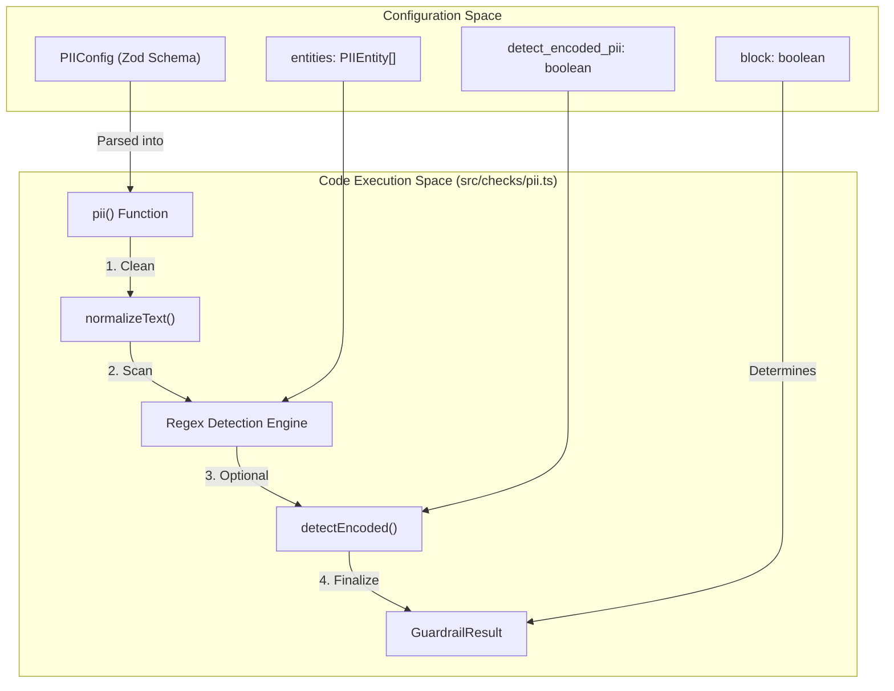
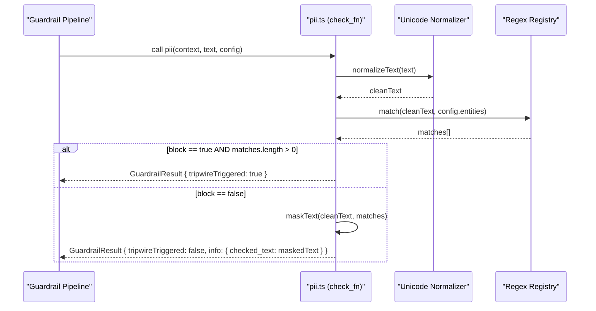

<!-- source: DeepWiki mcp.deepwiki.com · repo openai/openai-guardrails-js · extra page PII Detection · fetched 2026-10-26 -->

# PII Detection

<details>
<summary>Relevant source files</summary>

The following files were used as context for generating this wiki page:

- [docs/ref/checks/pii.md](docs/ref/checks/pii.md)
- [src/__tests__/unit/checks/pii.test.ts](src/__tests__/unit/checks/pii.test.ts)
- [src/checks/pii.ts](src/checks/pii.ts)

</details>


## Purpose and Scope

The **PII Detection** guardrail identifies and protects Personally Identifiable Information (PII) within text content. It utilizes a high-performance, regex-based engine to detect sensitive data such as Social Security Numbers (SSN), email addresses, and phone numbers. The guardrail supports two primary operational modes: **masking** (default) to redact PII before it reaches an LLM, and **blocking** to trigger a tripwire and halt execution when PII is found.

This page covers technical implementation details, including the `PIIEntity` registry, regex-based detection logic, Unicode normalization, and support for encoded PII detection (Base64, Hex, URL-encoded).

---

## Technical Overview

The PII guardrail is implemented as an asynchronous check function `pii` [src/checks/pii.ts:213-213](). Unlike LLM-based guardrails, it relies on curated regular expressions for speed and deterministic behavior.

### Key Components

- **`PIIEntity` Enum**: A comprehensive list of supported entity types across global regions (US, UK, IT, KR, etc.) [src/checks/pii.ts:75-141]().
- **`PIIConfig`**: A Zod schema defining configuration parameters including `entities`, `block`, and `detect_encoded_pii` [src/checks/pii.ts:164-176]().
- **Normalization**: Before detection, text is normalized using Unicode NFKC and stripped of zero-width characters to prevent bypass attempts [src/checks/pii.ts:219-220]().

### Data Flow and Code Entities

The following diagram bridges the Natural Language configuration to the internal TypeScript implementation.


**Sources:** [src/checks/pii.ts:164-213](), [src/checks/pii.ts:219-220]()

---

## Detection Implementation

### Regex-Based Engine
The guardrail maintains a internal registry of `PatternDefinition` objects. For example, the `EMAIL_ADDRESS` pattern handles standard email formats while the `KR_RRN` pattern validates Korean Resident Registration Numbers with specific date and gender digit logic [src/__tests__/unit/checks/pii.test.ts:46-59]().

### Masking vs. Blocking Behavior
The behavior is governed by the `block` parameter:

| Mode | Configuration | Behavior |
| :--- | :--- | :--- |
| **Masking** | `block: false` | Replaces PII with tokens like `<EMAIL_ADDRESS>`. Does not trigger tripwire [src/checks/pii.ts:46-51](). |
| **Blocking** | `block: true` | Triggers `tripwireTriggered: true` if any entity is found. Returns `GuardrailResult` [src/checks/pii.ts:52-56](). |

**Important Note:** Masking is only supported in the `pre-flight` stage. Using `block: false` in the `output` stage is not supported and will not work as expected [src/checks/pii.ts:13-17]().

### Encoded PII Detection
When `detect_encoded_pii` is enabled, the guardrail scans for Base64, Hex, and URL-encoded strings [src/checks/pii.ts:64-66](). It decodes these candidates (up to `MAX_DECODED_BYTES`) and runs the PII detection engine on the decoded content [src/checks/pii.ts:67-67](). If PII is found inside the encoded string, the original encoded substring is masked with an `_ENCODED` suffix (e.g., `<EMAIL_ADDRESS_ENCODED>`) [src/__tests__/unit/checks/pii.test.ts:138-153]().

---

## Entity Reference and Defaults

### Default Entities
By default, the guardrail checks for most entities except `NRP` (National Registration Number) and `PERSON` (Person Names) [src/checks/pii.ts:160-162](). These are excluded due to high false-positive rates in natural language:
- **`NRP`**: Often matches any two consecutive words [docs/ref/checks/pii.md:35-35]().
- **`PERSON`**: Often matches any two capitalized words like "New York" [docs/ref/checks/pii.md:36-36]().

### Common Entity Types
| Enum Value | Description |
| :--- | :--- |
| `US_SSN` | US Social Security Numbers [src/checks/pii.ts:99-99]() |
| `EMAIL_ADDRESS` | Standard email addresses [src/checks/pii.ts:80-80]() |
| `PHONE_NUMBER` | Global phone number formats [src/checks/pii.ts:86-86]() |
| `CREDIT_CARD` | Credit card numbers [src/checks/pii.ts:77-77]() |
| `KR_RRN` | Korean Resident Registration Number [src/checks/pii.ts:140-140]() |

**Sources:** [src/checks/pii.ts:75-141](), [docs/ref/checks/pii.md:31-44]()

---

## Architecture and Integration

The PII guardrail is a core part of the data protection suite. The following diagram shows how the `pii` function interacts with the `GuardrailResult` and the pipeline.


**Sources:** [src/checks/pii.ts:213-350](), [src/__tests__/unit/checks/pii.test.ts:9-35]()

---

## Configuration Example

```typescript
import { PIIEntity } from './src/checks/pii';

const config = {
  name: "Contains PII",
  config: {
    // Select specific entities to reduce false positives
    entities: [PIIEntity.EMAIL_ADDRESS, PIIEntity.US_SSN, PIIEntity.PHONE_NUMBER],
    // Mask in pre-flight, block in output
    block: false, 
    detect_encoded_pii: true
  }
};
```
**Sources:** [docs/ref/checks/pii.md:14-23](), [src/checks/pii.ts:45-56]()

### Return Value (`GuardrailResult.info`)
The `info` object returned by the guardrail provides detailed metadata about the detection:
- `detected_entities`: A map of entity types to the specific values found [docs/ref/checks/pii.md:98-101]().
- `checked_text`: The text after masking (if `block=false`) [docs/ref/checks/pii.md:103-103]().
- `pii_detected`: Boolean flag indicating if any matches were found [docs/ref/checks/pii.md:105-105]().

**Sources:** [docs/ref/checks/pii.md:91-107](), [src/__tests__/unit/checks/pii.test.ts:18-21]()

---

